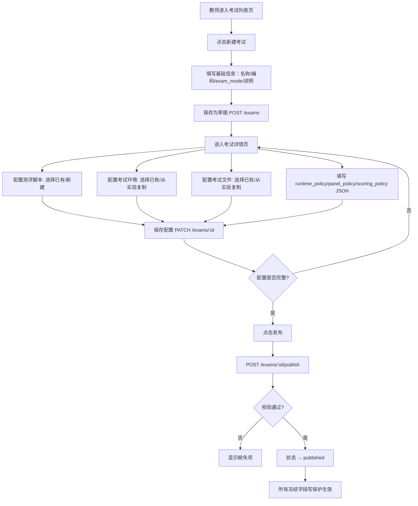
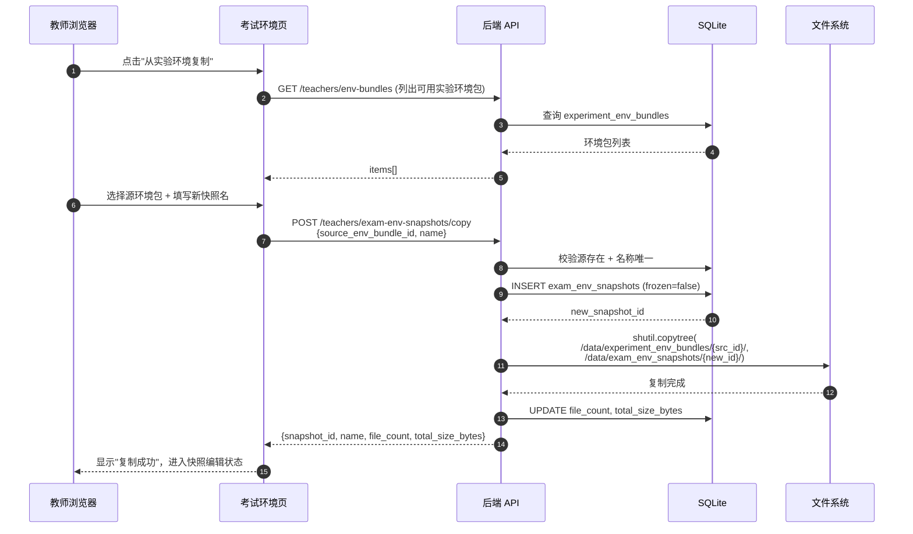
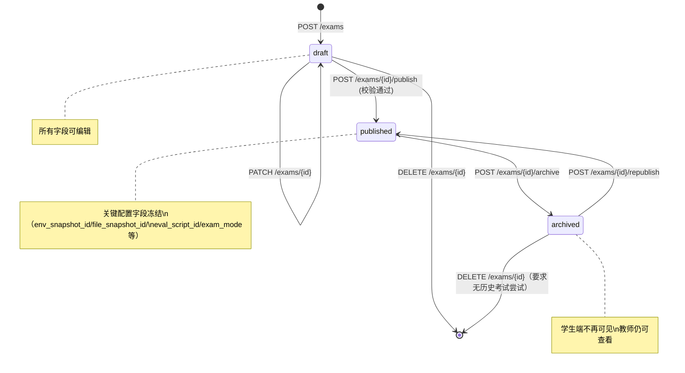

# SDD-第11期：考试域数据基座与教师端资源管理

> 版本：v1.0
> 日期：2026-04-10
> 状态：可评审 / 可执行
> 架构主路线：Sidecar + 考试模式 + 配置驱动（参见 `docs/废案/评测系统轻量级过程记录与评分方案.md` 与 v1.1 修订）

---

## 0. 文档元信息

- **文档标题**：SDD-第11期：考试域数据基座与教师端资源管理
- **文档版本**：v1.1
- **创建日期**：2026-04-12
- **负责人**：Thouder03
- **前置依赖**：第10期（实验环境版本化与容器重建）、第7.5期（用户域模型重构）
- **后续期次**：
  - 第12期：Sidecar 执行引擎与考试运行闭环
  - 第13期：考试模式扩展、面板策略与教师复核增强
- **目标读者**：后端 / 前端 / 测试 / 产品

---

## 1. 执行摘要

### 1.1 本期要解决的问题

1. **没有"考试"这个业务实体**——平台只有"实验"概念，教师无法将实验模板转化为可用于考核的考试定义。
2. **教师无法配置评测脚本**——评测逻辑无法以结构化资源存储和版本管理。
3. **没有考试环境与考试文件快照语义**——考试一旦发布，如果仍直接引用实验环境，实验端的任何改动都会污染考试，无法保证公平性与可追溯性。
4. **教师端缺少考试管理入口**——没有考试列表、测评脚本、考试环境、考试文件四个资源的管理页面。

### 1.2 本期关键结果

1. 教师可在后台创建考试定义，配置 `exam_mode`、运行策略、面板策略、评分策略、Sidecar 策略。
2. 教师可在"测评脚本页"创建和管理测评脚本包（为后续 Sidecar 执行引擎提供数据源）。
3. 教师可在"考试环境页"创建考试环境，**支持一键从实验环境复制并冻结为考试快照**。
4. 教师可在"考试文件页"创建考试文件，同样支持从实验文件复制冻结。
5. 考试一旦发布，所有关联资源（环境、文件、脚本）的引用 ID 都无法再被修改，保证考试可重复运行。

### 1.3 成功判定

- **SM-1**：教师能端到端完成"创建考试 → 关联环境/文件/脚本 → 发布考试"的全流程，无需手动拷贝文件。
- **SM-2**：从实验资源复制到考试快照的操作成功率 ≥ 99%，复制后两端解耦，互不影响。
- **SM-3**：考试发布后，所有冻结字段的修改请求均返回 409，日志可追溯。
- **SM-4**：本期所有 API 的契约测试覆盖率 100%（CRUD + 冻结约束）。

---

## 2. 范围定义（Scope）

### 2.1 In Scope（本期必须交付）

| 编号 | 交付项 |
|------|--------|
| S1 | `exams` 表（考试定义主表，含 6 段式配置 JSON 字段） |
| S2 | `exam_env_snapshots` 表（考试环境快照） |
| S3 | `exam_file_snapshots` 表（考试文件快照） |
| S4 | `exam_eval_scripts` 表（测评脚本包） |
| S5 | 考试定义 CRUD + 发布/归档 API |
| S6 | 考试环境快照 CRUD + 从实验环境复制 API |
| S7 | 考试文件快照 CRUD + 从实验文件复制 API |
| S8 | 测评脚本包 CRUD + 文件上传/读取/保存/删除 API |
| S9 | 教师端四个新增页面（考试列表、考试详情、考试环境、考试文件、测评脚本） |
| S10 | 前后端路由权限配置 |
| S11 | "复制实验资源"的物理文件复制能力（复用现有 `ExperimentEnvBundle` / `ExperimentFileBundle` 存储结构） |
| S12 | 冻结约束校验（发布状态下的写保护） |

### 2.2 Out of Scope（本期明确不做）

| 项目 | 不纳入本期原因 |
|------|---------------|
| Sidecar 执行引擎 | 属于第12期范围；本期仅定义数据与配置 |
| `exam_attempts` 运行记录表 | 属于第12期，与 Sidecar 调度强耦合 |
| 学生端考试页面 | 属于第12期 |
| 客观评分计算 | 由 Sidecar 脚本负责，平台只存储 JSON |
| 人工评分与最终成绩核算 | 属于第13期 |
| 面板策略的实际生效 | 本期仅存储配置，生效逻辑在第13期 |
| 评测脚本语法校验 | 脚本正确性由教师通过 Dry Run 自验（第13期后可考虑） |
| 考试数据的版本化 | 考试通过 `exams.code` 唯一，无需额外版本号；如需变更，复制现有考试即可 |
| 考试成绩导出 | 属于第13期+ |

---

## 3. 前提挑战与方案比选

### 3.1 前提挑战

**为什么需要"考试快照"而不是直接引用实验资源？**

答：实验资源在教师调整实验模板时会频繁变动；如果考试直接引用实验 bundle，实验变动会污染已发布考试，导致两个学生跑同一个考试时环境不同。快照语义保证"考试一旦发布，环境即冻结"。

**为什么需要把测评脚本独立为一张表而不是塞进考试表？**

答：测评脚本需要支持文件级编辑（.py、.sh、.yaml、requirements.txt 多文件协作），其存储和访问模式与 `ExperimentFileBundle` 高度相似，复用 bundle 存储结构能最小化新增代码。

### 3.2 现有资产复用

#### 3.2.1 后端复用资产

| 资产 | 路径 | 本期复用方式 |
|------|------|-------------|
| `Experiment` / `ExperimentVersion` 模型 | `app/models/experiment.py` | 参照其命名、字段布局与 CRUD 模式 |
| `ExperimentEnvBundle` 模型与 API | `app/models/experiment.py` + `app/api/v1/endpoints/teacher/env_bundles.py` | 存储结构复用；考试环境快照复制其物理目录 |
| `ExperimentFileBundle` 模型与 API | `app/models/experiment.py` + `app/api/v1/endpoints/teacher/file_bundles.py` | 同上，考试文件快照复制其物理目录 |
| 环境包文件管理 API | `teacher/env_bundles.py` 的 files 系列接口 | 直接参照实现考试环境/考试文件/测评脚本的 files 系列接口 |
| `ApiResponse[T]` | `app/schemas/common.py` | 所有新接口统一使用 |
| `get_current_teacher_id` / 教师鉴权 | `app/core/security.py` | 所有教师端 API 鉴权 |
| `Base` ORM 基类 | `app/db/base.py` | 新模型继承 |
| SQLAlchemy 异步 Session | `app/db/database.py` | 新 CRUD 模块使用 |

#### 3.2.2 前端复用资产

| 资产 | 路径 | 本期复用方式 |
|------|------|-------------|
| 教师实验列表页 | `views/Teacher/Experiments/ExperimentList.vue` | 参照其表格 + 筛选 + 分页布局构建考试列表页 |
| 教师实验详情页 | `views/Teacher/Experiments/ExperimentDetail.vue` | 参照其 ContentWrap + Card + 表单布局构建考试详情页 |
| 教师文件包页 | `views/Teacher/Experiments/ExperimentFiles.vue` | 参照其 bundle 列表 + 文件树布局构建考试文件页 |
| 教师环境包页 | `views/Teacher/Experiments/ExperimentEnvs.vue` | 参照其布局构建考试环境页与测评脚本页 |
| `api/experiment/*` | `src/api/experiment/` | 参照其模块化风格新增 `src/api/exam/` |
| `MonacoEditor.vue` | `src/components/Monaco/` | 考试详情页用于编辑 JSON 策略字段 |
| Element Plus 组件 | 全局 | Table / Dialog / Form / Select 等 |

### 3.3 实施路径备选

#### 方案 A：独立考试域（推荐）

**摘要**：考试拥有自己的资源表（`exam_env_snapshots` / `exam_file_snapshots` / `exam_eval_scripts`），从实验复制时执行物理文件复制。

- **优点**：完全解耦，考试发布后不受实验变动影响；数据模型清晰。
- **风险**：磁盘占用增加（考试环境 + 实验环境双份存储）。
- **缓解**：ROS 环境包单个通常 10-100MB，考试数量有限，单个项目预期 ≤10GB 级别，可接受。

#### 方案 B：引用 + 冻结版本号

**摘要**：考试直接引用实验 bundle 的 ID，发布时记录 `frozen_version`；每次访问都动态加版本号 filter。

- **优点**：零磁盘开销。
- **风险**：
  1. 实验 bundle 若被教师物理删除，历史考试直接坏；
  2. 版本号语义与实验体系深度耦合，后续独立演进困难；
  3. 实现复杂度实际上高于方案 A。

### 3.4 方案决策

**最终采用方案 A（独立考试域 + 物理复制快照）**。

理由：
1. 与"考试环境发布后冻结"的业务语义最直接匹配；
2. 物理复制的实现成本低，复用 `shutil.copytree` 即可；
3. 考试资源生命周期可独立于实验体系，后续演进不受约束；
4. 磁盘开销可控，且教师可手动归档旧考试。

---

## 4. 系统交互设计

### 4.1 创建考试主流程图



### 4.2 从实验复制资源时序图



### 4.3 考试发布状态机



**状态流转规则**：

| 当前状态 | 允许转换至 | 触发动作 | 冻结范围 |
|---------|-----------|---------|---------|
| `draft` | `published` | POST /publish | 校验必填项齐全（env、file、eval_script、exam_mode） |
| `draft` | （删除） | DELETE | 无限制 |
| `published` | `archived` | POST /archive | 解冻，但学生端不可见 |
| `archived` | `published` | POST /republish | 重新冻结 |
| `archived` | （删除） | DELETE | 要求无历史 `exam_attempts`（第12期后生效） |

**发布后的冻结字段**（更新时 API 返回 409）：
- `exam_mode`
- `env_snapshot_id`
- `file_snapshot_id`
- `eval_script_id`
- `sidecar_policy_json`（内含镜像版本等）

**发布后仍可修改的字段**：
- `name`、`description`、`teacher_comment_template`
- `runtime_policy_json`、`panel_policy_json`、`scoring_policy_json`

**补充约束（供第12-13期执行链路使用）**：
- 平台允许教师在考试已发布后继续调整 `runtime_policy_json`、`panel_policy_json`、`scoring_policy_json`，以支持教学现场按需微调。
- 但**每次学生创建 `exam_attempt` 时，必须把当次生效的 `exam_mode`、`runtime_policy_json`、`panel_policy_json`、`scoring_policy_json` 全量快照到 attempt 记录**。
- 第12期的考试执行、第13期的教师复核、人工评分、申诉解释，均以 attempt 上的策略快照为准，而不是回读 `exams` 当前值。
- 因此，发布后修改策略只影响**后续新创建的 attempt**，不允许回溯改变历史 attempt 的运行条件与评分依据。

---

## 5. API 契约

> 所有教师端 API 统一前缀 `/api/v1/teachers/`，使用 Bearer Token 鉴权，响应格式 `ApiResponse[T]`。

### 5.1 考试定义 API

| Endpoint | Method | 鉴权 | Request 结构 | Response 结构 | 状态码 |
|----------|--------|------|-------------|---------------|--------|
| `/exams` | GET | teacher | Query: `page, page_size, keyword, status, exam_mode` | `{items: ExamListItem[], total}` | 200 |
| `/exams` | POST | teacher | `ExamCreateRequest` | `ExamResponse` | 201 / 400 / 409（code 重复） |
| `/exams/{id}` | GET | teacher | — | `ExamDetailResponse` | 200 / 404 |
| `/exams/{id}` | PATCH | teacher | `ExamUpdateRequest`（部分字段） | `ExamResponse` | 200 / 404 / 409（冻结字段） |
| `/exams/{id}` | DELETE | teacher | — | `null` | 200 / 404 / 409（有历史尝试） |
| `/exams/{id}/publish` | POST | teacher | — | `ExamResponse` | 200 / 404 / 409（校验失败） |
| `/exams/{id}/archive` | POST | teacher | — | `ExamResponse` | 200 / 404 |
| `/exams/{id}/republish` | POST | teacher | — | `ExamResponse` | 200 / 404 |

**`ExamCreateRequest` 字段**：

| 字段 | 类型 | 必填 | 说明 |
|------|------|------|------|
| `name` | string(128) | 是 | 考试显示名 |
| `code` | string(64) | 是 | 唯一编码，创建后不可改 |
| `description` | string(512) | 否 | 考试说明 |
| `exam_mode` | enum | 是 | `result_run` / `process_run` / `multi_stage_run` |

**`ExamUpdateRequest` 字段**（全部可选，按字段级更新）：
`name`、`description`、`env_snapshot_id`、`file_snapshot_id`、`eval_script_id`、`runtime_policy`、`panel_policy`、`scoring_policy`、`sidecar_policy`、`teacher_comment_template`。

> 补充约束：若考试处于 `published` 状态，允许更新 `runtime_policy`、`panel_policy`、`scoring_policy`；但这些变更只对后续新创建的 attempt 生效。历史 attempt 的解释与复核以其创建时固化的策略快照为准。

### 5.2 考试环境快照 API

| Endpoint | Method | Request | Response | 说明 |
|----------|--------|---------|----------|------|
| `/exam-env-snapshots` | GET | Query: `page, page_size, keyword` | `{items, total}` | 列表 |
| `/exam-env-snapshots` | POST | `{name, container_target_dir}` | `ExamEnvSnapshotResponse` | 创建空快照 |
| `/exam-env-snapshots/copy` | POST | `{source_env_bundle_id, name}` | `ExamEnvSnapshotResponse` | **从实验环境复制** |
| `/exam-env-snapshots/{id}` | GET | — | `ExamEnvSnapshotResponse` | 详情 |
| `/exam-env-snapshots/{id}` | PATCH | `{name?, container_target_dir?}` | `ExamEnvSnapshotResponse` | 200 / 409（已被发布考试引用） |
| `/exam-env-snapshots/{id}` | DELETE | — | `null` | 409 若被任何考试引用 |
| `/exam-env-snapshots/{id}/files` | GET | Query: `path` | `BundleFileListResponse` | 列目录 |
| `/exam-env-snapshots/{id}/files/upload` | POST | multipart | `{file_count, total_size_bytes}` | 上传 |
| `/exam-env-snapshots/{id}/files/read` | GET | Query: `path` | `BundleFileReadResponse` | 读文件 |
| `/exam-env-snapshots/{id}/files/save` | POST | `{path, content, modified_at?}` | `null` | 保存 |
| `/exam-env-snapshots/{id}/files/delete` | DELETE | Query: `path` | `null` | 删除 |

> **说明**：files 系列接口的参数签名与 `teacher/env_bundles.py` 保持一致，仅存储根目录不同。

### 5.3 考试文件快照 API

结构与 5.2 完全对称：

| Endpoint | Method | 说明 |
|----------|--------|------|
| `/exam-file-snapshots` | GET | 列表 |
| `/exam-file-snapshots` | POST | 创建空快照 |
| `/exam-file-snapshots/copy` | POST | **从实验文件复制**：`{source_file_bundle_id, name}` |
| `/exam-file-snapshots/{id}` | GET / PATCH / DELETE | 详情 / 更新 / 删除 |
| `/exam-file-snapshots/{id}/files/*` | files 系列 | 同 5.2 |

### 5.4 测评脚本包 API

| Endpoint | Method | Request | Response | 说明 |
|----------|--------|---------|----------|------|
| `/exam-eval-scripts` | GET | Query | `{items, total}` | 列表 |
| `/exam-eval-scripts` | POST | `{name, description?, entry_point?}` | `ExamEvalScriptResponse` | 创建，`entry_point` 默认 `evaluate.sh` |
| `/exam-eval-scripts/{id}` | GET / PATCH / DELETE | | | 详情 / 重命名 / 删除 |
| `/exam-eval-scripts/{id}/files/*` | files 系列 | | | 同上 |

> **说明**：测评脚本不支持"从实验复制"（实验没有对应资源）；教师通过文件上传或在线编辑创建。

### 5.5 错误语义映射

| 错误码 | HTTP | 语义 | 前端动作 |
|--------|------|------|---------|
| `EXAM_CODE_DUPLICATED` | 409 | code 已存在 | 表单校验红字提示 |
| `EXAM_PUBLISH_INCOMPLETE` | 409 | 发布时配置不完整 | 显示缺失项清单 |
| `EXAM_FIELD_FROZEN` | 409 | 尝试修改已发布考试的冻结字段 | 提示"考试已发布，请先归档再编辑" |
| `EXAM_HAS_ATTEMPTS` | 409 | 删除时存在历史尝试 | 提示"考试已有学生参加，无法删除，仅可归档" |
| `SNAPSHOT_IN_USE` | 409 | 快照被考试引用，禁止删除 | 提示"该环境/文件正被考试使用" |
| `SOURCE_BUNDLE_NOT_FOUND` | 404 | 复制时源 bundle 不存在 | 刷新列表 |
| `COPY_FAILED_DISK` | 500 | 物理复制失败（磁盘 I/O） | 提示"复制失败，请重试或联系管理员" |
| `NAME_DUPLICATED` | 409 | 同教师下名称重复 | 表单校验 |

---

## 6. 数据字典

### 6.1 表：`exams`

| 字段名 | 类型 | 必填 | 默认 | 说明 |
|--------|------|------|------|------|
| `id` | INTEGER | 是 | 自增 | 主键 |
| `name` | VARCHAR(128) | 是 | — | 考试显示名 |
| `code` | VARCHAR(64) | 是 | — | 唯一编码（UNIQUE） |
| `description` | VARCHAR(512) | 否 | — | 考试说明 |
| `exam_mode` | VARCHAR(20) | 是 | `result_run` | 考试模式（见枚举） |
| `status` | VARCHAR(20) | 是 | `draft` | 发布状态（见枚举） |
| `env_snapshot_id` | INTEGER | 否 | — | FK → exam_env_snapshots.id |
| `file_snapshot_id` | INTEGER | 否 | — | FK → exam_file_snapshots.id |
| `eval_script_id` | INTEGER | 否 | — | FK → exam_eval_scripts.id |
| `runtime_policy_json` | JSON | 是 | `{}` | 运行策略（见 6.5） |
| `panel_policy_json` | JSON | 是 | `{}` | 面板策略（见 6.6） |
| `scoring_policy_json` | JSON | 是 | `{}` | 评分策略（见 6.7） |
| `sidecar_policy_json` | JSON | 是 | `{}` | Sidecar 策略（见 6.8） |
| `teacher_comment_template` | TEXT | 否 | — | 教师评语模板 |
| `created_by` | INTEGER | 是 | — | FK → users.id |
| `created_at` | DATETIME | 是 | `utcnow` | 创建时间 |
| `updated_at` | DATETIME | 是 | `utcnow` | 更新时间 |
| `published_at` | DATETIME | 否 | — | 首次发布时间 |

**索引**：
- `uk_exams_code`（UNIQUE）
- `idx_exams_status`
- `idx_exams_created_by`

### 6.2 表：`exam_env_snapshots`

| 字段名 | 类型 | 必填 | 默认 | 说明 |
|--------|------|------|------|------|
| `id` | INTEGER | 是 | 自增 | 主键 |
| `name` | VARCHAR(128) | 是 | — | 快照名 |
| `source_env_bundle_id` | INTEGER | 否 | — | 来源实验环境包 ID（可追溯，非外键） |
| `storage_root` | VARCHAR(512) | 是 | — | 存储根目录（格式 `/data/exam_env_snapshots/{id}/`） |
| `container_target_dir` | VARCHAR(255) | 是 | `/home/ubuntu20/catkin_ws` | 容器内挂载目标目录 |
| `file_count` | INTEGER | 是 | 0 | 文件数 |
| `total_size_bytes` | BIGINT | 是 | 0 | 总大小（字节） |
| `created_by` | INTEGER | 是 | — | 创建教师 ID |
| `created_at` | DATETIME | 是 | `utcnow` | — |
| `updated_at` | DATETIME | 是 | `utcnow` | — |

**索引**：`uk_exam_env_snapshot_name_by_creator (name, created_by)`

### 6.3 表：`exam_file_snapshots`

| 字段名 | 类型 | 必填 | 默认 | 说明 |
|--------|------|------|------|------|
| `id` | INTEGER | 是 | 自增 | 主键 |
| `name` | VARCHAR(128) | 是 | — | 快照名 |
| `source_file_bundle_id` | INTEGER | 否 | — | 来源实验文件包 ID（可追溯） |
| `storage_root` | VARCHAR(512) | 是 | — | `/data/exam_file_snapshots/{id}/` |
| `file_count` | INTEGER | 是 | 0 | — |
| `total_size_bytes` | BIGINT | 是 | 0 | — |
| `file_manifest` | JSON | 是 | `[]` | 文件清单（`[{relative_path, chmod_mode}]`） |
| `created_by` | INTEGER | 是 | — | — |
| `created_at` / `updated_at` | DATETIME | 是 | — | — |

**索引**：`uk_exam_file_snapshot_name_by_creator`

### 6.4 表：`exam_eval_scripts`

| 字段名 | 类型 | 必填 | 默认 | 说明 |
|--------|------|------|------|------|
| `id` | INTEGER | 是 | 自增 | 主键 |
| `name` | VARCHAR(128) | 是 | — | 脚本包名 |
| `description` | VARCHAR(512) | 否 | — | 说明 |
| `storage_root` | VARCHAR(512) | 是 | — | `/data/exam_eval_scripts/{id}/` |
| `entry_point` | VARCHAR(128) | 是 | `evaluate.sh` | 平台调用入口脚本相对路径 |
| `file_count` | INTEGER | 是 | 0 | — |
| `total_size_bytes` | BIGINT | 是 | 0 | — |
| `validate_status` | VARCHAR(20) | 是 | `pending` | 校验状态（见枚举） |
| `created_by` | INTEGER | 是 | — | — |
| `created_at` / `updated_at` | DATETIME | 是 | — | — |

**索引**：`uk_exam_eval_script_name_by_creator`

### 6.5 JSON 字段：`runtime_policy_json` 结构

```jsonc
{
  "allow_debug_before_start": true,        // 考前是否允许调试
  "allow_debug_during_exam": false,        // 考中是否允许继续调试
  "allow_manual_finish": true,             // 是否允许手动结束
  "allow_restart": false,                  // 是否允许重新开始
  "max_duration_ms": 600000,               // 最大考试时长（毫秒）
  "max_attempts_per_student": 1,           // 单学生最大尝试次数
  "show_countdown": true,                  // 是否显示倒计时
  "show_stage_status": false,              // 是否显示阶段状态
  "freeze_code_on_start": true,            // 开始考试时是否冻结代码
  "sidecar_timeout_ms": 180000             // Sidecar 执行超时
}
```

### 6.6 JSON 字段：`panel_policy_json` 结构

```jsonc
{
  "terminal_enabled": true,
  "file_tree_enabled": true,
  "editor_enabled": true,
  "ros_log_enabled": true,
  "ros3d_enabled": true,
  "keyboard_control_enabled": false,
  "manual_restart_enabled": false,
  "task_status_panel_enabled": true
}
```

> **说明**：本期仅存储配置；实际生效逻辑在第13期。

### 6.7 JSON 字段：`scoring_policy_json` 结构

```jsonc
{
  "enable_manual_score": true,
  "weight_objective": 0.7,
  "weight_manual": 0.3,
  "pass_threshold": 60,
  "allow_override_objective": false,        // 是否允许教师覆盖客观分
  "allow_override_pass_flag": true,         // 是否允许教师修改 pass 标记
  "show_detail_to_student": true            // 是否向学生展示评分明细
}
```

### 6.8 JSON 字段：`sidecar_policy_json` 结构

```jsonc
{
  "image": "edubot/sidecar-runner:v1",      // Sidecar 基础镜像
  "timeout_ms": 180000,                     // 执行超时
  "cpu_limit": 1.0,                         // CPU 核心数限制
  "memory_limit_mb": 512,                   // 内存限制
  "env_extra": {}                           // 追加环境变量
}
```

### 6.9 枚举

#### `ExamMode`

| 值 | 含义 | 典型场景 |
|----|------|---------|
| `result_run` | 结果型自动评测 | 自动导航、巡线导航、标准定点任务 |
| `process_run` | 过程型操作评测 | SLAM 建图、遥控、调参 |
| `multi_stage_run` | 多阶段编排评测 | 先巡线再返航、综合测试 |

#### `ExamStatus`（现先写成自由切换以方便测试）

| 值 | 含义 | UI 策略 |
|----|------|--------|
| `draft` | 草稿 | 教师端完全可编辑；学生端不可见 |
| `published` | 已发布 | 冻结字段写保护；学生端可见并可参加 |
| `archived` | 已归档 | 学生端不可见；教师仍可查看；可重新发布 |

#### `ExamEvalScriptValidateStatus`

| 值 | 含义 |
|----|------|
| `pending` | 上传后待验证 |
| `valid` | 存在 `entry_point` 文件且可读 |
| `invalid` | 未找到 `entry_point` 或读取失败 |

> **说明**：本期校验仅做最基本的"入口文件存在性"检查，不做脚本语法校验。

---

## 7. 前端设计

### 7.1 路由配置

**前端新增路由**（`src/router/index.ts` → `asyncRouterMap`）：

```
/teacher/exams                → 父路由（redirect to list）
/teacher/exams/list           → 考试列表页
/teacher/exams/:id/detail     → 考试详情页（hidden, activeMenu: list）
/teacher/exams/envs           → 考试环境页
/teacher/exams/files          → 考试文件页
/teacher/exams/eval-scripts   → 测评脚本页
```

**后端路由权限**（`app/api/v1/endpoints/common/auth.py` → `get_user_routes` → `teacher` 数组追加）：

```
"/teacher/exams"
"/teacher/exams/list"
"/teacher/exams/:id/detail"
"/teacher/exams/envs"
"/teacher/exams/files"
"/teacher/exams/eval-scripts"
```

### 7.2 菜单结构

教师端左侧菜单新增"考试管理"一级菜单，展开后四项：

```
📝 考试管理
  ├─ 考试列表
  ├─ 测评脚本
  ├─ 考试环境
  └─ 考试文件
```

### 7.3 考试列表页（`/teacher/exams/list`）

**布局**：参照 `ExperimentList.vue`。

```
┌───────────────────────────────────────────────────────────────────┐
│  考试列表                              [+ 新建考试]              │
├───────────────────────────────────────────────────────────────────┤
│  筛选：[关键字 🔍] [状态 ▾] [exam_mode ▾]                          │
├────┬──────────┬────────┬──────────┬─────────┬───────┬────────────┤
│ #  │ 考试名称  │ 编码    │ 模式      │ 状态     │ 创建时│ 操作       │
├────┼──────────┼────────┼──────────┼─────────┼───────┼────────────┤
│ 1  │ 自动导航考│ nav01  │ result   │ 已发布  │ 04-10 │ 详情 归档  │
│ 2  │ SLAM 建图 │ slam01 │ process  │ 草稿     │ 04-09 │ 详情 删除  │
└────┴──────────┴────────┴──────────┴─────────┴───────┴────────────┘
共 12 条  [< 1 2 >]
```

**"新建考试"对话框**：
- name / code / description / exam_mode（下拉）
- 提交 → POST /exams → 跳转详情页

### 7.4 考试详情页（`/teacher/exams/:id/detail`）

**布局**：左右分栏，左侧资源引用选择，右侧策略 JSON 编辑器。参照 `ExperimentDetail.vue` 的 ContentWrap + Card 结构。

```
┌──────────────────────────────────────────────────────────────────────┐
│  ← 返回   自动导航考试  [草稿] ✏ [发布考试] [归档]                   │
├───────────────────────────┬──────────────────────────────────────────┤
│  基础信息                  │                                          │
│  ┌───────────────────────┐│  运行策略 runtime_policy                 │
│  │ 名称 [_______]         ││  ┌────────────────────────────────────┐ │
│  │ 编码 nav01 (冻结)      ││  │  Monaco JSON 编辑器                │ │
│  │ 模式 [result_run ▾]    ││  │  {                                 │ │
│  │ 说明 [_______]         ││  │    "max_duration_ms": 600000,      │ │
│  └───────────────────────┘│  │    ...                             │ │
│                            │  │  }                                 │ │
│  资源引用                  │  └────────────────────────────────────┘ │
│  ┌───────────────────────┐│                                          │
│  │ 测评脚本 [nav-v1 ▾]    ││  面板策略 panel_policy                   │
│  │ 考试环境 [env1 ▾]      ││  [Monaco 编辑器]                        │
│  │ 考试文件 [file1 ▾]     ││                                          │
│  └───────────────────────┘│  评分策略 scoring_policy                 │
│                            │  [Monaco 编辑器]                        │
│  教师评语模板              │                                          │
│  [______________]          │  Sidecar 策略 sidecar_policy             │
│                            │  [Monaco 编辑器]                        │
└───────────────────────────┴──────────────────────────────────────────┘
```

**交互规则**：
- 所有字段变更自动保存为草稿（debounce 500ms）。
- 发布时前端先做必填校验：`env_snapshot_id`、`file_snapshot_id`、`eval_script_id`、`exam_mode` 均不为空。
- 已发布状态下，冻结字段的下拉和输入框为 disabled，并显示锁图标。

### 7.5 考试环境页 / 考试文件页 / 测评脚本页

这三个页面采用统一布局：左侧列表，右侧文件树 + 文件编辑器。参照 `ExperimentEnvs.vue` + `ExperimentFiles.vue`。

**考试环境页布局示例**：

```
┌────────────────────────────────────────────────────────────────────┐
│  考试环境  [+ 新建空快照] [📋 从实验环境复制]                       │
├──────────────┬─────────────────────────────────────────────────────┤
│  快照列表     │  env1 - 2MB / 15 文件                               │
│  ──────────  │  ┌────────────────┬──────────────────────────────┐  │
│  • env1 ★    │  │ 文件树           │ 文件编辑器                    │  │
│  • env2      │  │                 │                              │  │
│  • env3      │  │ ├ launch/       │ #!/bin/bash                  │  │
│              │  │ │ └ nav.launch  │ source /opt/ros/noetic/...   │  │
│              │  │ └ config/       │                              │  │
│              │  │   └ params.yaml │                              │  │
│              │  └────────────────┴──────────────────────────────┘  │
└──────────────┴─────────────────────────────────────────────────────┘
```

**"从实验环境复制"对话框**：

```
┌──────────────────────────────────────┐
│  从实验环境复制                        │
├──────────────────────────────────────┤
│  源环境包 [选择实验环境包 ▾]           │
│  新快照名 [_______________]           │
│                                      │
│            [取消]  [确认复制]         │
└──────────────────────────────────────┘
```

**文件编辑器**：复用 `MonacoEditor.vue`，支持 .py .sh .yaml .launch .xml .json .md。

### 7.6 前端 API 模块（新增）

```
src/api/exam/
  ├─ index.ts           # 考试定义 CRUD + 发布/归档
  ├─ envSnapshots.ts    # 考试环境快照 CRUD + 复制 + files
  ├─ fileSnapshots.ts   # 考试文件快照 CRUD + 复制 + files
  ├─ evalScripts.ts     # 测评脚本包 CRUD + files
  └─ types.ts           # 所有 exam 相关 TypeScript 类型
```

**TypeScript 类型必须强类型**（禁止 `any`），参照 `api/experiment/types.ts` 风格：

```typescript
// 示例
export interface ExamListItem {
  id: number
  name: string
  code: string
  exam_mode: 'result_run' | 'process_run' | 'multi_stage_run'
  status: 'draft' | 'published' | 'archived'
  env_snapshot_id: number | null
  file_snapshot_id: number | null
  eval_script_id: number | null
  created_at: string
  published_at: string | null
}
```

---

## 8. 安全与边界约束

| 风险点 | 威胁描述 | 防护策略 | 验证方式 |
|--------|---------|---------|---------|
| 路径穿越 | 文件操作 path 含 `..` 或以 `/` 开头 | 复用现有 `env_bundles.py` 的 `_resolve_safe_path` 工具函数 | 安全测试 |
| 跨教师越权 | 教师 A 修改教师 B 的考试/快照 | 教师端 API 校验 `created_by == current_user_id`（admin 除外） | 权限测试 |
| 快照误删 | 删除被考试引用的快照 | CRUD 校验：存在引用则返回 `SNAPSHOT_IN_USE` | 集成测试 |
| 发布后篡改 | 修改已发布考试的冻结字段 | PATCH /exams/{id} 校验 status + 字段白名单 | 集成测试 |
| 物理复制竞态 | 同一源被并发复制 | 无需加锁（复制源是只读），新快照目录由新 ID 唯一生成 | — |
| 磁盘耗尽 | 大量复制导致磁盘满 | 单快照上限 500MB；总体配额在部署文档规定 | 压测 |
| Monaco JSON 错误 | 教师在 JSON 编辑器写出非法 JSON | 前端提交前 `JSON.parse` 校验；后端 Pydantic 再校验 | 单元测试 |

---

## 9. 异常、恢复与可观测性

### 9.1 失败模式登记

| Codepath | 失败模式 | 已处理? | 用户可见? | 日志/指标? | 测试覆盖? |
|----------|---------|--------|----------|-----------|----------|
| 创建考试 code 重复 | UniqueConstraint 违反 | Y | 表单红字 | Y | Y |
| 发布考试配置不完整 | 必填校验失败 | Y | 缺失项清单 | Y | Y |
| 修改冻结字段 | 状态校验失败 | Y | "已发布不可改" | Y | Y |
| 复制实验资源时源不存在 | 源 ID 404 | Y | 提示"源不存在" | Y | Y |
| 复制时磁盘 I/O 失败 | `shutil.copytree` 异常 | Y | 提示"复制失败" + 事务回滚（删除空记录） | Y | Y |
| 快照被引用时删除 | 引用计数检查 | Y | 提示"正在使用" | Y | Y |
| 文件上传超出单文件限制 | 413 | Y | 表单提示 | Y | Y |
| 文件路径穿越攻击 | 路径校验失败 | Y | 403 错误 | Y | Y |

### 9.2 错误恢复策略

| 场景 | 降级 | 重试 | 终态 |
|------|------|------|------|
| 复制资源磁盘 I/O 异常 | 回滚数据库记录 + 删除不完整目录 | 前端提示用户手动重试 | 失败提示 |
| 数据库写入失败 | FastAPI 自动 500 | 前端重试按钮 | 失败提示 |
| 教师并发编辑同一考试 | 后端以 `updated_at` 做乐观锁 | 前端发现 409 → 重新拉取 | 提示"已被其他人修改" |

### 9.3 可观测性要求

- **关键日志字段**：`trace_id`、`user_id`、`exam_id`、`snapshot_id`、`script_id`、`action`、`error_code`
- **核心指标**：
  - 考试创建/发布/归档请求量
  - 资源复制耗时 P95
  - 资源复制失败率
- **告警建议**：资源复制失败率 > 5%

---

## 10. 测试与验收

### 10.1 测试覆盖地图

| 流程/分支 | 测试类型 | 用例要点 | 通过标准 |
|----------|---------|---------|---------|
| 创建考试 | 集成 | 正常创建 + code 重复 | code 重复返回 409 |
| 更新考试 draft 状态 | 集成 | 修改所有字段 | 全部字段成功更新 |
| 更新考试 published 状态 | 集成 | 修改冻结字段 | 冻结字段返回 409 |
| 发布考试 | 集成 | 配置不完整 vs 完整 | 不完整返回 409 + 缺失项 |
| 复制实验环境 | 集成 | 源存在 vs 不存在 | 源不存在返回 404 |
| 复制实验环境 | 集成 | 磁盘复制成功 | 目标目录文件数与源一致 |
| 复制实验环境 | 集成 | 模拟磁盘 I/O 失败 | 数据库回滚 + 目录清理 |
| 删除被引用的快照 | 集成 | 快照被考试引用 | 返回 409 + `SNAPSHOT_IN_USE` |
| 快照文件上传 | 集成 | 正常 + 路径穿越 | 路径穿越返回 403 |
| 测评脚本 validate_status | 集成 | 存在/缺失 entry_point | 自动更新 status |

### 10.2 验收标准

#### 10.2.1 功能验收

- [ ] 教师可通过 UI 完成"新建考试 → 配置资源 → 保存 → 发布"的端到端流程
- [ ] 教师可一键从实验环境/文件复制出考试快照，且复制后与实验完全解耦
- [ ] 考试发布后，冻结字段的 UI 显示为 disabled + 锁图标
- [ ] 测评脚本页支持多文件上传、在线编辑、删除
- [ ] 四个教师端页面都在菜单中可见并可访问

#### 10.2.2 一致性验收

- [ ] 所有 API 返回格式为 `ApiResponse[T]`
- [ ] 前端 API 调用无 `any` 类型
- [ ] 错误码在前后端完全一致
- [ ] 路由在 `asyncRouterMap` 和 `get_user_routes` 中完全一致

#### 10.2.3 稳定性验收

- [ ] 连续 10 次复制环境包无失败
- [ ] 单次复制 100MB 环境包耗时 ≤ 5 秒

---

## 11. 实施交付清单

### 11.1 后端交付

**新增文件**：

| 路径 | 说明 |
|------|------|
| `app/models/exam.py` | 4 个新 ORM 模型（`Exam`、`ExamEnvSnapshot`、`ExamFileSnapshot`、`ExamEvalScript`）+ 枚举 |
| `app/schemas/exam.py` | 全部 Pydantic Schema |
| `app/crud/exam.py` | 考试定义 CRUD |
| `app/crud/exam_env_snapshot.py` | 环境快照 CRUD + 复制逻辑 |
| `app/crud/exam_file_snapshot.py` | 文件快照 CRUD + 复制逻辑 |
| `app/crud/exam_eval_script.py` | 脚本包 CRUD |
| `app/core/snapshot_copier.py` | 物理复制工具函数（`shutil.copytree` 封装 + 事务回滚） |
| `app/api/v1/endpoints/teacher/exams.py` | 考试定义路由 |
| `app/api/v1/endpoints/teacher/exam_env_snapshots.py` | 环境快照路由 |
| `app/api/v1/endpoints/teacher/exam_file_snapshots.py` | 文件快照路由 |
| `app/api/v1/endpoints/teacher/exam_eval_scripts.py` | 脚本包路由 |

**修改文件**：

| 路径 | 修改内容 |
|------|---------|
| `app/models/__init__.py` | 导出新模型 |
| `app/api/v1/endpoints/teacher/__init__.py` | 注册新路由 |
| `app/api/v1/endpoints/common/auth.py` → `get_user_routes` | 追加 teacher 考试路由 |
| `init_db.py` | 新增表的初始化 |

### 11.2 前端交付

**新增文件**：

| 路径 | 说明 |
|------|------|
| `src/api/exam/index.ts` | 考试定义 API |
| `src/api/exam/envSnapshots.ts` | 环境快照 API |
| `src/api/exam/fileSnapshots.ts` | 文件快照 API |
| `src/api/exam/evalScripts.ts` | 脚本包 API |
| `src/api/exam/types.ts` | TypeScript 类型 |
| `src/views/Teacher/Exams/ExamList.vue` | 考试列表页 |
| `src/views/Teacher/Exams/ExamDetail.vue` | 考试详情页 |
| `src/views/Teacher/Exams/ExamEnvs.vue` | 考试环境页 |
| `src/views/Teacher/Exams/ExamFiles.vue` | 考试文件页 |
| `src/views/Teacher/Exams/ExamEvalScripts.vue` | 测评脚本页 |

**修改文件**：

| 路径 | 修改内容 |
|------|---------|
| `src/router/index.ts` | 追加考试管理相关路由 |
| `mock/role/index.mock.ts`（若使用） | 同步菜单路由 |

### 11.3 文档交付

- 本 SDD
- 单元/集成测试用例清单

---

## 12. Deferred（后续期次）

| 延后项 | 期次 | 延后原因 |
|--------|------|---------|
| Sidecar 执行引擎 | 第12期 | 本期仅建数据基座 |
| `exam_attempts` 运行记录 | 第12期 | 与 Sidecar 强耦合 |
| 学生端考试页 | 第12期 | 运行流程依赖 Sidecar 就绪 |
| 面板策略实际生效 | 第13期 | 需学生端考试页先具备面板切换能力 |
| 人工评分 + 最终成绩 | 第13期 | 依赖考试运行结果落库 |
| 测评脚本 Dry Run | 未计划 | 需评测运行引擎成熟后再考虑 |
| 脚本包语法校验 | 未计划 | 教师可通过 Dry Run 自验 |
| 考试复制（整考试克隆） | 未计划 | 非高频诉求，后续按需添加 |

---

## 13. 附录

### 13.1 规范—代码映射

| 规范项 | 代码路径 |
|--------|---------|
| 考试定义模型 | `edubot-twin-server/app/models/exam.py` |
| 考试 CRUD | `edubot-twin-server/app/crud/exam.py` |
| 快照复制工具 | `edubot-twin-server/app/core/snapshot_copier.py` |
| 考试定义 API | `edubot-twin-server/app/api/v1/endpoints/teacher/exams.py` |
| 考试环境快照 API | `edubot-twin-server/app/api/v1/endpoints/teacher/exam_env_snapshots.py` |
| 考试文件快照 API | `edubot-twin-server/app/api/v1/endpoints/teacher/exam_file_snapshots.py` |
| 测评脚本 API | `edubot-twin-server/app/api/v1/endpoints/teacher/exam_eval_scripts.py` |
| 前端考试 API | `edubot-twin-web/src/api/exam/` |
| 教师考试页面 | `edubot-twin-web/src/views/Teacher/Exams/` |

### 13.2 术语表

| 术语 | 定义 |
|------|------|
| Exam | 考试定义，绑定 env/file/script 快照与 4 段策略 |
| Exam Env Snapshot | 考试环境快照，从实验环境复制冻结而来 |
| Exam File Snapshot | 考试文件快照 |
| Exam Eval Script | 测评脚本包，供 Sidecar 执行使用 |
| Frozen Fields | 已发布考试禁止修改的字段 |
| Snapshot Copy | 物理复制实验资源到考试存储根 |

### 13.3 变更记录

| 版本 | 日期 | 变更 | 负责人 |
|------|------|------|--------|
| v1.0 | 2026-04-10 | 初版（基于 v1.1 Sidecar 架构拆分） | Thouder03 |
| v1.1 | 2026-04-12 | CEO审查 | Thouder03 |
