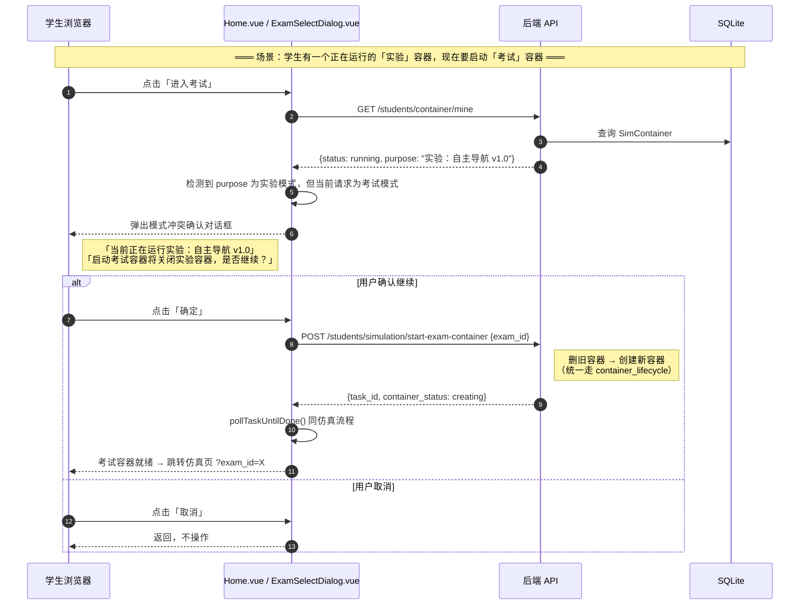
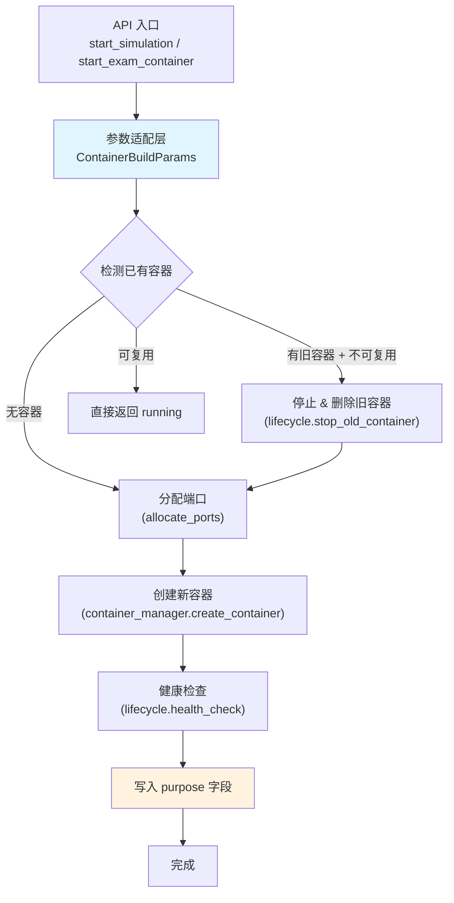

# SDD-第12期-补充：容器启动统一化与用途标记

> 版本：v1.0
> 日期：2026-04-13
> 状态：可评审 / 可执行
> 前序文档：SDD-第12期 v1.1（Sidecar 执行引擎与考试运行闭环）

---

## 0. 文档元信息

- **文档标题**：SDD-第12期-补充：容器启动统一化与用途标记
- **创建日期**：2026-04-13
- **负责人**：Thouder03
- **前置依赖**：
  - 第10期：`_run_rebuild_task`、`container_manager.create_container`、`port_allocator`、`readiness_checker`
  - 第11期：`ExamEnvSnapshot`、`ExamFileSnapshot`（含 `startup.sh`、`container_target_dir`）
  - 第12期主文档：Sidecar 引擎、`exam_attempts`、`useExamMode` composable
- **目标读者**：后端 / 前端 / 测试

---

## 1. 问题陈述

### 1.1 现状分析

当前容器启动存在三个结构性问题：

**P1：后端容器启动逻辑耦合在路由层**

`_run_rebuild_task()` 函数（~300 行）直接嵌入 `student/simulation.py` 路由文件中，包含：删旧容器 → 创建新容器 → GzWeb 健康检查 → RosBridge 健康检查 → 完成。考试模式需要相同的容器创建 + 健康检查流程，但参数来源不同（实验版本 vs 考试快照）。若直接复制该函数，会产生大量重复代码。

**P2：容器 `purpose` 字段未被使用**

`SimContainer.purpose` 字段（`String(200)`）已在模型中定义，但 `crud_container.create_container()` 从未设置该字段。教师监控页 `ContainerMonitorInfo.purpose` 始终为空字符串，无法区分学生当前是在做实验还是考试。

**P3：前端两种启动流程割裂**

| 路径 | 入口 | 容器操作 | 局限性 |
|------|------|---------|--------|
| 仿真启动 | `Home.vue` → `startSimulationApi()` | 完整创建/重建 + 文件分发 | 只支持实验版本参数 |
| 考试启动 | `ExamSelectDialog.vue` → `ensureContainerRunning()` | 仅检查/启动已有容器 | **不创建新容器**，不注入考试环境快照，**不分发考试文件** |

考试需要**指定考试环境快照**来创建容器，但当前流程无法做到。此外，仿真与考试容器**互斥**（单学生单容器），但前端没有处理模式冲突。

### 1.2 本补充文档的目标

1. **后端**：将容器启动核心逻辑抽象为 `container_lifecycle.py` 模板模块，同时被仿真和考试两条路径复用。
2. **后端**：启动容器时将实验/考试用途写入 `purpose` 字段。
3. **后端**：新增考试容器启动 API，复用统一的容器生命周期模块。
4. **前端**：扩展 `useContainerStart.ts`，统一仿真与考试的启动流程，处理模式冲突。

---

## 2. 系统交互设计

### 2.1 容器模式冲突处理时序图



### 2.2 统一容器启动流程图



---

## 3. 后端设计

### 3.1 新增模块：`app/core/container_lifecycle.py`

#### 3.1.1 设计思路

将 `_run_rebuild_task()` 中的**通用容器生命周期逻辑**抽取到独立模块，通过参数对象 `ContainerBuildParams` 统一两种启动来源的差异：

| 参数来源 | 实验模式 | 考试模式 |
|---------|---------|---------|
| 镜像 | `ExperimentVersion.image_name` | 默认镜像 `gzweb_sim:v1`（或 `runtime_policy.image`） |
| launch 参数 | `ExperimentVersion.launch_args_template` | 空（考试环境快照已包含完整启动配置） |
| 启动脚本 | `ExperimentEnvBundle.storage_root/startup.sh` | `ExamEnvSnapshot.storage_root/startup.sh` |
| 环境卷 | `{env_bundle.storage_root: env_bundle.container_target_dir}` | `{exam_env_snapshot.storage_root: exam_env_snapshot.container_target_dir}` |
| purpose | `"实验：{exp_name} / {version_name}"` | `"考试：{exam_name}"` |
| current_version_id | `version.id` | `None`（考试容器不关联实验版本） |

#### 3.1.2 接口契约

```python
# app/core/container_lifecycle.py

@dataclass
class ContainerBuildParams:
    """容器构建参数（适配仿真/考试两种来源）"""
    student_id: int
    image_name: str = "gzweb_sim:v1"
    launch_args: dict[str, str] = field(default_factory=dict)
    startup_script_path: str | None = None
    env_volumes: dict[str, str] = field(default_factory=dict)
    purpose: str = ""
    current_version_id: int | None = None


async def run_container_lifecycle(
    task_id: str,
    params: ContainerBuildParams,
) -> None:
    """
    通用容器生命周期编排（后台任务）。

    流程：
      1. PREPARING_CONFIG  → 参数校验
      2. STOPPING_OLD      → 删除已有容器
      3. CREATING_NEW      → 创建并启动 Docker 容器 + 写入 purpose
      4. CHECKING_GZWEB    → GzWeb 端口健康检查
      5. CHECKING_ROSBRIDGE → RosBridge 健康检查

    异步执行模式：asyncio.create_task + 独立 AsyncSessionLocal
    （与原 _run_rebuild_task 相同模式）

    :param task_id: SimulationTask 任务 ID（用于阶段进度上报）
    :param params: 容器构建参数
    """


def build_params_from_version(
    student_id: int,
    version: ExperimentVersion,
    env_bundle: ExperimentEnvBundle | None,
    experiment_name: str = "",
) -> ContainerBuildParams:
    """
    从实验版本构建容器参数（仿真模式）。
    purpose 格式：「实验：{experiment_name} / {version.version_name}」
    """


async def build_params_from_exam(
    db: AsyncSession,
    student_id: int,
    exam: Exam,
) -> ContainerBuildParams:
    """
    从考试定义构建容器参数（考试模式）。
    purpose 格式：「考试：{exam.name}」

    参数读取优先级：
      1. exam.runtime_policy_json.image → image_name（若未配置则使用默认镜像）
      2. ExamEnvSnapshot（若 exam.env_snapshot_id 存在）→ startup_script_path + env_volumes
    """
```

#### 3.1.3 从 `_run_rebuild_task` 重构的变更点

将 `student/simulation.py` 中的 `_run_rebuild_task()` 改为**薄适配层**：

```python
# student/simulation.py — 重构后

async def _run_rebuild_task(task_id: str, student_id: int, version_id: int) -> None:
    """仿真容器启动（向后兼容入口，委托给 container_lifecycle）"""
    async with AsyncSessionLocal() as db:
        version = await crud_experiment.get_version(db, version_id)
        if not version:
            # ... 错误处理（与原逻辑相同）
            return

        env_bundle = None
        if version.env_bundle_id:
            env_bundle = await crud_experiment.get_env_bundle(db, version.env_bundle_id)

        experiment = await crud_experiment.get_experiment(db, version.experiment_id)
        exp_name = experiment.name if experiment else "未知实验"

        params = build_params_from_version(student_id, version, env_bundle, exp_name)

    # 委托给统一生命周期
    await run_container_lifecycle(task_id, params)
```

### 3.2 考试容器启动 API

#### 3.2.1 新增 API

| Endpoint | Method | 鉴权 | Request | Response | 状态码 |
|----------|--------|------|---------|----------|--------|
| `/students/simulation/start-exam-container` | POST | student | `{exam_id: int}` | `SimulationStartResponse` | 202 / 400 / 404 / 409 |

**请求体**：

```json
{
  "exam_id": 5
}
```

**响应体**（与仿真启动 `StudentSimulationStartResponse` 结构一致）：

```json
{
  "data": {
    "task_id": "uuid-xxxx",
    "container_status": "creating",
    "experiment_context": null
  }
}
```

**校验规则**：
- 考试存在且状态为 `published`
- 如有旧容器（不论实验/考试用途），统一删旧建新
- 考试模式为 `result_run`（非该模式返回 400 `EXAM_MODE_NOT_SUPPORTED_YET`）
- 如已有活跃的重建任务，返回 409 `CONTAINER_REBUILD_IN_PROGRESS`

#### 3.2.2 考试环境快照到容器参数的映射

`build_params_from_exam()` 的参数映射细节：

| 容器参数 | 考试来源 | 默认值 |
|---------|---------|--------|
| `image_name` | `exam.runtime_policy_json.image` | `"gzweb_sim:v1"` |
| `launch_args` | `exam.runtime_policy_json.launch_args` | `{}` |
| `startup_script_path` | `ExamEnvSnapshot.storage_root + "/startup.sh"` | `None` |
| `env_volumes` | `{snapshot.storage_root: snapshot.container_target_dir}` | `{}` |
| `purpose` | `"考试：{exam.name}"` | — |
| `current_version_id` | — | `None` |

> **设计决策**：考试容器的 `image_name` 统一放入 `runtime_policy_json`。（要同步默认值和说明）
> 这保持了 Exam 模型不新增列，且与已有的 4 段式策略配置保持一致。
>
> `runtime_policy_json` 扩展字段（本补充新增）：
> ```json
> {
>   "max_duration_ms": 600000,
>   "max_attempts": 3,
>   "allow_debug_before_start": true,
>   "image": "gzweb_sim:v1",
>   "launch_args": {}
> }
> ```

### 3.3 `purpose` 字段写入

#### 3.3.1 写入时机

在 `run_container_lifecycle()` 的 **CREATING_NEW_CONTAINER** 阶段，容器创建成功后立即更新 `purpose`：

```python
# container_lifecycle.py 内部

container = await crud_container.create_container(db, ContainerCreate(...))
# 创建成功后写入用途
container.purpose = params.purpose
container.updated_at = datetime.utcnow()
await db.commit()
```

#### 3.3.2 `purpose` 格式约定

| 场景 | purpose 值 | 示例 |
|------|-----------|------|
| 仿真启动 | `"实验：{experiment.name} / {version.version_name}"` | `"实验：自主导航 / v1.0"` |
| 考试启动 | `"考试：{exam.name}"` | `"考试：自动导航期末考试"` |
| 教师 Dry Run | `"调试：{experiment.name} / {version.version_name}"` | `"调试：自主导航 / v1.0"` |

#### 3.3.3 `ContainerCreate` Schema 扩展

在 `app/schemas/container.py` 的 `ContainerCreate` 中新增 `purpose` 可选字段：

```python
class ContainerCreate(BaseModel):
    # ... 现有字段
    purpose: Optional[str] = Field(default=None, max_length=200)
```

`crud_container.create_container()` 在写入 DB 时设置：
```python
container = SimContainer(
    # ... 现有字段
    purpose=data.purpose,
)
```

### 3.4 模型变更

**无新增列**。`purpose` 字段已存在于 `SimContainer` 模型中，本次仅开始实际使用。

`runtime_policy_json` 的扩展字段（`image`、`launch_args`）为 JSON 内部键，不涉及数据库迁移。

---

## 4. 前端设计

### 4.1 `useContainerStart.ts` 统一重构

#### 4.1.1 设计目标

将 `useContainerStart.ts` 从"仿真专用工具"升级为**通用容器启动协调器**，同时支持：
- 仿真模式：`startSimulationApi({ version_id })` → 创建容器 + 实验文件分发
- 考试模式：`startExamContainerApi({ exam_id })` → 创建容器 + 考试文件分发

注意：两者在流程上对称，但在文件分发时调用的 API 端点不同。

#### 4.1.2 新增导出

```typescript
// useContainerStart.ts 新增导出

/**
 * 启动模式
 */
export type ContainerStartMode = 'simulation' | 'exam'

/**
 * 启动参数
 */
export interface ContainerStartOptions {
  mode: ContainerStartMode
  /** 仿真模式必填 */
  versionId?: number
  /** 考试模式必填 */
  examId?: number
}

/**
 * 统一容器启动流程（处理模式冲突 + 容器创建 + 健康检查）
 *
 * 流程：
 *   1. 查询当前容器状态与用途
 *   2. 检测模式冲突 → 弹出确认对话框
 *   3. 启动容器（仿真/考试 API 分发）
 *   4. 轮询任务进度
 *   5. 针对模式调用对应的文件分发 API（实验/考试）
 *
 * @returns true 表示容器已就绪，false 表示用户取消或启动失败
 */
export async function startContainerUnified(
  options: ContainerStartOptions,
  loadingInstance: LoadingInstance
): Promise<boolean>
```

#### 4.1.3 模式冲突检测逻辑

```typescript
async function checkModeConflict(
  currentPurpose: string | undefined,
  targetMode: ContainerStartMode
): Promise<'no_conflict' | 'confirmed' | 'cancelled'> {
  if (!currentPurpose) return 'no_conflict'

  const isCurrentExam = currentPurpose.startsWith('考试：')
  const isCurrentSimulation = currentPurpose.startsWith('实验：')

  // 同模式 → 容器复用判断由后端处理，前端不弹窗
  if (targetMode === 'exam' && isCurrentExam) return 'no_conflict'
  if (targetMode === 'simulation' && isCurrentSimulation) return 'no_conflict'

  // 跨模式冲突
  const currentLabel = isCurrentExam
    ? `考试容器（${currentPurpose}）`
    : `实验容器（${currentPurpose}）`
  const targetLabel = targetMode === 'exam' ? '考试' : '实验'

  try {
    await ElMessageBox.confirm(
      `当前正在运行${currentLabel}。\n启动${targetLabel}容器将关闭当前容器，是否继续？`,
      '容器模式冲突',
      {
        confirmButtonText: '确定，关闭当前容器',
        cancelButtonText: '取消',
        type: 'warning'
      }
    )
    return 'confirmed'
  } catch {
    return 'cancelled'
  }
}

async function _startExamContainer(examId: number, loading: LoadingInstance) {
  // 1. 发起容器重启重建
  const startRes = await startExamContainerApi({ exam_id: examId })
  const taskId = startRes.data.task_id
  
  // 2. 轮询等待
  loading.setText('正在创建考试容器，大概需要 30 秒...')
  const isRunning = await pollTaskUntilDone(taskId)
  if (!isRunning) return false
  
  // 3. 考试文件分发
  loading.setText('正在分发考试文件...')
  await request.post({ url: `/api/v1/students/simulation/distribute-exam-files`, data: { exam_id: examId } })
  
  return true
}
```

#### 4.1.4 统一启动主流程

```typescript
export async function startContainerUnified(
  options: ContainerStartOptions,
  loadingInstance: LoadingInstance
): Promise<boolean> {
  // 1. 查询当前容器
  loadingInstance.setText('正在检查容器状态...')
  let currentPurpose: string | undefined
  try {
    const res = await getMyContainerApi()
    currentPurpose = res?.data?.purpose
  } catch {
    // 404 = 无容器，继续
  }

  // 2. 模式冲突检测
  const conflict = await checkModeConflict(currentPurpose, options.mode)
  if (conflict === 'cancelled') return false

  // 3. 按模式分发 API
  if (options.mode === 'simulation') {
    return await _startSimulation(options.versionId!, loadingInstance)
  } else {
    return await _startExamContainer(options.examId!, loadingInstance)
  }
}
```

### 4.2 考试容器启动 API 模块

**新增文件**：`src/api/exam/container.ts`（或在 `attempts.ts` 中添加）

```typescript
export interface ExamContainerStartRequest {
  exam_id: number
}

/**
 * 启动考试专用容器
 *
 * POST /api/v1/students/simulation/start-exam-container
 */
export const startExamContainerApi = (
  data: ExamContainerStartRequest
): Promise<IResponse<StudentSimulationStartResponse>> => {
  return request.post({
    url: '/api/v1/students/simulation/start-exam-container',
    data
  })
}
```

### 4.3 `ContainerStatusResponse` 扩展

在 `api/container/types.ts` 中增加 `purpose` 字段：

```typescript
export interface ContainerStatusResponse {
  id: number
  status: ContainerStatus
  gzbridge_url?: string
  rosbridge_url?: string
  current_version_id?: number
  purpose?: string  // 新增：容器用途
}
```

后端 `ContainerStatusResponse` Schema 对应修改（新增 `purpose` 字段返回）。

### 4.4 调用方修改

#### 4.4.1 `Home.vue`（仿真启动）

将 `handleStartSimulation` 改为调用统一流程：

```typescript
// 原来: startSimulationApi + pollTaskUntilDone + distributeSimulationFilesApi
// 改为:
const handleStartSimulation = async () => {
  const version = selectedVersion.value
  if (!version) { ... }

  const loadingInstance = ElLoading.service({...})
  try {
    const ok = await startContainerUnified(
      { mode: 'simulation', versionId: version.version_id },
      loadingInstance
    )
    if (ok) openSimulationPage(version)
  } catch (e) {
    // 错误处理
  } finally {
    loadingInstance.close()
  }
}
```

#### 4.4.2 `ExamSelectDialog.vue`（考试启动）

将 `handleConfirm` 改为调用统一流程：

```typescript
// 原来: ensureContainerRunning(loadingInstance)
// 改为:
async function handleConfirm() {
  if (!selectedExamId.value) { ... }

  const loadingInstance = ElLoading.service({...})
  try {
    const ok = await startContainerUnified(
      { mode: 'exam', examId: selectedExamId.value },
      loadingInstance
    )
    if (!ok) {
      loadingInstance.close()
      return
    }

    loadingInstance.close()
    emit('update:visible', false)
    // 跳转仿真页 ?exam_id=X
    const url = router.resolve({
      name: 'Simulation',
      query: { exam_id: String(selectedExamId.value) }
    }).href
    window.open(url, '_blank') || router.push(...)
  } catch {
    loadingInstance.close()
    ElMessage.error('启动考试容器失败，请重试')
  }
}
```

#### 4.4.3 `ensureContainerRunning` 保留

`ensureContainerRunning()` 仍保留用于 **Simulation.vue 内部容器重启**场景（容器心跳超时 → 自动重启已有容器），不适用于初始启动。

---

## 5. 错误处理扩展

### 5.1 新增错误码

| 错误码 | HTTP | 语义 | 前端动作 |
|--------|------|------|---------|
| `EXAM_NOT_FOUND` | 404 | 考试不存在 | 提示刷新考试列表 |
| `EXAM_NOT_PUBLISHED` | 409 | 考试未发布 | 提示「考试未开放」 |
| `EXAM_MODE_NOT_SUPPORTED_YET` | 400 | 非 result_run | 提示「该考试模式将在后续期次开放」 |
| `EXAM_ENV_SNAPSHOT_MISSING` | 409 | 考试关联的环境快照不存在 | 提示联系教师 |
| `EXAM_STARTUP_SCRIPT_MISSING` | 409 | 环境快照中缺少 startup.sh | 提示联系教师 |

---

## 6. 实施交付清单

### 6.1 后端交付

**新增文件**：

| 路径 | 说明 |
|------|------|
| `app/core/container_lifecycle.py` | 统一容器生命周期编排（`ContainerBuildParams` + `run_container_lifecycle`） |

**修改文件**：

| 路径 | 修改内容 |
|------|---------| 
| `app/api/v1/endpoints/student/simulation.py` | `_run_rebuild_task` 重构为薄委托层；新增 `start-exam-container` API |
| `app/schemas/container.py` | `ContainerCreate` 增加 `purpose` 字段；`ContainerStatusResponse` 增加 `purpose` 返回 |
| `app/crud/container.py` | `create_container()` 使用 `data.purpose` 写入模型 |
| `app/api/v1/endpoints/student/container.py` | `/mine` 响应中增加 `purpose` 字段 |

### 6.2 前端交付

**修改文件**：

| 路径 | 修改内容 |
|------|---------|
| `src/views/Simulation/composables/useContainerStart.ts` | 新增 `startContainerUnified()` + 模式冲突检测；保留 `pollTaskUntilDone` + `ensureContainerRunning` |
| `src/api/container/types.ts` | `ContainerStatusResponse` 增加 `purpose` 字段 |
| `src/api/exam/attempts.ts`（或新建 `container.ts`） | 新增 `startExamContainerApi` |
| `src/views/Student/Home.vue` | `handleStartSimulation` 改为调用 `startContainerUnified` |
| `src/views/Student/ExamSelectDialog.vue` | `handleConfirm` 改为调用 `startContainerUnified` |

### 6.3 不变部分

| 路径 | 说明 |
|------|------|
| `app/models/container.py` | **无变更**：`purpose` 字段已存在 |
| `app/core/port_allocator.py` | **无变更**：考试与仿真共用同一端口范围 |
| `app/core/container_manager.py` | **无变更**：底层 Docker 操作不区分用途 |

---

## 7. 测试验收

### 7.1 测试用例

| 用例 | 类型 | 要点 | 通过标准 |
|------|------|------|---------|
| 仿真启动写入 purpose | 集成 | 启动后查询 DB | `purpose = "实验：自主导航 / v1.0"` |
| 考试启动写入 purpose | 集成 | 启动后查询 DB | `purpose = "考试：自动导航考试"` |
| 仿真 → 考试模式切换 | 集成 | 有 running 仿真容器，请求启动考试 | 旧容器删除 + 新容器 purpose 为考试 |
| 考试 → 仿真模式切换 | 集成 | 对称场景 | 旧容器删除 + 新容器 purpose 为仿真 |
| 教师监控页 purpose 显示 | E2E | 容器列表 | purpose 列正确显示 |
| 前端模式冲突弹窗 | E2E | 正在仿真 → 点击考试 | 确认弹窗显示当前用途 |
| 前端取消冲突 | E2E | 弹窗点击取消 | 不操作容器 |
| `_run_rebuild_task` 回归 | 集成 | 重构后仿真启动行为不变 | 与重构前行为完全一致 |
| 考试环境快照缺失 | 集成 | `exam.env_snapshot_id` 为 None | 返回 409 + `EXAM_ENV_SNAPSHOT_MISSING` |
| 考试 startup.sh 缺失 | 集成 | 快照目录无 startup.sh | 返回 409 + `EXAM_STARTUP_SCRIPT_MISSING` |

### 7.2 验收标准

- [ ] 仿真启动回归通过（`_run_rebuild_task` 重构无行为变更）
- [ ] 考试容器启动 + purpose 正确写入
- [ ] 前端模式冲突弹窗正常工作
- [ ] 教师监控页 purpose 列正确显示
- [ ] 两种模式切换容器正确销毁与重建

---

## 8. 实施约束

### 8.1 部署约束

- **无数据库迁移**：`purpose` 字段已存在，`runtime_policy_json` 扩展字段为 JSON 内部键
- **无新镜像**：考试容器复用仿真镜像（`gzweb_sim:v1`），由 `runtime_policy_json.image` 配置

### 8.2 向后兼容

- `_run_rebuild_task()` 作为薄委托层保留原函数签名，所有现有调用方无需修改
- `ensureContainerRunning()` 保留导出，`Simulation.vue` 内部重启仍使用该函数
- `ContainerCreate` 新增的 `purpose` 字段为 `Optional`，默认 `None`，不影响现有调用

### 8.3 开放问题

> **OP-1**：考试模型当前没有 `image_name` 列。本方案将它放入 `runtime_policy_json`。如果后续教师端需要在 UI 上独立配置这个字段，可能需要在 `Exam` 模型中新增列或在教师端考试编辑页增加对应的表单项。本期暂按 JSON 方案实施。

---

## 9. 变更记录

| 版本 | 日期 | 变更 | 负责人 |
|------|------|------|--------|
| v1.0 | 2026-04-13 | 初版 | Thouder03 |
