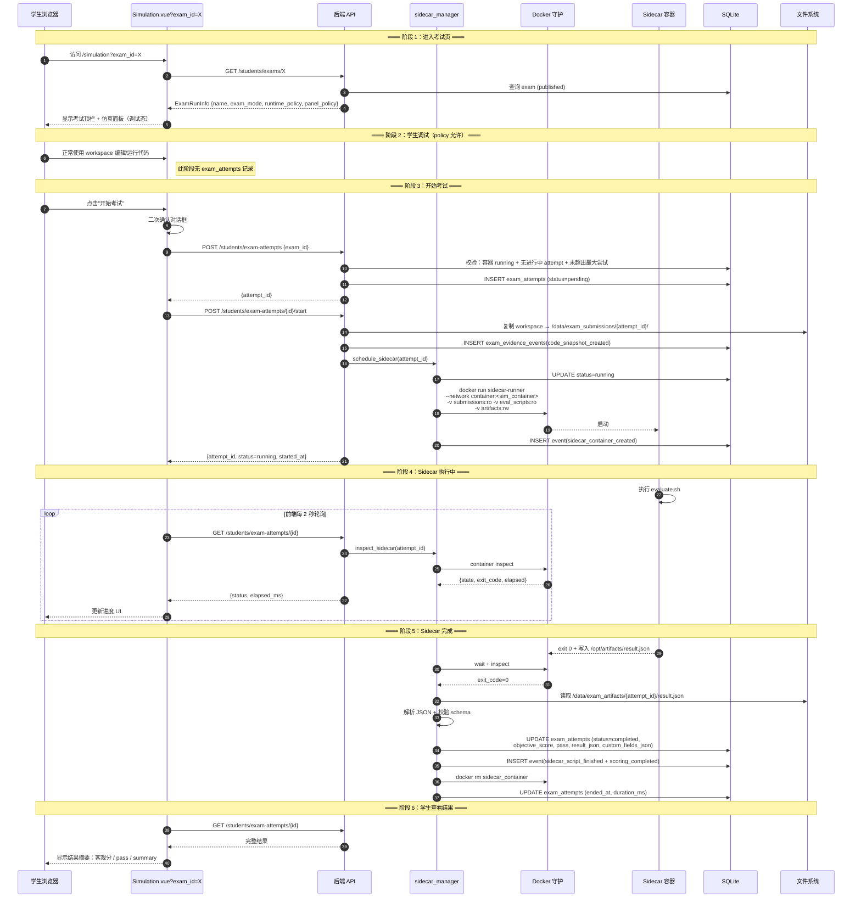
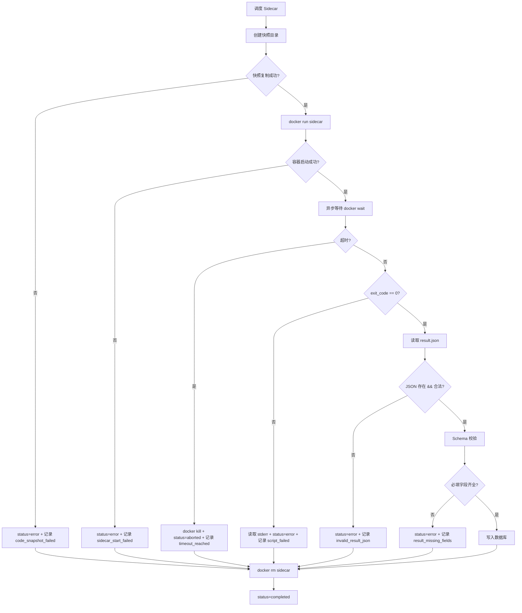
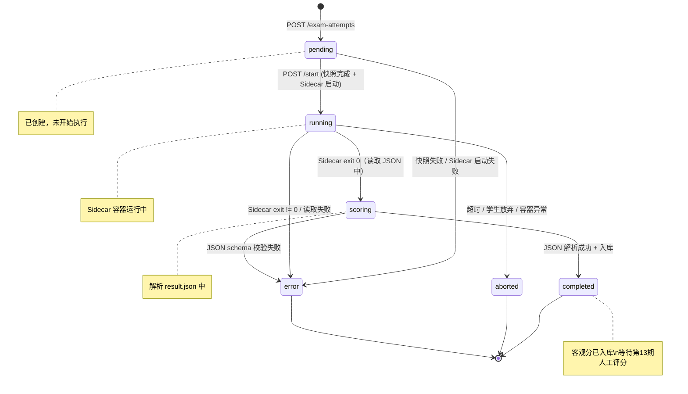

# SDD-第12期：Sidecar 执行引擎与考试运行闭环

> 版本：v1.0
> 日期：2026-04-10
> 状态：可评审 / 可执行
> 架构主路线：Sidecar + 考试模式 + 配置驱动

---

## 0. 文档元信息

- **文档标题**：SDD-第12期：Sidecar 执行引擎与考试运行闭环
- **文档版本**：v1.1
- **创建日期**：2026-04-1
- **负责人**：Thouder03
- **前置依赖**：
  - 第11期：考试定义、测评脚本、考试环境/文件快照四张表与教师端 CRUD
  - 第10期：Docker 集成、仿真容器生命周期、`SimulationTask` 任务编排
- **后续期次**：第13期：考试模式扩展、面板策略与教师复核增强
- **目标读者**：后端 / 前端 / 测试 / 运维

---

## 1. 执行摘要

### 1.1 本期要解决的问题

1. **考试定义有了，但没法跑**——第11期只建了考试资源，缺少把考试"运行起来"的执行引擎。
2. **没有运行记录实体**——学生每次参加考试没有对应的 `exam_attempts` 记录，成绩无处落地。
3. **代码快照机制缺失**——学生"开始考试"时，如何冻结当前工作区代码以供 Sidecar 读取？
4. **缺少 Sidecar 调度能力**——如何创建 Sidecar 容器、挂载资源、读取 JSON 输出、清理资源？
5. **学生端没有考试入口**——学生无法在仿真页面"进入考试模式"。

### 1.2 本期关键结果

1. 学生在仿真页面通过 `?exam_id=X` 进入考试模式，顶栏显示考试名与倒计时。
2. 学生点击"开始考试"后，平台创建 `exam_attempts` 记录，冻结代码快照，启动 Sidecar 容器。
3. Sidecar 运行教师脚本，输出标准 JSON；平台解析并写入考试结果。
4. 学生和教师都能查看考试结果（客观分、`pass`、`summary`、`result_json` 原文）。
5. 本期只支持 `result_run` 模式的最小闭环；另两种模式在第13期扩展。

### 1.3 成功判定

- **SM-1**：`result_run` 考试端到端成功率 ≥ 90%（从开始考试到结果入库）。
- **SM-2**：Sidecar 启动成功率 ≥ 95%（不含教师脚本本身错误）。
- **SM-3**：代码快照完整性 100%（快照目录与 workspace 字节级一致）。
- **SM-4**：非法 JSON 输出被 100% 捕获并转为 `status=error`，无静默失败。
- **SM-5**：Sidecar 超时能被正确终止，容器资源无残留。

---

## 2. 范围定义

### 2.1 In Scope

| 编号 | 交付项 |
|------|--------|
| S1 | `exam_attempts` 表（考试运行记录） |
| S2 | `exam_evidence_events` 表（生命周期审计事件） |
| S3 | 代码快照机制（`workspace` 目录物理复制到 `/data/exam_submissions/{attempt_id}/`） |
| S4 | Sidecar 调度服务（`app/core/sidecar_manager.py`） |
| S5 | 标准 JSON 结果解析器（`app/core/result_parser.py`） |
| S6 | 学生端考试 API（创建尝试、开始、查询、结束） |
| S7 | 教师端考试运行记录列表与详情 API |
| S8 | 学生端考试页框架（复用 `Simulation.vue` + `?exam_id=X`） |
| S9 | `result_run` 模式的完整闭环 |
| S10 | 教师端考试详情页内"运行记录"子面板（看分数 + result_json 原文） |
| S11 | Sidecar 基础镜像规格 |
| S12 | 超时终止与资源清理（Sidecar 容器 + 临时目录） |

### 2.2 Out of Scope

| 项目 | 不纳入本期原因 |
|------|---------------|
| `process_run` 模式 | 交互复杂度高，第13期处理 |
| `multi_stage_run` 模式 | 阶段事件流 + 阶段视图 UI 复杂，第13期处理 |
| 面板策略实际生效 | 需阶段 UI 配合，第13期处理 |
| 人工评分 + 最终成绩核算 | 第13期处理 |
| 阶段视图、artifacts 查看器、轨迹可视化 | 第13期处理 |
| 多容器并行考试 | 平台限制单学生单容器，无此场景 |
| Sidecar 基础镜像的自动构建 CI | 属于 DevOps 任务，非 SDD 范围 |
| 教师覆盖客观分 / 手动修改 pass | 第13期处理 |
| 考试成绩导出 | 第13期+ |

---

## 3. 前提挑战与方案比选

### 3.1 前提挑战

**为什么必须引入 Sidecar 容器而不是直接在主仿真容器内跑脚本？**

答：
1. 教师脚本可能污染仿真容器的 ROS 环境（import 奇怪的库、启动多余节点）；
2. Sidecar 作为独立容器可设置 CPU/内存/超时限额，避免影响主仿真；
3. Sidecar 随用随丢，考试结束立即销毁，无状态残留；
4. 未来支持多阶段评测时，Sidecar 作为"执行体"与主仿真解耦更清晰。

**代码快照为什么不用 Git？**

答：workspace 目录下不一定有 `.git`；`git init + commit` 需要额外依赖；`shutil.copytree` 原子性和可读性最高，Sidecar 可直接挂载只读目录。

### 3.2 现有资产复用

#### 3.2.1 后端复用资产

| 资产 | 路径 | 复用方式 |
|------|------|---------|
| Docker 客户端单例 | `app/core/docker_client.py` | Sidecar 容器创建/启动/停止 |
| 容器管理器 | `app/core/container_manager.py` | 参照其容器生命周期管理模式 |
| 端口分配器 | `app/core/port_allocator.py` | Sidecar 一般不需要暴露端口，但必要时复用 |
| 可用性检查器 | `app/core/readiness_checker.py` | 参照其 `check_port_ready` 模式做 Sidecar 就绪检测 |
| `SimulationTask` 模型与任务 | `app/models/simulation_task.py` + `student/simulation.py` | 参照其 stage_statuses 语义做 Sidecar 执行阶段追踪 |
| `ApiResponse[T]` | `app/schemas/common.py` | 统一响应 |
| `get_current_student_id` / 鉴权 | `app/core/security.py` | 学生端 API 鉴权 |
| 第11期的 `Exam` 模型 | `app/models/exam.py` | 读取 exam 配置 |
| 第11期的快照存储根 | `exam_env_snapshots.storage_root` 等 | Sidecar 挂载来源 |
| 学生容器状态查询 | `crud/container.py` | 考试前校验容器 running |

#### 3.2.2 前端复用资产

| 资产 | 路径 | 复用方式 |
|------|------|---------|
| `Simulation.vue` | `views/Simulation/Simulation.vue` | 加 `?exam_id=X` query 分支 |
| `SimulationHeader.vue` | `views/Simulation/components/SimulationHeader.vue` | 增加考试模式顶栏 |
| `useRosConnection` | `views/Simulation/panels/ROS3DViewer/composables/` | 不变 |
| 容器 API | `api/container/index.ts` | 考试前校验 |
| 任务轮询工具 | `simulation.vue` 现有的 `SimulationTask` 轮询逻辑 | 参照其模式做 `exam_attempts` 状态轮询 |
| Element Plus Dialog / Timeline | 全局 | 确认对话框 + 结果摘要 |

### 3.3 方案决策（v1.1 已定型，此处仅复核）

| 维度 | 决策 |
|------|------|
| Sidecar 部署方式 | **独立 Docker 容器**，共享主仿真容器的 network namespace（`--network container:<sim>`），可访问同一 ROS master |
| 代码快照 | **文件复制**：`shutil.copytree` 到 `/data/exam_submissions/{attempt_id}/` |
| JSON 解析 | **严格 schema 校验**：未知字段容忍，缺失必填字段 → `status=error` |
| 超时处理 | 后端定时器触发 `docker kill`，超时标记 `status=aborted` |
| 并发限制 | 单学生同时只能有一个 `in_progress`/`running`/`scoring` 状态的 attempt |

---

## 4. 系统交互设计

### 4.1 result_run 考试完整时序图



### 4.2 Sidecar 执行阶段流程图



### 4.3 考试尝试状态机



**状态转换规则**：

| 当前状态 | 允许转换至 | 触发条件 |
|---------|-----------|---------|
| `pending` | `running` | Sidecar 启动成功 |
| `pending` | `error` | 快照复制失败 / Sidecar 启动失败 |
| `running` | `scoring` | Sidecar exit_code=0 |
| `running` | `error` | Sidecar exit_code != 0 |
| `running` | `aborted` | 超时（runtime_policy.max_duration_ms 到达） / 学生主动放弃 |
| `scoring` | `completed` | result.json 解析成功 |
| `scoring` | `error` | result.json 缺失/非法/缺必填字段 |

---

## 5. API 契约

### 5.1 学生端 API

| Endpoint | Method | 鉴权 | Request | Response | 状态码 |
|----------|--------|------|---------|----------|--------|
| `/students/exams/{exam_id}` | GET | student | — | `ExamRunInfo` | 200 / 404 / 409（考试未发布） |
| `/students/exams/{exam_id}/my-attempts` | GET | student | — | `{items: AttemptSummary[]}` | 200 |
| `/students/exam-attempts` | POST | student | `{exam_id}` | `{attempt_id, status}` | 201 / 400 / 409 |
| `/students/exam-attempts/{id}/start` | POST | student | — | `AttemptDetail` | 200 / 404 / 409 |
| `/students/exam-attempts/{id}` | GET | student | — | `AttemptDetail` | 200 / 404 / 403 |
| `/students/exam-attempts/{id}/abort` | POST | student | `{reason?}` | `AttemptDetail` | 200 / 409 |

**`ExamRunInfo` 结构**：

| 字段 | 类型 | 说明 |
|------|------|------|
| `exam_id` | int | |
| `name` | string | 考试显示名 |
| `description` | string | |
| `exam_mode` | string | `result_run` / ... |
| `runtime_policy` | object | 运行策略（给前端决定 UI） |
| `panel_policy` | object | 面板策略（本期仅传递，不生效） |
| `time_limit_ms` | int | 来自 runtime_policy.max_duration_ms |
| `remaining_attempts` | int | 剩余尝试次数 |

**`AttemptDetail` 结构**：

| 字段 | 类型 | 说明 |
|------|------|------|
| `attempt_id` | int | |
| `exam_id` | int | |
| `status` | string | 状态枚举 |
| `started_at` | string | ISO datetime |
| `ended_at` | string \| null | |
| `duration_ms` | int \| null | |
| `objective_score` | float \| null | |
| `pass` | bool \| null | |
| `summary` | string \| null | Sidecar 输出的 summary |
| `result_json` | object \| null | 完整 JSON（含 custom_fields） |
| `error_code` | string \| null | 错误码（error 状态时） |
| `error_message` | string \| null | |

### 5.2 教师端 API

| Endpoint | Method | Request | Response | 说明 |
|----------|--------|---------|----------|------|
| `/teachers/exams/{exam_id}/attempts` | GET | Query: `page, student_id?, status?` | `{items, total}` | 单考试的运行记录列表 |
| `/teachers/exam-attempts` | GET | Query: `page, student_id?, exam_id?, status?` | `{items, total}` | 全局运行记录列表 |
| `/teachers/exam-attempts/{id}` | GET | — | `AttemptFullDetail` | 运行记录详情 |
| `/teachers/exam-attempts/{id}/events` | GET | — | `{items: LifecycleEvent[]}` | 生命周期事件时间轴 |

**`AttemptFullDetail` = `AttemptDetail` + 学生信息 + 考试信息 + 下载链接**（artifacts 打包）。

> 实现约束（本期审查决议）：后端 Schema 必须采用统一继承链，禁止学生端/教师端重复手写字段。
>
> - `AttemptBaseSchema`：公共字段（attempt_id、status、score、error 等）
> - `StudentAttemptDetailSchema`：`AttemptBaseSchema` + 学生自查所需字段
> - `TeacherAttemptFullSchema`：`AttemptBaseSchema` + 学生信息 + 考试信息 + artifacts 下载信息
>
> 前端 `types.ts` 仅允许从同一基础类型派生，禁止复制粘贴定义第二套 `AttemptDetail`。

### 5.3 错误语义映射

| 错误码 | HTTP | 语义 | 前端动作 |
|--------|------|------|---------|
| `EXAM_NOT_PUBLISHED` | 409 | 考试未发布，学生不可参加 | 提示"考试未开放" |
| `EXAM_MODE_NOT_SUPPORTED_YET` | 400 | 当前 exam_mode 非 `result_run`，需到第13期才支持 | 提示"该考试模式将在后续期次开放" |
| `CONTAINER_NOT_RUNNING` | 400 | 容器非 running | 引导学生启动仿真 |
| `ATTEMPT_IN_PROGRESS` | 409 | 已有进行中尝试 | 恢复按钮 |
| `MAX_ATTEMPTS_EXCEEDED` | 409 | 超出最大尝试次数 | 提示"已达上限" |
| `SNAPSHOT_FAILED` | 500 | 代码快照失败 | 重试按钮 + 联系管理员 |
| `SIDECAR_START_FAILED` | 500 | Sidecar 启动失败 | 同上 |
| `ATTEMPT_PENDING_STALE` | 409 | 上一次 attempt 停留在 `pending` 超过回收阈值，需先回收或重试 | 提示恢复或重试 |
| `RESULT_INVALID_JSON` | — | Sidecar 输出非法 JSON（状态内部转 error） | 前端显示"评测脚本输出格式错误" |
| `RESULT_MISSING_FIELDS` | — | 缺必填字段 | 显示缺失字段清单 |
| `SIDECAR_TIMEOUT` | — | Sidecar 超时被 kill | 显示"评测超时" |
| `FORBIDDEN_NOT_OWNER` | 403 | 学生访问他人 attempt | — |

> 实现约束（本期审查决议）：新增 `ExamAttemptErrorCode` 枚举与 `to_http_exception` 映射层。
>
> - 后端模块只允许抛 `ExamAttemptErrorCode`，不允许自由字符串错误码
> - API 层统一做错误码 → HTTP 状态码映射
> - 前端文案只按错误码 key 映射，不读取后端自由文本

---

## 6. 数据字典

### 6.1 表：`exam_attempts`

| 字段名 | 类型 | 必填 | 默认 | 说明 |
|--------|------|------|------|------|
| `id` | INTEGER | 是 | 自增 | 主键 |
| `exam_id` | INTEGER | 是 | — | FK → exams.id |
| `student_id` | INTEGER | 是 | — | FK → users.id |
| `container_id` | INTEGER | 否 | — | 关联主仿真容器 ID（快照引用） |
| `sim_container_docker_id` | VARCHAR(64) | 否 | — | Docker 容器 ID（用于共享 network） |
| `sidecar_container_id` | VARCHAR(64) | 否 | — | Sidecar Docker 容器 ID |
| `status` | VARCHAR(20) | 是 | `pending` | 状态（见 §4.3 状态机） |
| `attempt_exam_mode` | VARCHAR(20) | 是 | — | **创建 attempt 时固化的考试模式快照**，后续解释不回读 `exams.exam_mode` |
| `attempt_runtime_policy_json` | JSON | 是 | `{}` | **创建 attempt 时固化的运行策略快照** |
| `attempt_panel_policy_json` | JSON | 是 | `{}` | **创建 attempt 时固化的面板策略快照** |
| `attempt_scoring_policy_json` | JSON | 是 | `{}` | **创建 attempt 时固化的评分策略快照** |
| `attempt_sidecar_policy_json` | JSON | 是 | `{}` | **创建 attempt 时固化的 Sidecar 运行配置快照**，后续启动、超时处理、复核排查一律只读此字段 |
| `submission_snapshot_path` | VARCHAR(512) | 否 | — | 代码快照绝对路径 |
| `artifacts_path` | VARCHAR(512) | 否 | — | artifacts 目录路径 `/data/exam_artifacts/{attempt_id}/` |
| `result_json` | JSON | 否 | — | 完整 Sidecar 输出 JSON |
| `objective_score` | FLOAT | 否 | — | 从 result_json.objective_score 解析 |
| `manual_score` | FLOAT | 否 | — | 人工分（第13期写入） |
| `final_score` | FLOAT | 否 | — | 最终分（第13期核算） |
| `pass` | BOOLEAN | 否 | — | 从 result_json.pass 解析 |
| `summary` | VARCHAR(512) | 否 | — | 从 result_json.summary 解析 |
| `custom_fields_json` | JSON | 否 | — | 从 result_json.custom_fields 解析 |
| `stage_statuses_json` | JSON | 是 | `[]` | 第13期多阶段使用；本期为空数组 |
| `artifact_index_json` | JSON | 是 | `{}` | artifacts 文件索引；作为数据库侧复核主索引 |
| `review_status` | VARCHAR(20) | 是 | `pending` | `pending` / `reviewed` |
| `teacher_comment` | TEXT | 否 | — | 第13期写入 |
| `error_code` | VARCHAR(64) | 否 | — | 错误码（error 状态时） |
| `error_message` | VARCHAR(512) | 否 | — | 错误详情 |
| `started_at` | DATETIME | 否 | — | 实际开始时间（快照 + Sidecar 启动成功） |
| `ended_at` | DATETIME | 否 | — | 结束时间 |
| `duration_ms` | INTEGER | 否 | — | 总时长 |
| `created_at` | DATETIME | 是 | `utcnow` | 创建时间 |
| `updated_at` | DATETIME | 是 | `utcnow` | 更新时间 |

**索引**：
- `idx_attempts_student_id`
- `idx_attempts_exam_id`
- `idx_attempts_status`
- `idx_attempts_exam_student (exam_id, student_id)`

### 6.2 表：`exam_evidence_events`（生命周期审计）

| 字段名 | 类型 | 必填 | 默认 | 说明 |
|--------|------|------|------|------|
| `id` | INTEGER | 是 | 自增 | 主键 |
| `attempt_id` | INTEGER | 是 | — | FK → exam_attempts.id (CASCADE) |
| `event_type` | VARCHAR(40) | 是 | — | 事件类型（见 6.3） |
| `event_time_ms` | BIGINT | 是 | — | 毫秒 UNIX 时间 |
| `sequence_no` | INTEGER | 是 | — | 同 attempt 下序号 |
| `source` | VARCHAR(20) | 否 | `backend` | `backend` / `sidecar` / `frontend` |
| `payload_json` | JSON | 是 | `{}` | 事件负载 |
| `created_at` | DATETIME | 是 | `utcnow` | 入库时间 |

**索引**：`idx_evidence_attempt_id`、`idx_evidence_attempt_time (attempt_id, event_time_ms)`

### 6.3 枚举：`EvidenceEventType`

> 本期只记录生命周期事件，不记录证据数据（原 SDD 的位姿/碰撞采集已废弃）。

| 值 | 触发时机 | 来源 | Payload 示例 |
|----|---------|------|------|
| `exam_attempt_created` | 创建 attempt 记录时 | backend | `{}` |
| `code_snapshot_started` | 开始复制 workspace | backend | `{source_path, target_path}` |
| `code_snapshot_created` | 复制完成 | backend | `{file_count, total_bytes}` |
| `code_snapshot_failed` | 复制失败 | backend | `{error}` |
| `sidecar_container_created` | Sidecar 启动成功 | backend | `{docker_id, image}` |
| `sidecar_start_failed` | Sidecar 启动失败 | backend | `{error}` |
| `sidecar_script_finished` | Sidecar 进程退出 | backend | `{exit_code, elapsed_ms}` |
| `scoring_completed` | JSON 解析入库成功 | backend | `{objective_score, pass}` |
| `invalid_result_json` | JSON 非法 | backend | `{raw_stderr}` |
| `result_missing_fields` | 缺必填字段 | backend | `{missing}` |
| `timeout_reached` | 超时触发 kill | backend | `{elapsed_ms, limit_ms}` |
| `exam_aborted_by_student` | 学生主动放弃 | backend | `{reason}` |
| `exam_attempt_finalized` | 尝试进入终态 | backend | `{final_status}` |
| `system_warning` | 非致命异常 | backend | `{code, message}` |
| `system_error` | 致命异常 | backend | `{code, message}` |

---

## 7. Sidecar 执行引擎设计

### 7.1 Sidecar 基础镜像规格

**镜像名**：`edubot/sidecar-runner:v1`

**构建要点**（不含实现细节，仅契约）：

| 组件 | 版本/说明 |
|------|----------|
| 基础系统 | Ubuntu 20.04 |
| ROS 客户端 | roslibpy (Python) + ros-noetic-ros-base（如需 `rostopic` CLI） |
| Python | 3.8+ |
| 默认工具 | `curl`、`jq`、`python3`、`pip3` |
| 镜像大小目标 | ≤ 800MB |
| 默认工作目录 | `/opt/evaluate` |
| 默认用户 | 非 root（`sidecar`, UID 1500） |

**约定目录**：

| 容器内路径 | 挂载来源 | 模式 | 说明 |
|-----------|---------|------|------|
| `/opt/evaluate` | `/data/exam_eval_scripts/{script_id}/` | ro | 教师脚本（含 entry_point） |
| `/opt/submission` | `/data/exam_submissions/{attempt_id}/` | ro | 学生代码快照 |
| `/opt/env` | `/data/exam_env_snapshots/{env_id}/` | ro | 考试环境（可选，供脚本读参数） |
| `/opt/files` | `/data/exam_file_snapshots/{file_id}/` | ro | 考试文件（可选） |
| `/opt/artifacts` | `/data/exam_artifacts/{attempt_id}/` | rw | **脚本必须在此写入 `result.json`** |

**约定环境变量**：

| 变量 | 值 | 说明 |
|------|-----|------|
| `EXAM_ATTEMPT_ID` | int | 当前 attempt ID |
| `EXAM_MODE` | string | `result_run` / ... |
| `EXAM_ID` | int | |
| `RESULT_PATH` | `/opt/artifacts/result.json` | 脚本写入结果的固定路径 |
| `ARTIFACTS_DIR` | `/opt/artifacts` | |
| `RUNTIME_POLICY_JSON` | string | 序列化 policy，脚本可自行读取 |
| `ROSBRIDGE_URL` | `ws://localhost:9090` | 共享 network 后 rosbridge 本地可达 |
| `SIM_CONTAINER_NAME` | string | 主仿真容器名（便于脚本 docker exec） |

**入口命令**：

```
bash /opt/evaluate/{entry_point}
```

默认 `entry_point` = `evaluate.sh`。

### 7.2 docker run 参数契约

> 以下为 Sidecar 管理器调用 Docker SDK 时使用的参数结构，不写实现代码。

| 参数 | 值 |
|------|-----|
| `image` | `sidecar_policy.image`（默认 `edubot/sidecar-runner:v1`） |
| `name` | `sidecar-exam-{attempt_id}` |
| `network_mode` | `container:<sim_container_docker_id>` |
| `volumes` | 按 7.1 约定 5 个目录 |
| `environment` | 按 7.1 约定 8 个变量 |
| `user` | `1500:1500` |
| `read_only` | `True`（根文件系统只读，仅 `/opt/artifacts` rw） |
| `cap_drop` | `ALL` |
| `security_opt` | `no-new-privileges` |
| `cpu_quota` | `int(sidecar_policy.cpu_limit * 100000)` |
| `mem_limit` | `sidecar_policy.memory_limit_mb`MB |
| `detach` | `True` |
| `auto_remove` | `False`（由后端显式 `docker rm`，便于读取 exit_code） |

### 7.3 标准 JSON 契约（复核 v1.1 §15.2）

平台必须稳定解析的字段：

| 字段 | 类型 | 必填 | 语义 |
|------|------|------|------|
| `status` | string | 是 | `completed` / `failed`（脚本自判） |
| `objective_score` | number | 是 | 0-100 |
| `pass` | bool | 是 | 是否通过 |
| `summary` | string | 是 | ≤ 500 字的评语 |
| `metrics` | object | 否 | 平台通用指标容器 |
| `artifacts` | object | 否 | 产物索引（key → 相对路径） |
| `custom_fields` | object | 否 | 课程私有字段 |

**`metrics` 推荐字段**（非强制）：

- `goal_reached`（bool）
- `elapsed_seconds`（float）
- `collision_count`（int）
- `path_length`（float）
- `stage_count`（int，第13期使用）
- `stage_passed_count`（int，第13期使用）

**Schema 校验规则**：

1. `result.json` 文件必须存在，否则 `error_code=RESULT_MISSING_FILE`。
2. 必须是合法 JSON，否则 `error_code=RESULT_INVALID_JSON`。
3. 必填字段缺失 → `error_code=RESULT_MISSING_FIELDS`，`error_message` 列出缺失项。
4. `objective_score` 必须在 [0, 100]，超界 clamp 并记录 `system_warning`。
5. 未知字段容忍（向前兼容）。

### 7.4 Sidecar 调度服务职责（`app/core/sidecar_manager.py`）

> 接口契约，不含实现代码。

| 函数 | 职责 |
|------|------|
| `schedule_sidecar(attempt_id)` | 入口：编排快照 → 启动 → 监控 → 结果解析 → 清理 |
| `create_code_snapshot(attempt)` | `shutil.copytree` 复制 workspace |
| `build_docker_config(attempt)` | **只按 attempt 快照字段**组装 Docker 参数，不回读 `exams` 当前配置 |
| `start_sidecar(config)` | 调用 Docker SDK 启动 |
| `wait_for_completion(container_id, timeout_ms)` | 等待 exit + 超时 kill |
| `parse_result_json(artifacts_path)` | 读取 + Schema 校验 |
| `finalize_attempt(attempt, result)` | 写入数据库 + 状态转换 |
| `cleanup_sidecar(container_id)` | `docker rm` + 保留 artifacts |
| `kill_timeout_sidecar(attempt_id)` | 超时终止（由定时任务调用） |

**异步执行模式**：采用与第10期 `_run_rebuild_task` 相同的 `asyncio.create_task` + 独立 `AsyncSessionLocal` 模式。

**补充约束**：
- `schedule_sidecar()` 在启动 Sidecar 前，必须先把 `exam_mode`、`runtime_policy_json`、`panel_policy_json`、`scoring_policy_json`、`sidecar_policy_json` 从 `exams` 表复制到 attempt 快照字段。
- `build_docker_config()`、超时处理、前端状态展示、教师复核、申诉解释均以 attempt 快照字段为准，不再回读 `exams` 当前值。
- 创建 attempt 入口必须校验 `exam_mode == result_run`；`process_run` / `multi_stage_run` 在第13期扩展前不得创建 attempt。
- 两步开始流程保留，但 `pending` 状态必须具备超时回收与可重试语义，防止浏览器中断或第二步请求未发出时留下僵尸 attempt。
- `finalize_attempt()` 必须把 `artifact_index_json`、`result_json`、关键摘要字段一并固化到数据库，教师端详情页默认读取数据库快照；文件系统 artifacts 仅作为原始附件来源。
- 当前设计**仅支持单后端实例 / 单进程部署**。`asyncio.create_task`、超时扫描任务与第13期阶段轮询器不具备多实例协调能力，多副本部署前必须补分布式锁或租约机制。
- 部署与验收闸门（强制）：第12期上线检查必须验证后端副本数=1，并配置“检测到多实例即阻断发布”的流程告警。

### 7.5 超时终止定时任务

**任务**：后端启动一个后台定时任务，每 10 秒扫描一次 `exam_attempts`：

- 条件：`status=running` AND `started_at + attempt_runtime_policy_json.max_duration_ms + 30s < now`
- 动作：
  1. `docker kill` Sidecar 容器
  2. 更新 `status=aborted`, `error_code=SIDECAR_TIMEOUT`
  3. 写入 `timeout_reached` 生命周期事件
  4. `docker rm` 容器
  5. 记录 `exam_attempt_finalized`

> 为什么加 30 秒缓冲？给 Sidecar 脚本自行超时+写 result.json 的机会。

---

## 8. 前端设计

### 8.1 考试模式进入机制

**路由**：复用现有 `/simulation`，通过 query 参数进入考试模式：

```
/simulation                   ← 普通仿真
/simulation?exam_id=5         ← 考试模式（考试 ID=5）
```

**`Simulation.vue` 修改要点**：

1. 读取 `route.query.exam_id`，若存在则进入考试模式分支。
2. 考试模式下：
   - 顶栏切换为考试顶栏
   - 调用 `GET /students/exams/{exam_id}` 获取考试配置
   - 根据 `runtime_policy.allow_debug_before_start` 决定是否锁定面板（本期简化：仅 UI 提示，不强制锁定）
3. 维护考试态：
   - `currentAttemptId`、`attemptStatus`、`examRunInfo`、`countdownMs`
4. 考试进行中（`status=running/scoring`）时：
   - 禁用"关闭容器"按钮
   - 显示 Sidecar 进度条
   - 每 2 秒轮询 `GET /students/exam-attempts/{id}`

### 8.2 ExamHeader 考试模式

**普通模式顶栏**（现有）：
```
🤖 edubot-twin   实验：自主导航 v1.0       [设置] [退出]
```

**考试模式顶栏**（新增）：
```
┌─────────────────────────────────────────────────────────────────────────────┐
│  📝 考试：自动导航考试     模式：result_run                                 │
│  ⏱ 倒计时：08:45           状态：调试中       尝试：2/3剩余                  │
│                                       [▶ 开始考试]    [🚪 退出考试]         │
└─────────────────────────────────────────────────────────────────────────────┘
```

**按钮状态映射**：

| `attempt_status` | 顶栏按钮 |
|-----------------|---------|
| 无 attempt（调试中） | `[▶ 开始考试]` |
| `pending` | `[准备中…]`（loading） |
| `running` | `[🔄 评测中 (32%)] [⛔ 放弃]` |
| `scoring` | `[📊 计分中…]`（loading） |
| `completed` | `[📋 查看结果] [← 返回]` |
| `error` / `aborted` | `[❌ 评测异常] [查看详情]` |

### 8.3 "开始考试"确认对话框

```
┌───────────────────────────────────────────────┐
│  确认开始考试？                                │
├───────────────────────────────────────────────┤
│  考试：自动导航考试                             │
│  时限：10 分钟                                 │
│  剩余尝试：2 次                                │
│                                                │
│  ⚠ 点击确认后，平台将冻结当前代码快照并自动      │
│  运行评测脚本。本次尝试将计入剩余次数。          │
│                                                │
│           [取消]     [确认开始考试]            │
└───────────────────────────────────────────────┘
```

### 8.4 结果摘要对话框（completed 状态触发）

```
┌───────────────────────────────────────────────┐
│  🎉 考试完成                                    │
├───────────────────────────────────────────────┤
│  客观分：85                                    │
│  通过：✅ 是                                    │
│                                                │
│  summary:                                      │
│  在时限内完成任务，发生 1 次轻微碰撞             │
│                                                │
│  详细指标：                                     │
│  • 耗时：78.2s                                │
│  • 碰撞次数：1                                 │
│  • 目标点到达：✅                              │
│                                                │
│              [查看完整记录]                    │
└───────────────────────────────────────────────┘
```

### 8.5 前端 API 模块扩展（新增）

```
src/api/exam/
  ├─ attempts.ts       # 学生端 attempt API（本期新增）
  └─ types.ts          # 扩展 AttemptDetail / ExamRunInfo 类型
```

**关键 TypeScript 类型**：

```typescript
export type ExamAttemptStatus =
  | 'pending' | 'running' | 'scoring'
  | 'completed' | 'aborted' | 'error'

export interface ExamRunInfo {
  exam_id: number
  name: string
  description: string
  exam_mode: 'result_run' | 'process_run' | 'multi_stage_run'
  runtime_policy: RuntimePolicy
  panel_policy: PanelPolicy
  time_limit_ms: number
  remaining_attempts: number
}

export interface AttemptDetail {
  attempt_id: number
  exam_id: number
  status: ExamAttemptStatus
  started_at: string | null
  ended_at: string | null
  duration_ms: number | null
  objective_score: number | null
  pass: boolean | null
  summary: string | null
  result_json: ResultJson | null
  error_code: string | null
  error_message: string | null
}
```

### 8.6 教师端考试详情页新增"运行记录"面板

在第11期的 `ExamDetail.vue` 基础上，新增右下区域"运行记录"子面板：

> 本期仍为最小闭环视图，保留第13期升级为独立复核页的演进空间。

```
┌────────────────────────────────────────────────────┐
│  运行记录                                          │
├────────────────────────────────────────────────────┤
│  ┌────┬────────┬────────┬────────┬──────┬────────┐│
│  │ ID │ 学生    │ 状态    │ 客观分  │ 通过  │ 时间    ││
│  ├────┼────────┼────────┼────────┼──────┼────────┤│
│  │101 │ 张三    │ 完成    │ 85     │ ✅   │ 04-10  ││
│  │102 │ 李四    │ 异常    │ -      │ -    │ 04-10  ││
│  └────┴────────┴────────┴────────┴──────┴────────┘│
│                                                    │
│  点击行 → 弹出记录详情弹窗                          │
└────────────────────────────────────────────────────┘
```

**详情弹窗**（本期最简版）：
- 显示学生信息、考试信息、状态、时间
- 展示 `result_json` 原文（Monaco 只读）
- 显示生命周期事件列表（简单表格，不做美化时间轴）
- **不包含**人工评分表单、阶段视图、轨迹图（第13期）

---

## 9. 安全与边界约束

| 风险点 | 威胁描述 | 防护策略 | 验证方式 |
|--------|---------|---------|---------|
| Sidecar 容器逃逸 | 教师脚本试图访问宿主机 | 只读根文件系统 + `cap_drop ALL` + `no-new-privileges` + 非 root 用户 | 安全测试 |
| Sidecar 资源耗尽 | 脚本 OOM 或 CPU 100% | Docker cgroup 限额（cpu/memory） | 压测 |
| 共享 network 跨攻击 | Sidecar 访问主容器私有端口 | 仅开放已知的 ROS/gzbridge 端口；主容器内部端口由 iptables 规则限制（部署文档处理） | 网络测试 |
| 代码快照越权 | 学生 A 读到学生 B 的快照 | 快照路径按 `attempt_id` 隔离；目录权限 700 | 文件权限测试 |
| JSON 注入 | result.json 含超大 payload | 文件大小上限 1MB；超出则 `RESULT_TOO_LARGE` | 单元测试 |
| 并发考试 | 学生同时启动多次 | 应用层限制单学生仅一个 `pending/running/scoring` attempt；`pending` 需超时回收 | 集成测试 |
| 超时未清理 | Sidecar 容器残留 | 定时扫描 + 强制 kill + 启动时自愈检查 | 集成测试 |
| 磁盘耗尽 | 大量快照和 artifacts | 单 attempt 快照上限 100MB；artifacts 上限 50MB | 压测 |

---

## 10. 异常、恢复与可观测性

### 10.1 失败模式登记

| Codepath | 失败模式 | 已处理? | 用户可见? | 日志/指标? | 测试? |
|----------|---------|--------|----------|-----------|-------|
| 创建 attempt 时已有进行中 | 应用层状态校验 + 恢复入口 | Y | 明确提示 + 恢复 | Y | Y |
| `pending` attempt 半路中断 | 超时回收 + 可重试 | Y | 提示恢复或重试 | Y | Y |
| 容器非 running | 状态校验 | Y | 引导启动 | Y | Y |
| workspace 复制失败（磁盘满） | I/O 异常 | Y | 提示 + 数据库回滚 | Y | Y |
| Sidecar 镜像拉取失败 | Docker 异常 | Y | `SIDECAR_START_FAILED` + 建议管理员检查 | Y | Y |
| Sidecar 启动失败 | 同上 | Y | 同上 | Y | Y |
| Sidecar 超时 | 定时任务 kill | Y | `SIDECAR_TIMEOUT` | Y | Y |
| Sidecar 非 0 退出 | 脚本错误 | Y | `SCRIPT_FAILED` + stderr 片段 | Y | Y |
| result.json 缺失 | 文件检查 | Y | `RESULT_MISSING_FILE` | Y | Y |
| result.json 非法 JSON | 解析异常 | Y | `RESULT_INVALID_JSON` | Y | Y |
| result.json 缺必填字段 | Schema 校验 | Y | `RESULT_MISSING_FIELDS` + 缺失列表 | Y | Y |
| Sidecar 容器清理失败 | Docker API 异常 | Y | 后端自愈扫描重试 | Y | Y（本期补回归测试） |
| 学生关闭浏览器 | 前端断线 | Y | 后端任务独立运行，不受影响 | Y | Y |
| 主仿真容器中途崩溃 | 状态不一致 | Y | 标记 attempt aborted + 记录 system_error | Y | Y |

### 10.2 错误恢复策略

| 场景 | 降级 | 重试 | 终态 |
|------|------|------|------|
| Docker 守护暂时不可达 | — | 指数退避 3 次 | `SIDECAR_START_FAILED` |
| result.json 读取失败 | 尝试从 stderr 提取 | — | `error` 状态 |
| 磁盘复制失败 | — | 不重试（回滚数据库） | `SNAPSHOT_FAILED` |
| 超时 kill 失败 | 强制更新 DB 状态 | — | 标记 `aborted` |
| 前端断线重连 | 后端任务继续 | — | 前端下次轮询拿到最终状态 |

### 10.3 可观测性

- **关键日志字段**：`trace_id`, `attempt_id`, `exam_id`, `student_id`, `sidecar_container_id`, `stage`, `error_code`
- **核心指标**：
  - `exam_attempt_created_total` / `_succeeded_total` / `_failed_total`
  - `sidecar_start_duration_p95`
  - `sidecar_execution_duration_p95`
  - `result_json_parse_failure_total`
- **告警建议**：
  - `sidecar_start_duration_p95 > 30s`
  - `result_json_parse_failure_total` 5 分钟内 ≥ 3（说明某个脚本有问题）

---

## 11. 测试与验收

### 11.1 测试覆盖地图

| 流程/分支 | 类型 | 用例要点 | 通过标准 |
|----------|------|---------|---------|
| 创建 attempt（正常） | 集成 | 容器 running + `exam_mode=result_run` + 无冲突 | status=pending + DB 记录 |
| 创建 attempt（非 result_run） | 集成 | `process_run` / `multi_stage_run` | 返回 400 `EXAM_MODE_NOT_SUPPORTED_YET` |
| 创建 attempt（容器非 running） | 集成 | — | 返回 400 |
| 创建 attempt（已有进行中） | 集成 | `pending/running/scoring` 任一存在 | 返回 409 |
| pending 超时回收 | 集成 | 创建 attempt 后不调用 `/start` | 超过阈值后自动标记 stale，可重试 |
| start（快照 + Sidecar 启动） | 集成 | Happy path | Sidecar 容器启动 + status=running |
| start（workspace 不存在） | 集成 | — | `SNAPSHOT_FAILED` |
| 正常完成评测 | 集成（需 mock Sidecar 或 fake image） | exit 0 + 合法 JSON | status=completed + 字段入库 |
| Sidecar 非 0 退出 | 集成 | exit 1 | `error` + error_message 含 stderr |
| Sidecar 超时 | 集成 | 脚本 sleep 200s + limit 100s | `aborted` + `SIDECAR_TIMEOUT` |
| result.json 缺失 | 集成 | 脚本 exit 0 但不写文件 | `error` + `RESULT_MISSING_FILE` |
| result.json 非法 | 集成 | 脚本输出 `not json` | `error` + `RESULT_INVALID_JSON` |
| result.json 缺必填 | 集成 | 少写 objective_score | `error` + `RESULT_MISSING_FIELDS` |
| 学生查看进行中 | 集成 | poll API | 返回 status=running + elapsed_ms |
| 学生主动 abort | 集成 | POST /abort | status=aborted + Sidecar kill |
| Sidecar 清理失败回归 | 集成 | mock docker rm 异常 + 自愈扫描重试 | 最终无残留容器 + attempt 终态正确 |
| 前端双击开始并发防护 | E2E | 连续双击“开始考试” | 仅创建 1 条 attempt，按钮状态正确 |
| running 状态刷新/重进恢复 | E2E | 评测中刷新页面后重进 | 正确恢复 attempt 状态与轮询 |
| 越权访问他人 attempt | 安全 | 学生 A 读 B 的 | 403 |
| JSON Schema 单元 | 单元 | 边界 score=-1, score=101 | clamp + warning |
| 超时扫描任务 | 集成 | 手动造过期 attempt | 5 秒内被 kill |

### 11.2 验收标准

#### 11.2.1 功能验收

- [ ] 学生访问 `/simulation?exam_id=X` 能看到考试顶栏与时限
- [ ] 点击"开始考试" → 代码快照生成 → Sidecar 启动 → 返回运行状态
- [ ] Sidecar 执行完成后，学生端自动弹出结果摘要
- [ ] 教师在 `ExamDetail.vue` 的"运行记录"面板能看到所有学生尝试
- [ ] 教师点击记录行能查看 `result_json` 原文

#### 11.2.2 稳定性验收

- [ ] 连续 10 次 Sidecar 执行无容器残留
- [ ] 超时 attempt 100% 被清理
- [ ] 非法 JSON 100% 被捕获并转 error

#### 11.2.3 一致性验收

- [ ] `exam_attempts` 状态转换符合 §4.3 状态机
- [ ] 所有错误码在前后端一致
- [ ] 生命周期事件顺序严格按 §6.3 语义
- [ ] 镜像发布验收闸门通过：部署镜像 digest 与考试配置 sidecar 镜像一致
- [ ] 运行与调试命令仅通过 `scripts/` 脚本入口执行

---

## 12. 实施交付清单

### 12.1 后端交付

**新增文件**：

| 路径 | 说明 |
|------|------|
| `app/models/exam_attempt.py` | `ExamAttempt` + `ExamEvidenceEvent` + 枚举 |
| `app/schemas/exam_attempt.py` | 请求/响应 Schema |
| `app/crud/exam_attempt.py` | CRUD |
| `app/core/sidecar_manager.py` | Sidecar 调度服务（§7.4 契约） |
| `app/core/result_parser.py` | 标准 JSON 解析与 Schema 校验 |
| `app/core/workspace_snapshot.py` | 学生 workspace 代码快照工具（区别于第11期在 [`app/crud/exam_env_snapshot.py`](edubot-twin-server/app/crud/exam_env_snapshot.py:1) / [`app/crud/exam_file_snapshot.py`](edubot-twin-server/app/crud/exam_file_snapshot.py:1) 内完成的教师资源冻结复制，本工具仅面向学生实时代码快照） |
| `app/api/v1/endpoints/student/exam_attempts.py` | 学生端 attempt API |
| `app/api/v1/endpoints/teacher/exam_attempts.py` | 教师端 attempt API |
| `app/core/sidecar_timeout_scanner.py` | 超时扫描定时任务 |

**修改文件**：

| 路径 | 修改内容 |
|------|---------|
| `app/models/__init__.py` | 导出新模型 |
| `app/api/v1/endpoints/teacher/__init__.py` | 注册新路由 |
| `app/api/v1/endpoints/student/__init__.py` | 注册新路由 |
| `app/main.py` | 启动超时扫描后台任务 |
| `init_db.py` | 新增表初始化 |
| Docker 部署配置 | 预拉取 `edubot/sidecar-runner:v1` 镜像 |

**运维交付**：

| 项目 | 说明 |
|------|------|
| `edubot/sidecar-runner:v1` 镜像 Dockerfile | Ubuntu 20.04 + roslibpy + Python + jq |
| Docker Compose / 脚本预拉取 | 确保后端启动前镜像已存在 |
| `/data/exam_submissions`、`/data/exam_artifacts` 目录 | 启动前创建 + 权限 700 |

### 12.2 前端交付

**新增文件**：

| 路径 | 说明 |
|------|------|
| `src/api/exam/attempts.ts` | 学生端 attempt API |
| `src/views/Simulation/composables/useExamMode.ts` | 考试模式状态管理 Composable |
| `src/views/Simulation/components/ExamHeader.vue` | 考试模式顶栏（本期沿用独立考试头部路线） |
| `src/views/Simulation/components/ExamStartDialog.vue` | 开始考试确认对话框 |
| `src/views/Simulation/components/ExamResultDialog.vue` | 结果摘要对话框 |
| `src/views/Teacher/Exams/components/AttemptList.vue` | 运行记录列表面板 |
| `src/views/Teacher/Exams/components/AttemptDetailDialog.vue` | 运行记录详情弹窗 |

**修改文件**：

| 路径 | 修改内容 |
|------|---------|
| `src/views/Simulation/Simulation.vue` | 读取 query `exam_id`，注入 ExamMode 状态 |
| `edubot-twin-web/package.json` | 增加 `Vitest + Vue Test Utils + Playwright` 测试脚本与依赖 |
| `src/views/Teacher/Exams/ExamDetail.vue` | 增加"运行记录"子面板 |

### 12.3 文档交付

- 本 SDD
- Sidecar 脚本作者指南（供教师参考，另行交付 `docs/sidecar-script-guide.md`）
- 测试用例清单

---

## 13. Deferred（后续期次）

| 延后项 | 期次 | 延后原因 |
|--------|------|---------|
| `process_run` 模式 | 第13期 | 交互时序与 result_run 差异大，独立实现 |
| `multi_stage_run` 模式 | 第13期 | 需 Sidecar 阶段事件协议扩展 |
| 面板策略实际生效 | 第13期 | 需学生端考试页面板切换能力完善 |
| 人工评分 + 最终成绩核算 | 第13期 | 依赖本期结果落库 |
| 阶段视图 UI、轨迹图 | 第13期 | 需 artifacts viewer |
| 教师覆盖客观分 | 第13期 | 需完整复核 UI |
| Sidecar 镜像自动构建 CI | DevOps | 非 SDD 范围 |
| 考试成绩导出 | 未计划 | 非核心闭环 |

---

## 14. 附录

### 14.1 规范—代码映射

| 规范项 | 代码路径 |
|--------|---------|
| 运行记录模型 | `edubot-twin-server/app/models/exam_attempt.py` |
| 生命周期事件模型 | 同上（同文件） |
| Sidecar 调度服务 | `edubot-twin-server/app/core/sidecar_manager.py` |
| JSON 解析器 | `edubot-twin-server/app/core/result_parser.py` |
| 代码快照工具 | `edubot-twin-server/app/core/workspace_snapshot.py` |
| 学生端 attempt API | `edubot-twin-server/app/api/v1/endpoints/student/exam_attempts.py` |
| 教师端 attempt API | `edubot-twin-server/app/api/v1/endpoints/teacher/exam_attempts.py` |
| 超时扫描 | `edubot-twin-server/app/core/sidecar_timeout_scanner.py` |
| 前端考试模式 Composable | `edubot-twin-web/src/views/Simulation/composables/useExamMode.ts` |
| 考试顶栏 | `edubot-twin-web/src/views/Simulation/components/ExamHeader.vue` |

### 14.2 术语表

| 术语 | 定义 |
|------|------|
| Sidecar | 独立 Docker 容器，运行教师测评脚本，共享主仿真容器 network |
| Attempt | 考试尝试记录（单次运行实例） |
| Code Snapshot | 学生 workspace 目录的物理只读副本，供 Sidecar 挂载 |
| Result JSON | Sidecar 输出的标准 JSON 结果文件 |
| Artifacts | Sidecar 执行过程中产出的附加文件目录 |
| Lifecycle Event | 考试生命周期审计事件（非证据数据） |

### 14.3 Sidecar 教师脚本示例约定

教师测评脚本的最小契约（用于写教师指南文档）：

```
/opt/evaluate/
├─ evaluate.sh        ← 平台固定入口（必需）
├─ evaluate.py        ← 主脚本（推荐 Python）
└─ requirements.txt   ← Python 依赖（可选）
```

`evaluate.sh` 典型骨架：
1. 安装 `requirements.txt`（若存在）
2. 执行 `python3 evaluate.py "$@"`
3. 脚本内部必须在 `$RESULT_PATH` 写入合法 JSON

### 14.4 变更记录

| 版本 | 日期 | 变更 | 负责人 |
|------|------|------|--------|
| v1.0 | 2026-04-10 | 初版（基于 v1.1 Sidecar 架构） | Thouder03 |
| v1.1 | 2026-04-12 | CEO审查 | Thouder03 |
