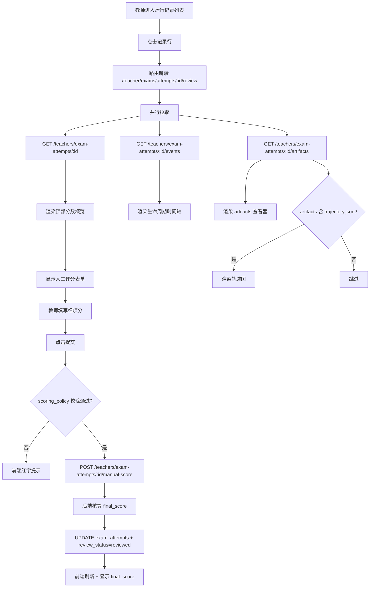
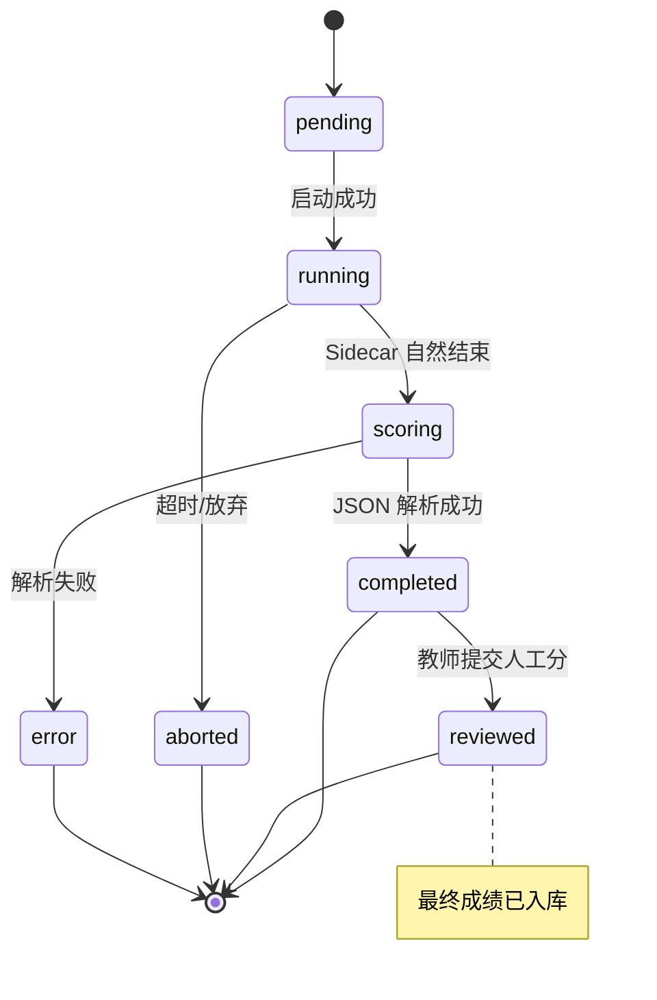

# SDD-第13期：面板策略与教师复核增强

> 版本：v1.2
> 日期：2026-04-14
> 状态：可评审 / 可执行
> 架构主路线：Sidecar + 配置驱动

---

## 0. 文档元信息

- **文档标题**：SDD-第13期：面板策略与教师复核增强
- **文档版本**：v1.2
- **创建日期**：2026-04-12
- **修订日期**：2026-04-14（v1.2：考试模式扩展部分移入 TODOS，见 TODO-13-001 ~ 004）
- **负责人**：Thouder03
- **前置依赖**：
  - 第11期：考试定义、快照、策略 JSON 字段
  - 第12期：Sidecar 执行引擎、`exam_attempts`、`result_run` 最小闭环
- **目标读者**：后端 / 前端 / 测试 / 产品 / 教学研究

---

## 1. 执行摘要

### 1.1 本期要解决的问题

1. **面板策略不生效**——第11期存储了 `panel_policy`，但学生端没有根据它过滤面板。
2. **教师复核能力薄弱**——第12期教师只能看到 JSON 原文，没有分数明细、产物查看、人工评分入口。
3. **没有最终成绩核算**——人工分写不进去，`final_score` 字段永远为空。

### 1.2 本期关键结果

1. 学生端考试页按 `panel_policy` 动态过滤可见面板（Terminal / 编辑器 / 键盘控制等）。
2. 学生端考试页"考试中"状态下的面板锁定（editor 只读、terminal 禁用等）。
3. 教师复核详情页改造为完整版：分数概览 + artifacts 查看器 + 人工评分表单。
4. 人工评分提交后自动按 `scoring_policy` 核算 `final_score` 并入库。
5. 教师可按策略覆盖客观分或修改 `pass` 标记（需 `allow_override_*` 配置）。

### 1.3 成功判定

- **SM-1**：教师复核效率——单次考试从打开详情页到完成人工评分 ≤ 3 分钟。
- **SM-2**：面板策略生效正确率 100%（禁用的面板在 Golden Layout 中不可见）。

---

## 2. 范围定义

### 2.1 In Scope

| 编号 | 交付项 |
|------|--------|
| S1 | 学生端考试模式按 `panel_policy` 过滤面板 |
| S2 | 学生端考试页"考试中"状态下的面板锁定（editor 只读、terminal 禁用等） |
| S3 | 教师端复核详情页完整版 |
| S4 | artifacts 查看器（文件列表 + 文本预览 + 图片预览） |
| S5 | 轨迹图组件（若 artifacts 含 `trajectory.json`） |
| S6 | 人工评分表单（细项评分 + 权重核算） |
| S7 | 最终成绩核算逻辑 |
| S8 | 教师覆盖客观分 / pass 标记（受 `scoring_policy.allow_override_*` 控制） |

### 2.2 Out of Scope

| 项目 | 不纳入本期原因 |
|------|---------------|
| `process_run` / `multi_stage_run` 模式完整闭环 | 已转入 TODOS（TODO-13-001 ~ 004），待专项期次实施 |
| Sidecar 阶段事件协议 / 阶段轮询器 | 同上 |
| AI 自动评语 | 需先积累数据，后续专项 |
| 考试成绩可视化仪表盘（按班级/周期聚合） | 非核心闭环 |
| 学生端查看自己历史考试详情页 | 学生端可简化为仅看结果摘要 |
| 多人协作评分 | 无此诉求 |
| 评分规则版本化 | 首版全局 `scoring_policy` 已够用 |
| 考试模板克隆 | 教师可手动复制考试 |
| 争议仲裁流程 | 线下解决 |
| rosbag 录制 / 3D 回放 | 原 SDD 已明确延后 |

---

## 3. 方案选型

### 3.1 现有资产复用

#### 3.1.1 后端复用资产

| 资产 | 路径 | 复用方式 |
|------|------|---------|
| 第11期考试定义 | `app/models/exam.py` | 读取 `panel_policy`、`scoring_policy` |
| 第12期 `ExamAttempt` | `app/models/exam_attempt.py` | 人工评分、override、final_score 写入 |
| 第12期 Result Parser | `app/core/result_parser.py` | 读取客观分 |
| 生命周期事件表 | `app/models/exam_attempt.py`（`ExamEvidenceEvent`） | 增加 manual_score_submitted / teacher_override / final_score_calculated 事件类型 |

#### 3.1.2 前端复用资产

| 资产 | 路径 | 复用方式 |
|------|------|---------|
| 第11期 `ExamDetail.vue` | `views/Teacher/Exams/ExamDetail.vue` | 补充复核能力 |
| 第11期运行记录面板 | `views/Teacher/Exams/components/AttemptList.vue` | 详情弹窗升级为独立路由页 |
| 第12期 `useExamMode` Composable | `views/Simulation/composables/useExamMode.ts` | 读取 attempt 状态，触发面板锁定 |
| 第12期 `ExamHeader.vue` | `views/Simulation/components/ExamHeader.vue` | 现有按钮状态 |
| 面板注册中心 | `views/Simulation/panels/registry.ts` | 面板策略过滤 |
| Golden Layout 桥接 | `views/Simulation/components/GLayout.vue` | 按策略动态注册面板 |
| Monaco Editor | `components/Monaco/MonacoEditor.vue` | 只读模式 + 文件预览 |
| Element Plus `el-timeline` | 全局 | 生命周期事件时间轴 |

### 3.2 面板策略生效方式比选

- **A）注册时过滤（推荐）**：Golden Layout 初始化时按 `panel_policy` 决定哪些面板进入 registry。
- **B）运行时隐藏**：所有面板都注册，运行时 CSS `display: none`。

**决策：方案 A**。学生无法通过 DevTools 取消隐藏，安全性更好，逻辑更清晰。

---

## 4. 系统交互设计

### 4.1 教师复核详情页交互流程



### 4.2 考试尝试状态机（本期相关部分）



> **说明**：`waiting_submit` 状态属于 `process_run` 模式，已移入 TODO-13-001，本期不涉及。

---

## 5. API 契约

### 5.1 教师端新增

| Endpoint | Method | Request | Response | 说明 |
|----------|--------|---------|----------|------|
| `/teachers/exam-attempts/{id}/artifacts` | GET | — | `ArtifactTree` | artifacts 目录树 |
| `/teachers/exam-attempts/{id}/artifacts/file` | GET | Query: `path` | `{content, encoding, mime}` | 读取单文件 |
| `/teachers/exam-attempts/{id}/manual-score` | POST | `ManualScoreRequest` | `AttemptFullDetail` | 提交人工评分 |
| `/teachers/exam-attempts/{id}/override` | POST | `OverrideRequest` | `AttemptFullDetail` | 教师覆盖客观分/pass |

**`ManualScoreRequest`**：

| 字段 | 类型 | 必填 | 说明 |
|------|------|------|------|
| `manual_score` | float | 是 | 综合人工分（0-100） |
| `breakdown` | object | 是 | 细项分 |
| `comment` | string | 否 | 教师评语 |

**`breakdown` 推荐字段**：

| 字段 | 说明 |
|------|------|
| `operation_quality` | 操作规范性（0-100） |
| `path_rationality` | 路径合理性 |
| `recovery_ability` | 恢复能力 |
| `stability` | 运行稳定性 |
| `extra_comment` | 附加评语 |

**`OverrideRequest`**（受 `scoring_policy.allow_override_*` 控制）：

| 字段 | 类型 | 必填 | 说明 |
|------|------|------|------|
| `objective_score` | float | 否 | 仅 `allow_override_objective=true` 时可传 |
| `pass` | bool | 否 | 仅 `allow_override_pass_flag=true` 时可传 |
| `override_reason` | string | 是 | 必填，写入审计日志 |

### 5.2 最终成绩核算规则

**公式**：

```
final_score = objective_score × scoring_policy.weight_objective
            + manual_score × scoring_policy.weight_manual
pass_final = final_score ≥ scoring_policy.pass_threshold
```

**教师覆盖场景**：

- 若 `OverrideRequest.objective_score` 存在：用覆盖值代替原 `objective_score` 重新核算。
- 若 `OverrideRequest.pass` 存在：直接覆盖 `pass` 字段（不重算分数）。
- 覆盖动作记录到 `exam_evidence_events`（`event_type=teacher_override`）。

### 5.3 错误语义映射

| 错误码 | HTTP | 语义 | 前端动作 |
|--------|------|------|---------|
| `ATTEMPT_NOT_COMPLETED` | 409 | 人工评分前考试未完成客观评分 | 禁用评分表单 |
| `OVERRIDE_NOT_ALLOWED` | 403 | 策略禁止覆盖客观分/pass | 按钮灰化 |
| `ARTIFACT_NOT_FOUND` | 404 | artifact 文件路径不存在 | 提示"文件已清理" |
| `ARTIFACT_TOO_LARGE` | 413 | 单文件超出 5MB 预览限制 | 提示"文件过大，请下载查看" |

---

## 6. 数据字典（增量）

### 6.1 `exam_attempts` 表字段使用扩展

> 本期不新增字段，但对既有字段的使用语义做增强。

| 字段 | 第12期语义 | 第13期扩展 |
|------|-----------|-----------|
| `status` | `pending/running/scoring/completed/aborted/error` | 新增 `reviewed`（教师已完成人工评分） |
| `attempt_panel_policy_json` | 第12期新增 | 学生端面板过滤与锁定逻辑读取此快照，不回读 `exams` |
| `attempt_scoring_policy_json` | 第12期新增 | 人工评分、override、final_score 核算一律读取此快照 |
| `artifact_index_json` | 第12期预留 | 本期作为数据库侧 artifacts 主索引，教师端先读该索引，再按需读取文件系统附件 |
| `manual_score` | 预留 null | 本期写入 |
| `final_score` | 预留 null | 本期核算写入 |
| `review_status` | `pending` | 提交人工分后设为 `reviewed` |
| `teacher_comment` | 预留 null | 本期写入 |

### 6.2 `exam_evidence_events` 新增事件类型

| `event_type` | 触发 | 来源 | Payload |
|-------------|------|------|---------|
| `manual_score_submitted` | 教师提交人工评分 | backend | `{teacher_id, manual_score}` |
| `teacher_override` | 教师覆盖客观分/pass | backend | `{field, old, new, reason}` |
| `final_score_calculated` | 最终成绩核算完成 | backend | `{objective, manual, final}` |

### 6.3 `artifact_index_json` 结构（第12期预留，本期落实）

> **主真相源约束**：教师复核默认以数据库中的 `objective_score`、`manual_score`、`final_score`、`exam_evidence_events`、`artifact_index_json` 为准；文件系统 `artifacts/` 仅保存原始附件，不承担复核主状态来源。

```jsonc
{
  "result": "result.json",
  "evaluation_log": "eval.log",
  "map_output": "map.pgm",
  "trajectory": "trajectory.json",
  "screenshots": ["screenshot_001.png", "screenshot_002.png"]
}
```

**填充时机**：Sidecar 完成后，后端扫描 `/opt/artifacts/` 并更新此字段。

---

## 7. 面板策略生效设计

### 7.1 面板过滤机制

`Simulation.vue` 在初始化 Golden Layout 前，根据 `panel_policy` 过滤 `panelRegistry`：

**过滤规则**：

| panel_policy 字段 | 影响的面板 key | 行为 |
|-------------------|--------------|------|
| `terminal_enabled=false` | `ContainerTerminal` | 从 registry 中删除；菜单不可见 |
| `file_tree_enabled=false` | `WorkspacePanel` | 同上 |
| `editor_enabled=false` | `WorkspacePanel`（编辑器部分） | 整个 panel 不显示；或仅禁用编辑器，保留文件树 |
| `ros_log_enabled=false` | `RosoutPanel` | 删除 |
| `ros3d_enabled=false` | `ROS3DViewer` | 删除 |
| `keyboard_control_enabled=false` | `KeyboardControl` | 删除 |
| `manual_restart_enabled=false` | — | 仅影响顶栏"重启容器"按钮 |

### 7.2 "考试进行中"状态下的额外锁定

当 `attempt.status ∈ {running, scoring}`：

| 面板 | 锁定行为 |
|------|---------|
| `WorkspacePanel` 编辑器 | Monaco Editor 设为只读（`readOnly: true`） |
| `ContainerTerminal` | 根据 `allow_debug_during_exam` 决定：禁用输入或保留 |
| `KeyboardControl` | 始终允许（这是考试操作手段） |
| 顶栏"关闭容器"按钮 | 禁用 |

**实现要点**：`useExamMode` Composable 暴露 `isExamLocked` 计算属性，各面板组件监听该状态。

---

## 8. 教师复核详情页设计

### 8.1 路由

```
/teacher/exams/attempts/:attempt_id/review    ← 新增独立路由
```

**注意**：此路由替代第12期的"弹窗式详情"。列表页点击行 → 跳转到此页。

### 8.2 页面布局

```
┌──────────────────────────────────────────────────────────────────────────┐
│  ← 返回   考试复核 - 张三 / 自动导航考试 #101                            │
├──────────────────────────────────────────────────────────────────────────┤
│  ┌───────────────┐ ┌───────────────┐ ┌───────────────┐ ┌───────────────┐ │
│  │ 客观分        │ │ 人工分        │ │ 最终分        │ │ Pass          │ │
│  │    85         │ │    -          │ │    -          │ │  ✅ 是        │ │
│  └───────────────┘ └───────────────┘ └───────────────┘ └───────────────┘ │
├──────────────────────────────────────────────────────────────────────────┤
│  ┌─────────────────────────────────┐  ┌───────────────────────────────┐  │
│  │ 📈 指标摘要                      │  │ 📝 人工评分                    │  │
│  │ • 总耗时：82.3s                  │  │ ┌───────────────────────────┐ │  │
│  │ • 碰撞次数：1                   │  │ │ 操作规范性 [████░] 80     │ │  │
│  │ • 目标到达：✅                  │  │ │ 路径合理性 [█████] 90     │ │  │
│  │                                 │  │ │ 恢复能力   [████░] 85     │ │  │
│  │ 📂 artifacts                    │  │ │ 运行稳定性 [█████] 95     │ │  │
│  │ ├ result.json    [预览]          │  │ │                           │ │  │
│  │ ├ eval.log       [预览]          │  │ │ 综合人工分：[  88  ]      │ │  │
│  │ ├ trajectory.json[查看轨迹]       │  │ │ 教师评语：                │ │  │
│  │ └ screenshot.png [预览]          │  │ │ [_________________]        │ │  │
│  └─────────────────────────────────┘  │ │                           │ │  │
│                                        │ │ [提交评分]                 │ │  │
│                                        │ └───────────────────────────┘ │  │
│                                        │ ⚙ 高级：覆盖客观分/pass       │  │
│                                        └───────────────────────────────┘  │
├──────────────────────────────────────────────────────────────────────────┤
│  📅 生命周期时间轴                                                        │
│  ──●──●──●──●──●──●──→                                                   │
│   创建 开始 快照 启动 完成 入库                                            │
│                                                                          │
│  点击事件 → 显示详情                                                      │
└──────────────────────────────────────────────────────────────────────────┘
```

### 8.3 子组件拆分

| 组件 | 职责 |
|------|------|
| `ReviewHeader.vue` | 返回按钮 + 考试名 |
| `ScoreOverview.vue` | 四个分数卡片 |
| `MetricsSummary.vue` | 指标摘要（从 `result_json.metrics` 渲染） |
| `ArtifactsExplorer.vue` | artifacts 列表 + 点击预览 |
| `ArtifactPreviewDialog.vue` | 文件预览弹窗（Monaco 文本 / 图片 / JSON 结构） |
| `TrajectoryCanvas.vue` | 轨迹图 Canvas（若 artifacts 含 trajectory.json） |
| `ManualScoreForm.vue` | 人工评分表单 |
| `ScoreOverrideDrawer.vue` | 覆盖客观分/pass 抽屉（默认折叠） |
| `LifecycleTimeline.vue` | 生命周期事件时间轴 |

### 8.4 轨迹图规格（可选能力）

**前提**：artifacts 含 `trajectory.json`，格式约定：

```jsonc
{
  "points": [
    {"t": 0,     "x": 0.0, "y": 0.0, "theta": 0},
    {"t": 1000,  "x": 0.2, "y": 0.1, "theta": 0.1}
  ],
  "start": {"x": 0, "y": 0},
  "goal":  {"x": 5, "y": 3},
  "collisions": [{"t": 15000, "x": 2.1, "y": 1.5}]
}
```

**渲染引擎**：原生 Canvas 2D（不引入图表库）。

**要素**：
- 轨迹折线（按时间顺序连接点）
- 起点（绿色 "S"）、目标点（绿色旗帜 "G"）
- 碰撞点（红色圆点，hover 显示详情）
- 自适应画布尺寸（fit + padding）

> 若脚本未输出 `trajectory.json`，本组件不渲染，其他区域正常显示。

### 8.5 artifacts 预览规则

| mime / 扩展名 | 预览方式 |
|--------------|---------|
| `.json` / `.yaml` / `.txt` / `.log` / `.md` / `.csv` / `.sh` / `.py` | Monaco 只读 |
| `.png` / `.jpg` / `.gif` / `.webp` | `` 渲染 |
| `.pgm` 地图文件 | 首版只提供下载（后续期次可添加转换预览） |
| 其他 | 显示"不支持预览" + 下载按钮 |

**限制**：单文件预览上限 5MB，超出返回 413 + 下载提示。

---

## 9. 安全与边界约束

| 风险点 | 威胁描述 | 防护 | 验证 |
|--------|---------|------|------|
| artifact 路径穿越 | 预览接口查询 `?path=../../etc/passwd` | 后端路径归一化 + 白名单根目录 | 安全测试 |
| artifact 大文件 | 预览大文件阻塞 | 5MB 限制 | — |
| 人工评分数据篡改 | 教师提交非法分数 | Pydantic Schema 校验 (0-100) + scoring_policy 允许列表校验 | 单元测试 |
| 教师越权覆盖 | 策略禁止时仍调用 override | 后端强制校验 `scoring_policy.allow_override_*` | 集成测试 |

---

## 10. 异常、恢复与可观测性

### 10.1 失败模式登记

| Codepath | 失败模式 | 已处理? | 用户可见? | 日志? | 测试? |
|----------|---------|--------|----------|-------|-------|
| 轨迹 JSON 格式错误 | 渲染异常 | Y | 显示"轨迹数据损坏" | Y | Y |
| 人工评分提交时 attempt 已被归档 | 状态冲突 | Y | 提示"考试已归档" | Y | Y |
| 覆盖客观分时策略禁止 | 策略校验 | Y | 按钮灰化 + 403 | Y | Y |
| artifact 文件过大 | 预览 413 | Y | 提示下载 | Y | Y |
| 核算时 manual_score 缺失 | 公式异常 | Y | 回退为 `final=objective`（单分数） | Y | Y |
| artifacts 丢失 | 文件系统缺失 | Y | 显示"文件已清理/丢失"，分数仍可读 | Y | — |

### 10.2 错误恢复

| 场景 | 降级 | 重试 | 终态 |
|------|------|------|------|
| 轨迹图渲染异常 | Canvas 空白 + 提示 | — | 不影响复核流程 |
| artifacts 预览失败 | 显示错误 + 下载按钮 | — | — |
| 最终成绩核算异常 | 保持 final_score=null + 记录 error | 教师可手动重试 | — |

### 10.3 Runbook

#### 10.3.1 `result.json` 非法
1. 固定保留数据库里的失败摘要、`error_code`、`error_message` 与 `invalid_result_json` 事件，作为审计记录。
2. 打开文件系统原始 `result.json` 与 stderr 片段，确认是脚本输出格式错误还是截断写入。
3. 若为脚本问题，修脚本后仅影响后续新 attempt；禁止回写历史 attempt 的结果快照。
4. 如需复核，教师端显示失败原因和原始附件下载入口，不伪装成"正常完成"。

#### 10.3.2 artifacts 丢失
1. 先以数据库 `artifact_index_json` 判断该 attempt 理论上应有哪些附件，再检查文件系统是否缺失。
2. 若数据库有索引但磁盘文件缺失，教师端显示"文件已清理/丢失"，但分数、事件摘要仍以数据库快照继续可读。
3. 记录 `system_error` 事件并排查宿主机清理策略、目录权限、磁盘配额。
4. 禁止因附件缺失而直接修改历史分数；只允许补充运维说明。

### 10.4 可观测性

- **关键日志字段**：`attempt_id`, `teacher_id`, `action`, `error_code`
- **核心指标**：
  - 人工评分提交率（reviewed / completed）
  - 教师覆盖客观分次数
  - artifacts 预览失败率
- **告警建议**：
  - 人工评分 72 小时未提交率 > 50%

---

## 11. 测试与验收

### 11.1 测试覆盖地图

| 流程/分支 | 类型 | 要点 | 通过标准 |
|----------|------|------|---------|
| 面板策略生效 | 前端单元（Vitest + Vue Test Utils） | panel_policy 配置组合 | registry 正确过滤 |
| 考试中编辑器锁定 | 前端集成（Vitest + Vue Test Utils） | 进入 running 状态 | Monaco readOnly=true |
| 教师复核页主流程 | E2E（Playwright） | 进入 review 页 → 预览 artifacts → 提交人工评分 | final_score 刷新且 review_status=reviewed |
| 人工评分提交 | 集成 | 正常提交 | final_score 正确 + reviewed |
| 覆盖客观分（允许） | 集成 | allow_override_objective=true | 重算 final_score |
| 覆盖客观分（禁止） | 集成 | allow_override_objective=false | 403 |
| artifact 预览（json） | 集成 | 预览 result.json | Monaco 渲染 |
| artifact 预览（图片） | 集成 | 预览 PNG | img 渲染 |
| artifact 预览（路径穿越） | 安全 | path=../../etc/passwd | 403 |
| 轨迹图渲染 | 前端单元 | 有效 trajectory.json | Canvas 正确绘制 |
| 轨迹图缺失 | 前端单元 | artifacts 无 trajectory | 不渲染，不报错 |

### 11.2 验收标准

#### 11.2.1 功能验收

- [ ] 学生端面板按 panel_policy 正确过滤
- [ ] 考试进行中编辑器进入只读
- [ ] 教师端复核页四个分数卡片正确显示
- [ ] artifacts 目录可浏览、文本/图片可预览
- [ ] 人工评分提交后 final_score 立即更新

#### 11.2.2 一致性验收

- [ ] scoring_policy 各字段的"允许/禁止"在前后端一致
- [ ] `attempt_panel_policy_json` 快照与运行时实际使用的面板策略一致，不回读 `exams.panel_policy_json`
- [ ] `attempt_scoring_policy_json` 与人工评分、核算逻辑一致，不回读 `exams.scoring_policy_json`

#### 11.2.3 稳定性验收

- [ ] 教师复核页在 100+ 生命周期事件下渲染流畅（无卡顿）

---

## 12. 实施交付清单

### 12.1 后端交付

**新增文件**：

| 路径 | 说明 |
|------|------|
| `app/core/final_score_calculator.py` | 最终成绩核算器（读取 attempt 级 scoring policy 快照） |
| `app/api/v1/endpoints/teacher/exam_attempts_review.py` | 复核专用 API（数据库快照主视图 + artifacts / manual-score / override ） |

**修改文件**：

| 路径 | 修改 |
|------|------|
| `app/models/exam_attempt.py` | 新增 `reviewed` 状态值 |
| `app/schemas/exam_attempt.py` | ManualScoreRequest / OverrideRequest |

### 12.2 前端交付

**新增文件**：

| 路径 | 说明 |
|------|------|
| `src/views/Teacher/Exams/ExamAttemptReview.vue` | 教师复核详情页（取代第12期弹窗式详情） |
| `src/views/Teacher/Exams/components/ScoreOverview.vue` | 分数概览 |
| `src/views/Teacher/Exams/components/MetricsSummary.vue` | 指标摘要 |
| `src/views/Teacher/Exams/components/ArtifactsExplorer.vue` | artifacts 列表 |
| `src/views/Teacher/Exams/components/ArtifactPreviewDialog.vue` | 预览弹窗 |
| `src/views/Teacher/Exams/components/TrajectoryCanvas.vue` | 轨迹图 |
| `src/views/Teacher/Exams/components/ManualScoreForm.vue` | 人工评分表单 |
| `src/views/Teacher/Exams/components/ScoreOverrideDrawer.vue` | 覆盖抽屉 |
| `src/views/Teacher/Exams/components/LifecycleTimeline.vue` | 生命周期时间轴 |
| `src/views/Simulation/composables/usePanelPolicy.ts` | 面板策略过滤逻辑 |

**修改文件**：

| 路径 | 修改 |
|------|------|
| `src/router/index.ts` | 新增 `/teacher/exams/attempts/:id/review` 路由 |
| `src/views/Simulation/Simulation.vue` | 集成 usePanelPolicy + 考试锁定 |
| `src/views/Simulation/panels/WorkspacePanel/index.vue` | 监听 `isExamLocked` → Monaco `readOnly` |
| `src/views/Simulation/panels/ContainerTerminal/index.vue` | 监听 `isExamLocked` + `allow_debug_during_exam` |
| `src/views/Teacher/Exams/ExamDetail.vue` | 列表点击行 → 跳转 review 页（替代弹窗） |
| `src/api/exam/attempts.ts` | 新增 artifacts / manual-score / override |
| `app/api/v1/endpoints/common/auth.py` → `get_user_routes` | 追加 `/teacher/exams/attempts/:id/review` |

---

## 13. Deferred（后续期次）

| 延后项 | 延后原因 | 触发条件 |
|--------|---------|---------|
| `process_run` / `multi_stage_run` 模式 | 已转入 TODOS（TODO-13-001 ~ 004） | 专项期次 |
| AI 自动评语 | 数据不足 | 历史评分 > 500 条 |
| 评分仪表盘（按班级聚合） | 非核心闭环 | 明确教学管理需求 |
| 评分规则版本化（全局） | 首版全局 policy 够用 | 跨学期规则变更需要 |
| 争议仲裁工作流 | 线下解决 | 争议比例 > 10% |
| rosbag 录制 | 原方案明确延后 | 复核需要原始数据 |
| 3D 历史回放 | 成本高 | 2D 轨迹图不够用 |
| 学生端历史考试详情页 | 首版仅看结果摘要 | 学生明确需求 |
| 考试克隆 / 模板化 | 教师可手动复制 | 重复配置成本高 |
| 多教师协作评分 | 无诉求 | — |
| `.pgm` 地图文件在线预览 | 需后端格式转换 | 明确教师需求 |

---

## 14. 附录

### 14.1 规范—代码映射

| 规范项 | 代码路径 |
|--------|---------|
| 最终成绩核算器 | `edubot-twin-server/app/core/final_score_calculator.py` |
| 复核 API | `edubot-twin-server/app/api/v1/endpoints/teacher/exam_attempts_review.py` |
| 教师复核页 | `edubot-twin-web/src/views/Teacher/Exams/ExamAttemptReview.vue` |
| 轨迹图组件 | `edubot-twin-web/src/views/Teacher/Exams/components/TrajectoryCanvas.vue` |
| 人工评分表单 | `edubot-twin-web/src/views/Teacher/Exams/components/ManualScoreForm.vue` |
| 面板策略 Composable | `edubot-twin-web/src/views/Simulation/composables/usePanelPolicy.ts` |

### 14.2 术语表

| 术语 | 定义 |
|------|------|
| Panel Policy | 控制学生端考试页可见面板的策略 |
| Artifacts Explorer | 教师端 artifacts 文件浏览器 |
| Manual Override | 教师覆盖客观分或 pass 标记 |
| Final Score | 客观分 + 人工分按权重核算后的最终成绩 |
| Review Status | 复核状态（pending / reviewed） |

### 14.3 变更记录

| 版本 | 日期 | 变更 | 负责人 |
|------|------|------|--------|
| v1.0 | 2026-04-10 | 初版（基于 v1.1 Sidecar 架构） | Thouder03 |
| v1.1 | 2026-04-12 | CEO审查 | Thouder03 |
| v1.2 | 2026-04-14 | 将考试模式扩展部分（process_run / multi_stage_run / 阶段事件协议）移入 TODOS（TODO-13-001 ~ 004），本期范围聚焦面板策略与教师复核 | Thouder03 |
