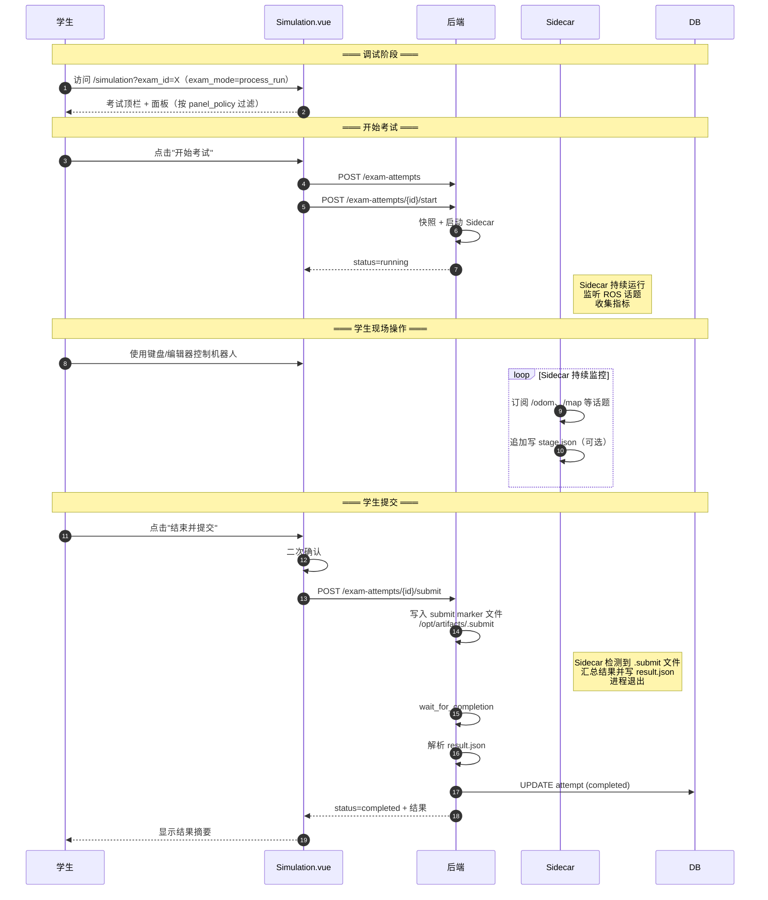
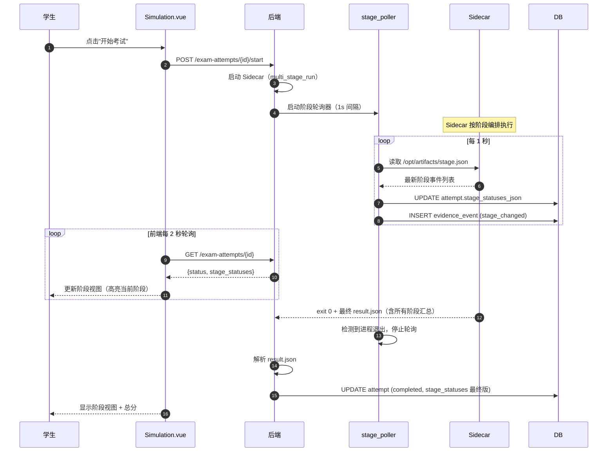
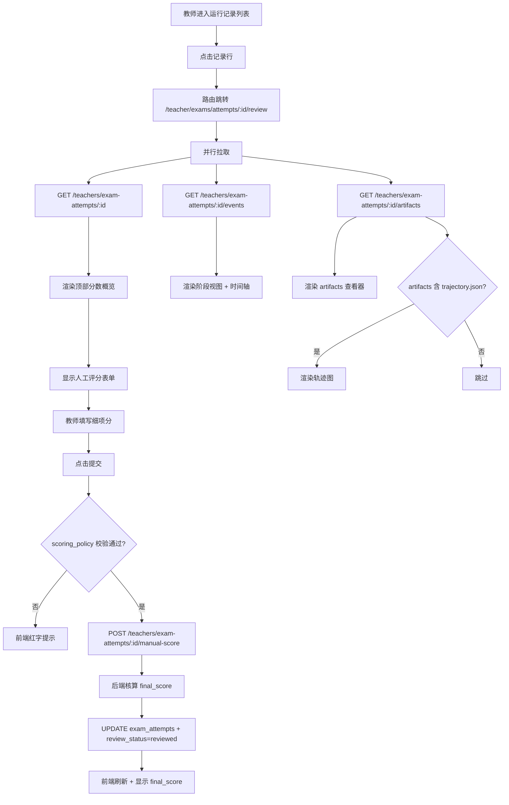
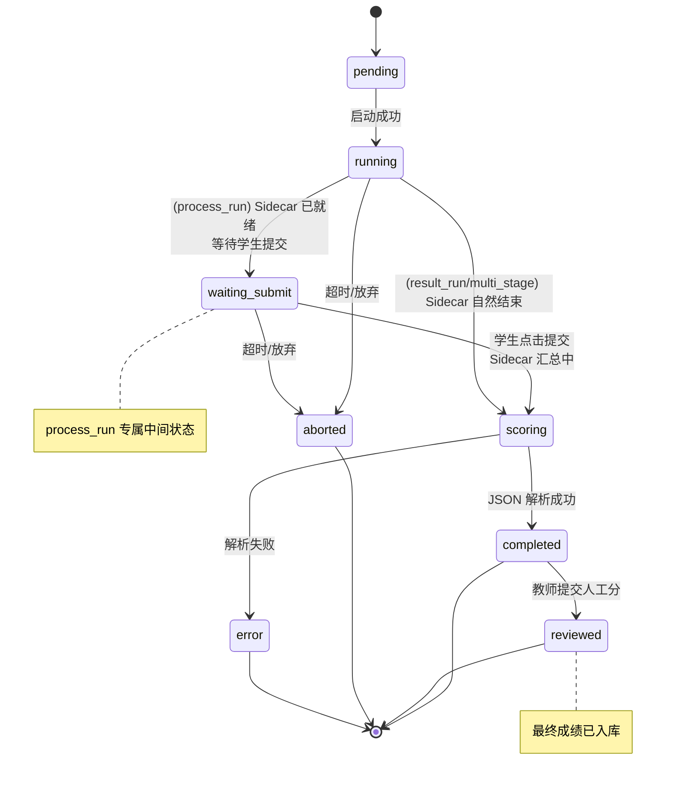

# SDD-第13期：考试模式扩展、面板策略与教师复核增强

> 版本：v1.0
> 日期：2026-04-10
> 状态：可评审 / 可执行
> 架构主路线：Sidecar + 考试模式 + 配置驱动

---

## 0. 文档元信息

- **文档标题**：SDD-第13期：考试模式扩展、面板策略与教师复核增强
- **文档版本**：v1.1
- **创建日期**：2026-04-12
- **负责人**：Thouder03
- **前置依赖**：
  - 第11期：考试定义、快照、策略 JSON 字段
  - 第12期：Sidecar 执行引擎、`exam_attempts`、`result_run` 最小闭环
- **目标读者**：后端 / 前端 / 测试 / 产品 / 教学研究

---

## 1. 执行摘要

### 1.1 本期要解决的问题

1. **只支持 `result_run`**——SLAM 建图、遥控、综合测试场景无法落地。
2. **面板策略不生效**——第11期存储了 `panel_policy`，但学生端没有根据它过滤面板。
3. **教师复核能力薄弱**——第12期教师只能看到 JSON 原文，没有分数明细、阶段视图、产物查看、人工评分入口。
4. **没有最终成绩核算**——人工分写不进去，`final_score` 字段永远为空。
5. **缺少阶段事件协议**——`multi_stage_run` 的阶段切换无法实时推送给前端。

### 1.2 本期关键结果

1. 学生端支持三种考试模式：`result_run`、`process_run`、`multi_stage_run`。
2. 学生端考试页按 `panel_policy` 动态过滤可见面板（Terminal/编辑器/键盘控制等）。
3. Sidecar 支持阶段事件协议（`stage.json` 流），平台透传到前端实现阶段进度条。
4. 教师复核详情页改造为完整版：分数概览 + 阶段视图 + artifacts 查看器 + 轨迹可视化（可选）+ 人工评分表单。
5. 人工评分提交后自动按 `scoring_policy` 核算 `final_score` 并入库。
6. 教师可按策略覆盖客观分或修改 `pass` 标记（需 `allow_override_*` 配置）。

### 1.3 成功判定

- **SM-1**：三种模式端到端运行成功率 ≥ 90%（`result_run` 单独 ≥ 95%）。
- **SM-2**：阶段事件实时性：从 Sidecar 触发到前端显示 ≤ 2 秒。
- **SM-3**：教师复核效率——单次考试从打开详情页到完成人工评分 ≤ 3 分钟。
- **SM-4**：面板策略生效正确率 100%（禁用的面板在 Golden Layout 中不可见）。

---

## 2. 范围定义

### 2.1 In Scope

| 编号 | 交付项 |
|------|--------|
| S1 | `process_run` 模式的完整闭环（学生端"开始 → 结束并提交"） |
| S2 | `multi_stage_run` 模式的完整闭环（阶段事件 + 阶段视图） |
| S3 | Sidecar 阶段事件协议（`stage.json` 追加写文件） |
| S4 | 后端阶段事件轮询器（读取 `stage.json` → 更新 `stage_statuses_json`） |
| S5 | 学生端考试模式按 `panel_policy` 过滤面板 |
| S6 | 学生端考试页"考试中"状态下的面板锁定（editor 只读、terminal 禁用等） |
| S7 | 教师端复核详情页完整版 |
| S8 | 阶段视图 UI 组件（`StageTimeline.vue`） |
| S9 | artifacts 查看器（文件列表 + 文本预览 + 图片预览） |
| S10 | 轨迹图组件（若 artifacts 含 `trajectory.json`） |
| S11 | 人工评分表单（细项评分 + 权重核算） |
| S12 | 最终成绩核算逻辑 |
| S13 | 教师覆盖客观分 / pass 标记（受 `scoring_policy.allow_override_*` 控制） |
| S14 | 教师批量导出考试成绩（CSV） |

### 2.2 Out of Scope

| 项目 | 不纳入本期原因 |
|------|---------------|
| AI 自动评语 | 需先积累数据，后续专项 |
| 考试成绩可视化仪表盘（按班级/周期聚合） | 非核心闭环 |
| 学生端查看自己历史考试详情页 | 学生端可简化为仅看结果摘要 |
| 多人协作评分 | 无此诉求 |
| 评分规则版本化 | 首版全局 `scoring_policy` 已够用 |
| 考试模板克隆 | 教师可手动复制考试 |
| 争议仲裁流程 | 线下解决 |
| rosbag 录制 / 3D 回放 | 原 SDD 已明确延后 |

---

## 3. 前提挑战与方案比选

### 3.1 前提挑战

**为什么 `process_run` 和 `multi_stage_run` 不在第12期一起实现？**

答：
1. `result_run` 只需"一次启动一次结束"，Sidecar 最简；
2. `process_run` 需要 Sidecar 持续监控、学生手动触发结束；
3. `multi_stage_run` 需要阶段事件流、阶段 UI、阶段分汇总；
4. 把三种模式全塞一期会超出单次对话工作量，且调试难度巨大。

**阶段事件协议为什么不用 WebSocket 或 gRPC？**

答：Sidecar 是独立容器，不参与主后端通信协议；最简单的方式是"约定文件 + 定时轮询"，Sidecar 仅需追加写 `/opt/artifacts/stage.json`，后端每秒读取一次。这与 rosbag 写入原理类似，可靠、易调试、无额外依赖。

### 3.2 现有资产复用

#### 3.2.1 后端复用资产

| 资产 | 路径 | 复用方式 |
|------|------|---------|
| 第11期考试定义 | `app/models/exam.py` | 读取 `panel_policy`、`scoring_policy` |
| 第12期 `ExamAttempt` | `app/models/exam_attempt.py` | 扩展 `stage_statuses_json` 使用 |
| 第12期 Sidecar Manager | `app/core/sidecar_manager.py` | 扩展 `poll_stage_events` 方法 |
| 第12期 Result Parser | `app/core/result_parser.py` | 扩展多阶段 JSON schema 校验 |
| 生命周期事件表 | `app/models/exam_attempt.py`（`ExamEvidenceEvent`） | 增加阶段事件类型 |

#### 3.2.2 前端复用资产

| 资产 | 路径 | 复用方式 |
|------|------|---------|
| 第11期 `ExamDetail.vue` | `views/Teacher/Exams/ExamDetail.vue` | 补充复核能力 |
| 第11期考试详情运行记录面板 | `views/Teacher/Exams/components/AttemptList.vue` | 详情弹窗升级为独立路由页 |
| 第12期 `useExamMode` Composable | `views/Simulation/composables/useExamMode.ts` | 扩展阶段状态 |
| 第12期 `ExamHeader.vue` | `views/Simulation/components/ExamHeader.vue` | 扩展按钮状态 |
| 面板注册中心 | `views/Simulation/panels/registry.ts` | 面板策略过滤 |
| Golden Layout 桥接 | `views/Simulation/components/GLayout.vue` | 按策略动态注册面板 |
| Monaco Editor | `components/Monaco/MonacoEditor.vue` | 只读模式 + 文件预览 |
| Element Plus `el-timeline` | 全局 | 阶段视图基础 |

### 3.3 方案比选

#### 阶段事件传输：A/B/C

- **A）约定文件 + 后端轮询（推荐）**：Sidecar 追加写 `stage.json`，后端每秒读取，数据库更新后前端轮询 `GET /attempts/{id}`。
- **B）Sidecar → 后端 HTTP 回调**：Sidecar 容器启动时注入后端 URL，脚本主动 POST 阶段事件。
- **C）WebSocket 直连**：前端直接与 Sidecar 容器 WS 通信。

**决策：方案 A**。

理由：
1. Sidecar 镜像无额外依赖（HTTP client 是 B 的前提）；
2. Sidecar 可能无网络访问后端的权限（共享主容器 network 时路由不清晰）；
3. 约定文件方式 Sidecar 崩溃后仍可事后读取部分阶段历史（比网络回调更可靠）；
4. 1 秒轮询精度对 UI 已足够。

#### 面板策略生效方式：A/B

- **A）注册时过滤（推荐）**：Golden Layout 初始化时按 `panel_policy` 决定哪些面板进入 registry。
- **B）运行时隐藏**：所有面板都注册，运行时 CSS `display: none`。

**决策：方案 A**。学生无法通过 DevTools 取消隐藏，安全性更好，逻辑更清晰。

---

## 4. 系统交互设计

### 4.1 process_run 模式时序图



### 4.2 multi_stage_run 模式时序图



### 4.3 教师复核详情页交互流程



### 4.4 扩展后的考试尝试状态机



**新增状态说明**：

| 状态 | 仅 process_run | 说明 |
|------|--------------|------|
| `waiting_submit` | ✓ | Sidecar 已启动并进入监控状态，等待学生点击"结束并提交" |
| `reviewed` | — | 教师已提交人工评分，`final_score` 已入库 |

---

## 5. API 契约

### 5.1 学生端新增/修改

| Endpoint | Method | 鉴权 | Request | Response | 状态码 |
|----------|--------|------|---------|----------|--------|
| `/students/exam-attempts/{id}/submit` | POST | student | — | `AttemptDetail` | 200 / 409 |

**触发条件**：`process_run` 模式下，状态为 `running` 或 `waiting_submit`。

**行为**：
1. 在 Sidecar 的 artifacts 目录写入 `.submit` 标记文件
2. 更新 attempt 状态为 `scoring`（触发 Sidecar 自己读取 marker 并汇总）
3. 后端继续监控 Sidecar 直到 exit
4. **该端点必须是幂等的**：若第一次提交已成功写入 marker 或 attempt 已进入 `scoring/completed/reviewed`，后续重复调用返回当前 attempt 状态与相同结果摘要，不因双击、断网重试、刷新重放而报错

### 5.2 教师端新增

| Endpoint | Method | Request | Response | 说明 |
|----------|--------|---------|----------|------|
| `/teachers/exam-attempts/{id}/artifacts` | GET | — | `ArtifactTree` | artifacts 目录树 |
| `/teachers/exam-attempts/{id}/artifacts/file` | GET | Query: `path` | `{content, encoding, mime}` | 读取单文件 |
| `/teachers/exam-attempts/{id}/manual-score` | POST | `ManualScoreRequest` | `AttemptFullDetail` | 提交人工评分 |
| `/teachers/exam-attempts/{id}/override` | POST | `OverrideRequest` | `AttemptFullDetail` | 教师覆盖客观分/pass |
| `/teachers/exams/{exam_id}/attempts/export` | GET | Query: filters | `text/csv` | 批量导出成绩 |

**`ManualScoreRequest`**：

| 字段 | 类型 | 必填 | 说明 |
|------|------|------|------|
| `manual_score` | float | 是 | 综合人工分（0-100） |
| `breakdown` | object | 是 | 细项分 |
| `comment` | string | 否 | 教师评语 |

**`breakdown` 推荐字段**：

| 字段 | 说明 |
|------|------|
| `operation_quality` | 操作规范性（0-100） |
| `path_rationality` | 路径合理性 |
| `recovery_ability` | 恢复能力 |
| `stability` | 运行稳定性 |
| `extra_comment` | 附加评语 |

**`OverrideRequest`**（受 `scoring_policy.allow_override_*` 控制）：

| 字段 | 类型 | 必填 | 说明 |
|------|------|------|------|
| `objective_score` | float | 否 | 仅 `allow_override_objective=true` 时可传 |
| `pass` | bool | 否 | 仅 `allow_override_pass_flag=true` 时可传 |
| `override_reason` | string | 是 | 必填，写入审计日志 |

### 5.3 最终成绩核算规则

**公式**：

```
final_score = objective_score × scoring_policy.weight_objective
            + manual_score × scoring_policy.weight_manual
pass_final = final_score ≥ scoring_policy.pass_threshold
```

**教师覆盖场景**：

- 若 `OverrideRequest.objective_score` 存在：用覆盖值代替原 `objective_score` 重新核算。
- 若 `OverrideRequest.pass` 存在：直接覆盖 `pass` 字段（不重算分数）。
- 覆盖动作记录到 `exam_evidence_events` (`event_type=teacher_override`)。

### 5.4 错误语义映射

| 错误码 | HTTP | 语义 | 前端动作 |
|--------|------|------|---------|
| `INVALID_EXAM_MODE_ACTION` | 409 | 动作与考试模式不匹配（如 result_run 调 /submit） | 前端按钮屏蔽 |
| `ATTEMPT_NOT_COMPLETED` | 409 | 人工评分前考试未完成客观评分 | 禁用评分表单 |
| `OVERRIDE_NOT_ALLOWED` | 403 | 策略禁止覆盖客观分/pass | 按钮灰化 |
| `ARTIFACT_NOT_FOUND` | 404 | artifact 文件路径不存在 | 提示"文件已清理" |
| `ARTIFACT_TOO_LARGE` | 413 | 单文件超出 5MB 预览限制 | 提示"文件过大，请下载查看" |

---

## 6. 数据字典（增量）

### 6.1 `exam_attempts` 表字段使用扩展

> 本期不新增字段，但对既有字段的使用语义做增强。

| 字段 | 第12期语义 | 第13期扩展 |
|------|-----------|-----------|
| `status` | `pending/running/scoring/completed/aborted/error` | 新增 `waiting_submit`、`reviewed` |
| `attempt_exam_mode` | 第12期新增 | 第13期继续作为复核与前端展示的唯一模式快照来源 |
| `attempt_runtime_policy_json` | 第12期新增 | process_run 超时、倒计时、交互边界均读取此快照 |
| `attempt_panel_policy_json` | 第12期新增 | 学生端面板过滤与锁定逻辑读取此快照，不回读 `exams` |
| `attempt_scoring_policy_json` | 第12期新增 | 人工评分、override、final_score 核算一律读取此快照 |
| `stage_statuses_json` | 默认 `[]`（result_run 不使用） | multi_stage_run 下由后端阶段轮询器更新，并固化为数据库复核主视图 |
| `artifact_index_json` | 第12期预留 | 本期作为数据库侧 artifacts 主索引，教师端先读该索引，再按需读取文件系统附件 |
| `manual_score` | 预留 null | 本期写入 |
| `final_score` | 预留 null | 本期核算写入 |
| `review_status` | `pending` | 提交人工分后设为 `reviewed` |
| `teacher_comment` | 预留 null | 本期写入 |

### 6.2 `stage_statuses_json` 结构

```jsonc
[
  {
    "stage_key": "line_following",
    "stage_name": "巡线阶段",
    "status": "completed",            // pending / running / completed / failed
    "score": 40,
    "started_at_ms": 1712345678000,
    "ended_at_ms": 1712345714000,
    "elapsed_ms": 36000,
    "metrics": {
      "elapsed_seconds": 35.2,
      "line_loss_count": 1
    },
    "message": "巡线完成，1 次丢线"
  },
  {
    "stage_key": "return_to_origin",
    "stage_name": "返航阶段",
    "status": "running",
    "started_at_ms": 1712345714000,
    "metrics": {}
  }
]
```

### 6.3 Sidecar `stage.json` 协议

**文件位置**：`/opt/artifacts/stage.json`

**格式**：JSON Lines（每行一个事件，追加写入）

```
{"ts": 1712345678000, "stage_key": "line_following", "event": "started", "stage_name": "巡线阶段"}
{"ts": 1712345714000, "stage_key": "line_following", "event": "completed", "score": 40, "metrics": {"line_loss_count": 1}, "message": "巡线完成"}
{"ts": 1712345714100, "stage_key": "return_to_origin", "event": "started", "stage_name": "返航阶段"}
{"ts": 1712345760000, "stage_key": "return_to_origin", "event": "completed", "score": 42, "metrics": {"goal_reached": true}}
```

**事件类型**：

| `event` | 语义 |
|---------|------|
| `started` | 阶段开始，必填 `stage_key` + `stage_name` |
| `completed` | 阶段成功完成，必填 `score` |
| `failed` | 阶段失败 |
| `progress` | 阶段进度更新（可选，用于长阶段） |

### 6.4 `exam_evidence_events` 新增事件类型

| `event_type` | 触发 | 来源 | Payload |
|-------------|------|------|---------|
| `stage_started` | 后端阶段轮询器检测到新阶段 | backend (via sidecar) | `{stage_key, stage_name}` |
| `stage_completed` | 同上 | backend | `{stage_key, score, metrics}` |
| `stage_failed` | 同上 | backend | `{stage_key, reason}` |
| `student_submitted` | process_run 下学生点击提交 | backend | `{}` |
| `manual_score_submitted` | 教师提交人工评分 | backend | `{teacher_id, manual_score}` |
| `teacher_override` | 教师覆盖客观分/pass | backend | `{field, old, new, reason}` |
| `final_score_calculated` | 最终成绩核算完成 | backend | `{objective, manual, final}` |

### 6.5 `artifact_index_json` 结构（第12期预留，本期落实）

> **主真相源约束**：教师复核默认以数据库中的 `objective_score`、`manual_score`、`final_score`、`stage_statuses_json`、`exam_evidence_events`、`artifact_index_json` 为准；文件系统 `artifacts/` 仅保存原始附件，不承担复核主状态来源。

```jsonc
{
  "result": "result.json",
  "stage": "stage.json",
  "trajectory": "trajectory.json",
  "evaluation_log": "eval.log",
  "map_output": "map.pgm",
  "screenshots": ["screenshot_001.png", "screenshot_002.png"]
}
```

**填充时机**：Sidecar 完成后，后端扫描 `/opt/artifacts/` 并更新此字段。

---

## 7. 面板策略生效设计

### 7.1 面板过滤机制

`Simulation.vue` 在初始化 Golden Layout 前，根据 `panel_policy` 过滤 `panelRegistry`：

**过滤规则**：

| panel_policy 字段 | 影响的面板 key | 行为 |
|-------------------|--------------|------|
| `terminal_enabled=false` | `ContainerTerminal` | 从 registry 中删除；菜单不可见 |
| `file_tree_enabled=false` | `WorkspacePanel` | 同上 |
| `editor_enabled=false` | `WorkspacePanel`（编辑器部分） | 可选：整个 panel 不显示；或仅禁用编辑器，保留文件树 |
| `ros_log_enabled=false` | `RosoutPanel` | 删除 |
| `ros3d_enabled=false` | `ROS3DViewer` | 删除 |
| `keyboard_control_enabled=false` | `KeyboardControl` | 删除 |
| `manual_restart_enabled=false` | — | 仅影响顶栏"重启容器"按钮 |
| `task_status_panel_enabled=true` | `TaskStatusPanel`（新） | 注入阶段视图面板 |

### 7.2 "考试进行中"状态下的额外锁定

当 `attempt.status ∈ {running, waiting_submit, scoring}`：

| 面板 | 锁定行为 |
|------|---------|
| `WorkspacePanel` 编辑器 | Monaco Editor 设为只读（`readOnly: true`） |
| `ContainerTerminal` | 根据 `allow_debug_during_exam` 决定：禁用输入或保留 |
| `KeyboardControl` | 始终允许（这是考试操作手段） |
| 顶栏"关闭容器"按钮 | 禁用 |

**实现要点**：`useExamMode` Composable 暴露 `isExamLocked` 计算属性，各面板组件监听该状态。

### 7.3 新增面板：`TaskStatusPanel`（阶段视图）

**用途**：multi_stage_run 模式专用，展示 Sidecar 当前阶段进度。

**布局**：

```
┌──────────────────────────────────────┐
│  阶段进度                              │
├──────────────────────────────────────┤
│  ● ───── 巡线阶段       ✅ 40/50      │
│  │                                   │
│  ● ───── 返航阶段       🔄 运行中     │
│  │                                   │
│  ○ ───── 到达检查       ⏳ 待开始     │
│                                      │
│  总分（暂计）：40                      │
└──────────────────────────────────────┘
```

**数据源**：`exam_attempts.stage_statuses_json`，前端每 2 秒轮询刷新。

---

## 8. 教师复核详情页设计

### 8.1 路由

```
/teacher/exams/attempts/:attempt_id/review    ← 新增独立路由
```

**注意**：此路由替代第12期的"弹窗式详情"。列表页点击行 → 跳转到此页。

### 8.2 页面布局

```
┌──────────────────────────────────────────────────────────────────────────┐
│  ← 返回   考试复核 - 张三 / 自动导航考试 #101      [导出 CSV]            │
├──────────────────────────────────────────────────────────────────────────┤
│  ┌───────────────┐ ┌───────────────┐ ┌───────────────┐ ┌───────────────┐ │
│  │ 客观分        │ │ 人工分        │ │ 最终分        │ │ Pass          │ │
│  │    85         │ │    -          │ │    -          │ │  ✅ 是        │ │
│  └───────────────┘ └───────────────┘ └───────────────┘ └───────────────┘ │
├──────────────────────────────────────────────────────────────────────────┤
│  ┌─────────────────────────────────┐  ┌───────────────────────────────┐  │
│  │ 📊 阶段视图                      │  │ 📝 人工评分                    │  │
│  │ ● 巡线    ✅ 40/50  36.2s       │  │ ┌───────────────────────────┐ │  │
│  │ ● 返航    ✅ 42/50  46.1s       │  │ │ 操作规范性 [████░] 80     │ │  │
│  │                                 │  │ │ 路径合理性 [█████] 90     │ │  │
│  │ 📈 指标摘要                      │  │ │ 恢复能力   [████░] 85     │ │  │
│  │ • 总耗时：82.3s                  │  │ │ 运行稳定性 [█████] 95     │ │  │
│  │ • 碰撞次数：1                   │  │ │                           │ │  │
│  │ • 目标到达：✅                  │  │ │ 综合人工分：[  88  ]      │ │  │
│  │                                 │  │ │ 教师评语：                │ │  │
│  │ 📂 artifacts                    │  │ │ [_________________]        │ │  │
│  │ ├ result.json    [预览]          │  │ │                           │ │  │
│  │ ├ stage.json     [预览]          │  │ │ [提交评分]                 │ │  │
│  │ ├ eval.log       [预览]          │  │ └───────────────────────────┘ │  │
│  │ ├ trajectory.json[查看轨迹]       │  │                               │  │
│  │ └ screenshot.png [预览]          │  │ ⚙ 高级：覆盖客观分/pass       │  │
│  └─────────────────────────────────┘  └───────────────────────────────┘  │
├──────────────────────────────────────────────────────────────────────────┤
│  📅 生命周期时间轴                                                        │
│  ──●──●──●──●──●──●──●──●──●──●──→                                      │
│   创建 开始 快照 启动 巡线 巡线 返航 返航 完成 入库                       │
│                                                                          │
│  点击事件 → 显示详情                                                      │
└──────────────────────────────────────────────────────────────────────────┘
```

### 8.3 子组件拆分

| 组件 | 职责 |
|------|------|
| `ReviewHeader.vue` | 返回按钮 + 考试名 + 导出按钮 |
| `ScoreOverview.vue` | 四个分数卡片 |
| `StageTimeline.vue` | 阶段视图（复用自 §7.3 的 TaskStatusPanel） |
| `MetricsSummary.vue` | 指标摘要（从 `result_json.metrics` 渲染） |
| `ArtifactsExplorer.vue` | artifacts 列表 + 点击预览 |
| `ArtifactPreviewDialog.vue` | 文件预览弹窗（Monaco 文本 / 图片 / JSON 结构） |
| `TrajectoryCanvas.vue` | 轨迹图 Canvas（若 artifacts 含 trajectory.json） |
| `ManualScoreForm.vue` | 人工评分表单 |
| `ScoreOverrideDrawer.vue` | 覆盖客观分/pass 抽屉（默认折叠） |
| `LifecycleTimeline.vue` | 生命周期事件时间轴 |

### 8.4 轨迹图规格（可选能力）

**前提**：artifacts 含 `trajectory.json`，格式约定：

```jsonc
{
  "points": [
    {"t": 0,     "x": 0.0, "y": 0.0, "theta": 0},
    {"t": 1000,  "x": 0.2, "y": 0.1, "theta": 0.1}
  ],
  "start": {"x": 0, "y": 0},
  "goal":  {"x": 5, "y": 3},
  "collisions": [{"t": 15000, "x": 2.1, "y": 1.5}]
}
```

**渲染引擎**：原生 Canvas 2D（不引入图表库）。

**要素**：
- 轨迹折线（按时间顺序连接点）
- 起点（绿色 "S"）、目标点（绿色旗帜 "G"）
- 碰撞点（红色圆点，hover 显示详情）
- 自适应画布尺寸（fit + padding）

> 若脚本未输出 `trajectory.json`，本组件不渲染，其他区域正常显示。

### 8.5 artifacts 预览规则

| mime / 扩展名 | 预览方式 |
|--------------|---------|
| `.json` / `.yaml` / `.txt` / `.log` / `.md` / `.csv` / `.sh` / `.py` | Monaco 只读 |
| `.png` / `.jpg` / `.gif` / `.webp` | `` 渲染 |
| `.pgm` / `.pgm` 地图文件 | 转为 PNG 后预览（后端转换，第13期后可选）；首版只提供下载 |
| 其他 | 显示"不支持预览" + 下载按钮 |

**限制**：单文件预览上限 5MB，超出返回 413 + 下载提示。

---

## 9. 各考试模式的学生端交互差异

| 维度 | result_run | process_run | multi_stage_run |
|------|-----------|-------------|----------------|
| 主按钮语义 | 开始考试 → 查看结果 | 开始考试 → 结束并提交 → 查看结果 | 开始考试 → 查看阶段 → 结束并提交 |
| 面板编辑器锁定 | 开始后立即只读 | 按 `allow_debug_during_exam` 决定 | 开始后立即只读 |
| 倒计时 | 从开始起计 | 从开始起计 | 从开始起计 |
| 阶段视图面板 | 不显示 | 不显示 | 必显示 |
| 进度显示 | "评测中 (X%)" | "考试进行中 (HH:MM:SS)" | "阶段 2/3（返航中）" |
| Sidecar 结束 | 脚本自然退出 | 学生触发 `.submit` marker 后退出 | 脚本自然退出 |
| 结果摘要展示 | 总分 + summary | 总分 + summary + 过程指标 | 总分 + 阶段分细节 |

---

## 10. 安全与边界约束

| 风险点 | 威胁描述 | 防护 | 验证 |
|--------|---------|------|------|
| 伪造阶段事件 | 学生通过 Terminal 直接写 `stage.json` | `/opt/artifacts` 挂载为 rw，但学生容器与 Sidecar 容器网络共享、文件系统独立；学生无法访问 Sidecar 文件系统 | 权限测试 |
| artifact 路径穿越 | 预览接口查询 `?path=../../etc/passwd` | 后端路径归一化 + 白名单根目录 | 安全测试 |
| artifact 大文件 | 预览大文件阻塞 | 5MB 限制 | — |
| 人工评分数据篡改 | 教师提交非法分数 | Pydantic Schema 校验 (0-100) + scoring_policy 允许列表校验 | 单元测试 |
| 教师越权覆盖 | 策略禁止时仍调用 override | 后端强制校验 `scoring_policy.allow_override_*` | 集成测试 |
| 阶段轮询文件并发读写 | Sidecar 追加写 + 后端读取 | 使用 JSON Lines 追加模式，每行自解析；读取时跳过不完整最后一行 | 并发测试 |
| 批量导出敏感数据 | 导出 CSV 含学生手机号等 | 导出字段白名单（姓名 + 分数 + 时间，不含敏感字段） | 安全 review |

---

## 11. 异常、恢复与可观测性

### 11.1 失败模式登记

| Codepath | 失败模式 | 已处理? | 用户可见? | 日志? | 测试? |
|----------|---------|--------|----------|-------|-------|
| process_run 下学生提前关闭浏览器 | Sidecar 仍在运行 | Y | 重进页面恢复状态 | Y | Y |
| multi_stage 阶段轮询文件锁冲突 | 偶发 I/O | Y | 重试下一秒 | Y | N |
| 轨迹 JSON 格式错误 | 渲染异常 | Y | 显示"轨迹数据损坏" | Y | Y |
| 人工评分提交时 attempt 已被归档 | 状态冲突 | Y | 提示"考试已归档" | Y | Y |
| 覆盖客观分时策略禁止 | 策略校验 | Y | 按钮灰化 + 403 | Y | Y |
| artifact 文件过大 | 预览 413 | Y | 提示下载 | Y | Y |
| 阶段事件中断（Sidecar 崩溃） | 状态停留 | Y | 后端超时扫描触发 abort | Y | Y |
| 核算时 manual_score 缺失 | 公式异常 | Y | 回退为 `final=objective`（单分数） | Y | Y |

### 11.2 错误恢复

| 场景 | 降级 | 重试 | 终态 |
|------|------|------|------|
| 阶段文件格式错误（某行非法 JSON） | 跳过该行继续解析 | — | 记录 warning |
| 轨迹图渲染异常 | Canvas 空白 + 提示 | — | 不影响复核流程 |
| artifacts 预览失败 | 显示错误 + 下载按钮 | — | — |
| 最终成绩核算异常 | 保持 final_score=null + 记录 error | 教师可手动重试 | — |

### 11.3 Runbook（正式运维处理手册）

#### 11.3.1 Sidecar 启动失败
1. 按 `attempt_id` 查询数据库中的 `error_code=SIDECAR_START_FAILED` 与 `attempt_exam_mode` 快照。
2. 检查单实例后端进程日志中的 `sidecar_policy.image`、Docker API 错误原文、主容器 `sim_container_docker_id` 是否存在。
3. 确认宿主机已预拉取指定镜像、`/data/exam_submissions/{attempt_id}` 与 `/data/exam_artifacts/{attempt_id}` 权限正确。
4. 若镜像/宿主机问题已修复，允许教师指导学生重新创建新 attempt；原 attempt 保持失败记录，不覆写。

#### 11.3.2 阶段轮询卡死
1. 检查当前部署是否仍满足**单后端实例**前提，确认没有第二个扫描器/轮询器实例并发运行。
2. 对照 `stage_statuses_json` 的最后更新时间、`exam_evidence_events` 最后一条 `stage_*` 事件时间与 Sidecar 容器存活状态。
3. 若 Sidecar 仍在运行但阶段未刷新，重启该 attempt 对应的轮询协程；禁止直接手工改写数据库阶段状态。
4. 若 Sidecar 已退出，则立即走 finalize 流程，把数据库状态收敛到 `completed/error/aborted` 之一。

#### 11.3.3 `result.json` 非法
1. 固定保留数据库里的失败摘要、`error_code`、`error_message` 与 `invalid_result_json` 事件，作为审计记录。
2. 打开文件系统原始 `result.json` 与 stderr 片段，确认是脚本输出格式错误还是截断写入。
3. 若为脚本问题，修脚本后仅影响后续新 attempt；禁止回写历史 attempt 的结果快照。
4. 如需复核，教师端显示失败原因和原始附件下载入口，不伪装成“正常完成”。

#### 11.3.4 artifacts 丢失
1. 先以数据库 `artifact_index_json` 判断该 attempt 理论上应有哪些附件，再检查文件系统是否缺失。
2. 若数据库有索引但磁盘文件缺失，教师端显示“文件已清理/丢失”，但分数、阶段、事件摘要仍以数据库快照继续可读。
3. 记录 `system_error` 事件并排查宿主机清理策略、目录权限、磁盘配额。
4. 禁止因附件缺失而直接修改历史分数；只允许补充运维说明。

#### 11.3.5 超时清理失败
1. 检查超时扫描器日志，确认 `docker kill` / `docker rm` 哪一步失败。
2. 若数据库已标记 `aborted` 但容器仍残留，运维按 `sidecar_container_id` 手工清理残留容器与临时目录，并补记 `system_warning`。
3. 若容器已消失但数据库未收敛，执行一次 finalize/cleanup 补偿任务，把 attempt 收敛到终态。
4. 连续出现 3 次以上时触发告警，暂停新考试场次，先处理宿主机 Docker 健康问题。

### 11.4 可观测性


- **关键日志字段**：`attempt_id`, `exam_mode`, `stage_key`, `teacher_id`, `action`, `error_code`
- **核心指标**：
  - 三种 exam_mode 的成功率（分别统计）
  - 阶段事件推送延迟 P95
  - 人工评分提交率（reviewed / completed）
  - 教师覆盖客观分次数
- **告警建议**：
  - multi_stage_run 失败率 > 20%（脚本或协议有问题）
  - 人工评分 72 小时未提交率 > 50%

---

## 12. 测试与验收

### 12.1 测试覆盖地图

| 流程/分支 | 类型 | 要点 | 通过标准 |
|----------|------|------|---------|
| result_run 完整流 | E2E | 使用 fake sidecar 镜像 | 客观分入库 |
| process_run 完整流 | E2E | 学生启动 → 操作 → 提交 | waiting_submit → scoring → completed |
| process_run 幂等提交 | 集成 | 双击提交 / 断网后重试提交 | 返回同一 attempt 当前状态，不重复写 marker，不报 409 |
| process_run 超时 | 集成 | 超过 max_duration | aborted |
| multi_stage_run 阶段流 | 集成 | 2 个阶段脚本 | stage_statuses 正确更新 |
| 阶段文件畸形 | 单元 | 非法 JSON 行 | 跳过 + warning |
| 面板策略生效 | 前端单元 | panel_policy 配置组合 | registry 正确过滤 |
| 考试中编辑器锁定 | 前端集成 | 进入 running 状态 | Monaco readOnly=true |
| 人工评分提交 | 集成 | 正常提交 | final_score 正确 + reviewed |
| 覆盖客观分（允许） | 集成 | allow_override_objective=true | 重算 final_score |
| 覆盖客观分（禁止） | 集成 | allow_override_objective=false | 403 |
| artifact 预览（json） | 集成 | 预览 result.json | Monaco 渲染 |
| artifact 预览（图片） | 集成 | 预览 PNG | img 渲染 |
| artifact 预览（路径穿越） | 安全 | path=../../etc/passwd | 403 |
| 导出 CSV | 集成 | 带 filter 的导出 | CSV 字段正确 |
| 轨迹图渲染 | 前端单元 | 有效 trajectory.json | Canvas 正确绘制 |
| 轨迹图缺失 | 前端单元 | artifacts 无 trajectory | 不渲染，不报错 |

### 12.2 验收标准

#### 12.2.1 功能验收

- [ ] 三种模式均可端到端运行
- [ ] 学生端面板按 panel_policy 正确过滤
- [ ] 考试进行中编辑器进入只读
- [ ] 教师端复核页四个分数卡片正确显示
- [ ] 阶段视图按 stage_statuses 实时更新（≤2 秒延迟）
- [ ] artifacts 目录可浏览、文本/图片可预览
- [ ] 人工评分提交后 final_score 立即更新
- [ ] CSV 导出文件可打开且字段正确

#### 12.2.2 一致性验收

- [ ] 状态机扩展与 §4.4 一致
- [ ] 阶段事件协议与 §6.3 一致
- [ ] scoring_policy 各字段的"允许/禁止"在前后端一致

#### 12.2.3 稳定性验收

- [ ] 10 次 multi_stage_run 运行阶段轮询无丢事件
- [ ] 教师复核页在 100+ 生命周期事件下渲染流畅（无卡顿）
- [ ] process_run 重复提交 3 次以上仍保持幂等，不产生重复评分或重复事件
- [ ] 单实例部署约束已写入部署文档与启动说明，多副本未放开前不可上线

---

## 13. 实施交付清单

### 13.1 后端交付

**新增文件**：

| 路径 | 说明 |
|------|------|
| `app/core/stage_event_poller.py` | Sidecar 阶段事件文件轮询器（单实例约束） |
| `app/core/final_score_calculator.py` | 最终成绩核算器（读取 attempt 级 scoring policy 快照） |
| `app/api/v1/endpoints/teacher/exam_attempts_review.py` | 复核专用 API（数据库快照主视图 + artifacts / manual-score / override / export） |

**修改文件**：

| 路径 | 修改 |
|------|------|
| `app/core/sidecar_manager.py` | 支持 `process_run` 的 `.submit` marker + `multi_stage_run` 的阶段轮询启停 |
| `app/core/result_parser.py` | 支持多阶段 JSON schema（`stages[]` 数组） |
| `app/models/exam_attempt.py` | 新增 `waiting_submit` / `reviewed` 状态值 |
| `app/api/v1/endpoints/student/exam_attempts.py` | 增加 `/submit` 端点 |
| `app/schemas/exam_attempt.py` | ManualScoreRequest / OverrideRequest |

### 13.2 前端交付

**新增文件**：

| 路径 | 说明 |
|------|------|
| `src/views/Teacher/Exams/ExamAttemptReview.vue` | 教师复核详情页（取代第12期弹窗式详情） |
| `src/views/Teacher/Exams/components/ScoreOverview.vue` | 分数概览 |
| `src/views/Teacher/Exams/components/StageTimeline.vue` | 阶段视图 |
| `src/views/Teacher/Exams/components/MetricsSummary.vue` | 指标摘要 |
| `src/views/Teacher/Exams/components/ArtifactsExplorer.vue` | artifacts 列表 |
| `src/views/Teacher/Exams/components/ArtifactPreviewDialog.vue` | 预览弹窗 |
| `src/views/Teacher/Exams/components/TrajectoryCanvas.vue` | 轨迹图 |
| `src/views/Teacher/Exams/components/ManualScoreForm.vue` | 人工评分表单 |
| `src/views/Teacher/Exams/components/ScoreOverrideDrawer.vue` | 覆盖抽屉 |
| `src/views/Teacher/Exams/components/LifecycleTimeline.vue` | 生命周期时间轴 |
| `src/views/Simulation/panels/TaskStatusPanel/index.vue` | 阶段视图面板（学生端） |
| `src/views/Simulation/composables/usePanelPolicy.ts` | 面板策略过滤逻辑 |

**修改文件**：

| 路径 | 修改 |
|------|------|
| `src/router/index.ts` | 新增 `/teacher/exams/attempts/:id/review` 路由 |
| `src/views/Simulation/Simulation.vue` | 集成 usePanelPolicy + 考试锁定 |
| `src/views/Simulation/panels/WorkspacePanel/index.vue` | 监听 `isExamLocked` → Monaco `readOnly` |
| `src/views/Simulation/panels/ContainerTerminal/index.vue` | 监听 `isExamLocked` + `allow_debug_during_exam` |
| `src/views/Simulation/panels/registry.ts` | 注册 `TaskStatusPanel` |
| `src/views/Simulation/composables/useExamMode.ts` | 扩展 `submit()` 方法 + 阶段状态 |
| `src/views/Simulation/components/ExamHeader.vue` | 按 exam_mode 切换按钮语义 |
| `src/views/Teacher/Exams/ExamDetail.vue` | 列表点击行 → 跳转 review 页（替代弹窗） |
| `src/api/exam/attempts.ts` | 新增 submit / artifacts / manual-score / override / export |
| `app/api/v1/endpoints/common/auth.py` → `get_user_routes` | 追加 `/teacher/exams/attempts/:id/review` |

---

## 14. Deferred（后续期次）

| 延后项 | 延后原因 | 触发条件 |
|--------|---------|---------|
| AI 自动评语 | 数据不足 | 历史评分 > 500 条 |
| 评分仪表盘（按班级聚合） | 非核心闭环 | 明确教学管理需求 |
| 评分规则版本化（全局） | 首版全局 policy 够用 | 跨学期规则变更需要 |
| 争议仲裁工作流 | 线下解决 | 争议比例 > 10% |
| rosbag 录制 | 原方案明确延后 | 复核需要原始数据 |
| 3D 历史回放 | 成本高 | 2D 轨迹图不够用 |
| 学生端历史考试详情页 | 首版仅看结果摘要 | 学生明确需求 |
| 考试克隆 / 模板化 | 教师可手动复制 | 重复配置成本高 |
| 多教师协作评分 | 无诉求 | — |

---

## 15. 附录

### 15.1 规范—代码映射

| 规范项 | 代码路径 |
|--------|---------|
| 阶段事件轮询器 | `edubot-twin-server/app/core/stage_event_poller.py` |
| 最终成绩核算器 | `edubot-twin-server/app/core/final_score_calculator.py` |
| 复核 API | `edubot-twin-server/app/api/v1/endpoints/teacher/exam_attempts_review.py` |
| 教师复核页 | `edubot-twin-web/src/views/Teacher/Exams/ExamAttemptReview.vue` |
| 阶段视图组件 | `edubot-twin-web/src/views/Teacher/Exams/components/StageTimeline.vue` |
| 轨迹图组件 | `edubot-twin-web/src/views/Teacher/Exams/components/TrajectoryCanvas.vue` |
| 人工评分表单 | `edubot-twin-web/src/views/Teacher/Exams/components/ManualScoreForm.vue` |
| 面板策略 Composable | `edubot-twin-web/src/views/Simulation/composables/usePanelPolicy.ts` |
| 学生阶段面板 | `edubot-twin-web/src/views/Simulation/panels/TaskStatusPanel/` |

### 15.2 术语表

| 术语 | 定义 |
|------|------|
| process_run | 过程型操作评测模式 |
| multi_stage_run | 多阶段编排评测模式 |
| Stage Event | Sidecar 通过追加写 `stage.json` 报告的阶段事件 |
| Panel Policy | 控制学生端考试页可见面板的策略 |
| Artifacts Explorer | 教师端 artifacts 文件浏览器 |
| Manual Override | 教师覆盖客观分或 pass 标记 |
| Final Score | 客观分 + 人工分按权重核算后的最终成绩 |
| Review Status | 复核状态（pending / reviewed） |

### 15.3 教师脚本阶段事件写入示例约定

（本节供教师脚本指南文档引用，不属于平台实现）

```python
# 教师脚本中追加写阶段事件的参考约定
import json, time
stage_file = "/opt/artifacts/stage.json"

def emit_stage(event, stage_key, stage_name=None, score=None, metrics=None):
    row = {"ts": int(time.time() * 1000), "stage_key": stage_key, "event": event}
    if stage_name: row["stage_name"] = stage_name
    if score is not None: row["score"] = score
    if metrics: row["metrics"] = metrics
    with open(stage_file, "a") as f:
        f.write(json.dumps(row) + "\n")
```

### 15.4 变更记录

| 版本 | 日期 | 变更 | 负责人 |
|------|------|------|--------|
| v1.0 | 2026-04-10 | 初版（基于 v1.1 Sidecar 架构） | Thouder03 |
| v1.1 | 2026-04-12 | CEO审查 | Thouder03 |
