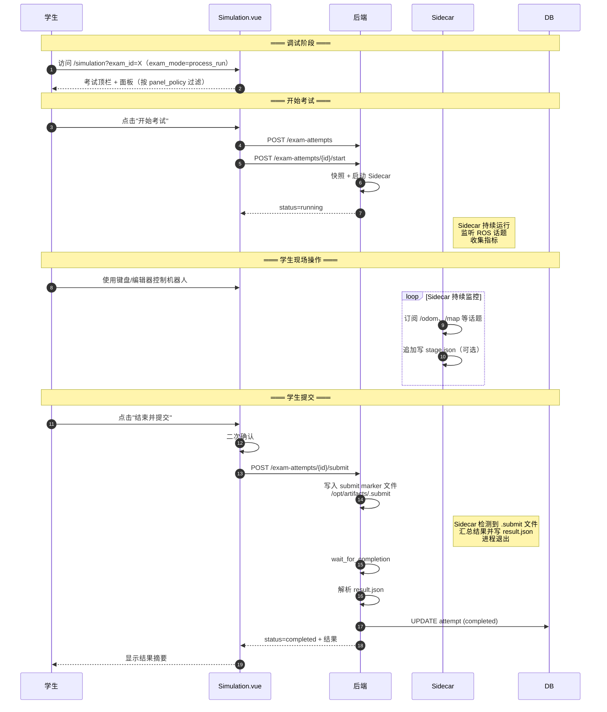
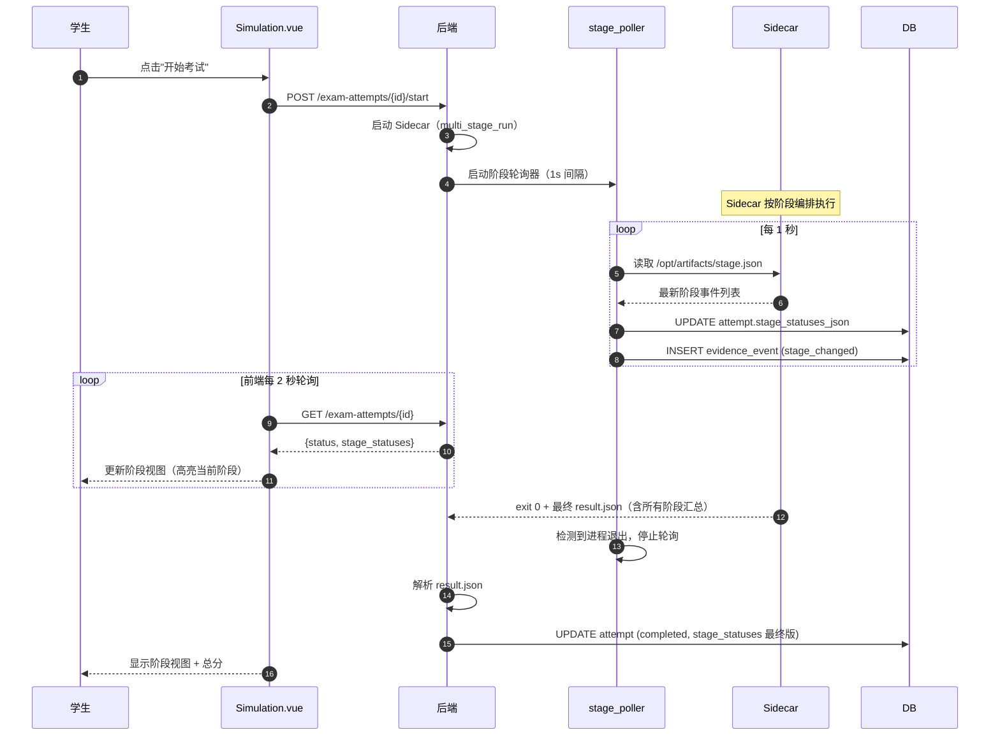

# TODOS - 第11-13期考试链路

**生成日期**：2026-04-13  
**来源**：第12期工程审查收口
**优先级**：P0（阻塞） > P1（重要） > P2（优化）

---

## P0（多实例前置阻塞）

### TODO-12-001: 考试执行链路多实例协调机制
**What**: 为 `exam_attempt` 调度与超时扫描增加多实例互斥协调（分布式锁或租约机制）。  
**Why**: 当前第12期设计仅支持单实例；一旦后端扩容为多副本，可能出现同一 attempt 被重复调度、重复结算。  
**Pros**: 防止状态踩踏、重复 Sidecar 启动、成绩覆盖，提升可扩展性。  
**Cons**: 需要新增协调字段或中间件，引入额外复杂度与并发测试成本。  
**Context**: 第12期审查决议保留单实例部署，但要求将该项作为扩容前置阻塞项显式跟踪，避免被遗忘。  
**Depends on / blocked by**: 依赖部署策略从单实例向多实例演进；建议在第13期前后实施并完成压测验证。  
**状态**: Open

---

## P1（高并发性能优化）

### TODO-12-002: 考试轮询高并发优化
**What**: 为 attempt 状态查询链路增加轻量优化方案（inspect 结果短缓存 + 前端轮询退避）。  
**Why**: 当前每 2 秒实时 inspect 在并发学生规模上升时会线性增加 Docker API 压力。  
**Pros**: 降低后端 I/O 与 Docker 守护压力，提升状态查询稳定性。  
**Cons**: 需要维护缓存一致性与状态变更时序，增加性能回归测试。  
**Context**: 第12期审查决议保留每 2 秒实时 inspect 以控制实现复杂度，但明确该项为后续性能债。  
**Depends on / blocked by**: 依赖并发规模增长或性能指标触发阈值；建议与监控指标联动执行。  
**状态**: Open

---

## 第13期 - 考试模式扩展（已从第13期 SDD 移出，v1.2，2026-04-14）

> 以下四项原属 SDD-第13期 In Scope S1~S4，因实现复杂度高、与面板策略/教师复核主线耦合低，
> 已从第13期 SDD 中移出，等待专项期次实施。

### TODO-13-001: `process_run` 考试模式完整闭环

**What**: 实现"过程型"考试模式的端到端闭环：学生启动 → Sidecar 持续监控 → 学生点击"结束并提交" → 后端写入 `.submit` marker → Sidecar 汇总结果退出 → 解析入库。  
**Why**: 当前第12期只支持 `result_run`（脚本自然退出），无法覆盖需要学生现场操作、实时观测的场景（遥控驾驶、实时建图等）。  
**Pros**: 解锁依赖学生主动提交的评测场景，覆盖更多实训类型。  
**Cons**: 需要新增 `waiting_submit` 状态、幂等 `/submit` 端点、Sidecar `.submit` marker 检测逻辑，前端需处理"提交中"等中间态。  
**Context**: 第13期 SDD v1.2 审查决议移出，避免与面板策略/教师复核主线混合实现；第12期已预留 `attempt_exam_mode` 和 `attempt_runtime_policy_json` 字段。  
**Depends on / blocked by**: 依赖 TODO-13-003（Sidecar marker 检测协议）。  
**状态**: Open

**关键设计要点**（来自原 SDD §4.1 / §5.1 / §4.4）：
- 新增状态 `waiting_submit`（Sidecar 就绪、等待学生提交）
- 后端写入 `/opt/artifacts/.submit` 标记文件，Sidecar 检测后自行汇总并退出
- `/students/exam-attempts/{id}/submit` 端点必须**幂等**：重复调用返回当前 attempt 状态，不重复写 marker
- 超时处理：`max_duration` 到达后自动 abort，无需学生手动提交

---

### TODO-13-002: `multi_stage_run` 考试模式完整闭环

**What**: 实现多阶段编排考试模式：Sidecar 按阶段顺序执行、上报阶段事件、各阶段分别计分，最终汇总。  
**Why**: 复杂实训任务（如"巡线 → 避障 → 返航"）需要阶段化结构，方便细分评分和实时进度展示，`result_run` 无法区分各阶段得分。  
**Pros**: 支持细粒度阶段评分、阶段超时单独管理、阶段失败可设置 continue/abort 策略。  
**Cons**: 实现复杂度最高——需要阶段事件协议、后端轮询器、前端阶段视图面板，三端协作。  
**Context**: 第13期 SDD v1.2 审查决议移出；依赖 TODO-13-003（阶段事件协议）和 TODO-13-004（前端阶段视图面板）。  
**Depends on / blocked by**: TODO-13-003 和 TODO-13-004 均需先完成。  
**状态**: Open

**关键设计要点**（来自原 SDD §4.2 / §6.1 / §6.2）：
- `stage_statuses_json` 字段（`exam_attempts` 表已预留）：`[{stage_key, stage_name, status, score, started_at_ms, ended_at_ms, metrics, message}]`
- 前端每 2 秒轮询 `GET /exam-attempts/{id}`，读取 `stage_statuses` 更新进度条
- Sidecar 自然退出后，`result.json` 需包含 `stages[]` 数组，`result_parser.py` 需扩展多阶段 schema 校验
- 成功判定：阶段事件实时性从 Sidecar 触发到前端显示 ≤ 2 秒

---

### TODO-13-003: Sidecar 阶段事件协议与后端轮询器

**What**: 定义 Sidecar 通过约定文件上报阶段事件的协议，并实现后端 `stage_event_poller.py`。  
**Why**: `multi_stage_run` 需要平台实时感知 Sidecar 内部阶段进展，Sidecar 是独立容器，最简可靠的方式是"约定文件 + 定时轮询"。  
**Pros**: Sidecar 无需额外依赖（无需 HTTP client）；文件追加写方式即使 Sidecar 崩溃仍可读取部分历史；1 秒轮询精度对 UI 已足够。  
**Cons**: 非实时（1 秒延迟）；需处理 JSON Lines 并发读写（读时跳过不完整末行）。  
**Context**: 原 SDD v1.1 §3.3 A/B/C 方案比选，决策采用方案 A（约定文件 + 后端轮询），排除 HTTP 回调（Sidecar 无网络访问权限）和 WebSocket 直连（复杂度高）。  
**Depends on / blocked by**: 无额外依赖，可独立实现后供 TODO-13-002 调用。  
**状态**: Open

**文件协议**（来自原 SDD §6.3）：
- 文件路径：`/opt/artifacts/stage.json`（JSON Lines，每行一条事件，追加写）
- 事件字段：`{ts, stage_key, event, stage_name?, score?, metrics?, message?}`
- 事件类型：`started` / `completed` / `failed` / `progress`
- 后端轮询器：`app/core/stage_event_poller.py`，1 秒间隔，读取 → 更新 `stage_statuses_json` → 写 `exam_evidence_events`
- **单实例约束**：当前架构仅支持单后端实例运行轮询器；多实例需先完成 TODO-12-001

**教师脚本写入示例**：
```python
import json, time

def emit_stage(event, stage_key, stage_name=None, score=None, metrics=None):
    row = {"ts": int(time.time() * 1000), "stage_key": stage_key, "event": event}
    if stage_name: row["stage_name"] = stage_name
    if score is not None: row["score"] = score
    if metrics: row["metrics"] = metrics
    with open("/opt/artifacts/stage.json", "a") as f:
        f.write(json.dumps(row) + "\n")
```

---

### TODO-13-004: `TaskStatusPanel` 学生端阶段视图面板

**What**: 新增 `TaskStatusPanel` 面板，在 `multi_stage_run` 考试模式下展示 Sidecar 当前阶段进度（阶段列表 + 每阶段得分 / 状态 / 耗时）。  
**Why**: `multi_stage_run` 的核心用户价值之一是学生能实时看到"巡线完成、正在返航"，若缺少该面板则模式体验残缺。  
**Pros**: 可复用于教师端 `StageTimeline.vue`（同一数据结构）。  
**Cons**: 需新增面板类型并在面板注册表中注册；`panel_policy.task_status_panel_enabled` 字段需同步更新。  
**Context**: 第13期 SDD v1.2 移出，随 TODO-13-002 一并实施。面板策略过滤机制（`usePanelPolicy.ts`）本期仍会实施，届时需留好 `task_status_panel_enabled` 的过滤入口。  
**Depends on / blocked by**: TODO-13-002（multi_stage_run 闭环）、TODO-13-003（阶段事件协议）。  
**状态**: Open

**布局草图**（来自原 SDD §7.3）：
```
┌──────────────────────────────────────┐
│  阶段进度                              │
├──────────────────────────────────────┤
│  ● ───── 巡线阶段       ✅ 40/50      │
│  │                                   │
│  ● ───── 返航阶段       🔄 运行中     │
│  │                                   │
│  ○ ───── 到达检查       ⏳ 待开始     │
│                                      │
│  总分（暂计）：40                      │
└──────────────────────────────────────┘
```
- 数据源：`exam_attempts.stage_statuses_json`，前端每 2 秒轮询刷新
- 文件路径：`src/views/Simulation/panels/TaskStatusPanel/index.vue`

### 4.1 process_run 模式时序图



### 4.2 multi_stage_run 模式时序图


