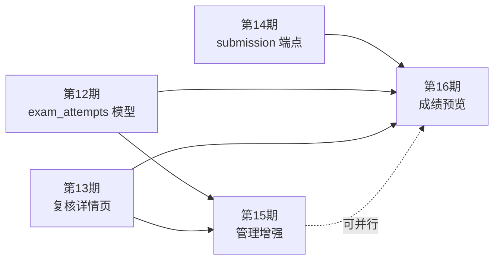

# SDD 第15-16期 分期总览

> 生成日期：2026-04-16
> 覆盖需求：教师端考试管理增强 + 成绩预览（教师 + 学生）

---

## 分期总览表

| 期次 | 主题 | 核心目标 | 范围边界 | 依赖 | 主要风险 |
|------|------|---------|---------|------|---------|
| **第15期** | 教师端考试管理增强 | 独立尝试管理页（批量清理）+ 复核列表（最高分视图，默认未复核优先） | 仅教师端管理操作；不含成绩字段展示 | 第12-14期 | "最高分视图"聚合查询需验证 NULL score 处理；批量删除需确保文件清理原子性 |
| **第16期** | 成绩预览 | 教师端完整 result.json 列表展示 + 学生端成绩历史 + 学生查看提交代码 | 仅展示；不含导出、不含学生 artifacts 查看 | 第12-14期（可并行第15期） | 学生端 submission 越权需严格测试；result_json 去 artifacts 键需在 Schema 层强制 |

---

## 需求-期次映射

| 原始需求 | 对应期次 | 对应交付项 |
|---------|---------|---------|
| 教师端添加学生考试结果复核页，可分考试显示或全部显示，一个考试一个学生只显示客观分数最高的尝试，可按多种方式排列，默认未评分的排前面。教师可以点击尝试进入考试复核页评分 | **第15期** | S3 `ExamReviewList.vue` + S4 `GET /teachers/exam-review-list` |
| 教师端添加学生考试尝试页，可分考试显示或全部显示，有批量删除，有一键删除异常尝试按钮，删除要删除 artifacts 和 submission 文件。点击详情可以进入考试复核页 | **第15期** | S1 `ExamAttemptsManager.vue` + S2 `POST /teachers/exam-attempts/delete-abnormal` |
| 教师端添加成绩预览页（列表），可分考试显示或全部显示或选择学生显示，完整显示 result.json（artifacts 字段除外），custom_fields 的名称直接显示，其他固定字段的名称显示中文。点击详情可以进入考试复核页 | **第16期** | S1 `TeacherGradePreview.vue` + S2 `GET /teachers/grade-preview` |
| 学生端添加成绩预览页，显示当前学生所有考试的最高成绩的尝试，类似教师端成绩预览页。点击可进入成绩详情页，可以查看不同尝试的评语（包括教师和评测脚本的）和点击查看按钮查看提交的代码 | **第16期** | S3-S8 全部（学生成绩预览 + 详情 + 代码查看） |

---

## 关键设计决策

| 决策点 | 选择 | 理由 |
|--------|------|------|
| 考试尝试管理 & 复核列表：独立路由 vs 嵌入 ExamDetail | 独立路由（方案B） | 职责清晰，URL 可书签，长期可维护 |
| 结果复核列表的"最高分"逻辑 | 每 (student_id, exam_id) 取 objective_score 最高的 completed/reviewed attempt，NULL score 视为 -1 | 与已有 `prune_lower_non_error_attempts` 语义保持一致 |
| "异常尝试"定义 | `status ∈ {error, aborted}` | error=系统异常；aborted=超时/学生放弃。两者都是无法进行复核的终态 |
| result_json 展示：行内展开 vs 弹窗 | 行内展开 | 便于横向对比多学生成绩 |
| result_json 去 artifacts 键 | 后端 Schema 层强制剔除（而非前端过滤） | 前端过滤易被绕过；Schema 层是契约边界 |
| custom_fields 汉化 | 键名直接显示（不翻译） | 教师自定义字段平台无法预知，汉化需额外配置入口（Deferred） |
| Grade Preview Schema 独立文件 | `app/schemas/grade_preview.py`（不合并到 exam_attempt.py） | 跨表 JOIN 视图 Schema 与 ORM 单表 Schema 职责不同，避免 exam_attempt.py 继续膨胀 |
| 学生端查看代码的鉴权 | `attempt.student_id == current_user_id`（后端强制，非前端隐藏） | 前端隐藏可被绕过；安全边界必须在服务端 |
| 学生端 submission 端点实现 | 镜像教师端实现（复用路径归一化逻辑），单独鉴权 | 不复用教师端路由，避免权限混乱 |

---

## 期次间依赖关系

> **注**：第15期和第16期没有强依赖关系，可并行开发，也可串行。第15期的 `list_best_attempts_per_student` CRUD 函数被第16期的 `my-grade-summary` 复用，若并行则第16期需独立实现同等逻辑（略有重复）；若串行则直接复用第15期函数。

---

## 新增路由汇总

### 后端路由权限（`auth.py` get_user_routes 增量）

| 角色 | 新增路径 |
|------|---------|
| teacher | `/teacher/exams/attempts` |
| teacher | `/teacher/exams/review-list` |
| teacher | `/teacher/exams/grade-preview` |
| student | `/student/grades` |
| student | `/student/grades/:exam_id` |
| student | `/student/grades/:exam_id/attempt/:attempt_id/code` |

### 前端 router/index.ts 增量

| 父路由 | 新增子路由 path | 组件 |
|--------|--------------|------|
| `/teacher/exams` | `attempts` | `TeacherExams/ExamAttemptsManager.vue` |
| `/teacher/exams` | `review-list` | `TeacherExams/ExamReviewList.vue` |
| `/teacher/exams` | `grade-preview` | `TeacherExams/TeacherGradePreview.vue` |
| `/student` | `grades` | `Student/Grades.vue` |
| `/student/grades` | `exam/:exam_id` | `Student/StudentGradeDetail.vue` |
| `/student/grades/exam/:exam_id` | `attempt/:attempt_id/code` | `Student/StudentAttemptCodeView.vue` |

### 后端 API 增量

| API | 文件 | 期次 |
|-----|------|------|
| `GET /teachers/exam-review-list` | `teacher/exam_attempts.py` | 第15期 |
| `POST /teachers/exam-attempts/delete-abnormal` | `teacher/exam_attempts.py` | 第15期 |
| `GET /teachers/grade-preview` | `teacher/grade_preview.py`（新建） | 第16期 |
| `GET /students/my-grade-summary` | `student/grade_preview.py`（新建） | 第16期 |
| `GET /students/exams/{exam_id}/my-grade-detail` | `student/grade_preview.py` | 第16期 |
| `GET /students/exam-attempts/{id}/submission/files` | `student/grade_preview.py` | 第16期 |
| `GET /students/exam-attempts/{id}/submission/files/read` | `student/grade_preview.py` | 第16期 |
| `GET /students/exam-attempts/{id}/submission/files/download` | `student/grade_preview.py` | 第16期 |
