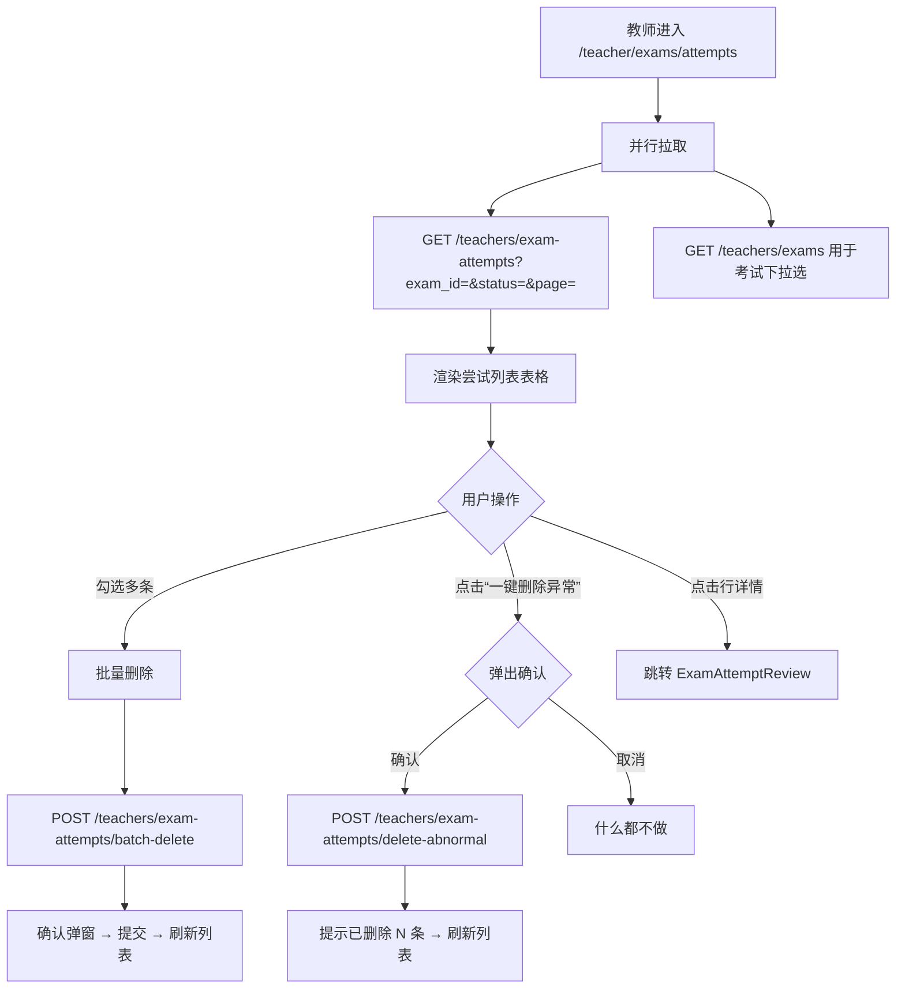
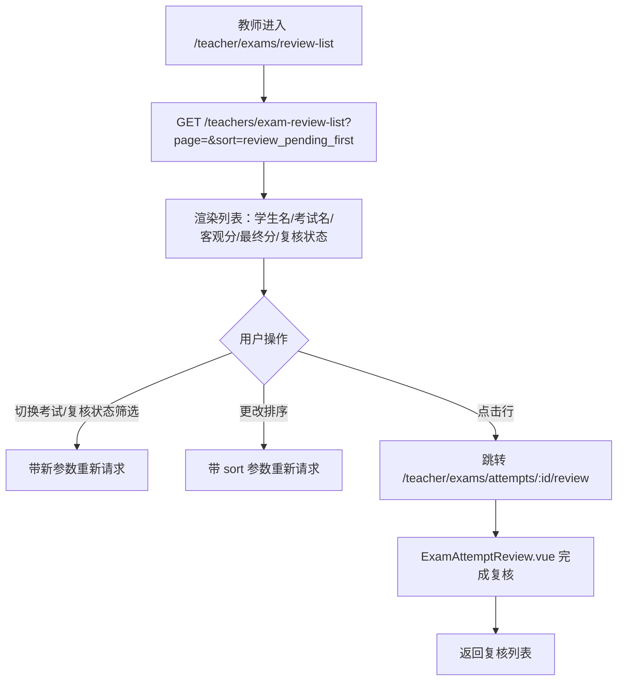
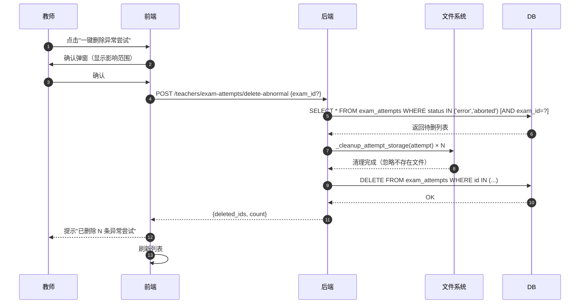

# SDD-第15期：教师端考试管理增强

> 版本：v1.0
> 日期：2026-04-16
> 状态：可评审 / 可执行
> 前置依赖：第12期（ExamAttempt 模型）、第13期（复核详情页）、第14期（提交代码查看）

---

## 0. 文档元信息

- **文档标题**：SDD-第15期：教师端考试管理增强
- **文档版本**：v1.0
- **创建日期**：2026-04-16
- **负责人**：Thouder03
- **前置依赖**：第12期 `exam_attempts` 表结构、`batch_delete_attempts_with_storage`；第13期 `ExamAttemptReview.vue`
- **目标读者**：后端 / 前端 / 测试

---

## 1. 执行摘要

### 1.1 本期要解决的问题

1. 教师缺乏跨考试的"一览无余"视图——现有 `AttemptList` 被嵌入 `ExamDetail` 中，无法全局管理所有学生的尝试记录。
2. 批量清理异常尝试效率低——教师只能逐条手动删除，或进入每个考试详情页批量删除，缺少"一键清理全局异常"快捷操作。
3. 教师无法快速定位"还有哪些学生尚未被复核"——必须进入每个考试详情才能看到 `review_status`，无法按复核状态排序筛选。

### 1.2 本期关键结果

1. 教师可在独立页面浏览、筛选、批量删除全局或按考试的所有学生尝试记录。
2. 教师可一键删除所有异常（error/aborted）尝试并连同 artifacts/submission 文件一并清理。
3. 教师可在"考试结果复核列表"中看到每学生每考试的最高分尝试，默认未复核排前，一键进入复核页评分。

### 1.3 成功判定

- **SM-1**：教师进入"考试尝试管理"页 → 批量勾选 → 删除，全程不超过 3 步操作。
- **SM-2**：一键删除异常尝试按钮点击 → 确认 → 完成，后台文件清理无残留。
- **SM-3**：考试结果复核列表默认展示未复核在前，点击任意行可直接跳转到已有的 `ExamAttemptReview.vue` 页面。

---

## 2. 范围定义

### 2.1 In Scope

| 编号 | 交付项 |
|------|--------|
| S1 | 教师端"考试尝试管理"独立页 `/teacher/exams/attempts` |
| S2 | 后端"一键删除异常尝试"接口 `POST /teachers/exam-attempts/delete-abnormal` |
| S3 | 教师端"考试结果复核列表"独立页 `/teacher/exams/review-list` |
| S4 | 后端"结果复核列表（最高分视图）"查询接口 `GET /teachers/exam-review-list` |
| S5 | 两个新页面注册到后端路由权限表（`auth.py` → `get_user_routes`） |
| S6 | 两个新页面注册到前端 `router/index.ts` |
| S7 | 侧边栏菜单（`teacher` 角色）新增两个菜单项 |

### 2.2 Out of Scope

| 项目 | 不纳入本期原因 |
|------|---------------|
| 成绩预览（result.json 字段展示） | 第16期专项，本期聚焦管理操作 |
| 学生端成绩查看 | 第16期 |
| 考试统计仪表盘（通过率、平均分） | 无明确需求，数据基础在本期积累后再议 |
| 一键重跑失败尝试 | 需 Sidecar 调度重构，延后 |
| 导出成绩 CSV | 依赖第16期成绩预览字段设计 |
| 分配复核任务给多名教师 | 无需求 |

---

## 3. 方案选型

### 3.1 前提挑战

- "结果复核列表"的核心查询是**每 (student, exam) 取最高客观分**。当前 `crud_attempt.list_attempts_for_teacher` 不支持此聚合；`prune_lower_non_error_attempts` 有类似逻辑但只针对单学生单考试。
- "一键删除异常"需要知道 `status ∈ {error, aborted}`，且必须触发 `_cleanup_attempt_storage` 以清理文件系统，不能只做数据库 DELETE。

### 3.2 现有资产复用

#### 3.2.1 后端复用资产

| 资产 | 路径 | 复用方式 |
|------|------|---------|
| `batch_delete_attempts_with_storage` | `app/crud/exam_attempt.py:353` | 删除异常尝试时直接复用 |
| `list_attempts_for_teacher` | `app/crud/exam_attempt.py` | 考试尝试管理页分页列表 |
| `_cleanup_attempt_storage` | `app/crud/exam_attempt.py` | delete-abnormal 内部调用 |
| `TeacherAttemptListItemSchema` | `app/schemas/exam_attempt.py:291` | 两个新列表页的响应 item 类型 |
| `TeacherBatchDeleteAttemptsRequest/Response` | `app/schemas/exam_attempt.py:264` | 批量删除已有 |
| POST `/teachers/exam-attempts/batch-delete` | `app/api/v1/endpoints/teacher/exam_attempts.py:258` | 批量删除已实现 |
| GET `/teachers/exam-attempts` | 同上 | 考试尝试管理页直接复用 |

#### 3.2.2 前端复用资产

| 资产 | 路径 | 复用方式 |
|------|------|---------|
| `AttemptList.vue` | `views/Teacher/Exams/components/AttemptList.vue` | 参考实现，独立页做功能扩展 |
| `ExamAttemptReview.vue` | `views/Teacher/Exams/ExamAttemptReview.vue` | 两个列表页的"详情"跳转目标（不修改） |
| `getExamAttemptsApi` | `src/api/exam/attempts.ts` | 直接复用 |
| `batchDeleteAttemptsApi` | 同上 | 直接复用 |

### 3.3 实施路径备选

#### 方案 A：最小可行（在 ExamDetail 里加全局 toggle）

- 在现有 `AttemptList.vue` 加一个"显示全部考试"的开关，不新增独立路由。
- 优点：改动小，1 天可完成。
- 风险：UI 混在 ExamDetail 里逻辑复杂，长期不可维护；"复核列表"的最高分视图也没法做。

#### 方案 B：两个独立页（本期采用）

- 新建两个独立路由页面，各自有独立 URL、侧边栏入口。
- 优点：职责清晰；URL 可书签；与第16期成绩预览统一风格。
- 风险：多 2 个路由注册点（前端+后端），工作量约 2 天。

### 3.4 方案决策

**采用方案 B**。独立路由页面的可维护性和可扩展性远优于在 ExamDetail 中堆砌逻辑。工作量可控。

---

## 4. 系统交互设计

### 4.1 考试尝试管理页主流程



### 4.2 考试结果复核列表主流程



### 4.3 一键删除异常尝试时序图



---

## 5. API 契约

### 5.1 新增端点

| Endpoint | Method | 鉴权 | Request | Response | 状态码 |
|----------|--------|------|---------|----------|--------|
| `/teachers/exam-review-list` | GET | Bearer Token（教师） | Query: `exam_id?`, `review_status?`, `sort?`, `page`, `page_size` | `ApiResponse[ExamReviewListResponse]` | 200/401/403 |
| `/teachers/exam-attempts/delete-abnormal` | POST | Bearer Token（教师） | Body: `DeleteAbnormalRequest` | `ApiResponse[DeleteAbnormalResponse]` | 200/401/403 |

### 5.2 GET /teachers/exam-review-list 详细规格

**Query 参数**：

| 参数 | 类型 | 必填 | 默认 | 说明 |
|------|------|------|------|------|
| `exam_id` | int | 否 | null（全部） | 按考试筛选 |
| `review_status` | string | 否 | null（全部） | `pending` / `reviewed` |
| `sort` | string | 否 | `review_pending_first` | 见下方排序说明 |
| `page` | int | 否 | 1 | 分页 |
| `page_size` | int | 否 | 20 | 最大 100 |

**排序选项**：

| `sort` 值 | 说明 |
|----------|------|
| `review_pending_first`（默认）| review_status=pending 排最前，同状态内按 objective_score DESC |
| `score_desc` | 客观分从高到低 |
| `score_asc` | 客观分从低到高 |
| `created_at_desc` | 最新创建在前 |

**后端查询逻辑**（伪 SQL，不写实现代码）：

```
-- 步骤1：找出每个 (student_id, exam_id) 中 objective_score 最高的 attempt id
-- NULL score 视为 -1（保证有 error attempt 时仍能选出有效的 completed 记录）
-- 仅考虑 status IN ('completed', 'reviewed')

-- 步骤2：按上述 id 列表 JOIN 获取完整信息
-- 步骤3：按 sort 参数排序
```

**响应结构**：

`ExamReviewListResponse`（新增 Schema）：

```
{
  items: ExamReviewListItem[],
  total: int,
  page: int,
  page_size: int
}
```

`ExamReviewListItem`（在 `TeacherAttemptListItemSchema` 基础上增加 `exam_name: str`）：

| 字段 | 类型 | 说明 |
|------|------|------|
| `attempt_id` | int | |
| `exam_id` | int | |
| `exam_name` | str | **新增**，用于列表展示（全部考试视图时需要） |
| `status` | str | 尝试状态 |
| `student` | `AttemptStudentInfo` | 学生信息 |
| `objective_score` | float\|null | 客观分 |
| `pass` | bool\|null | |
| `final_score` | float\|null | 最终分 |
| `review_status` | str | `pending` / `reviewed` |
| `manual_score` | float\|null | 人工分 |
| `started_at` | datetime\|null | |
| `ended_at` | datetime\|null | |
| `created_at` | datetime | |

### 5.3 POST /teachers/exam-attempts/delete-abnormal 详细规格

**请求体** `DeleteAbnormalRequest`：

| 字段 | 类型 | 必填 | 说明 |
|------|------|------|------|
| `exam_id` | int | 否 | 不传则删除全局所有异常尝试；传则限定到该考试 |

**"异常尝试"定义**：`status ∈ {error, aborted}`

**响应体** `DeleteAbnormalResponse`：

| 字段 | 类型 | 说明 |
|------|------|------|
| `deleted_ids` | list[int] | 已删除的 attempt id 列表 |
| `count` | int | 删除数量 |

### 5.4 已有端点（本期复用，无变更）

| Endpoint | Method | 复用场景 |
|----------|--------|---------|
| `GET /teachers/exam-attempts` | GET | 考试尝试管理页的列表数据 |
| `POST /teachers/exam-attempts/batch-delete` | POST | 批量勾选删除 |
| `GET /teachers/exams` | GET | 两个新页面的"考试筛选"下拉框 |

### 5.5 错误语义映射

| 错误码 | HTTP | 语义 | 前端动作 |
|--------|------|------|---------|
| `ATTEMPT_NOT_FOUND` | 404 | attempt id 不存在 | 弹窗提示，刷新列表 |
| `UNAUTHORIZED` | 401 | 未登录 | 跳转登录 |
| `FORBIDDEN` | 403 | 非教师角色 | 提示无权限 |

---

## 6. 数据字典

本期不新增表字段。后端新增的查询逻辑均基于现有字段。

### 6.1 新增 Pydantic Schema（仅增量）

**`ExamReviewListItem`**（新增，在 `app/schemas/exam_attempt.py`）：

| 字段 | 类型 | 必填 | 默认 | 业务说明 |
|------|------|------|------|---------|
| `attempt_id` | int | 是 | — | |
| `exam_id` | int | 是 | — | |
| `exam_name` | str | 是 | — | 从 `exams.name` JOIN 获取 |
| 其余字段 | — | — | — | 同 `TeacherAttemptListItemSchema`，字段完全继承 |

**实现建议**：`ExamReviewListItem` 继承 `TeacherAttemptListItemSchema` 并额外加 `exam_name: str` 字段，避免重复定义。

**`DeleteAbnormalRequest`**（新增）：

| 字段 | 类型 | 必填 | 默认 | 业务说明 |
|------|------|------|------|---------|
| `exam_id` | int \| None | 否 | None | 不传时删全局 |

**`DeleteAbnormalResponse`**（新增）：

| 字段 | 类型 | 必填 | 默认 | 业务说明 |
|------|------|------|------|---------|
| `deleted_ids` | list[int] | 是 | [] | |
| `count` | int | 是 | 0 | |

### 6.2 CRUD 新增函数（`app/crud/exam_attempt.py`）

| 函数签名 | 说明 |
|---------|------|
| `async def list_best_attempts_per_student(db, *, exam_id?, review_status?, sort, page, page_size) -> (list[ExamAttempt], total: int)` | 每学生每考试最高分视图，仅 completed/reviewed |
| `async def delete_abnormal_attempts(db, *, exam_id?) -> list[int]` | 删除 status∈{error,aborted} 的记录及文件 |

---

## 7. 前后端设计

### 7.1 考试尝试管理页 `/teacher/exams/attempts`

**功能定位**：教师的"考试尝试管理操作室"——CRUD 操作优先，显示信息足够管理决策即可。

**布局草图**：

```
┌──────────────────────────────────────────────────────────────────┐
│  考试尝试管理                                                      │
├──────────────────────────────────────────────────────────────────┤
│  筛选栏：[考试: 全部 ▼] [学生: __] [状态: 全部 ▼]   [🔍 查询]     │
├──────────────────────────────────────────────────────────────────┤
│  操作栏：[✅ 批量删除(N)] [⚠ 一键删除异常尝试]                     │
├──────────────────────────────────────────────────────────────────┤
│  □ | 学生姓名 | 考试名称 | 状态    | 客观分 | 复核状态 | 创建时间 | 操作 │
│  □   张三      导航考试  已完成   85.0    待复核    04-15    [复核] │
│  □   李四      建图考试  评测异常  —      —        04-14    [删除] │
│  □   王五      导航考试  已放弃   —      —        04-14    [删除] │
├──────────────────────────────────────────────────────────────────┤
│  < 1 2 3 ... >  共 47 条                                          │
└──────────────────────────────────────────────────────────────────┘
```

**交互细节**：

- **筛选栏**："考试"下拉框从 `GET /teachers/exams` 获取，追加"全部"选项
- **批量删除按钮**：仅在有选中行时启用（`el-button :disabled="selected.length === 0"`）；点击弹出 `el-message-box` 确认
- **一键删除异常尝试**：始终可点击；弹出确认："将删除当前筛选条件下所有 error 和 aborted 状态的尝试（N 条），此操作不可逆，是否继续？"
  - N 条数来自当前筛选条件下异常尝试总数（可在列表加载时统计，或前端临时展示"将删除全部匹配的异常尝试"）
  - 如果当前筛选有 `exam_id`，删除操作传该 `exam_id`；否则删全局
- **"复核"操作按钮**：status=completed 或 reviewed 的 attempt 显示"复核"，跳转 `/teacher/exams/attempts/:id/review`
- **"删除"操作按钮**：其他状态显示"删除"，点击单条删除（复用 batch-delete，传单条 id）

**分页**：`el-pagination` 绑定 page/pageSize，变化时重新请求

**列定义**（TypeScript 强类型）：

```
列: 复选框 | 学生名 | 学生账号 | 考试名 | 状态(tag) | 客观分 | 复核状态(tag) | 耗时 | 创建时间 | 操作
```

### 7.2 考试结果复核列表 `/teacher/exams/review-list`

**功能定位**：教师的"待复核队列"——快速看出还有谁没复核，一键跳入评分。

**布局草图**：

```
┌──────────────────────────────────────────────────────────────────┐
│  考试结果复核列表                                                   │
├──────────────────────────────────────────────────────────────────┤
│  筛选栏：[考试: 全部 ▼] [复核状态: 全部 ▼] [排序: 未复核优先 ▼]     │
├──────────────────────────────────────────────────────────────────┤
│  统计卡片：待复核 12 | 已复核 38 | 合计 50                          │
├──────────────────────────────────────────────────────────────────┤
│  学生姓名 | 考试名称 | 客观分 | 最终分 | Pass | 复核状态   | 操作    │
│  张三      导航考试   85.0   85.0    ✅     [待复核 🟠]   [复核]   │
│  李四      建图考试   72.0   —      —      [待复核 🟠]   [复核]   │
│  王五      导航考试   91.0   94.2    ✅     [已复核 ✅]   [查看]   │
├──────────────────────────────────────────────────────────────────┤
│  < 1 2 3 ... >  共 50 条                                          │
└──────────────────────────────────────────────────────────────────┘
```

**交互细节**：

- **统计卡片**：来自同一次请求的 total（不分页的 count）；或单独请求一次 count
  - 简单方案：先不做统计卡片，第16期再加（Out of Scope）
- **排序下拉**：选项对应 `sort` 参数（`review_pending_first`/`score_desc`/`score_asc`/`created_at_desc`）
- **操作按钮**：review_status=pending → "复核"（primary 色）；reviewed → "查看"
  - 两者均跳转 `/teacher/exams/attempts/:id/review`
- **每行仅展示该学生该考试的最高客观分尝试**（后端保证，前端无需去重）

**注意**：本页展示的是"最高分尝试视图"，不是"所有尝试"，因此不提供删除操作。删除在 S1（考试尝试管理页）完成。

### 7.3 侧边菜单扩展

在"考试管理"菜单组下新增两个子菜单：

```
考试管理
  ├── 考试列表（已有）
  ├── 考试文件（已有）
  ├── 评测脚本（已有）
  ├── 尝试管理（新增，对应 /teacher/exams/attempts）
  └── 复核列表（新增，对应 /teacher/exams/review-list）
```

---

## 8. 安全与边界约束

| 风险点 | 威胁描述 | 防护策略 | 验证方式 |
|--------|---------|---------|---------|
| 越权删除 | 非教师角色调用 delete-abnormal | `get_current_teacher` 依赖注入；角色校验 | 集成测试（student token → 403） |
| 误删 completed attempt | delete-abnormal 将已完成尝试删除 | 后端硬限 `status IN ('error','aborted')` | 单元测试 |
| 批量删除过量 | 前端传空 attempt_ids | 现有 Schema `min_length=1` 阻断 | — |
| 并发删除竞争 | 两个教师同时删同一 attempt | DB 外键级联 DELETE + commit 幂等 | — |
| 文件清理失败 | artifacts 目录已不存在 | `_safe_remove_tree` 忽略 FileNotFoundError | 已有实现 |

---

## 9. 异常、恢复与可观测性

### 9.1 失败模式登记

| Codepath | 失败模式 | 已处理? | 用户可见? | 日志? | 测试? |
|----------|---------|--------|---------|-------|-------|
| delete-abnormal：无异常尝试 | 空列表返回 | Y | 提示"当前没有需要清理的异常尝试" | N | Y |
| delete-abnormal：DB 删除失败 | DB 异常 | N→需处理 | 500 提示 | Y | N |
| list_best_attempts_per_student：聚合查询超时 | 大数据量 | N→监控 | 静默（前端 loading） | Y | N |
| 批量删除：部分 id 不存在 | 跳过不存在的，返回实际删除列表 | Y（已有实现） | 结果提示删除了哪些 | Y | Y |

### 9.2 错误恢复策略

| 场景 | 降级 | 重试 | 终态 |
|------|------|------|------|
| delete-abnormal 删除超时 | 返回已删除的 id 列表 | 教师可重试 | 第二次调用幂等（已删除的 attempt 不存在，自然跳过） |

### 9.3 可观测性要求

- **关键日志字段**：`teacher_id`, `action` (`delete_abnormal`/`batch_delete`), `exam_id?`, `deleted_count`, `error_code`
- **核心指标**：delete-abnormal 每次调用删除数量（用于监控异常增长）

---

## 10. 测试与验收

### 10.1 测试覆盖地图

| 流程/分支 | 类型 | 要点 | 通过标准 |
|----------|------|------|---------|
| 结果复核列表：每学生每考试只有最高分 | 后端单元 | 同学生同考试2条尝试，客观分不同 | 只返回最高分的那条 |
| 结果复核列表：NULL 客观分处理 | 后端单元 | 有 null score 的 attempt | 不出现在复核列表（仅 completed/reviewed） |
| 结果复核列表：review_pending_first 排序 | 后端单元 | 混合 pending/reviewed | pending 在前 |
| delete-abnormal：只删 error+aborted | 后端集成 | DB 中含 completed 和 error attempts | completed 不被删除 |
| delete-abnormal：exam_id 过滤 | 后端集成 | 传 exam_id=1，DB 有 exam 1 和 2 的异常 | 只删 exam_id=1 的 |
| delete-abnormal：文件清理 | 后端集成 | artifacts_path 指向真实目录 | 目录被删除 |
| 批量删除（前端）：无选中时按钮禁用 | 前端E2E | 未勾选直接点批量删除 | 按钮 disabled |
| 一键删除异常确认弹窗 | 前端E2E | 点击后取消 | 列表不变 |
| 跳转复核页 | 前端E2E | 点击"复核"按钮 | URL 跳转到 /attempts/:id/review |

### 10.2 验收标准

#### 10.2.1 功能验收

- [ ] 考试尝试管理页：分页加载、exam/status 筛选均可正常切换
- [ ] 考试尝试管理页：批量勾选后删除，列表刷新并减少对应条数
- [ ] 考试尝试管理页：一键删除异常后，所有 error/aborted 记录消失，文件系统无残留
- [ ] 复核列表：默认展示未复核在前
- [ ] 复核列表：点击行跳转到 ExamAttemptReview.vue（不新建复核页）
- [ ] 复核列表：每学生每考试只展示一条（最高分尝试）
- [ ] 两个页面在侧边栏有菜单入口

#### 10.2.2 稳定性验收

- [ ] 50 条数据分页加载无卡顿
- [ ] 一次删除 20 条异常尝试，全程完成不报错

#### 10.2.3 一致性验收

- [ ] 后端 `delete-abnormal` 的"异常"定义与前端确认弹窗描述文字一致（均为 error/aborted）
- [ ] 删除后数据库无对应 attempt 记录，文件系统无残留

---

## 11. 实施交付清单

### 11.1 后端交付

**新增文件**：

| 路径 | 说明 |
|------|------|
| — | （本期无需新文件，扩展现有文件） |

**修改文件**：

| 路径 | 修改说明 |
|------|---------|
| `app/crud/exam_attempt.py` | 新增 `list_best_attempts_per_student`（聚合查询）和 `delete_abnormal_attempts` 函数 |
| `app/schemas/exam_attempt.py` | 新增 `ExamReviewListItem`（继承 `TeacherAttemptListItemSchema` + `exam_name`）、`DeleteAbnormalRequest`、`DeleteAbnormalResponse`、`ExamReviewListResponse` |
| `app/api/v1/endpoints/teacher/exam_attempts.py` | 新增 `GET /exam-review-list` 和 `POST /exam-attempts/delete-abnormal` 两个路由 |
| `app/api/v1/endpoints/common/auth.py` → `get_user_routes` | teacher 角色追加 `/teacher/exams/attempts` 和 `/teacher/exams/review-list` |

### 11.2 前端交付

**新增文件**：

| 路径 | 说明 |
|------|------|
| `src/views/Teacher/Exams/ExamAttemptsManager.vue` | 考试尝试管理页 |
| `src/views/Teacher/Exams/ExamReviewList.vue` | 考试结果复核列表页 |
| `src/api/exam/attemptManager.ts` | 新增 `getExamReviewListApi`、`deleteAbnormalAttemptsApi` |

**修改文件**：

| 路径 | 修改说明 |
|------|---------|
| `src/router/index.ts` | 在 `TeacherExams.children` 中追加两个路由（`attempts` 和 `review-list`） |
| `src/views/Teacher/Exams/ExamList.vue` 或侧边菜单配置 | 追加"尝试管理"和"复核列表"菜单项 |
| `mock/role/index.mock.ts` | teacher 角色路由列表追加 `/teacher/exams/attempts` 和 `/teacher/exams/review-list`（开发环境 mock 路由同步更新） |

---

## 12. Deferred（后续期次）

| 延后项 | 延后原因 | 触发条件 |
|--------|---------|---------|
| 复核列表统计卡片（待复核/已复核/合计） | 需要额外聚合查询，优先级低 | 教师反馈需要快速看汇总数据 |
| 考试尝试管理页的学生筛选（输入学生名模糊搜索） | 需要后端全文检索，本期不引入 | 班级人数 > 50 人时体验下降 |
| 一键重跑失败尝试 | 需 Sidecar 调度重构 | process_run / multi_stage_run 上线后 |
| 导出成绩 CSV | 依赖第16期字段设计 | 第16期完成后 |

---

## 13. 附录

### 13.1 规范—代码映射

| 规范项 | 代码路径 |
|--------|---------|
| 最高分视图查询 | `edubot-twin-server/app/crud/exam_attempt.py::list_best_attempts_per_student` |
| 异常尝试删除 | `edubot-twin-server/app/crud/exam_attempt.py::delete_abnormal_attempts` |
| 复核列表 API | `edubot-twin-server/app/api/v1/endpoints/teacher/exam_attempts.py` |
| 考试尝试管理页 | `edubot-twin-web/src/views/Teacher/Exams/ExamAttemptsManager.vue` |
| 复核列表页 | `edubot-twin-web/src/views/Teacher/Exams/ExamReviewList.vue` |

### 13.2 术语表

| 术语 | 定义 |
|------|------|
| 异常尝试 | `status ∈ {error, aborted}` 的 ExamAttempt 记录 |
| 最高分视图 | 每 (student_id, exam_id) 仅取 objective_score 最高的已完成尝试 |
| 复核列表 | 最高分视图 + review_status 排序，供教师快速进入评分 |

### 13.3 变更记录

| 版本 | 日期 | 变更 | 负责人 |
|------|------|------|--------|
| v1.0 | 2026-04-16 | 初版 | Thouder03 |
