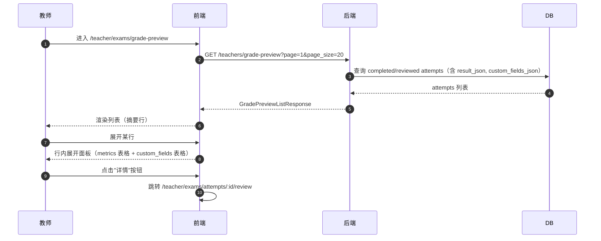
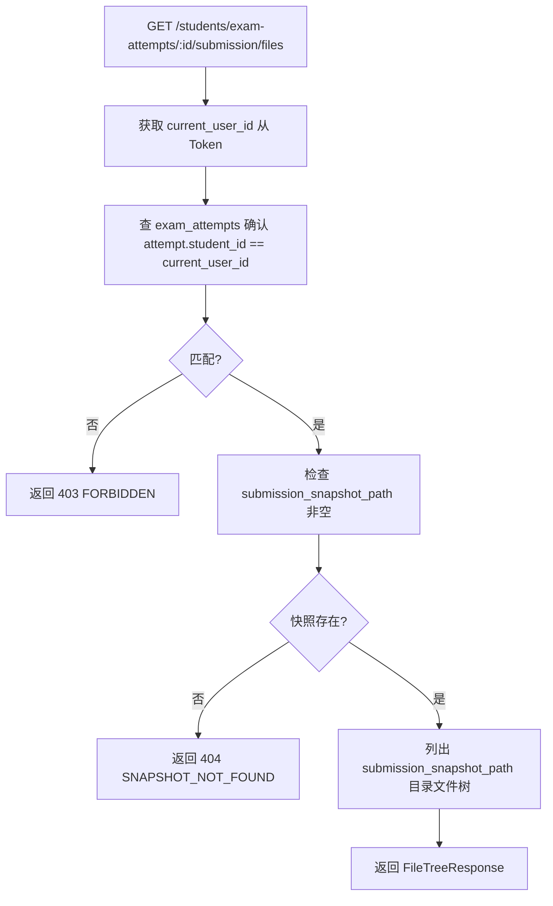

# SDD-第16期：成绩预览（教师端 + 学生端）

> 版本：v1.0
> 日期：2026-04-16
> 状态：可评审 / 可执行
> 前置依赖：第12期（student.exam_attempts、result_json 字段）、第13期（teacher_comment、custom_fields_json）、第14期（submission_snapshot_path、BundleWorkspaceTemplate readonly prop）、第15期（可并行，但复核列表逻辑已验证最高分查询）

---

## 0. 文档元信息

- **文档标题**：SDD-第16期：成绩预览（教师端 + 学生端）
- **文档版本**：v1.0
- **创建日期**：2026-04-16
- **负责人**：Thouder03
- **前置依赖**：第12期 `result_json`/`custom_fields_json` 字段；第13期 `teacher_comment`；第14期 `BundleWorkspaceTemplate` readonly 支持
- **目标读者**：后端 / 前端 / 测试

---

## 1. 执行摘要

### 1.1 本期要解决的问题

1. **教师看不到"成绩到底考了什么分"**——现有复核页（第13期）已能看 result.json，但没有跨学生汇总的成绩列表，教师必须逐一进入复核页才能了解整体情况。
2. **学生无法查看自己的成绩**——学生完成考试后只能通过实验工作台顶栏看到一个简短状态，没有历史成绩列表，也不知道教师是否留有评语。
3. **`custom_fields` 字段内容对教师和学生均不可见**——存入 DB 但没有展示入口。

### 1.2 本期关键结果

1. 教师可在"成绩预览"列表中，按考试/学生筛选，查看每次尝试的完整 result.json（去掉 artifacts 字段），custom_fields 的键名直接显示，固定字段显示中文名。
2. 学生可在"成绩预览"列表中，看到自己每个考试的最高分摘要（含教师评语），点击进入该考试的成绩详情页。
3. 学生在成绩详情页可浏览该考试下自己所有尝试的评语（教师评语 + 评测脚本评语），并可点击"查看代码"查看自己当时提交的代码快照。

### 1.3 成功判定

- **SM-1**：教师在"成绩预览"中 3 秒内找到某学生某考试的完整 result.json 字段。
- **SM-2**：学生登录后在"成绩预览"看到所有已完成考试的最高分摘要，延迟 < 2 秒。
- **SM-3**：学生点击"查看代码"后，文件树加载并进入只读编辑器，不可保存。

---

## 2. 范围定义

### 2.1 In Scope

| 编号 | 交付项 |
|------|--------|
| S1 | 教师端"成绩预览"列表页 `/teacher/exams/grade-preview` |
| S2 | 后端 `GET /teachers/grade-preview` 接口 |
| S3 | 学生端"成绩预览"列表页 `/student/grades` |
| S4 | 后端 `GET /students/my-grade-summary` 接口 |
| S5 | 学生端"考试成绩详情"页 `/student/grades/exam/:exam_id` |
| S6 | 后端 `GET /students/exams/{exam_id}/my-grade-detail` 接口（该考试所有尝试 + 评语） |
| S7 | 学生端"查看提交代码"页 `/student/grades/exam/:exam_id/attempt/:attempt_id/code` |
| S8 | 后端学生端 submission 只读端点（与教师端对称，但限定学生本人） |
| S9 | 路由权限注册（前端 router + 后端 auth.py） |

### 2.2 Out of Scope

| 项目 | 不纳入本期原因 |
|------|---------------|
| 成绩导出（CSV/Excel） | 需要确认字段格式，本期先做展示 |
| 成绩走势图/趋势分析 | 需要多期数据，延后 |
| 学生端直接访问 artifacts（图片/日志） | artifacts 属于评测系统内部，学生只看提交代码 |
| 自定义中文字段名映射（教师配置） | custom_fields 键名直接显示即可，汉化映射是可选优化 |
| 成绩争议申诉工作流 | 线下处理 |
| 成绩公示（按班级汇总） | 无需求 |
| 考试成绩与实验成绩合并报表 | 架构差异大，延后 |

---

## 3. 方案选型

### 3.1 前提挑战

- **"result.json 完整展示"** 需要在列表行内直接呈现大量字段（metrics + custom_fields 可能有 10+ 项），列表行展开是标准方案，但需要平衡展开状态与表格性能。
- **学生端"最高分摘要"** 需要跨多个考试的聚合查询（每考试取最高分 attempt），与第15期复核列表的逻辑高度类似，应复用 `list_best_attempts_per_student` CRUD 函数，只是过滤维度变为"当前学生的所有考试"。
- **学生查看自己提交代码** 已有教师端实现（第14期），学生端端点只差鉴权差异（must own the attempt）。

### 3.2 现有资产复用

#### 3.2.1 后端复用资产

| 资产 | 路径 | 复用方式 |
|------|------|---------|
| `list_best_attempts_per_student` | `app/crud/exam_attempt.py`（第15期新增） | 学生端最高分摘要查询，传 student_id 过滤 |
| `TeacherAttemptFullSchema` | `app/schemas/exam_attempt.py:312` | 教师成绩预览的响应结构（含 result_json） |
| `custom_fields_json` 字段 | `exam_attempts.custom_fields_json`（已入库） | 成绩预览直接读该字段展示 |
| `teacher_comment` 字段 | `exam_attempts.teacher_comment` | 学生端评语展示 |
| `submission_snapshot_path` | `exam_attempts.submission_snapshot_path` | 判断是否有代码快照可查看 |
| 教师端 submission 只读端点逻辑 | `exam_attempts_review.py` | 学生端端点镜像实现（鉴权不同）|
| `BundleWorkspaceTemplate.vue` | `views/Teacher/Exams/components/` | 学生端查看代码页直接复用（readonly=true）|
| `StudentAttemptSummarySchema` | `app/schemas/exam_attempt.py:225` | 扩展后用于学生端成绩详情 |

#### 3.2.2 前端复用资产

| 资产 | 路径 | 复用方式 |
|------|------|---------|
| `ExamAttemptReview.vue` | `views/Teacher/Exams/ExamAttemptReview.vue` | 教师成绩预览列表点"详情"跳转目标 |
| `BundleWorkspaceTemplate.vue`（readonly 支持） | `views/Teacher/Exams/components/` | 学生代码查看页 |
| `ExamAttemptSubmission.vue` | `views/Teacher/Exams/ExamAttemptSubmission.vue` | 参考实现，学生端对称实现 |
| `getExamAttemptsApi` | `src/api/exam/attempts.ts` | 教师端成绩预览的数据层 |

### 3.3 result_json 字段展示方案比选

#### 方案 A：行内可展开面板（本期采用）

- 每行默认折叠，点击展开显示 metrics + custom_fields 的 key-value 表格。
- 优点：列表不臃肿；字段再多也不破坏布局。
- 缺点：展开后无法多行对比。

#### 方案 B：成绩详情弹窗

- 点击行弹出弹窗，完整显示 result.json 各字段。
- 优点：空间更大，可显示更多信息。
- 缺点：弹窗无法与列表联动；无法"一扫"多个学生的成绩。

### 3.4 方案决策

**教师成绩预览采用方案 A（行内可展开）**。教师需要对比多个学生的成绩，展开/折叠切换效率更高。学生端成绩详情页（S5）因为只展示自己的数据，直接平铺展示即可，不需要展开/折叠。

---

## 4. 系统交互设计

### 4.1 教师端成绩预览时序图



### 4.2 学生端成绩预览 → 成绩详情 → 查看代码主流程

```mermaid
flowchart TD
  A[学生进入 /student/grades] --> B[GET /students/my-grade-summary]
  B --> C[渲染：每考试一行，最高分摘要]
  C --> D{点击行}
  D --> E[跳转 /student/grades/exam/:exam_id]
  E --> F[GET /students/exams/:exam_id/my-grade-detail]
  F --> G[渲染：该考试所有尝试列表]
  G --> H[每行展示: 客观分/最终分/评测脚本评语/教师评语]
  H --> I{点击"查看代码"}
  I --> J[跳转 /student/grades/exam/:exam_id/attempt/:attempt_id/code]
  J --> K[GET /students/exam-attempts/:id/submission/files]
  K --> L[BundleWorkspaceTemplate readonly 文件树 + 只读编辑器]
```

### 4.3 学生端查看提交代码鉴权流程



---

## 5. API 契约

### 5.1 新增端点总览

| Endpoint | Method | 鉴权 | 说明 |
|----------|--------|------|------|
| `GET /teachers/grade-preview` | GET | Bearer（教师） | 教师成绩预览列表（含 result_json） |
| `GET /students/my-grade-summary` | GET | Bearer（学生） | 学生最高分摘要（每考试一条） |
| `GET /students/exams/{exam_id}/my-grade-detail` | GET | Bearer（学生） | 该考试下本人所有尝试详情（含评语） |
| `GET /students/exam-attempts/{id}/submission/files` | GET | Bearer（学生，且必须是 attempt 所有人） | 学生查看自己提交的代码文件树 |
| `GET /students/exam-attempts/{id}/submission/files/read` | GET | Bearer（学生） | 读取文件内容（预览） |
| `GET /students/exam-attempts/{id}/submission/files/download` | GET | Bearer（学生） | 下载文件/目录 |

### 5.2 GET /teachers/grade-preview 详细规格

**Query 参数**：

| 参数 | 类型 | 必填 | 默认 | 说明 |
|------|------|------|------|------|
| `exam_id` | int | 否 | null（全部） | 按考试筛选 |
| `student_id` | int | 否 | null（全部） | 按学生筛选 |
| `page` | int | 否 | 1 | 分页 |
| `page_size` | int | 否 | 20 | 最大 100 |

**说明**：
- 仅返回 `status ∈ {completed, reviewed}` 的尝试（running/error/aborted 不显示）
- 返回 `result_json` 但**剔除** `artifacts` 键（后端在 Schema 中明确排除）
- 自定义字段（`custom_fields_json`）单独返回，不从 `result_json` 中提取（DB 字段已抽取）

**响应结构** `GradePreviewListResponse`：

```
{
  items: GradePreviewItem[],
  total: int,
  page: int,
  page_size: int
}
```

**`GradePreviewItem`** Schema（新增）：

| 字段 | 类型 | 来源 | 说明 |
|------|------|------|------|
| `attempt_id` | int | `exam_attempts.id` | |
| `exam_id` | int | | |
| `exam_name` | str | `exams.name` JOIN | |
| `student` | `AttemptStudentInfo` | | 学生姓名/账号 |
| `status` | str | | |
| `objective_score` | float\|null | | 客观分 |
| `manual_score` | float\|null | | 人工分 |
| `final_score` | float\|null | | 最终分 |
| `pass` | bool\|null | | |
| `summary` | str\|null | `exam_attempts.summary` | 评测脚本评语 |
| `teacher_comment` | str\|null | `exam_attempts.teacher_comment` | 教师评语 |
| `review_status` | str | | |
| `result_json_display` | dict\|null | `result_json` 去掉 `artifacts` 键 | 完整 result.json（不含 artifacts 字段） |
| `custom_fields` | dict\|null | `exam_attempts.custom_fields_json` | 自定义字段（键名直接用原始名） |
| `started_at` | datetime\|null | | |
| `ended_at` | datetime\|null | | |
| `duration_ms` | int\|null | | |
| `created_at` | datetime | | |

**`result_json_display` 构造规则**（后端 Schema 层处理）：

```
result_json_display = {k: v for k, v in attempt.result_json.items() if k != 'artifacts'}
若 result_json 为 None → result_json_display = None
```

### 5.3 GET /students/my-grade-summary 详细规格

**无 Query 参数**（从 Bearer Token 获取 student_id）

**响应结构** `list[StudentGradeSummaryItem]`（无分页，考试数量通常 < 50）：

**`StudentGradeSummaryItem`** Schema（新增）：

| 字段 | 类型 | 来源 | 说明 |
|------|------|------|------|
| `exam_id` | int | | |
| `exam_name` | str | `exams.name` JOIN | |
| `exam_code` | str | `exams.code` | |
| `best_attempt_id` | int | | 最高分尝试的 ID |
| `objective_score` | float\|null | | 最高客观分 |
| `final_score` | float\|null | | 对应最终分 |
| `pass` | bool\|null | | |
| `summary` | str\|null | | 评测脚本评语（截断 200 字） |
| `teacher_comment` | str\|null | | 教师评语（截断 200 字） |
| `status` | str | | completed / reviewed |
| `ended_at` | datetime\|null | | 完成时间 |

**查询逻辑**：
- 查询当前学生的所有 `exam_attempts`，`status ∈ {completed, reviewed}`
- 按 `(exam_id, student_id)` 分组，每组取 `objective_score` 最高的那条（NULL 视为 -1）
- JOIN `exams` 获取 `exam_name`、`exam_code`
- 结果按 `ended_at DESC` 排序（最新完成的考试排前面）

**错误处理**：
- 若该学生无任何已完成尝试 → 返回空列表 `[]`（HTTP 200）
- 无需分页（考试数量有限）

### 5.4 GET /students/exams/{exam_id}/my-grade-detail 详细规格

**Path 参数**：`exam_id: int`

**说明**：
- 返回当前学生在该考试下的**所有**尝试（不过滤状态），按 `created_at DESC`
- 包含评语字段（教师评语 + 评测脚本评语）
- 包含 `has_code_snapshot` 布尔字段（供前端决定是否显示"查看代码"按钮）

**响应结构** `list[StudentAttemptGradeDetailItem]`：

**`StudentAttemptGradeDetailItem`** Schema（新增）：

| 字段 | 类型 | 来源 | 说明 |
|------|------|------|------|
| `attempt_id` | int | | |
| `status` | str | | |
| `objective_score` | float\|null | | 客观分 |
| `final_score` | float\|null | | 最终分 |
| `pass` | bool\|null | | |
| `summary` | str\|null | `exam_attempts.summary` | 评测脚本评语 |
| `teacher_comment` | str\|null | `exam_attempts.teacher_comment` | 教师评语（若为 None 显示"暂无教师评语"） |
| `custom_fields` | dict\|null | `exam_attempts.custom_fields_json` | |
| `has_code_snapshot` | bool | `submission_snapshot_path is not None` | 是否可查看提交代码 |
| `started_at` | datetime\|null | | |
| `ended_at` | datetime\|null | | |
| `duration_ms` | int\|null | | |
| `created_at` | datetime | | |

**错误处理**：
- 若 `exam_id` 不存在 → 404 `EXAM_NOT_FOUND`
- 若该学生在此考试无尝试 → 返回空列表（200）

### 5.5 学生端 submission 只读端点

与教师端实现对称（参考 `exam_attempts_review.py`），鉴权差异：

| 对比维度 | 教师端 | 学生端 |
|---------|-------|-------|
| 鉴权函数 | `get_current_teacher` | `get_current_user_id` |
| 额外校验 | 无（教师可查看任意 attempt） | `attempt.student_id == current_user_id`（必须是自己的） |
| 路由前缀 | `/teachers/exam-attempts/{id}/submission/` | `/students/exam-attempts/{id}/submission/` |
| 功能 | list / read / download | 相同（只读） |

**错误语义**：

| 错误码 | HTTP | 说明 |
|--------|------|------|
| `ATTEMPT_NOT_FOUND` | 404 | attempt 不存在 |
| `FORBIDDEN` | 403 | attempt 不属于当前学生 |
| `SNAPSHOT_NOT_FOUND` | 404 | `submission_snapshot_path` 为 null 或目录不存在 |
| `FILE_NOT_FOUND` | 404 | 指定路径的文件不存在 |
| `PATH_TRAVERSAL` | 400 | 路径穿越检测 |

### 5.6 错误语义映射（统一）

| 错误码 | HTTP | 语义 | 前端动作 |
|--------|------|------|---------|
| `UNAUTHORIZED` | 401 | 未登录或 Token 失效 | 跳转登录 |
| `FORBIDDEN` | 403 | 无权访问（越权） | 提示"无权访问" |
| `EXAM_NOT_FOUND` | 404 | 考试不存在 | 提示并返回列表 |
| `ATTEMPT_NOT_FOUND` | 404 | 尝试不存在 | 提示并返回列表 |
| `SNAPSHOT_NOT_FOUND` | 404 | 代码快照不存在或已清理 | 提示"代码快照已清理，无法查看" |
| `PATH_TRAVERSAL` | 400 | 路径穿越 | 提示"非法路径" |

---

## 6. 数据字典

本期不新增表字段，所有数据均来自现有 `exam_attempts` 表字段。

### 6.1 现有字段语义确认（本期使用）

| 字段 | 表 | 本期使用方式 |
|------|-----|------------|
| `result_json` | `exam_attempts` | 教师成绩预览：返回去掉 `artifacts` 键的完整内容 |
| `custom_fields_json` | `exam_attempts` | 两端成绩预览：直接用原始键名展示 |
| `summary` | `exam_attempts` | 学生端：展示评测脚本评语 |
| `teacher_comment` | `exam_attempts` | 学生端：展示教师评语 |
| `submission_snapshot_path` | `exam_attempts` | 学生端：判断是否有代码快照可查看 |
| `final_score` | `exam_attempts` | 两端展示最终分 |
| `objective_score` | `exam_attempts` | 两端展示客观分 |

### 6.2 新增 Pydantic Schema

见第5节各接口详细规格中的 Schema 定义。汇总路径：

| Schema 名 | 文件 |
|----------|------|
| `GradePreviewItem` | `app/schemas/grade_preview.py`（新建，与 exam_attempt.py 分离，避免臃肿） |
| `GradePreviewListResponse` | 同上 |
| `StudentGradeSummaryItem` | `app/schemas/grade_preview.py` |
| `StudentAttemptGradeDetailItem` | `app/schemas/grade_preview.py` |

> **架构说明**：独立新建 `grade_preview.py` Schema 文件，原因是这些 Schema 涉及跨表 JOIN 后的视图响应，与 `exam_attempt.py` 中以单 ORM 对象为中心的 Schema 职责不同。避免 `exam_attempt.py` 继续膨胀。

### 6.3 result_json 固定字段中文名映射（前端维护）

| 字段路径 | 中文显示名 |
|---------|----------|
| `status` | 评测状态 |
| `objective_score` | 客观分 |
| `pass` | 是否通过 |
| `summary` | 评测评语 |
| `metrics.elapsed_seconds` | 运行时长（秒） |
| `metrics.goal_reached` | 到达目标 |
| `metrics.collision_count` | 碰撞次数 |
| 其他 `metrics.*` 字段 | 原始键名（不汉化） |
| `custom_fields.*` | 原始键名（不汉化，教师自定义） |

> **设计原则**：固定字段（由平台规范定义的字段）显示中文名；`custom_fields` 和非规范 metrics 字段原样展示，避免平台硬编码教师的业务逻辑。
> **维护方式**：在前端维护一个常量 Map 对象（如 `RESULT_JSON_FIELD_LABELS`），不通过接口动态获取，避免不必要的依赖。

---

## 7. 前后端设计

### 7.1 教师端成绩预览页 `/teacher/exams/grade-preview`

**功能定位**：横向比较多学生成绩，快速浏览完整 result.json 内容。

**布局草图**：

```
┌──────────────────────────────────────────────────────────────────┐
│  成绩预览                                                          │
├──────────────────────────────────────────────────────────────────┤
│  筛选栏：[考试: 全部 ▼] [学生: ____ 按学生名搜索]                   │
├──────────────────────────────────────────────────────────────────┤
│  ▷ | 学生   | 考试     | 客观分 | 最终分 | Pass | 复核 | 评语      | 操作   │
│  ▷   张三    导航考试   85.0    85.0    ✅    待复核 综合评语...  [详情]  │
│  ▽   李四    建图考试   72.0    —      —     待复核 连接超时...  [详情]  │
│      ┌────────────────────────────────────────────────────────┐  │
│      │ 📊 固定字段                    📋 自定义字段           │  │
│      │ 运行时长（秒）  58.2           path_score  75         │  │
│      │ 到达目标        ✅             obstacle_avoidance 80  │  │
│      │ 碰撞次数        0              route_efficiency 85    │  │
│      └────────────────────────────────────────────────────────┘  │
│  ▷   王五    导航考试   91.0    94.2    ✅    已复核 ...       [详情]  │
├──────────────────────────────────────────────────────────────────┤
│  < 1 2 3 ... >  共 53 条                                          │
└──────────────────────────────────────────────────────────────────┘
```

**交互细节**：

- **行展开/折叠**：点击行首的 `▷/▽` 或整行（非按钮区域）切换展开状态；展开后显示 `result_json_display` 解析后的字段
- **展开内容布局**：左侧展示固定字段（metrics），右侧展示 custom_fields；两侧均用 key-value 表格
- **固定字段显示中文名**：按 `RESULT_JSON_FIELD_LABELS` 映射（前端常量）
- **custom_fields 键名直接显示**：不翻译
- **"详情"按钮**：跳转 `/teacher/exams/attempts/:id/review`（ExamAttemptReview.vue，已有）
- **分页**：`el-pagination`

**组件拆分**：

| 组件 | 说明 |
|------|------|
| `TeacherGradePreview.vue` | 页面主组件：筛选 + 表格 |
| `GradeResultExpand.vue` | 行展开内容：固定字段 + custom_fields 两栏 |

**`RESULT_JSON_FIELD_LABELS` 常量位置**：`src/constants/resultJsonLabels.ts`

### 7.2 学生端成绩预览页 `/student/grades`

**功能定位**：学生一眼看出自己各考试的"最好成绩"。

**布局草图**：

```
┌──────────────────────────────────────────────────────────────────┐
│  我的成绩                                                          │
├──────────────────────────────────────────────────────────────────┤
│  考试名称     | 最高分  | 最终分 | Pass | 评测评语       | 完成时间   │
│  自动导航考试  | 85.0   | 85.0  | ✅   | 综合表现良好... | 04-15    │
│  建图考试     | 72.0   | —     | ❌   | 建图完成度不足... | 04-14   │
│  避障考试     | —      | —     | —   | （暂无成绩）     | —       │
├──────────────────────────────────────────────────────────────────┤
│  点击任意行查看详情                                                 │
└──────────────────────────────────────────────────────────────────┘
```

**交互细节**：

- 整行可点击，跳转 `/student/grades/exam/:exam_id`
- 无最高分的考试（无已完成尝试）也显示（但来源于`GET /students/my-grade-summary`只返回有已完成尝试的考试，无成绩的考试不在此列表中）
- 评测评语超过 100 字截断显示，hover 显示完整评语（el-tooltip）
- 有教师评语时，额外显示一个小标记（如 📝 图标），hover 提示"教师有评语，点击查看"

**空态**：无任何已完成考试时，显示空态（"暂无成绩，完成考试后在此查看"）。

### 7.3 学生端考试成绩详情页 `/student/grades/exam/:exam_id`

**功能定位**：学生查看自己在某考试下所有尝试的完整评语，并可回看提交的代码。

**布局草图**：

```
┌──────────────────────────────────────────────────────────────────┐
│  ← 返回   考试成绩详情：自动导航考试                               │
├──────────────────────────────────────────────────────────────────┤
│  ┌──────────────────────────────────────────────────────────┐    │
│  │  尝试 #1（2026-04-15 10:30）                              │    │
│  │  客观分：85.0  最终分：85.0  Pass：✅  耗时：82s          │    │
│  │                                                          │    │
│  │  📝 评测脚本评语                                          │    │
│  │  综合表现良好，路径规划效率 85 分，未发生碰撞。             │    │
│  │                                                          │    │
│  │  👨‍🏫 教师评语                                             │    │
│  │  操作稳定，建议提高路径优化意识。                          │    │
│  │  ─────────────────────────────────────                   │    │
│  │  自定义字段                                               │    │
│  │  path_score: 75 | obstacle_avoidance: 80                 │    │
│  │  ─────────────────────────────────────                   │    │
│  │                              [📂 查看提交代码]            │    │
│  └──────────────────────────────────────────────────────────┘    │
│                                                                   │
│  ┌──────────────────────────────────────────────────────────┐    │
│  │  尝试 #2（2026-04-14 09:10）                              │    │
│  │  客观分：60.0  最终分：—  Pass：❌  耗时：—               │    │
│  │                                                          │    │
│  │  📝 评测脚本评语                                          │    │
│  │  未到达目标点，路径规划出错。                              │    │
│  │                                                          │    │
│  │  👨‍🏫 教师评语：暂无                                        │    │
│  │                              [📂 查看提交代码]            │    │
│  └──────────────────────────────────────────────────────────┘    │
└──────────────────────────────────────────────────────────────────┘
```

**交互细节**：

- 每次尝试以 `el-card` 展示，按 `created_at DESC` 排列（最新尝试在前）
- 若 `teacher_comment` 为 null，显示"暂无教师评语"（灰色小字）
- "查看提交代码"按钮：仅在 `has_code_snapshot=true` 时显示；点击跳转 `/student/grades/exam/:exam_id/attempt/:attempt_id/code`
- custom_fields 以 `field_key: value` 形式平铺，不做翻译
- 状态 tag：`completed`→"已完成"、`reviewed`→"已复核"、`error`→"评测异常"、`aborted`→"已放弃"

**组件拆分**：

| 组件 | 说明 |
|------|------|
| `StudentGradeDetail.vue` | 页面主组件：返回 + 考试名 + 尝试卡片列表 |
| `StudentAttemptCard.vue` | 单次尝试卡片（分数 + 评语 + 代码查看按钮） |

### 7.4 学生端查看提交代码页 `/student/grades/exam/:exam_id/attempt/:attempt_id/code`

**功能定位**：学生只读查看自己当时提交的代码快照，无保存、无上传。

**实现方案**：复用 `BundleWorkspaceTemplate.vue`（readonly=true，第14期已添加 readonly prop）。

**路由跳转逻辑**：

```
StudentAttemptCard.vue 点击"查看提交代码" 
  → router.push(`/student/grades/exam/${examId}/attempt/${attemptId}/code`)
```

**页面组件**：`StudentAttemptCodeView.vue`

```
与 Teacher/ExamAttemptSubmission.vue 结构类似：
- 使用 BundleWorkspaceTemplate (readonly=true)
- apiPrefix = `/api/v1/students/exam-attempts/${attemptId}/submission`
- 无上传、无保存（readonly）
- 返回按钮：返回上一级（/student/grades/exam/:exam_id）
```

---

## 8. 安全与边界约束

| 风险点 | 威胁描述 | 防护策略 | 验证方式 |
|--------|---------|---------|---------|
| 学生越权查看他人代码 | 学生 A 猜测 attempt_id 查看学生 B 的代码 | 后端校验 `attempt.student_id == current_user_id`，失败返回 403 | 集成测试：student_A token + student_B attempt → 403 |
| 路径穿越 | 提交文件读取时 `?path=../../etc/passwd` | 路径归一化 + 白名单根目录（复用教师端已有逻辑） | 安全测试 |
| 无权访问 result_json | 学生调用 `/teachers/grade-preview` | 教师鉴权中间件（`get_current_teacher`）阻断 | 集成测试 |
| 学生访问已清理快照 | 快照文件已被清理策略删除 | 后端返回 404 SNAPSHOT_NOT_FOUND；前端显示友好提示 | 集成测试 |

---

## 9. 异常、恢复与可观测性

### 9.1 失败模式登记

| Codepath | 失败模式 | 已处理? | 用户可见? | 日志? | 测试? |
|----------|---------|--------|---------|-------|-------|
| `my-grade-summary`：学生无任何已完成尝试 | 返回空列表 | Y | 空态提示 | N | Y |
| `my-grade-detail`：exam_id 不存在 | 404 | N→需处理 | 提示 + 返回列表 | Y | Y |
| `my-grade-detail`：学生在此考试无尝试 | 空列表 | Y | 空态提示 | N | Y |
| 学生端 submission 越权（403） | 鉴权失败 | Y | 提示"无权访问" | Y | Y |
| 学生端 submission 快照已清理（404） | 文件不存在 | N→需处理 | 提示"快照已清理" | Y | N |
| `grade-preview`：result_json 为 null | 展开后无内容 | Y | 显示"暂无评测数据" | N | Y |
| `grade-preview`：custom_fields 为 null | 展开后只显示固定字段 | Y | 正常（无自定义字段区块） | N | Y |
| `grade-preview`：result_json.artifacts 键未剔除 | 数据泄漏 | Y（Schema 层处理） | — | N | Y |

### 9.2 错误恢复策略

| 场景 | 降级 | 重试 | 终态 |
|------|------|------|------|
| 快照目录不存在 | 提示"代码快照已清理，无法查看" + 隐藏"查看代码"按钮 | — | — |
| 学生端接口超时 | loading 状态 + 重试按钮 | 教师/学生手动刷新 | — |
| result_json 格式错误（legacy 数据） | 展开后显示"数据格式不支持预览"，提供"进入复核页"链接 | — | — |

### 9.3 可观测性要求

- **关键日志字段**：`user_id`, `role` (`student`/`teacher`), `exam_id`, `attempt_id`, `action`, `error_code`
- **告警建议**：
  - 学生端 `my-grade-summary` P95 响应 > 3s（聚合查询慢 → 需加索引）

---

## 10. 测试与验收

### 10.1 测试覆盖地图

| 流程/分支 | 类型 | 要点 | 通过标准 |
|----------|------|------|---------|
| `grade-preview`：result_json 去 artifacts 键 | 后端单元 | result_json 含 artifacts 字段 | 响应中无 artifacts 字段 |
| `grade-preview`：exam_id/student_id 过滤 | 后端集成 | 传 exam_id=1 | 只返回 exam_id=1 的记录 |
| `my-grade-summary`：每考试最高分 | 后端单元 | 同考试2条 completed，分数不同 | 只返回高分那条 |
| `my-grade-summary`：空结果 | 后端单元 | 学生无任何已完成尝试 | 返回 [] |
| `my-grade-detail`：含 teacher_comment | 后端集成 | attempt 有 teacher_comment | 响应中包含该字段 |
| `my-grade-detail`：has_code_snapshot 判断 | 后端单元 | submission_snapshot_path 非 null vs null | 对应 true/false |
| 学生端 submission 鉴权：本人 | 集成 | student A token + A's attempt → 200 | 文件树返回 |
| 学生端 submission 鉴权：他人 | 集成 | student A token + B's attempt → 403 | 403 FORBIDDEN |
| 路径穿越 | 安全 | `?path=../../etc/passwd` | 400 PATH_TRAVERSAL |
| 前端：快照不存在时"查看代码"按钮隐藏 | 前端单元 | has_code_snapshot=false | 按钮不渲染 |
| 前端：custom_fields 展示键名不翻译 | 前端单元 | custom_fields 含 path_score | 显示 "path_score: 75" |
| 前端：固定字段显示中文名 | 前端单元 | result_json 含 elapsed_seconds | 显示 "运行时长（秒）: 58.2" |

### 10.2 验收标准

#### 10.2.1 功能验收

- [ ] 教师成绩预览：可按考试/学生筛选，分页正常
- [ ] 教师成绩预览：展开行显示完整 result.json（无 artifacts 字段），固定字段显示中文名
- [ ] 教师成绩预览：custom_fields 键名直接显示（不翻译）
- [ ] 教师成绩预览：点"详情"跳转 ExamAttemptReview.vue
- [ ] 学生端成绩预览：显示每考试最高分摘要（含教师评语标记）
- [ ] 学生端成绩预览：点击行跳转成绩详情页
- [ ] 学生端成绩详情：显示该考试所有尝试（含评语）
- [ ] 学生端成绩详情：有 `has_code_snapshot=true` 时显示"查看代码"按钮
- [ ] 学生端查看代码：文件树可浏览，编辑器只读，无保存/上传按钮
- [ ] 学生无法通过直接调用后端接口查看他人代码（403）

#### 10.2.2 稳定性验收

- [ ] 100 条记录的成绩预览列表，展开/折叠操作无明显卡顿

#### 10.2.3 一致性验收

- [ ] `result_json_display` 与实际 `result_json`（去 artifacts 后）内容一致
- [ ] 学生端 `summary` 字段 = 教师端复核页的 `summary` 字段（同一 attempt）
- [ ] `has_code_snapshot` 与 `submission_snapshot_path is not None` 逻辑完全一致

---

## 11. 实施交付清单

### 11.1 后端交付

**新增文件**：

| 路径 | 说明 |
|------|------|
| `app/schemas/grade_preview.py` | 本期新增 Schema：`GradePreviewItem`、`GradePreviewListResponse`、`StudentGradeSummaryItem`、`StudentAttemptGradeDetailItem` |
| `app/api/v1/endpoints/teacher/grade_preview.py` | 教师端成绩预览 API |
| `app/api/v1/endpoints/student/grade_preview.py` | 学生端成绩预览 + 成绩详情 + submission 只读端点 |

**修改文件**：

| 路径 | 修改说明 |
|------|---------|
| `app/crud/exam_attempt.py` | 新增 `list_grade_preview_attempts` 函数（供教师端成绩预览，含 JOIN exam name）；新增 `list_grade_detail_for_student`（某考试学生所有尝试，含 custom_fields_json、teacher_comment）；学生端 `my-grade-summary` 复用第15期新增的 `list_best_attempts_per_student`（若串行开发）或独立实现同等逻辑（若并行） |
| `app/api/v1/endpoints/teacher/__init__.py` | 注册 `grade_preview.router` |
| `app/api/v1/endpoints/student/__init__.py` | 注册学生端 grade_preview router |
| `app/api/v1/endpoints/common/auth.py` → `get_user_routes` | teacher 追加 `/teacher/exams/grade-preview`；student 追加 `/student/grades`、`/student/grades/:exam_id`、`/student/grades/:exam_id/attempt/:attempt_id/code` |

### 11.2 前端交付

**新增文件**：

| 路径 | 说明 |
|------|------|
| `src/views/Teacher/Exams/TeacherGradePreview.vue` | 教师成绩预览页 |
| `src/views/Teacher/Exams/components/GradeResultExpand.vue` | 行展开内容组件 |
| `src/views/Student/Grades.vue` | 学生成绩预览列表页 |
| `src/views/Student/StudentGradeDetail.vue` | 学生考试成绩详情页 |
| `src/views/Student/components/StudentAttemptCard.vue` | 单次尝试卡片 |
| `src/views/Student/StudentAttemptCodeView.vue` | 学生查看提交代码页 |
| `src/api/exam/gradePreview.ts` | 教师端成绩预览 API 函数 |
| `src/api/student/grades.ts` | 学生端成绩 API 函数 |
| `src/constants/resultJsonLabels.ts` | result.json 固定字段名 → 中文名映射常量 |

**修改文件**：

| 路径 | 修改说明 |
|------|---------|
| `src/router/index.ts` | TeacherExams.children 追加 `grade-preview` 路由；Student 组下追加 `grades`、`grades/:exam_id`、`grades/:exam_id/attempt/:attempt_id/code` |
| 侧边菜单配置 | Teacher 下追加"成绩预览"菜单项；Student 下追加"我的成绩"菜单项 |
| `mock/role/index.mock.ts` | teacher 追加 `/teacher/exams/grade-preview`；student 追加 `/student/grades`、`/student/grades/:exam_id`、`/student/grades/:exam_id/attempt/:attempt_id/code`（开发环境 mock 路由同步更新） |

---

## 12. Deferred（后续期次）

| 延后项 | 延后原因 | 触发条件 |
|--------|---------|---------|
| 成绩导出（CSV/Excel） | 本期先做展示，导出格式需确认 | 明确教师批量提交成绩需求 |
| 成绩走势折线图 | 需要多期历史数据 | 学生完成 3+ 次不同考试后 |
| 学生端 custom_fields 中文名配置（教师自定义映射） | 首版直接显示键名，汉化是优化 | 学生反馈难以理解字段含义 |
| 成绩公示（全班对比视图） | 隐私问题需确认 | 教学管理明确授权 |
| 考试成绩与实验成绩合并报表 | 架构差异大 | 教学管理需求 |
| 学生端查看 artifacts（地图/截图） | 评测产物属于系统内部，首版不暴露给学生 | 学生明确需求 |

---

## 13. 附录

### 13.1 规范—代码映射

| 规范项 | 代码路径 |
|--------|---------|
| 教师成绩预览 API | `edubot-twin-server/app/api/v1/endpoints/teacher/grade_preview.py` |
| 学生成绩 API（含 submission 端点） | `edubot-twin-server/app/api/v1/endpoints/student/grade_preview.py` |
| Grade Preview Schema | `edubot-twin-server/app/schemas/grade_preview.py` |
| 教师成绩预览页 | `edubot-twin-web/src/views/Teacher/Exams/TeacherGradePreview.vue` |
| 行展开内容组件 | `edubot-twin-web/src/views/Teacher/Exams/components/GradeResultExpand.vue` |
| 学生成绩预览列表页 | `edubot-twin-web/src/views/Student/Grades.vue` |
| 学生成绩详情页 | `edubot-twin-web/src/views/Student/StudentGradeDetail.vue` |
| 学生查看代码页 | `edubot-twin-web/src/views/Student/StudentAttemptCodeView.vue` |
| 固定字段中文名映射 | `edubot-twin-web/src/constants/resultJsonLabels.ts` |

### 13.2 术语表

| 术语 | 定义 |
|------|------|
| 成绩预览 | 以列表形式完整展示 result.json 内容（含 custom_fields）的视图 |
| 最高分摘要 | 每考试仅展示 objective_score 最高的已完成尝试 |
| result_json_display | result_json 去掉 artifacts 键后的版本（由后端构造，禁止前端自行剔除） |
| 固定字段 | 由平台规范定义的 result.json 字段（status/objective_score/pass/summary/metrics.*） |
| custom_fields | 评测脚本输出的自定义扩展字段，键名由教师定义，平台不汉化 |
| has_code_snapshot | `submission_snapshot_path is not None` 的语义封装，前端根据此字段决定是否显示"查看代码"按钮 |
| 评测脚本评语 | `exam_attempts.summary`（从 `result_json.summary` 解析入库），区别于 `teacher_comment`（教师手动填写） |

### 13.3 变更记录

| 版本 | 日期 | 变更 | 负责人 |
|------|------|------|--------|
| v1.0 | 2026-04-16 | 初版 | Thouder03 |
