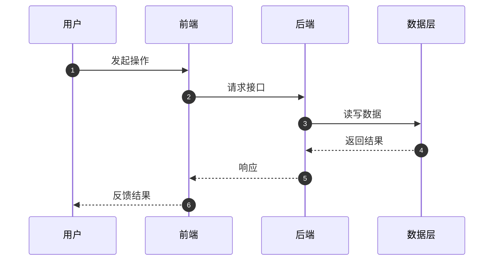
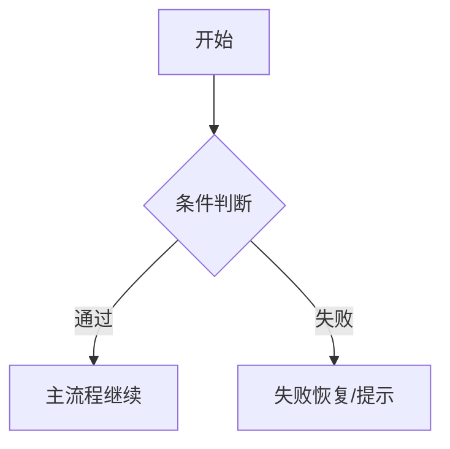
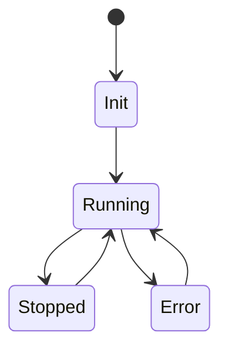

# SDD 标准模板（评审增强版）

> 版本：v1.0
> 适用：规范驱动开发（SDD）
> 来源：结合本项目第2~7期实践，并吸收 `plan-eng-review` / `plan-ceo-review` 的评审视角
> 文档状态：模板

---

## 0. 文档元信息

- **文档标题**：SDD-第X期：<主题>
- **文档版本**：vX.Y
- **创建日期**：YYYY-MM-DD
- **修订日期**：YYYY-MM-DD
- **负责人**：
- **关联需求/任务**：
- **前置依赖期次**：
- **目标读者**：产品 / 前端 / 后端 / 测试 / 运维

---

## 1. 执行摘要（给决策者）

### 1.1 本期要解决的问题（Problem）
- 用 3~5 条说明真实用户问题与业务痛点（不是技术动作）。

### 1.2 本期关键结果（Outcome）
- 用可验收结果描述“完成后用户能做什么”。

### 1.3 成功判定（Success Metrics）
- 指标1：
- 指标2：
- 指标3：

---

## 2. 范围定义（Scope）

### 2.1 In Scope（本期必须交付）
-
-

### 2.2 Out of Scope / NOT in scope（明确不做）
| 项目 | 不纳入本期原因 |
|---|---|
|  |  |

> 要求：凡是不做的内容必须写清楚，避免隐性范围漂移。

---

## 3. 前提挑战与方案比选（评审增强）

### 3.1 前提挑战（Premise Challenge）
- 这是否是正确问题，而不是代理问题？
- 如果“什么都不做”，会发生什么具体损失？
- 是否存在更小改动即可达成同等价值的路径？

### 3.2 现有资产复用（What already exists）

#### 3.2.1 前端复用资产
| 资产 | 路径 | 可复用能力 | 本期复用方式 |
|---|---|---|---|
|  |  |  |  |

#### 3.2.2 后端复用资产
| 资产 | 路径 | 可复用能力 | 本期复用方式 |
|---|---|---|---|
|  |  |  |  |

### 3.3 实施路径备选（至少2个）

#### 方案A：最小可行路径（Minimal Diff）
- 摘要：
- 优点：
- 风险：
- 适用前提：

#### 方案B：长期最优路径（Ideal Trajectory）
- 摘要：
- 优点：
- 风险：
- 适用前提：

#### 方案C（可选）：折中路径
- 摘要：
- 优点：
- 风险：

### 3.4 方案决策
- **最终采用**：A / B / C
- **决策理由**：
- **放弃方案的原因**：

---

## 4. 系统交互设计（必须含图）

### 4.1 核心时序图（Mermaid / PlantUML）

### 4.2 主流程图（含关键分支）

### 4.3 状态机图（有状态业务必填）

---

## 5. API 契约（标准化表格）

> 禁止写实现代码；仅定义契约与语义。

| Endpoint | Method | 鉴权方式 | Request 结构 | Response 结构 | 状态码说明 |
|---|---|---|---|---|---|
| `/api/v1/...` | GET/POST/... | Bearer Token / None | 字段+类型+必填 | 字段+类型 | 200/400/401/403/404/409/500 |

### 5.1 错误语义映射（推荐）
| 错误码 | 语义 | 前端动作 |
|---|---|---|
| `STATE_CONFLICT` | 状态冲突 | 刷新状态并提示 |
| `UNAUTHORIZED` | 鉴权失败 | 跳转登录 |
| `RESOURCE_NOT_FOUND` | 资源不存在 | 空态引导 |

---

## 6. 数据字典（数据库模型说明）

### 6.1 表/实体：`<name>`
| 字段名 | 数据类型 | 是否必填 | 默认值 | 业务说明 |
|---|---|---|---|---|
| id | INTEGER | 是 | 自增 | 主键 |

### 6.2 枚举/状态字典
| 枚举值 | 含义 | 业务约束 / UI策略 |
|---|---|---|
| creating | 创建中 | 只读等待态 |

---

## 7. 安全与合规约束

| 风险点 | 威胁描述 | 防护策略 | 验证方式 |
|---|---|---|---|
| 越权访问 | 访问他人资源 | 资源属主校验 | 权限测试 |
| 路径穿越 | 非法路径读写 | 路径归一化+白名单根目录 | 安全用例 |
| 注入风险 | SQL/命令/模板注入 | 参数化/转义/边界校验 | 安全扫描+测试 |

---

## 8. 异常、恢复与可观测性

### 8.1 失败模式登记（Failure Modes Registry）
| Codepath | 失败模式 | 已处理? | 用户可见? | 有日志/指标? | 测试覆盖? |
|---|---|---|---|---|---|
|  |  | Y/N | 明确提示/静默失败 | Y/N | Y/N |

### 8.2 错误恢复策略
| 场景 | 降级策略 | 重试策略 | 终态处理 |
|---|---|---|---|
| 上游超时 | 返回可恢复提示 | 指数退避重试 | 引导重试/返回 |

### 8.3 可观测性要求
- 关键日志字段：trace_id、user_id、resource_id、error_code
- 核心指标：请求成功率、P95 延迟、错误率、重试次数
- 告警建议：
  - 错误率超过阈值
  - 关键接口连续失败

---

## 9. 测试与验收（必须量化）

### 9.1 测试覆盖地图（建议）
| 流程/分支 | 测试类型 | 用例要点 | 通过标准 |
|---|---|---|---|
| 主流程 | 集成测试 | 正常输入 | 返回成功且数据正确 |
| 异常分支 | 集成/端到端 | 超时/越权/空数据 | 错误语义正确且可恢复 |

### 9.2 验收标准

#### 9.2.1 功能验收
- [ ] 验收项1
- [ ] 验收项2

#### 9.2.2 稳定性验收
- [ ] 连续运行 X 分钟无致命错误
- [ ] 核心操作成功率 ≥ Y%

#### 9.2.3 一致性验收
- [ ] API 契约与实现行为一致
- [ ] 状态字典与UI反馈一致

---

## 10. 实施分期与交付清单

### 10.1 分期总览
| 期次 | 目标 | 范围边界 | 依赖 | 风险 |
|---|---|---|---|---|
| 第X期 |  |  |  |  |

### 10.2 本期交付物清单
- 文档交付：
- 前端交付：
- 后端交付：
- 测试交付：

---

## 11. Deferred（后续阶段）

| 延后项 | 延后原因 | 触发条件（何时再做） |
|---|---|---|
|  |  |  |

---

## 12. 附录

### 12.1 规范—代码映射
| 规范项 | 代码路径 |
|---|---|
|  |  |

### 12.2 术语表
| 术语 | 定义 |
|---|---|
|  |  |

### 12.3 变更记录
| 版本 | 日期 | 变更说明 | 负责人 |
|---|---|---|---|
| v1.0 | YYYY-MM-DD | 初版模板 |  |
