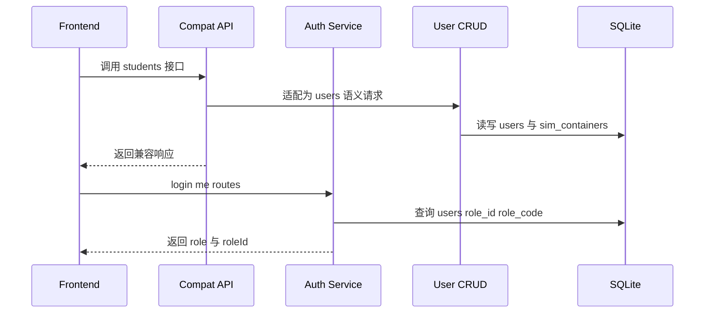
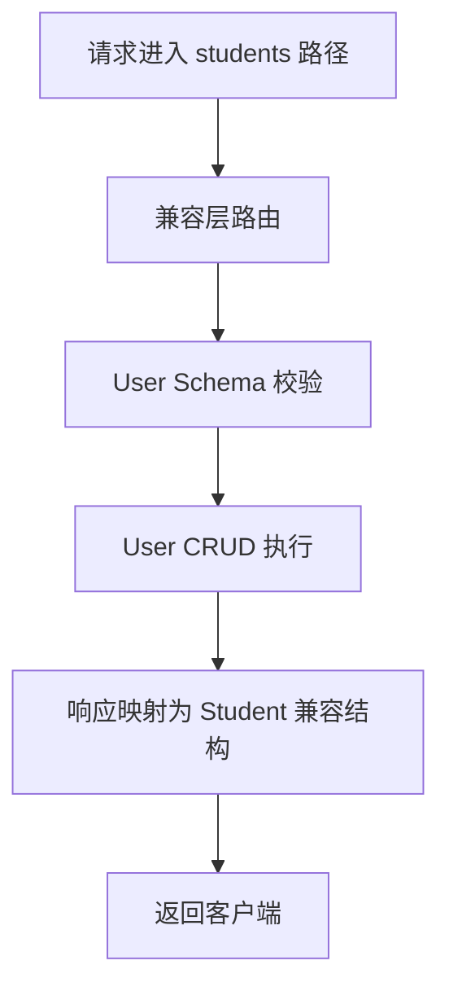

# SDD-第7.5期：用户域模型重构与角色字段规范

## 0. 文档元信息
- 文档名称：第7.5期 用户域模型重构与角色字段规范
- 适用范围：后端数据模型、鉴权契约、教师端学生管理接口、学生端基础接口
- 本期定位：方案一，内部 users 语义统一，对外保持 students 与 teachers/students 路径不变
- 版本状态：规划草案

## 1. 背景与目标
### 1.1 核心需求
当前后端核心实体为 students，且 role 语义分散在登录返回、路由权限映射、前端展示等多个位置。本期目标是在不破坏现有外部接口的前提下，完成内部用户域统一。

### 1.2 设计原则
1. 内部统一优先：模型、CRUD、Schema、鉴权统一到 users 语义。
2. 外部兼容优先：现有路径与响应外观保持稳定。
3. 角色强约束：采用 role_id + role_code 双字段规范。
4. 可演进优先：为后续方案二预留平滑升级路径。

### 1.3 成功判定
1. 数据库主实体完成从 students 到 users 的内部重构。
2. role 与 roleId 在登录、鉴权、路由映射中保持一致语义。
3. /api/v1/students 与 /api/v1/teachers/students 的调用方无需改造即可继续使用。
4. 迁移可回滚，出现异常时可恢复至迁移前状态。

## 2. 范围定义
### 2.1 In Scope
1. users 表模型定义与 students 历史数据迁移。
2. role_id 与 role_code 双字段规范落位。
3. sim_containers 关系字段由 student_id 迁移到 user_id。
4. 鉴权与当前用户信息接口的语义统一。
5. 对外 API 兼容层设计。

### 2.2 Out of Scope
1. 前端路由命名从 student 全量改为 user。
2. 外部 API 路径重命名为 /users 与 /teachers/users。
3. 多租户角色体系与细粒度 RBAC 权限中心。

## 3. 方案评审与决策
### 3.1 前提挑战
- 现有业务强依赖 students 命名，直接全量重命名风险高。
- SQLite 外键调整在无迁移框架场景下需要显式兼容步骤。

### 3.2 备选方案
#### 方案A 最小可行路径
内部 users 化，外部路径保持不变，通过别名 Schema 与兼容层适配。

#### 方案B 长期最优路径
内外语义统一为 users，逐步下线 students 命名接口。

### 3.3 方案决策
本期采用方案A，并在第11章给出方案B演进路线。

## 4. 架构与流程
### 4.1 核心时序图

### 4.2 主流程图

### 4.3 状态一致性规则
1. role_code 是业务语义字段，示例值 student teacher admin。
2. role_id 是稳定主键字段，用于跨模块引用与演进。
3. 登录返回中 role 对应 role_code，roleId 对应 role_id。

## 5. API 契约
### 5.1 兼容原则
1. 保持现有路径不变：
   - /api/v1/students
   - /api/v1/teachers/students
2. 保持响应主字段不破坏现有前端读取逻辑。
3. 内部实现统一走 UserService 与 UserSchema。

### 5.2 登录与鉴权契约
1. login 返回 data.username data.role data.roleId。
2. me 返回用户基础信息时，role 展示为 role_code。
3. routes 根据 role_code 做路由白名单映射。

### 5.3 错误语义映射
1. role_id 缺失或非法：400 参数错误。
2. role_code 不在字典内：422 语义校验失败。
3. users 与容器关系不一致：409 数据一致性冲突。

## 6. 数据模型设计
### 6.1 表 实体 users
建议字段如下：
- id: int 主键
- username: string 唯一
- email: string 可空 唯一约束按现有策略保持
- hashed_password: string
- full_name: string 可空
- is_active: bool
- role_id: string 非空 稳定主键语义
- role_code: string 非空 业务代码语义
- created_at: datetime
- updated_at: datetime

### 6.2 枚举 状态字典
- role_code 初始字典：student teacher admin
- role_id 与 role_code 映射初始约定：
  - role_id 10 对应 student
  - role_id 20 对应 teacher
  - role_id 30 对应 admin

说明：role_id 作为稳定标识，后续允许 role_code 变更展示文案或扩展别名，不破坏下游引用。

### 6.3 关系映射
- sim_containers.student_id 迁移为 sim_containers.user_id。
- 外键目标由 students.id 切换为 users.id。
- 兼容窗口内可在代码层保留 student_id 到 user_id 的读取映射逻辑。

### 6.4 索引与约束
1. uq_users_username 唯一索引。
2. idx_users_role_id 普通索引。
3. idx_users_role_code 普通索引。
4. ck_users_role_code 字典约束。
5. fk_sim_containers_user_id 外键约束。

## 7. 安全与合规
1. 密码仅存储 hashed_password，不落明文。
2. 鉴权不可信任前端传入 roleId，必须以后端查询结果为准。
3. 角色升级与降级操作必须记录审计日志。

## 8. 异常与可观测
### 8.1 失败模式登记
1. 迁移中断导致 users 表存在但外键未切换完成。
2. role_id 与 role_code 回填不完整导致登录接口异常。
3. 兼容层字段映射遗漏导致前端解析失败。

### 8.2 恢复策略
1. 迁移前生成数据库文件快照。
2. 分阶段提交 DDL 与数据回填，失败即回滚到快照。
3. 启用兼容开关，必要时回退到 students 读取路径。

### 8.3 观测要求
1. 记录迁移任务日志，输出到 logs 目录。
2. 增加 login me students 核心接口成功率指标。
3. 增加 role 字段一致性巡检日志。

## 9. 测试与验收
### 9.1 测试覆盖地图
1. 单元测试：User CRUD、role 映射、兼容层转换。
2. 集成测试：students 与 teachers/students 全链路。
3. 迁移测试：旧库到新库回填与回滚。

### 9.2 验收标准
#### 9.2.1 功能验收
- 既有前端页面可正常登录、拉取用户信息、访问角色路由。

#### 9.2.2 稳定性验收
- 迁移后核心接口稳定，无批量 5xx。

#### 9.2.3 一致性验收
- 抽样校验 users.role_id 与 users.role_code 映射正确。

## 10. 实施分解
### 10.1 分期总览
1. 数据层改造。
2. 服务层与接口兼容层改造。
3. 鉴权与路由映射改造。
4. 测试与发布验证。

### 10.2 本期交付物
1. users 模型与 Schema 规范。
2. 迁移脚本与回滚脚本。
3. 兼容层 API 规范说明。
4. 验收与观测清单。

## 11. Deferred 后续阶段
### 11.1 方案一 到 方案二 演进路线
触发条件：
1. 前端与第三方调用方完成 /users 路径切换准备。
2. 兼容指标稳定一个发布周期。
3. 监控确认 students 路径调用量可控。

里程碑拆分：
1. 新增并灰度开放 /api/v1/users 与 /api/v1/teachers/users。
2. 发布双写或双读兼容策略并观测。
3. 废弃公告与迁移窗口。
4. 下线 /students 与 /teachers/students 旧路径。

## 12. 附录
### 12.1 规范 代码映射
- 认证：app/api/v1/endpoints/common/auth.py
- 学生端接口：app/api/v1/endpoints/student/basic.py
- 教师端学生接口：app/api/v1/endpoints/teacher/students.py
- 模型：app/models/student.py app/models/container.py
- Schema：app/schemas/student.py app/schemas/auth.py
- 初始化：init_db.py

### 12.2 术语表
- role_code：角色业务代码值。
- role_id：角色稳定主键值。
- 兼容层：外部 students 语义到内部 users 语义的适配层。

### 12.3 变更记录
- v0.1：完成第7.5期方案一规划草案，明确 role_id + role_code 双字段规范，并附方案二演进路线。