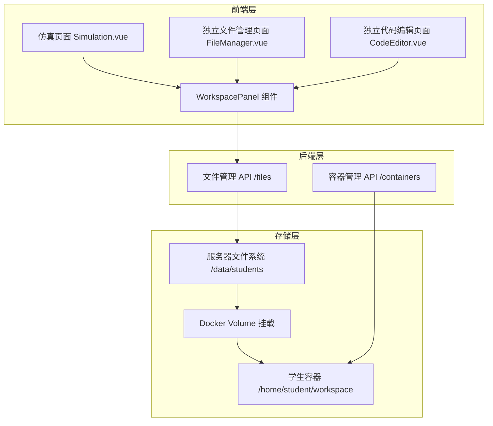
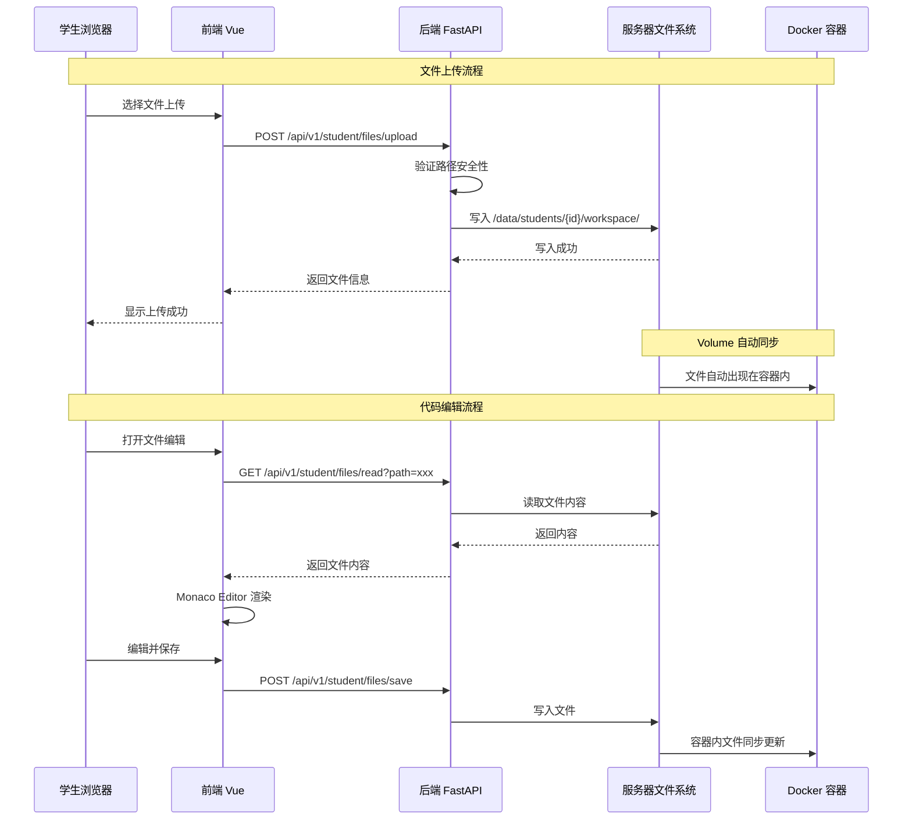

# SDD-第七期：文件管理与代码编辑模块

**文档版本**: v1.1  
**创建日期**: 2026-03-29  
**修订日期**: 2026-03-29  
**目标**: 实现学生工作区文件管理、代码在线编辑、独立页面访问能力

---

## 一、需求概述

### 1.1 核心需求

1. **文件上传**: 采用混合模式（服务器存储 + Volume 挂载）
2. **工作目录**: 使用 Volume 挂载方案实现持久化
3. **代码编辑器**: 使用 Monaco Editor，呈现形式为独立面板（左右分栏）
4. **独立页面**: 文件管理和代码编辑器可独立打开，无需进入仿真页面
5. **仿真页面集成**: WorkspacePanel 可在仿真页面内作为面板打开

### 1.2 设计原则

- 数据持久化：容器重启不丢失文件
- 安全隔离：路径穿越防护、权限控制
- 用户体验：VS Code 级别的编辑体验
- 灵活访问：支持仿真页面内嵌和独立页面两种模式

---

## 二、系统架构

### 2.1 整体架构图



### 2.2 数据流时序图



---

## 三、数据库设计

### 3.1 无需新增数据表

本模块不需要新增数据库表，文件元数据通过文件系统直接获取。

### 3.2 依赖现有表

| 表名 | 用途 | 关键字段 |
|------|------|----------|
| `students` | 学生身份验证 | `id`, `username` |
| `containers` | 容器信息查询 | `student_id`, `container_id`, `status` |

---

## 四、后端 API 设计

### 4.1 文件上传 API

| 项目 | 内容 |
|------|------|
| **Endpoint** | `POST /api/v1/student/files/upload` |
| **Method** | POST (multipart/form-data) |
| **鉴权** | Bearer Token (student 角色) |
| **Request Body** | `file`: UploadFile (必填)<br>`target_path`: string (可选，默认 "."，相对于 workspace) |
| **Response 200** | `{"code": 200, "message": "上传成功", "data": {"filename": "nav.py", "path": "src/nav.py", "size": 1024}}` |
| **Response 400** | `{"code": 400, "message": "非法路径"}` (路径包含 `..` 或以 `/` 开头) |
| **Response 413** | `{"code": 413, "message": "文件过大"}` (超过 10MB) |
| **Response 500** | `{"code": 500, "message": "写入失败"}` |

**核心逻辑伪代码**:
```
1. 路径安全检查
   IF target_path 包含 ".." OR 以 "/" 开头 THEN
       返回 400 错误
   END IF

2. 构造目标路径
   workspace = /data/students/{student_id}/workspace
   target_dir = workspace + target_path
   创建目录（如不存在）

3. 文件大小限制
   MAX_FILE_SIZE = 10MB
   IF file.size > MAX_FILE_SIZE THEN
       返回 413 错误
   END IF

4. 保存文件
   file_path = target_dir + file.filename
   写入文件内容
```

### 4.2 文件列表 API

| 项目 | 内容 |
|------|------|
| **Endpoint** | `GET /api/v1/student/files/list` |
| **Method** | GET |
| **鉴权** | Bearer Token (student 角色) |
| **Query Params** | `path`: string (可选，默认 "."，相对路径) |
| **Response 200** | `{"code": 200, "data": {"files": [...], "directories": [...]}}` |
| **Response 403** | `{"code": 403, "message": "无权访问"}` |

**Response Data 结构**:
```typescript
{
  files: [
    {
      name: "navigation.launch",
      path: "launch/navigation.launch",
      size: 2048,
      modified: "2026-03-29T10:30:00Z",
      extension: ".launch"
    }
  ],
  directories: [
    {
      name: "src",
      path: "src",
      file_count: 5
    }
  ]
}
```

### 4.3 文件读取 API

| 项目 | 内容 |
|------|------|
| **Endpoint** | `GET /api/v1/student/files/read` |
| **Method** | GET |
| **鉴权** | Bearer Token (student 角色) |
| **Query Params** | `path`: string (必填，相对路径) |
| **Response 200** | `{"code": 200, "data": {"content": "文件内容", "encoding": "utf-8"}}` |
| **Response 403** | `{"code": 403, "message": "无权访问"}` |
| **Response 404** | `{"code": 404, "message": "文件不存在"}` |

**核心逻辑伪代码**:
```
1. 路径安全检查
   workspace = /data/students/{student_id}/workspace
   file_path = resolve(workspace + path)

2. 防止路径穿越
   IF file_path 不在 workspace 内 THEN
       返回 403 错误
   END IF

3. 读取文件
   尝试 UTF-8 编码读取
   失败则尝试 GBK 编码
```

### 4.4 文件保存 API

| 项目 | 内容 |
|------|------|
| **Endpoint** | `POST /api/v1/student/files/save` |
| **Method** | POST |
| **鉴权** | Bearer Token (student 角色) |
| **Request Body** | `{"path": "src/nav.py", "content": "#!/usr/bin/env python\n..."}` |
| **Response 200** | `{"code": 200, "message": "保存成功"}` |
| **Response 403** | `{"code": 403, "message": "无权访问"}` |

### 4.5 文件删除 API

| 项目 | 内容 |
|------|------|
| **Endpoint** | `DELETE /api/v1/student/files/delete` |
| **Method** | DELETE |
| **鉴权** | Bearer Token (student 角色) |
| **Query Params** | `path`: string (必填) |
| **Response 200** | `{"code": 200, "message": "删除成功"}` |
| **Response 403** | `{"code": 403, "message": "无权访问"}` |
| **Response 404** | `{"code": 404, "message": "文件不存在"}` |

### 4.6 目录创建 API

| 项目 | 内容 |
|------|------|
| **Endpoint** | `POST /api/v1/student/files/mkdir` |
| **Method** | POST |
| **鉴权** | Bearer Token (student 角色) |
| **Request Body** | `{"path": "src/my_package"}` |
| **Response 200** | `{"code": 200, "message": "创建成功"}` |
| **Response 400** | `{"code": 400, "message": "目录已存在"}` |

---

## 五、前端组件设计

### 5.1 组件结构

```
edubot-twin-web/src/
├── views/
│   ├── Simulation/
│   │   └── panels/
│   │       └── WorkspacePanel/          # 工作区面板（仿真页面内嵌）
│   │           ├── index.vue
│   │           ├── FileTree.vue
│   │           ├── MonacoEditor.vue
│   │           └── composables/
│   │               └── useWorkspace.ts
│   └── Student/
│       ├── FileManager.vue              # 独立文件管理页面
│       └── CodeEditor.vue               # 独立代码编辑页面
├── components/
│   └── Monaco/
│       └── MonacoEditor.vue             # Monaco 编辑器封装
└── api/
    └── files/
        ├── index.ts
        └── types.ts
```

### 5.2 WorkspacePanel 主面板

**功能**: 左右分栏式面板，左侧文件树，右侧代码编辑器

**布局结构**:
```
┌─────────────────────────────────────────────┐
│  文件管理 & 代码编辑                         │
├──────────────┬──────────────────────────────┤
│ 📁 文件树    │  Monaco Editor               │
│              │  ┌─────────────────────────┐ │
│ workspace/   │  │ 1  #!/usr/bin/env python│ │
│ ├─ src/      │  │ 2  import rospy         │ │
│ │  └─ nav.py │  │ 3                       │ │
│ ├─ launch/   │  │ 4  def main():          │ │
│ │  └─ nav... │  │ 5      rospy.init_node()│ │
│ └─ config/   │  └─────────────────────────┘ │
│              │  [保存] [运行] [格式化]       │
└──────────────┴──────────────────────────────┘
```

**Props**:
```typescript
interface Props {
  containerId?: string  // 容器 ID（可选，用于显示容器状态）
}
```

**使用场景**:
- **仿真页面内嵌**: 作为 Golden Layout 面板，与其他面板（终端、3D 视图）并列
- **独立页面访问**: 学生端独立文件管理页面，全屏使用

### 5.3 FileTree 文件树组件

**功能**: 树形结构显示文件和目录、支持上传、删除

**核心状态**:
```typescript
interface FileTreeState {
  treeData: TreeNode[]      // 树形数据
  selectedFile: FileItem | null
  expandedKeys: string[]    // 展开的节点
  loading: boolean
}

interface TreeNode {
  key: string
  label: string
  type: 'file' | 'directory'
  children?: TreeNode[]
  size?: number
  extension?: string
}
```

**关键交互**:
1. 点击目录 → 展开/折叠
2. 点击文件 → 在右侧编辑器打开
3. 右键菜单 → 上传、删除、重命名、新建
4. 拖拽上传 → 上传到对应目录

### 5.4 MonacoEditor 代码编辑器组件

**功能**: Monaco Editor 集成，支持多语言语法高亮

**Props**:
```typescript
interface Props {
  file: {
    name: string
    path: string
    content: string
  } | null
}
```

**Monaco 配置**:
```typescript
{
  theme: 'vs-dark',
  automaticLayout: true,
  fontSize: 14,
  minimap: { enabled: true },
  scrollBeyondLastLine: false,
  wordWrap: 'on'
}
```

**语言检测逻辑**:
```
根据文件扩展名映射：
.py → python
.cpp, .h → cpp
.launch, .xml → xml
.yaml, .yml → yaml
.json → json
.sh → shell
其他 → plaintext
```

---

## 六、容器配置调整

### 6.1 Volume 挂载配置

**修改位置**: `edubot-twin-server/app/core/container_manager.py` 的 `create_container()` 函数

**新增配置伪代码**:
```
volumes = {
    # 学生工作区（读写）
    '/data/students/{student_id}/workspace': {
        'bind': '/home/student/workspace',
        'mode': 'rw'
    },
    # ROS 模板（只读）
    '/data/templates/ros_packages': {
        'bind': '/opt/templates',
        'mode': 'ro'
    }
}
```

### 6.2 工作目录初始化

**新增函数**: `create_student_workspace(student_id: int)`

**核心逻辑伪代码**:
```
FUNCTION create_student_workspace(student_id):
    workspace = /data/students/{student_id}/workspace
    创建目录 workspace（如不存在）
    
    # 初始化目录结构
    创建子目录 src
    创建子目录 launch
    创建子目录 config
    创建子目录 scripts
    
    # 复制模板文件（可选）
    IF 模板目录存在 THEN
        复制模板到 workspace/src/
    END IF
    
    RETURN workspace
END FUNCTION
```

**调用时机**: 学生首次创建容器时自动调用

---

## 七、路由配置

### 7.1 前端路由

**新增路由**:
```typescript
// edubot-twin-web/src/router/index.ts
{
  path: '/student/files',
  name: 'StudentFileManager',
  component: () => import('@/views/Student/FileManager.vue'),
  meta: {
    title: '文件管理',
    requiresAuth: true,
    roles: ['student']
  }
},
{
  path: '/student/editor',
  name: 'StudentCodeEditor',
  component: () => import('@/views/Student/CodeEditor.vue'),
  meta: {
    title: '代码编辑器',
    requiresAuth: true,
    roles: ['student']
  }
}
```

**Mock 配置**: 在 `mock/role/index.mock.ts` 的 `student` 角色路由列表中添加：
```typescript
{
  path: '/student/files',
  component: '#',
  name: 'StudentFileManager',
  meta: { title: '文件管理', icon: 'carbon:document' }
},
{
  path: '/student/editor',
  component: '#',
  name: 'StudentCodeEditor',
  meta: { title: '代码编辑器', icon: 'carbon:code' }
}
```

### 7.2 后端路由

**新增路由模块**: `edubot-twin-server/app/api/v1/endpoints/student/files.py`

**注册路由伪代码**:
```
# edubot-twin-server/app/api/v1/endpoints/student/__init__.py
从 files 模块导入 router
注册到主路由: prefix="/files", tags=["student-files"]
```

---

## 八、安全设计

### 8.1 路径穿越防护

**核心函数伪代码**:
```
FUNCTION validate_path(workspace, user_path):
    # 1. 禁止绝对路径
    IF user_path 以 "/" 开头 THEN
        抛出错误 "不允许使用绝对路径"
    END IF
    
    # 2. 禁止 .. 符号
    IF user_path 包含 ".." THEN
        抛出错误 "路径不能包含 .."
    END IF
    
    # 3. 解析为绝对路径并验证
    full_path = resolve(workspace + user_path)
    IF full_path 不在 workspace 内 THEN
        抛出错误 "路径超出工作区范围"
    END IF
    
    RETURN full_path
END FUNCTION
```

### 8.2 文件大小限制

```
MAX_FILE_SIZE = 10MB（单文件）
MAX_TOTAL_SIZE = 100MB（每个学生总容量）
```

### 8.3 磁盘配额管理

**实现方式**: 在文件上传前检查学生工作区总大小

**核心逻辑伪代码**:
```
FUNCTION check_disk_quota(student_id, new_file_size):
    workspace = /data/students/{student_id}/workspace
    current_size = 计算 workspace 目录总大小
    
    IF current_size + new_file_size > MAX_TOTAL_SIZE THEN
        返回错误 "存储空间不足"
    END IF
    
    RETURN True
END FUNCTION
```

---

## 九、实施计划

### 9.1 开发任务分解

| 任务 | 预估工时 | 优先级 |
|------|---------|--------|
| 后端文件管理 API 开发 | 1 天 | P0 |
| 容器 Volume 挂载配置 | 0.5 天 | P0 |
| 前端 Monaco Editor 集成 | 1 天 | P0 |
| WorkspacePanel 组件开发 | 1 天 | P0 |
| 独立页面开发 | 0.5 天 | P1 |
| 路由配置与权限控制 | 0.5 天 | P1 |
| 安全测试与优化 | 0.5 天 | P1 |

**总计**: 约 5 天

### 9.2 测试用例

| 测试场景 | 预期结果 |
|---------|---------|
| 上传 Python 文件到 `src/` | 文件出现在容器 `/home/student/workspace/src/` |
| 尝试上传路径 `../../etc/passwd` | 返回 400 错误 |
| 编辑并保存 `.launch` 文件 | 容器内文件同步更新 |
| 删除文件后在终端查看 | 文件已不存在 |
| 上传 11MB 文件 | 返回 413 错误 |
| 非 student 角色访问 | 返回 403 错误 |
| 工作区总大小超过 100MB | 返回存储空间不足错误 |
| 在仿真页面打开 WorkspacePanel | 面板正常显示并可编辑文件 |

---

## 十、技术风险与应对

| 风险 | 影响 | 应对措施 |
|------|------|---------|
| Monaco Editor 体积大（2MB+） | 首次加载慢 | 使用 CDN + 懒加载 |
| 文件编码问题（GBK/UTF-8） | 乱码 | 自动检测编码，提供手动切换 |
| 并发写入冲突 | 文件损坏 | 文件锁机制（可选） |
| Volume 挂载权限问题 | 容器内无法写入 | 容器内使用 UID 1000 用户 |
| 磁盘配额计算耗时 | API 响应慢 | 异步计算 + 缓存 |

---

## 十一、后续优化方向

1. **版本控制**: 集成 Git，支持提交、回滚
2. **协作编辑**: 多人同时编辑同一文件（WebSocket 同步）
3. **代码补全**: 集成 Language Server Protocol (LSP)
4. **文件搜索**: 全文搜索功能
5. **模板市场**: 提供常用 ROS 包模板下载

---

**文档状态**: 已完成  
**审核状态**: 待审核  
**最后更新**: 2026-03-29
