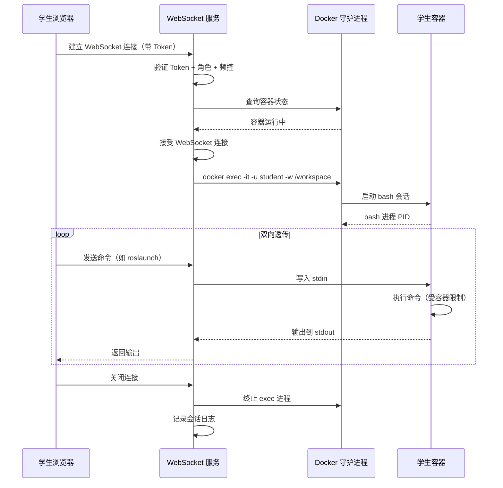
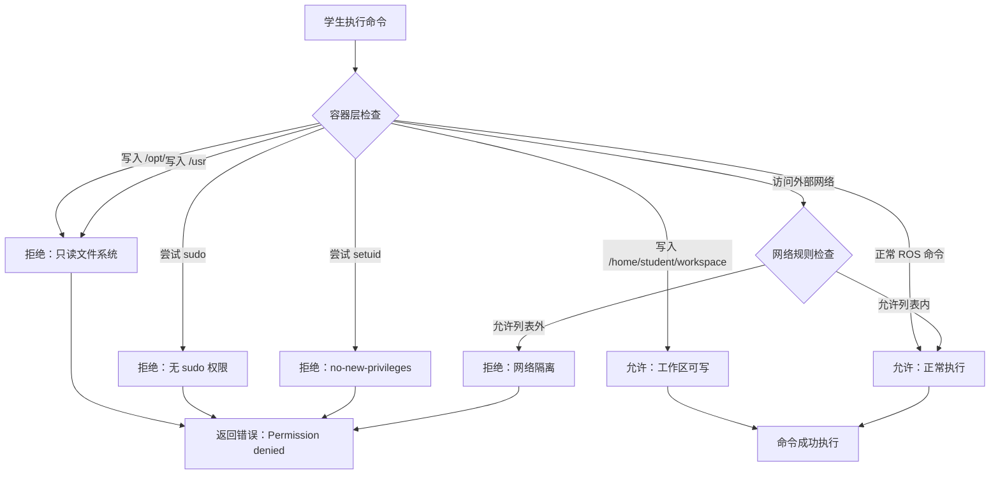

# SDD-第八期：容器安全加固与终端优化

**文档版本**: v1.1  
**创建日期**: 2026-03-29  
**修订日期**: 2026-03-29  
**目标**: 实现容器层安全隔离、终端自由操作、gzweb 启动参数对齐、网络限制

---

## 一、需求概述

### 1.1 核心需求

1. **容器安全加固**: 采用"自由终端 + 受限容器"方案
2. **终端保持自由**: 不拦截命令流，保留 ROS 调试能力
3. **容器层限制**: 路径限制、只读文件系统、非 root 用户、降权、网络隔离
4. **启动参数对齐**: 按照 gzweb/docker-compose.yml 的配置设置容器参数
5. **磁盘配额**: 依赖第七期实现的文件上传配额检查

### 1.2 设计原则

- **Free Terminal / Guarded Container**: 终端自由，容器受限
- **纵深防御**: 多层安全措施，单点失效不导致系统崩溃
- **最小权限**: 容器仅获得必要的系统权限
- **审计留痕**: 所有终端会话记录日志
- **网络隔离**: 限制容器外部网络访问

---

## 二、安全架构设计

### 2.1 安全层次图

```mermaid
graph TB
    subgraph 第一层：身份认证
        A[JWT Token 验证]
        B[角色权限检查]
        C[频率限制]
    end
    
    subgraph 第二层：终端层
        D[WebSocket 双向透传]
        E[会话审计日志]
        F[极端命令兜底]
    end
    
    subgraph 第三层：容器层
        G[非 root 用户]
        H[只读文件系统]
        I[工作区可写挂载]
        J[能力降权 cap_drop]
        K[禁止特权提升]
        L[网络隔离]
    end
    
    subgraph 第四层：宿主机层
        M[Docker 隔离]
        N[资源限制]
        O[磁盘配额-第七期]
    end
    
    A --> D
    B --> D
    C --> D
    D --> G
    E --> G
    F --> G
    G --> M
    H --> M
    I --> M
    J --> M
    K --> M
    L --> M
```

### 2.2 安全策略对比

| 维度 | 传统方案（命令拦截） | 推荐方案（容器受限） |
|------|---------------------|---------------------|
| **终端自由度** | ❌ 受限，误杀调试命令 | ✅ 完全自由 |
| **安全性** | ⚠️ 依赖黑名单（易绕过） | ✅ 容器层物理隔离 |
| **开发工作量** | 高（复杂规则维护） | 低（Docker 原生能力） |
| **用户体验** | 差（频繁拦截提示） | 好（透明防护） |
| **教学价值** | 低（隐藏真实环境） | 高（真实 Linux 体验） |

---

## 三、容器安全配置

### 3.1 容器创建参数调整

**修改位置**: `edubot-twin-server/app/core/container_manager.py` 的 `create_container()` 函数

**新增安全配置伪代码**:

```
容器配置 = {
    镜像: image,
    分离模式: True,
    容器名: container_name,
    
    # ========== 端口映射 ==========
    端口映射: {
        "8080/tcp": gz_port,
        "9090/tcp": ros_port
    },
    
    # ========== Volume 挂载（对齐 gzweb） ==========
    卷挂载: {
        # 学生工作区（唯一可写目录）
        '/data/students/{student_id}/workspace': {
            绑定: '/home/student/workspace',
            模式: 'rw'
        },
        # X11 显示（只读）
        '/tmp/.X11-unix': {
            绑定: '/tmp/.X11-unix',
            模式: 'ro'
        },
        # 系统目录只读（防止篡改）
        '/opt/ros': {
            绑定: '/opt/ros',
            模式: 'ro'
        },
        '/usr': {
            绑定: '/usr',
            模式: 'ro'
        }
    },
    
    # ========== 设备挂载（对齐 gzweb） ==========
    设备: [
        '/dev/dri:/dev/dri:rwm'  # GPU 加速
    ],
    
    # ========== 环境变量（对齐 gzweb） ==========
    环境变量: {
        'DISPLAY': 获取环境变量('DISPLAY', 默认':0'),
        'ROS_MASTER_URI': 'http://localhost:11311',
        'ROS_HOSTNAME': 'localhost'
    },
    
    # ========== 资源限制 ==========
    内存限制: "2g",
    CPU限制: 2核心,
    共享内存: "512m",  # 对齐 gzweb
    
    # ========== 安全配置 ==========
    用户: "1000:1000",  # 非 root 用户（student）
    特权模式: False,  # 禁用特权模式
    安全选项: [
        'no-new-privileges:true'  # 禁止进程提升权限
    ],
    能力移除: ['ALL'],  # 移除所有 Linux Capabilities
    能力添加: [
        'CHOWN',      # 允许修改文件所有者（工作区内）
        'DAC_OVERRIDE',  # 允许绕过文件权限检查（工作区内）
        'SETGID',     # 允许设置 GID
        'SETUID'      # 允许设置 UID
    ],
    
    # ========== 网络隔离配置 ==========
    网络模式: 'bridge',  # 使用桥接网络
    DNS服务器: ['8.8.8.8', '8.8.4.4'],  # 指定 DNS
    # 可选：创建自定义网络并限制出站流量
    网络: 'edubot_network',  # 自定义网络名称
    
    # ========== 工作目录 ==========
    工作目录: '/home/student/workspace',
    
    # ========== 标签 ==========
    标签: {
        "edubot.student_id": student_id,
        "edubot.type": "simulation",
        "edubot.security_level": "restricted"
    },
    
    # ========== TTY 支持（对齐 gzweb） ==========
    标准输入打开: True,
    TTY: True,
    
    删除时移除: False
}
```

### 3.2 网络隔离配置

**目标**: 限制容器仅能访问必要的外部网络资源

**实现方案**:

**网络创建伪代码**:
```
FUNCTION create_edubot_network():
    IF 网络 'edubot_network' 不存在 THEN
        创建网络 'edubot_network' WITH {
            驱动: 'bridge',
            内部网络: False,  # 允许访问外部（受防火墙规则限制）
            子网: '172.20.0.0/16',
            网关: '172.20.0.1'
        }
    END IF
END FUNCTION
```

**防火墙规则伪代码**（宿主机层面）:
```
# 允许容器访问的目标
允许列表 = [
    '8.8.8.8',      # DNS
    '8.8.4.4',      # DNS
    '宿主机IP',      # 访问宿主机服务
    'ROS包仓库IP'    # 允许下载 ROS 包
]

# iptables 规则（示例）
FOR EACH 容器IP IN edubot_network:
    默认拒绝所有出站流量
    FOR EACH 允许IP IN 允许列表:
        允许 容器IP -> 允许IP
    END FOR
END FOR
```

### 3.3 安全配置说明

| 配置项 | 作用 | 安全效果 |
|--------|------|---------|
| `user="1000:1000"` | 容器内使用非 root 用户 | 防止提权攻击 |
| `privileged=False` | 禁用特权模式 | 防止访问宿主机设备 |
| `no-new-privileges` | 禁止进程提升权限 | 防止 setuid 提权 |
| `cap_drop=['ALL']` | 移除所有 Linux 能力 | 最小权限原则 |
| `cap_add=[...]` | 仅添加必要能力 | 精细化权限控制 |
| 只读挂载 `/opt/ros`, `/usr` | 系统目录不可写 | 防止篡改系统文件 |
| 读写挂载 `/home/student/workspace` | 工作区可写 | 学生操作不受限 |
| 自定义网络 + 防火墙 | 限制外部访问 | 防止恶意网络行为 |

---

## 四、终端安全优化

### 4.1 现有安全机制保留

**已实现的安全措施**（保持不变）:

1. **身份验证**: JWT Token 验证
2. **角色检查**: 仅允许 `role == "student"`
3. **频率限制**: 60 秒内最多 8 次连接
4. **会话审计**: 记录会话开始/结束、时长、客户端 IP

### 4.2 终端启动参数优化

**修改位置**: `edubot-twin-server/app/api/v1/endpoints/student/terminal.py`

**优化后伪代码**:
```
启动终端进程:
    命令 = "script -qc"
    参数 = "docker exec -it " +
           "-u student " +  # 指定用户
           "-w /home/student/workspace " +  # 指定工作目录
           "-e TERM=xterm " +
           "-e PS1='\\u@edubot:\\w\\$ ' " +  # 自定义提示符
           "{容器ID} /bin/bash"
    
    创建子进程(命令, 参数)
```

**优化说明**:
- `-u student`: 确保以非 root 用户身份进入
- `-w /home/student/workspace`: 默认落点在工作目录
- 自定义 `PS1`: 提示符显示 `student@edubot:~/workspace$`

### 4.3 极端命令兜底（可选）

**仅拦截明显危险的命令**（不影响正常 ROS 操作）:

```
危险命令模式列表 = [
    'rm -rf /',           # 删除根目录
    ':\(\)\{.*\|\:&\}\;', # Fork 炸弹
    'mkfs\.',             # 格式化文件系统
    'dd if=.*of=/dev/'    # 写入设备
]

FUNCTION is_extremely_dangerous(命令):
    FOR EACH 模式 IN 危险命令模式列表:
        IF 命令匹配模式 THEN
            RETURN True
        END IF
    END FOR
    RETURN False
END FUNCTION
```

**注意**: 此功能为可选项，不推荐在生产环境启用（容器层已足够安全）。

---

## 五、Docker Compose 参数对齐

### 5.1 gzweb 原始配置

**参考文件**: `/home/ubuntu20/gzweb/docker-compose.yml`

```yaml
version: '3'
services:
  gzweb:
    build: .
    image: gzweb_sim:v1
    container_name: gzweb_dev
    ports:
      - "8080:8080"  # Gzweb
      - "9090:9090"  # Rosbridge
      - "11311:11311"
    volumes:
      - /tmp/.X11-unix:/tmp/.X11-unix
    devices:
      - /dev/dri:/dev/dri
    environment:
      - DISPLAY=$DISPLAY
    shm_size: '512mb'
    stdin_open: true
    tty: true
    privileged: true  # ⚠️ 生产环境需移除
```

### 5.2 对齐后的配置

**已对齐的参数**:
- ✅ `ports`: 8080 (gzweb), 9090 (rosbridge)
- ✅ `volumes`: `/tmp/.X11-unix`
- ✅ `devices`: `/dev/dri`
- ✅ `environment`: `DISPLAY`
- ✅ `shm_size`: 512MB
- ✅ `stdin_open`, `tty`: true

**安全调整**:
- ❌ `privileged: true` → `privileged: false`（安全加固）
- ✅ 新增 `user: "1000:1000"`（非 root）
- ✅ 新增 `security_opt`, `cap_drop`, `cap_add`（能力控制）
- ✅ 新增网络隔离配置

**端口说明**:
- 11311 端口（ROS Master）不需要映射到宿主机，容器内部通信即可

---

## 六、磁盘配额说明

### 6.1 磁盘配额由第七期实现

**说明**: 磁盘配额管理在第七期"文件管理与代码编辑模块"中已实现，本期无需重复开发。

**第七期实现的功能**:
- 单文件大小限制：10MB
- 学生工作区总容量限制：100MB
- 文件上传前检查配额

**本期依赖**:
- 容器创建时，工作区目录已由第七期初始化
- Volume 挂载的目录受第七期配额管理

---

## 七、系统交互流程

### 7.1 终端会话建立流程



### 7.2 安全防护触发流程



---

## 八、数据库设计

### 8.1 无需新增数据表

本模块不需要新增数据库表，复用现有 `containers` 表。

### 8.2 容器表字段说明

| 字段 | 类型 | 说明 | 新增/修改 |
|------|------|------|----------|
| `security_level` | String | 安全级别标识 | 新增（可选） |

**SQL 迁移**（可选）:
```sql
ALTER TABLE containers ADD COLUMN security_level VARCHAR(20) DEFAULT 'restricted';
```

---

## 九、API 设计

### 9.1 无需新增 API

本模块不需要新增 API 端点，仅修改现有容器创建逻辑。

### 9.2 现有 API 行为变化

| API | 变化 | 影响 |
|-----|------|------|
| `POST /api/v1/student/containers/create` | 容器创建时应用安全配置 + 网络隔离 | 学生无感知 |
| `WebSocket /api/v1/student/terminal/ws` | 终端启动参数优化 | 默认进入工作目录 |

---

## 十、前端调整

### 10.1 无需前端修改

本模块为后端安全加固，前端无需修改。

### 10.2 用户体验变化

| 场景 | 变化 | 说明 |
|------|------|------|
| 打开终端 | 默认在 `/home/student/workspace` | 无需手动 `cd` |
| 提示符显示 | `student@edubot:~/workspace$` | 更清晰的身份标识 |
| 执行 `sudo` | 提示 `command not found` | 容器内无 sudo |
| 写入系统目录 | 提示 `Permission denied` | 透明防护 |
| 访问外部网络 | 部分网站无法访问 | 网络隔离生效 |

---

## 十一、测试用例

### 11.1 安全测试用例

| 测试场景 | 操作 | 预期结果 |
|---------|------|---------|
| 尝试写入系统目录 | `echo "test" > /usr/bin/test` | Permission denied |
| 尝试删除 ROS 文件 | `rm /opt/ros/noetic/setup.bash` | Permission denied (只读) |
| 工作区写入 | `echo "test" > ~/workspace/test.txt` | 成功 |
| 尝试提权 | `sudo su` | sudo: command not found |
| 执行 ROS 命令 | `roslaunch turtlebot3_gazebo ...` | 正常执行 |
| Fork 炸弹（可选拦截） | `:(){:\|:&};:` | 被拦截或资源限制触发 |
| 访问允许列表外网站 | `curl https://example.com` | 连接超时或拒绝 |
| 访问宿主机服务 | `curl http://宿主机IP:8000` | 正常访问 |

### 11.2 功能测试用例

| 测试场景 | 操作 | 预期结果 |
|---------|------|---------|
| 终端默认目录 | 打开终端 | 位于 `/home/student/workspace` |
| 提示符显示 | 查看提示符 | `student@edubot:~/workspace$` |
| GPU 加速 | 启动 Gazebo | 正常使用 GPU 渲染 |
| X11 显示 | 运行 `rqt` | 正常显示 GUI |
| DNS 解析 | `nslookup google.com` | 正常解析 |

---

## 十二、实施计划

### 12.1 开发任务分解

| 任务 | 预估工时 | 优先级 |
|------|---------|--------|
| 容器创建参数调整 | 0.5 天 | P0 |
| 网络隔离配置 | 0.5 天 | P0 |
| 终端启动参数优化 | 0.5 天 | P0 |
| 安全配置测试 | 0.5 天 | P0 |
| 网络规则测试 | 0.5 天 | P1 |
| 文档更新 | 0.5 天 | P1 |

**总计**: 约 3 天

### 12.2 部署步骤

1. **创建自定义 Docker 网络**
2. **配置宿主机防火墙规则**（可选）
3. **更新 `container_manager.py`**
4. **更新 `terminal.py`**
5. **重启后端服务**
6. **创建测试容器验证**
7. **执行安全测试用例**
8. **执行网络隔离测试**
9. **清理旧容器，应用新配置**

---

## 十三、技术风险与应对

| 风险 | 影响 | 应对措施 |
|------|------|---------|
| 只读文件系统导致 ROS 无法写入临时文件 | ROS 节点启动失败 | 挂载 `/tmp` 为可写 |
| GPU 驱动权限不足 | Gazebo 无法使用 GPU | 保留 `/dev/dri` 设备挂载 |
| 非 root 用户无法绑定特权端口 | ROS Master 启动失败 | 使用非特权端口（11311 > 1024） |
| 能力限制过严导致功能异常 | 部分 ROS 功能不可用 | 逐步测试，按需添加 capabilities |
| 网络隔离过严影响 ROS 包下载 | 学生无法安装依赖 | 允许列表添加 ROS 仓库 IP |

---

## 十四、监控与审计

### 14.1 日志记录

**终端会话日志**（已实现）:
```
记录: [Terminal] 会话开始: student={id}, container={id}, client={ip}
记录: [Terminal] 会话结束: student={id}, container={id}, duration={秒}
```

**容器创建日志**（须新增）:
```
记录: [Container] 创建容器: student={id}, security_level=restricted, 
      user=1000:1000, network=edubot_network
```

### 14.2 异常告警

**建议监控指标**:
- 频繁触发频率限制（可能的暴力破解）
- 容器内大量 Permission denied 错误（可能的攻击尝试）
- 异常高的 CPU/内存使用（可能的资源滥用）
- 异常网络连接尝试（可能的恶意行为）

---

## 十五、后续优化方向

1. **命令审计**: 记录所有执行的命令（可选，隐私考虑）
2. **动态网络策略**: 根据学生等级调整网络访问权限
3. **会话录制**: 录制终端会话用于教学回放
4. **动态安全策略**: 根据学生等级调整容器权限
5. **入侵检测**: 集成容器运行时安全监控工具

---

**文档状态**: 已完成  
**审核状态**: 待审核  
**最后更新**: 2026-03-29
