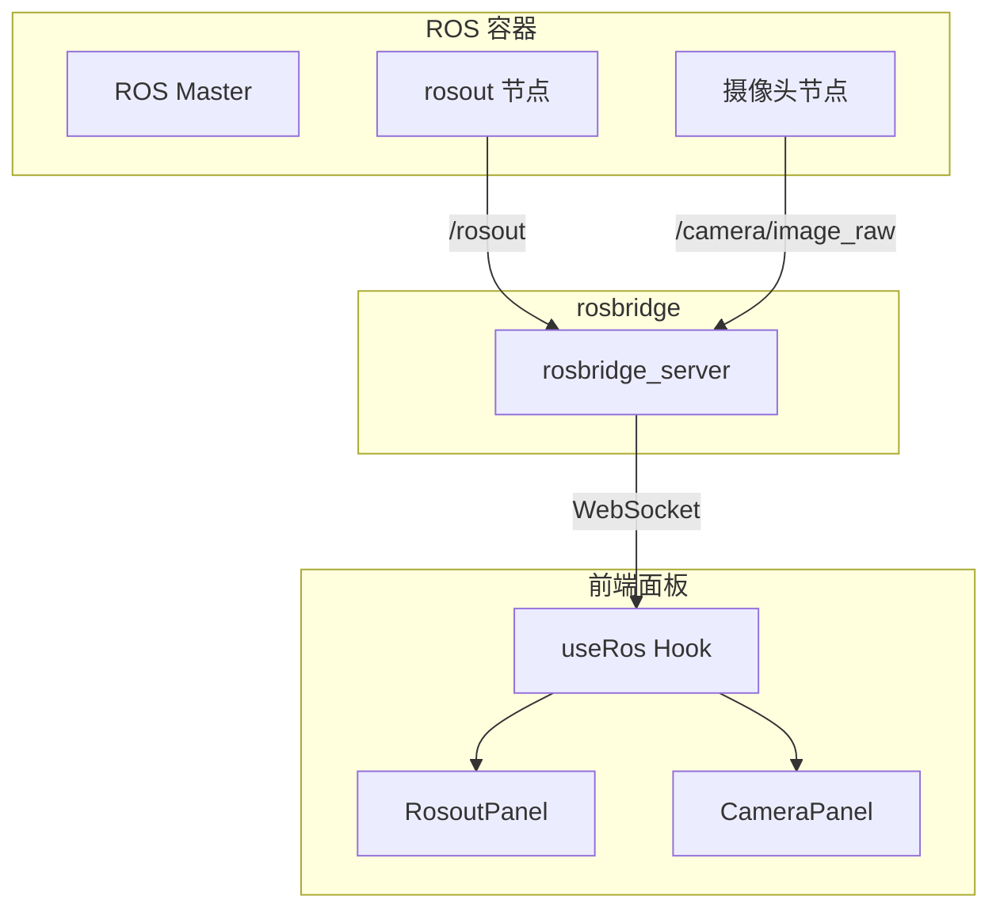
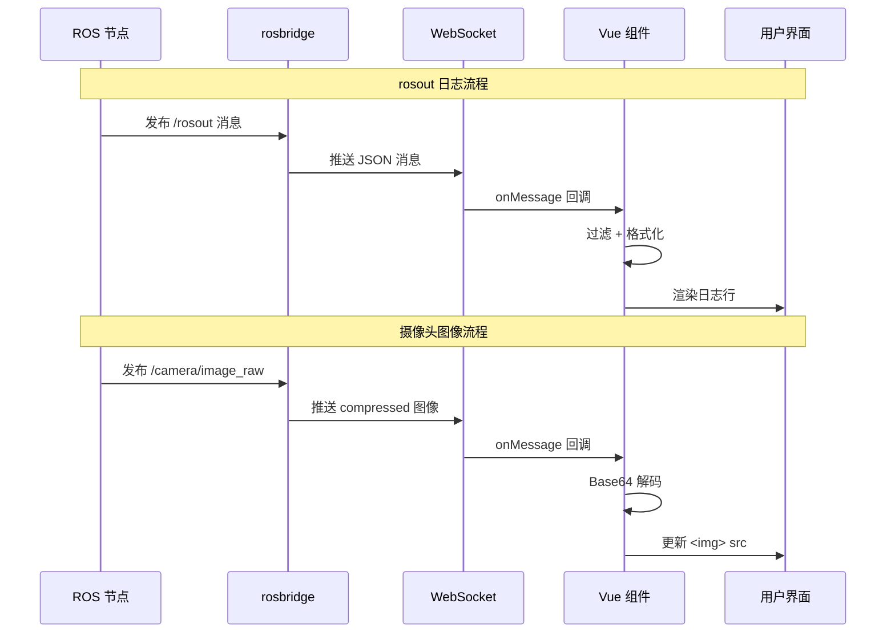

# SDD-第九期：rosout 日志与摄像头监控面板

**文档版本**: v1.1  
**创建日期**: 2026-03-29  
**修订日期**: 2026-03-29  
**目标**: 实现 ROS 日志实时显示和摄像头图像监控功能

---

## 一、需求概述

### 1.1 核心需求

1. **rosout 日志面板**: 实时订阅并显示 ROS 系统日志
2. **摄像头监控面板**: 订阅摄像头 Topic 并显示实时图像
3. **面板集成**: 作为独立面板集成到仿真页面的 Golden Layout 中

### 1.2 设计原则

- 实时性：WebSocket 订阅，低延迟显示
- 可过滤：支持日志级别过滤、关键词搜索
- 轻量级：避免大量日志导致前端卡顿
- 复用组件：使用现有 ROS 连接基础设施

---

## 二、系统架构

### 2.1 整体架构图



### 2.2 数据流时序图



---

## 三、数据库设计

### 3.1 无需新增数据表

本模块不需要数据库支持，所有数据通过 ROS Topics 实时传输。

---

## 四、后端 API 设计

### 4.1 无需新增后端 API

本模块完全基于 rosbridge WebSocket，无需后端 API。

### 4.2 依赖的 ROS Topics

| Topic | 消息类型 | 说明 |
|-------|---------|------|
| `/rosout` | `rosgraph_msgs/Log` | ROS 系统日志 |
| `/camera/rgb/image_raw` | `sensor_msgs/Image` | 摄像头原始图像 |
| `/camera/rgb/image_raw/compressed` | `sensor_msgs/CompressedImage` | 压缩图像（推荐） |

---

## 五、前端组件设计

### 5.1 组件结构

```
edubot-twin-web/src/views/Simulation/panels/
├── RosoutPanel/
│   ├── index.vue                 # 主面板
│   ├── LogItem.vue              # 单条日志组件
│   └── composables/
│       └── useRosout.ts         # 日志订阅逻辑
└── CameraPanel/
    ├── index.vue                 # 主面板
    └── composables/
        └── useCamera.ts          # 图像订阅逻辑
```

---

## 六、rosout 日志面板详细设计

### 6.1 ROS 消息结构

**Topic**: `/rosout`  
**类型**: `rosgraph_msgs/Log`

```typescript
interface RosoutMessage {
  header: {
    seq: number
    stamp: { secs: number; nsecs: number }
    frame_id: string
  }
  level: number  // 1=DEBUG, 2=INFO, 4=WARN, 8=ERROR, 16=FATAL
  name: string   // 节点名称
  msg: string    // 日志内容
  file: string   // 源文件
  function: string
  line: number
  topics: string[]
}
```

### 6.2 日志级别映射

```typescript
enum LogLevel {
  DEBUG = 1,
  INFO = 2,
  WARN = 4,
  ERROR = 8,
  FATAL = 16
}

const LOG_LEVEL_MAP = {
  1: { label: 'DEBUG', color: '#909399', icon: 'bug' },
  2: { label: 'INFO', color: '#409EFF', icon: 'info-filled' },
  4: { label: 'WARN', color: '#E6A23C', icon: 'warning-filled' },
  8: { label: 'ERROR', color: '#F56C6C', icon: 'circle-close-filled' },
  16: { label: 'FATAL', color: '#F56C6C', icon: 'circle-close-filled' }
}
```

### 6.3 组件状态设计

```typescript
interface RosoutState {
  logs: LogEntry[]           // 日志列表
  maxLogs: number           // 最大保留条数（默认 500）
  filterLevel: LogLevel[]   // 过滤级别
  filterKeyword: string     // 关键词过滤
  autoScroll: boolean       // 自动滚动到底部
  paused: boolean           // 暂停接收
}

interface LogEntry {
  id: string                // 唯一 ID
  timestamp: Date
  level: LogLevel
  node: string
  message: string
  file?: string
  line?: number
}
```

### 6.4 核心功能实现

**useRosout.ts 核心逻辑伪代码**:

```
FUNCTION useRosout():
    初始化状态:
        logs = 空数组
        maxLogs = 500
        paused = false
    
    FUNCTION subscribe(ros连接):
        创建 Topic 订阅 {
            名称: '/rosout',
            类型: 'rosgraph_msgs/Log'
        }
        
        监听消息回调:
            IF paused THEN 返回
            
            创建日志条目 {
                id: 时间戳 + 随机数,
                timestamp: 从消息头提取时间,
                level: 消息.level,
                node: 消息.name,
                message: 消息.msg,
                file: 消息.file,
                line: 消息.line
            }
            
            添加到 logs 数组
            
            IF logs.length > maxLogs THEN
                移除最旧的日志
            END IF
        END 监听
    END FUNCTION
    
    FUNCTION unsubscribe():
        取消 Topic 订阅
    END FUNCTION
    
    FUNCTION clear():
        清空 logs 数组
    END FUNCTION
    
    返回 { logs, paused, subscribe, unsubscribe, clear }
END FUNCTION
```

### 6.5 UI 设计

**布局结构**:
```
┌─ Rosout 日志 ────────────────────────────────────┐
│ [🔍 搜索] [DEBUG] [INFO] [WARN] [ERROR] [清空]   │
├──────────────────────────────────────────────────┤
│ 10:30:15 [INFO] /move_base: Goal received        │
│ 10:30:16 [WARN] /amcl: Laser scan timeout        │
│ 10:30:17 [ERROR] /rosout: Connection lost        │
│ ...                                              │
│ (自动滚动到底部)                                  │
└──────────────────────────────────────────────────┘
```

**关键特性**:
- 虚拟滚动：使用 `vue-virtual-scroller` 处理大量日志
- 颜色编码：不同级别使用不同颜色
- 时间戳：显示相对时间或绝对时间
- 节点过滤：点击节点名快速过滤

---

## 七、摄像头监控面板详细设计

### 7.1 ROS 消息结构

**Topic**: `/camera/rgb/image_raw/compressed`  
**类型**: `sensor_msgs/CompressedImage`

```typescript
interface CompressedImage {
  header: {
    seq: number
    stamp: { secs: number; nsecs: number }
    frame_id: string
  }
  format: string  // "jpeg", "png"
  data: number[]  // Base64 编码的图像数据
}
```

### 7.2 组件状态设计

```typescript
interface CameraState {
  imageSrc: string          // 图像 Data URL
  fps: number               // 当前帧率
  lastUpdate: Date          // 最后更新时间
  quality: 'low' | 'medium' | 'high'  // 图像质量
  paused: boolean
}
```

### 7.3 核心功能实现

**useCamera.ts 核心逻辑伪代码**:

```
FUNCTION useCamera():
    初始化状态:
        imageSrc = 空字符串
        fps = 0
        paused = false
        frameCount = 0
        lastFpsUpdate = 当前时间
    
    FUNCTION subscribe(ros连接, topic名称):
        创建 Topic 订阅 {
            名称: topic名称,
            类型: 'sensor_msgs/CompressedImage',
            压缩: 'cbor'
        }
        
        监听消息回调:
            IF paused THEN 返回
            
            # 将 Base64 数据转换为 Data URL
            base64数据 = 将消息.data转为Base64字符串
            imageSrc = "data:image/" + 消息.format + ";base64," + base64数据
            
            # 计算 FPS
            frameCount++
            当前时间 = 获取当前时间
            IF 当前时间 - lastFpsUpdate >= 1000毫秒 THEN
                fps = frameCount
                frameCount = 0
                lastFpsUpdate = 当前时间
            END IF
        END 监听
    END FUNCTION
    
    FUNCTION unsubscribe():
        取消 Topic 订阅
    END FUNCTION
    
    返回 { imageSrc, fps, paused, subscribe, unsubscribe }
END FUNCTION
```

### 7.4 UI 设计

**布局结构**:
```
┌─ 摄像头监控 ─────────────────────────────────────┐
│ Topic: /camera/rgb/image_raw/compressed  FPS: 30 │
├──────────────────────────────────────────────────┤
│                                                  │
│          [摄像头图像显示区域]                     │
│                                                  │
│                                                  │
├──────────────────────────────────────────────────┤
│ [⏸ 暂停] [📷 截图] [🔄 刷新] 质量: [●○○]         │
└──────────────────────────────────────────────────┘
```

**关键特性**:
- 自适应缩放：图像自动适应面板大小
- 帧率显示：实时显示当前 FPS
- 截图功能：保存当前帧为图片
- 质量调节：切换不同压缩质量的 Topic

---

## 八、Golden Layout 集成

### 8.1 面板注册

**修改位置**: `edubot-twin-web/src/views/Simulation/Simulation.vue`

**注册伪代码**:
```
面板组件映射 = {
  'ros3d-viewer': ROS3DViewer组件,
  'gzweb': GzWebPanel组件,
  'terminal': TerminalPanel组件,
  'keyboard': KeyboardPanel组件,
  'rosout': RosoutPanel组件,      // 新增
  'camera': CameraPanel组件        // 新增
}
```

### 8.2 默认布局配置

**布局配置伪代码**:
```
默认布局 = {
  根节点: {
    类型: '行',
    内容: [
      {
        类型: '列',
        宽度: 60%,
        内容: [
          { 类型: '组件', 名称: 'gzweb', 标题: 'Gazebo' },
          { 类型: '组件', 名称: 'keyboard', 标题: '键盘控制' }
        ]
      },
      {
        类型: '列',
        宽度: 40%,
        内容: [
          { 类型: '组件', 名称: 'ros3d-viewer', 标题: 'ROS 3D' },
          {
            类型: '堆叠',  // Tab 堆叠
            内容: [
              { 类型: '组件', 名称: 'terminal', 标题: '终端' },
              { 类型: '组件', 名称: 'rosout', 标题: '日志' },
              { 类型: '组件', 名称: 'camera', 标题: '摄像头' }
            ]
          }
        ]
      }
    ]
  }
}
```

---

## 九、性能优化

### 9.1 日志面板优化

| 优化项 | 方案 | 效果 |
|--------|------|------|
| 虚拟滚动 | vue-virtual-scroller | 支持 10000+ 条日志流畅滚动 |
| 日志限制 | 最多保留 500 条 | 防止内存溢出 |
| 暂停接收 | paused 状态 | 调试时冻结日志 |
| 防抖过滤 | debounce 300ms | 减少重复渲染 |

### 9.2 摄像头面板优化

| 优化项 | 方案 | 效果 |
|--------|------|------|
| 压缩传输 | CompressedImage | 带宽减少 80% |
| 帧率限制 | throttle 30fps | 避免过度渲染 |
| 图像缓存 | 复用 Data URL | 减少 Base64 转换 |
| 质量调节 | 切换不同 Topic | 平衡清晰度与性能 |

---

## 十、实施计划

### 10.1 开发任务分解

| 任务 | 预估工时 | 优先级 |
|------|---------|--------|
| RosoutPanel 组件开发 | 1 天 | P1 |
| CameraPanel 组件开发 | 1 天 | P2 |
| Golden Layout 集成 | 0.5 天 | P1 |
| 性能优化与测试 | 0.5 天 | P1 |

**总计**: 约 3 天

### 10.2 测试用例

| 测试场景 | 操作 | 预期结果 |
|---------|------|---------|
| 订阅 rosout | 启动 ROS 节点 | 日志实时显示 |
| 日志过滤 | 选择 ERROR 级别 | 仅显示错误日志 |
| 关键词搜索 | 输入 "move_base" | 高亮匹配行 |
| 日志清空 | 点击清空按钮 | 日志列表清空 |
| 摄像头订阅 | 启动摄像头节点 | 图像实时显示 |
| 帧率显示 | 观察 FPS 指示器 | 显示实际帧率 |
| 截图功能 | 点击截图按钮 | 下载当前帧 |
| 暂停/恢复 | 切换暂停状态 | 图像冻结/恢复 |

---

## 十一、技术风险与应对

| 风险 | 影响 | 应对措施 |
|------|------|---------|
| 大量日志导致浏览器卡顿 | 用户体验差 | 虚拟滚动 + 日志限制 |
| 图像传输带宽占用高 | 网络拥堵 | 使用 CompressedImage |
| rosbridge 连接不稳定 | 数据丢失 | 自动重连机制 |
| 不同摄像头 Topic 名称不一致 | 无法订阅 | 提供 Topic 选择器 |

---

## 十二、后续优化方向

1. **日志导出**: 支持导出为 .log 文件
2. **日志回放**: 录制并回放历史日志
3. **多摄像头**: 同时显示多个摄像头
4. **图像标注**: 在图像上绘制检测框
5. **性能监控**: 显示 CPU/内存/网络使用情况

---

**文档状态**: 已完成  
**审核状态**: 待审核  
**最后更新**: 2026-03-29
