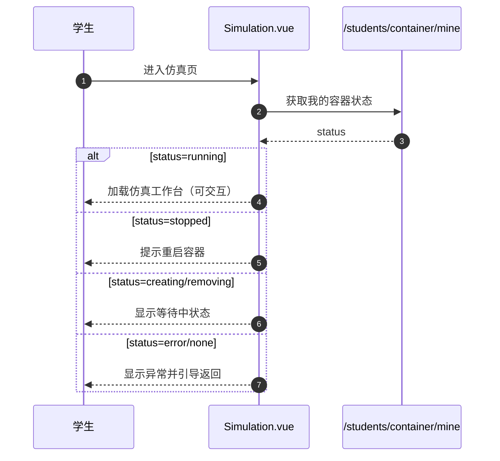
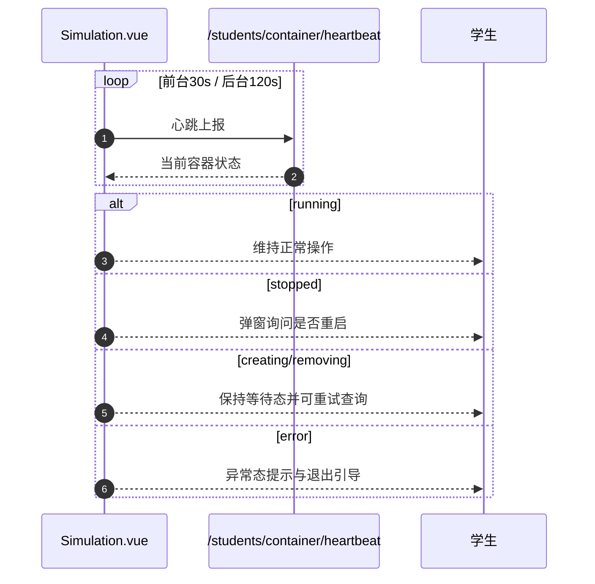
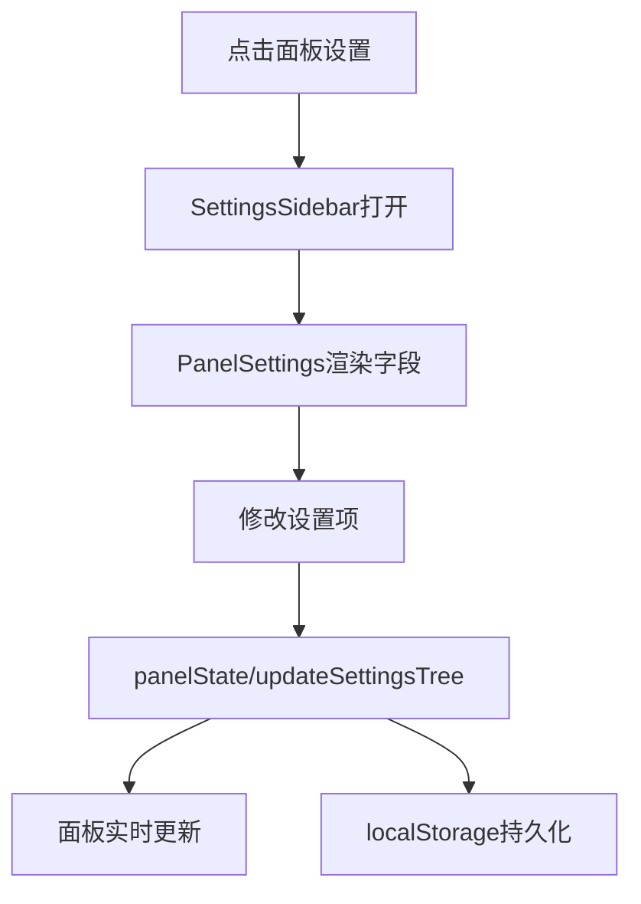
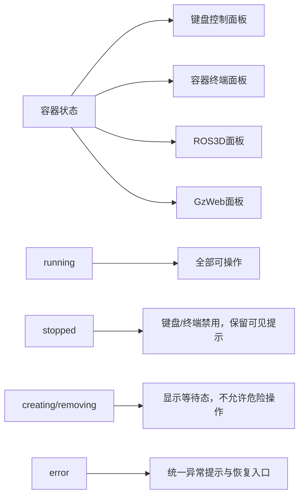

# SDD：仿真页面功能面板完整规范（第六期）

> 版本：3.0
> 日期：2026-03-28
> 状态：可评审 / 可拆分实现
> 适用范围：学生端仿真页面（Simulation）

---

## 1. 文档范围与目标/非目标

### 1.1 本期目标（第六期）
第六期只做一件事：**把仿真页面面板体系做完整、做稳定**，让学生可在同一页面完成核心仿真操作闭环。

核心交付是面板能力，不是评测能力。

### 1.2 非目标（明确排除）
本期不做以下内容：
1. 自动评测系统（包含最小自动评测）。
2. 复杂评分模型、评分解释链路。
3. 考试录制与回放实现。
4. 任务编排引擎。

以上全部标记为后续阶段（Deferred）。

### 1.3 交付判定原则
- 以“仿真面板可用性与稳定性”为验收主轴。
- 以“最小改动复用现有架构”为实施原则。
- 所有新增能力必须可映射到已有前后端资产，不重造底座。

---

## 2. 可复用资产映射（前后端）

### 2.1 前端可复用资产

| 资产 | 路径 | 本期用途 |
|---|---|---|
| 仿真页面主编排 | `edubot-twin-web/src/views/Simulation/Simulation.vue` | 页面生命周期、容器状态联动、心跳恢复主流程 |
| Golden Layout 桥接 | `edubot-twin-web/src/views/Simulation/components/GLayout.vue` | 面板渲染、拖拽布局、面板动态注入 |
| 面板注册中心 | `edubot-twin-web/src/views/Simulation/panels/registry.ts` | 新面板统一注册入口 |
| 面板状态管理 | `edubot-twin-web/src/views/Simulation/stores/panelState.ts` | 面板选中、设置树、实例状态共享 |
| 设置侧栏 | `edubot-twin-web/src/views/Simulation/components/SettingsSidebar.vue` | 统一设置入口与设置容器 |
| 设置表单渲染 | `edubot-twin-web/src/views/Simulation/components/PanelSettings.vue` | 面板设置 UI 统一渲染 |
| 配置持久化桥接 | `edubot-twin-web/src/views/Simulation/composables/usePanelConfig.ts` | 面板配置读写与 settings action 分发 |

### 2.2 后端可复用资产

| 资产 | 路径 | 本期用途 |
|---|---|---|
| 学生容器生命周期接口 | `edubot-twin-server/app/api/v1/endpoints/student/container.py` | 容器状态读取、启动、心跳、停止 |
| 路由聚合 | `edubot-twin-server/app/api/v1/api.py` | 路由前缀一致性基线 |
| 统一响应模型 | `edubot-twin-server/app/schemas/common.py` | 统一接口响应包装 |
| 容器模型 | `edubot-twin-server/app/models/container.py` | 容器状态字典与字段基线 |

### 2.3 复用边界
- 允许：在现有页面框架内新增面板与状态联动。
- 禁止：新增并行页面框架、并行状态中心、并行容器生命周期体系。

---

## 3. 核心交互流程（Mermaid）

### 3.1 进入仿真页与容器可用性决策

### 3.2 心跳与恢复流程

### 3.3 面板设置联动流程

### 3.4 跨面板状态联动（本期必须）

---

## 4. 面板能力规划（P0/P1/P2）

## 4.1 P0（本期必须）

| 面板 | 状态 | 目标 | 验收要点 |
|---|---|---|---|
| GzWebViewer | 已有（回归） | 保持稳定可用 | 场景持续刷新，无功能回退 |
| ROS3DViewer | 已有（回归） | 保持稳定可用 | 地图/点云/TF可见，设置生效 |
| 键盘控制面板 | 新增 | 实时控制与急停 | 可发送控制指令，非 running 时禁用 |
| 容器终端面板 | 新增 | 容器命令交互 | 建连成功、回显正常、断连可恢复 |

### 4.2 P1（本期建议）

| 面板 | 状态 | 目标 | 验收要点 |
|---|---|---|---|
| 基础日志能力 | 新增（轻量） | 查看核心运行日志 | 可见连接/启动/错误关键日志 |
| 精简文件管理 | 新增（精简） | 支持基础浏览能力 | 目录可浏览、文件可查看 |

### 4.3 P2（后续）

| 面板/能力 | 状态 | 说明 |
|---|---|---|
| 摄像头监控 | Deferred | 非本期硬门槛 |
| 自动评测系统 | Deferred | 明确后置 |
| 任务编排 | Deferred | 明确后置 |
| 录制回放 | Deferred | 明确后置 |

---

## 5. API 契约（仅本期需要）

> 说明：本期只定义仿真面板能力所需契约，不扩展评测域接口。

### 5.1 容器生命周期接口（复用）

| Endpoint | Method | 作用 | 关键返回 |
|---|---|---|---|
| `/api/v1/students/container/mine` | GET | 获取当前容器状态 | status + 连接信息 |
| `/api/v1/students/container/start` | POST | 启动已停止容器 | 目标状态 |
| `/api/v1/students/container/heartbeat` | POST | 心跳更新与状态查询 | 最新状态 |
| `/api/v1/students/container/stop` | POST | 主动停止容器 | 停止后状态 |
| `/api/v1/students/container/stop-on-exit` | POST | 退出页时停止容器 | 静默结果 |

### 5.2 本期新增接口建议（按需）

| 领域 | Endpoint（建议） | 作用 |
|---|---|---|
| 终端 | `/api/v1/students/terminal/ws` | 容器终端会话（WebSocket） |
| 文件（精简） | `/api/v1/students/files/tree` | 获取目录树 |
| 文件（精简） | `/api/v1/students/files/read` | 读取文件内容 |

> 注：具体路径可在实现评审时定稿，但必须保持 `/api/v1/students/*` 前缀一致性。

### 5.3 统一错误语义（本期最小）

| 错误码 | 含义 | 前端动作 |
|---|---|---|
| `CONTAINER_UNAVAILABLE` | 容器不可用 | 禁用依赖面板并提示恢复 |
| `STATE_CONFLICT` | 当前状态不允许该操作 | 提示并刷新状态 |
| `UPSTREAM_TIMEOUT` | 上游超时 | 提供重试入口 |
| `UNAUTHORIZED` | 鉴权失败 | 引导重新登录 |

---

## 6. 数据模型与状态字典

### 6.1 容器状态字典（复用并约束）

| 状态 | 含义 | UI策略 |
|---|---|---|
| `creating` | 创建中 | 等待态（可见，不可危险操作） |
| `running` | 运行中 | 全面可操作 |
| `stopped` | 已停止 | 禁用控制/终端，允许重启 |
| `error` | 异常 | 统一错误态与恢复引导 |
| `removing` | 删除中 | 等待态，不允许写操作 |

### 6.2 页面级状态模型（必须统一）

| 状态类型 | 定义 | 允许行为 |
|---|---|---|
| loading | 数据/连接初始化中 | 浏览只读信息，禁止高风险操作 |
| success | 依赖可用 | 正常操作 |
| partial | 部分依赖可用 | 允许局部功能，明确告警 |
| empty | 无可展示数据 | 显示空态与下一步引导 |
| error | 关键依赖失败 | 显示恢复入口与退出路径 |

---

## 7. 错误语义与恢复策略（页面级+面板级）

### 7.1 页面级恢复策略

| 触发条件 | 用户影响 | 恢复动作 |
|---|---|---|
| 心跳短暂失败 | 状态不确定 | 静默重试 + 非阻断提示 |
| 连续失败达到阈值 | 无法确认状态 | 升级为阻断提示并引导恢复 |
| 容器 stopped | 关键能力不可用 | 弹窗引导重启 |
| 容器 error | 页面不可继续 | 引导返回首页重新进入 |

### 7.2 面板级恢复策略

| 面板 | 故障 | 恢复动作 |
|---|---|---|
| 键盘控制 | 容器非 running | 控件禁用 + 状态提示 |
| 终端 | WS断开 | 显示断连状态 + 重连按钮 |
| ROS3D | Topic中断 | 保持面板可见 + 数据中断提示 |
| GzWeb | iframe连接异常 | 显示重试入口，不阻断其他面板 |

### 7.3 跨面板一致性要求
- 同一时刻的容器状态必须驱动所有相关面板一致变化。
- 不允许出现“终端可操作但键盘已禁用且无说明”的状态不一致。
- 页面级错误优先于面板级局部提示。

---

## 8. 风险与一致性校验清单

### 8.1 主要风险
1. **状态语义分叉**：各面板自己定义状态，导致行为不一致。
2. **鉴权/属主边界缺口**：出现跨用户容器访问风险。
3. **固定节拍心跳脉冲**：并发量大时形成瞬时压力峰值。
4. **路径安全问题**：文件能力若缺路径归一校验存在穿越风险。
5. **面板范围失控**：P2能力提前侵入本期，影响交付稳定性。

### 8.2 发布前硬校验
- [ ] 面板范围与 P0/P1/P2 一致，无越界项。
- [ ] 所有新增面板已在 registry 中统一注册。
- [ ] 页面级状态模型与面板级状态行为一致。
- [ ] 容器状态联动在关键面板可复现验证。
- [ ] 错误码与前端恢复动作有一一映射。

---

## 9. 验收标准（量化）

### 9.1 功能验收
1. 学生可在单页面完成：场景观察、ROS可视化、键盘控制、终端交互。
2. 容器状态变化可驱动相关面板统一联动。
3. P0 面板全部可用，P1 面板按计划交付或明确延期。

### 9.2 稳定性验收
1. 多面板运行 30 分钟内无致命错误。
2. 终端断连后可在可见路径内完成恢复。
3. 容器 stopped 状态下无危险操作入口可执行。

### 9.3 一致性验收
1. 前后端接口路径前缀一致。
2. 状态字典与错误语义在页面与面板层一致。
3. 不出现“同状态下不同面板行为冲突”。

---

## 10. 里程碑（W1/W2/W3）与延期门槛

### W1（架构与边界）
- 冻结面板清单与优先级（P0/P1/P2）。
- 冻结跨面板状态联动规则。
- 冻结本期 API 最小契约与错误语义。

### W2（核心实现）
- 完成 P0 新增面板（键盘控制、容器终端）。
- 完成已有面板回归（GzWeb、ROS3D）。
- 完成页面级状态与恢复链路联调。

### W3（稳定性与交付）
- 完成 P1（若纳入）或形成延期说明。
- 完成稳定性验证与演示脚本彩排。
- 完成第六期交付文档收口。

### 延期门槛（执行规则）
若满足任一条件，P1/P2 自动延期，不新增范围：
1. P0 任一能力未完成。
2. 稳定性验收未通过。
3. 状态一致性校验存在阻塞问题。

---

## 11. Deferred（后续阶段）

以下内容明确后置，不属于第六期交付：
- 自动评测系统（含最小评测）。
- 任务编排。
- 录制回放。
- 复杂评分与评分解释链路。

---

## 12. 附录：规范与代码映射

| 规范项 | 代码路径 |
|---|---|
| 仿真页面主流程 | `edubot-twin-web/src/views/Simulation/Simulation.vue` |
| 面板布局桥接 | `edubot-twin-web/src/views/Simulation/components/GLayout.vue` |
| 面板注册 | `edubot-twin-web/src/views/Simulation/panels/registry.ts` |
| 面板状态中心 | `edubot-twin-web/src/views/Simulation/stores/panelState.ts` |
| 设置侧栏 | `edubot-twin-web/src/views/Simulation/components/SettingsSidebar.vue` |
| 设置渲染器 | `edubot-twin-web/src/views/Simulation/components/PanelSettings.vue` |
| 配置桥接 | `edubot-twin-web/src/views/Simulation/composables/usePanelConfig.ts` |
| 容器生命周期接口 | `edubot-twin-server/app/api/v1/endpoints/student/container.py` |
