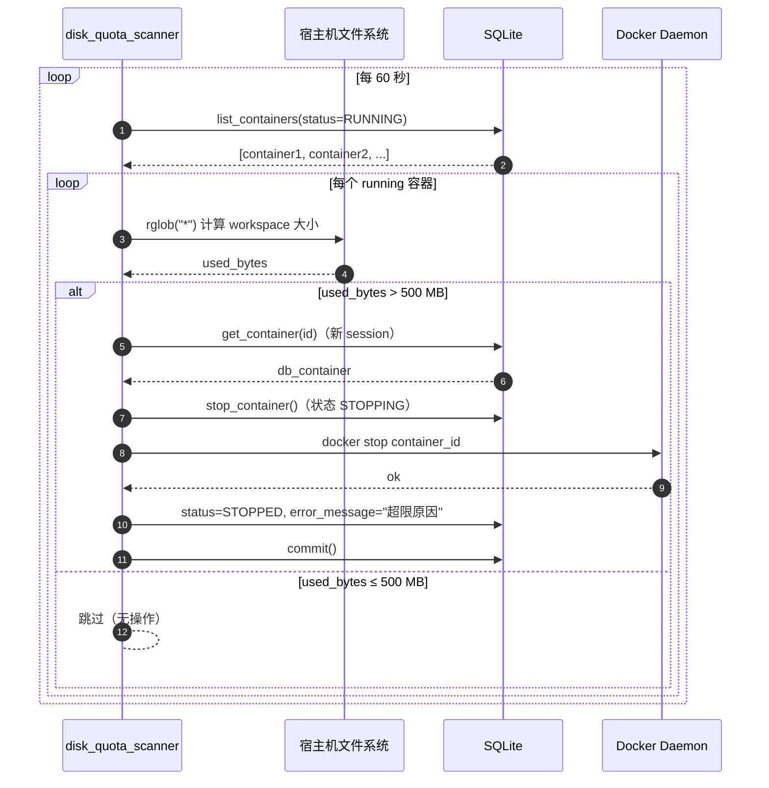
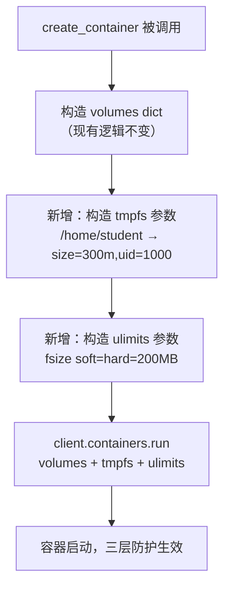
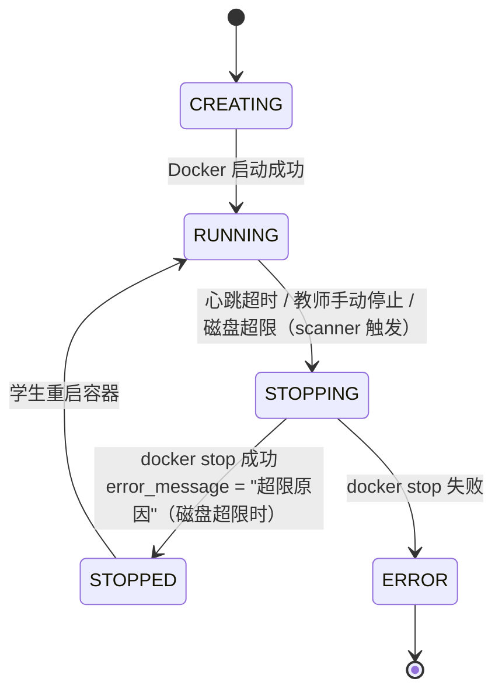

# SDD - 学生容器磁盘配额保护

> 文档版本：v1.0
> 创建日期：2026-04-17
> 文档状态：**待实施**
> 负责人：待分配
> 关联需求：安全加固 / 资源隔离
> 前置依赖期次：第3期（Docker全真接入）、第7期（文件管理模块）

---

## 0. 文档元信息

- **文档标题**：SDD - 学生容器磁盘配额保护
- **文档版本**：v1.0
- **创建日期**：2026-04-17
- **修订日期**：2026-04-17
- **目标读者**：后端开发 / 运维
- **关联文件**：
  - `edubot-twin-server/app/core/container_manager.py`
  - `edubot-twin-server/app/api/v1/endpoints/student/files.py`
  - `edubot-twin-server/app/main.py`

---

## 1. 执行摘要（给决策者）

### 1.1 本期要解决的问题（Problem）

- 学生可以在仿真工作台的容器终端中直接执行 Python 代码（如 `open('bigfile','wb').write(b'\x00'*50*1024**3)`），完全绕过后端 API 层的磁盘配额检查，在宿主机写入任意大小的文件。
- 现有的 `check_disk_quota()` 只在文件通过 HTTP 上传、保存、解压、复制路径时生效，对容器内直接写文件没有任何约束。
- 容器内 `/home/student`（非 workspace 挂载部分）写入的文件存在于 Docker overlay2 可写层，宿主机上无对应目录，现有监控机制完全不可见。
- 单个学生的恶意或无意滥用可能耗尽宿主机磁盘，影响所有学生正常使用。

### 1.2 本期关键结果（Outcome）

- 容器内任意进程无法写入超过 200 MB 的单个文件，OS 内核直接强制（无轮询延迟）。
- `/home/student` 中非 workspace 区域（容器可写层）写入总量被限制在 300 MB 以内，内核级强制。
- workspace 目录（宿主机 bind mount）写入总量超过 500 MB 时，后台扫描器在最多 60 秒内自动停止对应容器，`error_message` 记录超限原因，教师端可见。
- 全部保护层在后端实现，**零前端改动**。

### 1.3 成功判定（Success Metrics）

- 指标1：在容器内执行 `dd if=/dev/zero of=bigfile bs=1M count=300` 返回 `File too large` 错误，文件不超过 200 MB。
- 指标2：在容器内对 `/home/student/tmp` 目录持续写入，达到 300 MB 时写入被拒绝（`ENOSPC`）。
- 指标3：通过容器终端脚本将 workspace 累积写入到 500 MB 后，容器在 60 秒内被自动停止，DB 中 `error_message` 包含"磁盘超限"字样。

---

## 2. 范围定义（Scope）

### 2.1 In Scope（本期必须交付）

- `ulimit fsize` 硬限制注入容器创建参数（单文件大小上限）
- `tmpfs` 挂载替换 `/home/student` 内存文件系统（非 workspace 写入总量上限）
- `app/core/disk_quota_scanner.py` 后台扫描器（workspace 总量轮询 + 超限停容器）
- `app/main.py` lifespan 注册新后台任务
- 配额相关常量统一管理（集中在 scanner 文件顶部）

### 2.2 Out of Scope / NOT in scope（明确不做）

| 项目 | 不纳入本期原因 |
|---|---|
| 前端展示"工作区已用量"进度条 | 前端改动成本高，后台日志+教师端 error_message 已满足运维需求 |
| Docker `--storage-opt size=Xg` | 依赖 XFS 文件系统，当前宿主机为 ext4，环境不满足 |
| OS-level Project Quota（xfs_quota） | 需要文件系统迁移，运维成本过高，与本期范围不匹配 |
| Docker SizeRw 可写层轮询监控 | `docker ps --size` 性能代价较高；tmpfs 已从内核层覆盖该场景 |
| API 层 `check_disk_quota` 逻辑修改 | 现有 API 层配额（100 MB）保留不变，本期在更底层补充防线 |
| 超限事件主动推送前端（WebSocket）| 复杂度高，教师刷新容器状态即可看到 error_message |

---

## 3. 前提挑战与方案比选（评审增强）

### 3.1 前提挑战（Premise Challenge）

- **是否是正确问题？** 是。即便学生无恶意，在仿真任务中运行 ROS bag 录制、大规模地图生成、训练数据输出等场景，也可能在数分钟内制造数 GB 文件，宿主机磁盘是真实的共享稀缺资源。
- **不做会怎样？** 单个学生可在 10 秒内写满宿主机磁盘，导致所有容器和后端服务崩溃，影响所有在线学生。
- **是否有更小改动？** 单独实施方案A（ulimit）可在 1 行代码内上线，能拦截最暴力的单文件攻击，但无法限制总量。本期采用组合方案，成本可控。

### 3.2 现有资产复用（What already exists）

#### 3.2.1 后端复用资产

| 资产 | 路径 | 可复用能力 | 本期复用方式 |
|---|---|---|---|
| `check_disk_quota()` | `app/api/v1/endpoints/student/files.py:101` | 目录大小计算 + 配额判断 | `_get_dir_size()` 逻辑直接复制到 scanner（避免循环依赖） |
| `sidecar_timeout_scanner.py` | `app/core/sidecar_timeout_scanner.py` | 后台扫描循环模式 | disk_quota_scanner 完全复用该架构（while True + asyncio.sleep） |
| `crud_container.stop_container()` | `app/crud/container.py:145` | 停容器 + 状态机转换（STOPPING → STOPPED） | 超限时直接调用，触发已有的 Docker stop + DB 状态更新 |
| `AsyncSessionLocal` | `app/db/database.py` | 独立 DB session | scanner 每次扫描开独立 session，与 sidecar_timeout_scanner 相同模式 |
| lifespan 后台任务注册模式 | `app/main.py:372-389` | `asyncio.create_task` + cancel | 新 scanner 完全对称接入 |
| Docker volumes 参数 | `app/core/container_manager.py:174` | 已有 volumes dict 构造 | tmpfs 通过 `tmpfs` 参数单独传入，不影响现有 volumes |

### 3.3 实施路径备选（至少2个）

#### 方案A（已在备选中讨论）：仅做 `ulimit fsize`（Minimal Diff）

- **摘要**：在 `create_container` 中增加 `ulimits` 参数，限制容器内单文件写入不超过 200 MB。
- **优点**：改动极小（1 行），即时生效，无轮询开销，内核强制。
- **风险**：只限单文件大小，不限总量。学生可写 N 个 199 MB 的文件绕过限制。
- **适用前提**：仅用于临时止血，后续需要补充总量限制。

#### 方案B（已在备选中讨论）：后台 workspace 扫描器

- **摘要**：新增 `disk_quota_scanner.py`，每 60 秒轮询学生 workspace 目录总大小，超过 500 MB 时停止对应容器。
- **优点**：无需修改容器创建参数，可覆盖所有通过 workspace bind mount 写入的文件。
- **风险**：轮询延迟最长 60 秒；不覆盖容器内非 workspace 路径的写入。
- **适用前提**：需配合其他手段覆盖非 workspace 写入场景。

#### 方案C（本期采用）：组合防御 = 方案A + 方案B + tmpfs

- **摘要**：同时实施三项机制：`ulimit fsize`（单文件硬限制）+ `tmpfs`（非 workspace 总量硬限制）+ 后台 workspace 扫描器（持久化区域总量软限制）。
- **优点**：三层互补，覆盖所有写入路径，两层为内核级强制（无轮询延迟），一层为异步监控兜底。
- **风险**：`tmpfs` 占用 RAM（每容器最多 300 MB），需评估宿主机内存容量。
- **适用前提**：宿主机内存充裕（当前每容器已有 2 GB 内存限制，300 MB tmpfs 在配额内）。

### 3.4 方案决策

- **最终采用**：方案C（组合防御）
- **决策理由**：三项机制彼此正交，代码量增量小（约 80 行），可一次性关闭所有绕过路径。
- **放弃方案的原因**：方案A、方案B单独使用均有明显盲区，不满足"恶意学生无法滥用"的安全目标。

---

## 4. 系统交互设计（必须含图）

### 4.1 三层防护架构

```
学生在容器内写文件
        │
        ▼
┌───────────────────────────────────────────────────────┐
│ 层 1：ulimit fsize（内核级，立即强制）                   │
│   任何 write() 使文件超过 200 MB → SIGXFSZ / EFBIG      │
│   覆盖路径：workspace + /home/student + /tmp + 全部      │
└───────────────────────────────────────────────────────┘
        │ 单文件 < 200MB 的写入继续
        ▼
┌───────────────────────────────────────────────────────┐
│ 层 2：tmpfs 挂载（内核级，立即强制）                      │
│   /home/student 挂载为 300 MB tmpfs                     │
│   /home/student/workspace 覆盖为宿主机 bind mount        │
│   非 workspace 写满 tmpfs → ENOSPC                      │
│   覆盖路径：/home/student（非 workspace 子路径）           │
└───────────────────────────────────────────────────────┘
        │ workspace 写入继续（宿主机持久化）
        ▼
┌───────────────────────────────────────────────────────┐
│ 层 3：disk_quota_scanner（异步轮询，最长 60s 延迟）        │
│   每 60s 扫描 data/students/{id}/workspace 目录大小      │
│   超过 500 MB → crud.stop_container() + error_message   │
│   覆盖路径：workspace bind mount（宿主机侧）              │
└───────────────────────────────────────────────────────┘
```

### 4.2 容器挂载结构（实施后）

```
容器内文件系统
/
├── home/
│   └── student/               ← tmpfs (300 MB RAM, 容器停止后数据丢失)
│       └── workspace/         ← bind mount 覆盖 (宿主机 data/students/{id}/workspace)
│           ├── src/
│           ├── launch/
│           └── ...            ← 被 disk_quota_scanner 监控，上限 500 MB
├── tmp/                       ← overlay2 可写层 (受 ulimit fsize 限制)
└── ...
```

### 4.3 disk_quota_scanner 时序图



### 4.4 容器创建参数变更（container_manager.py）



### 4.5 超限容器状态机（容器视角）



---

## 5. API 契约

本期**不新增任何 API 端点**。所有保护机制在容器创建和后台任务层实现。

现有 API 的行为变化：

| 端点 | 变化说明 |
|---|---|
| `POST /api/v1/student/container/create` | 返回容器信息不变；底层 Docker 参数新增 ulimits + tmpfs |
| `GET /api/v1/teacher/containers` | `error_message` 字段可能出现 "工作区磁盘超限" 原因 |
| `GET /api/v1/student/container/status` | 容器被 scanner 停止后，status 变为 `stopped`，error_message 可见 |

### 5.1 错误语义映射

| 场景 | 用户可见信息来源 | 内容示例 |
|---|---|---|
| 单文件超过 ulimit | 容器终端（OS 错误） | `OSError: [Errno 27] File too large` |
| /home/student tmpfs 写满 | 容器终端（OS 错误） | `OSError: [Errno 28] No space left on device` |
| workspace 超 500 MB | DB `sim_containers.error_message` | `工作区磁盘超限（523MB / 500MB），容器已自动停止` |

---

## 6. 数据字典

### 6.1 表/实体：`sim_containers`（现有，无结构变更）

| 字段名 | 数据类型 | 变更说明 |
|---|---|---|
| `error_message` | VARCHAR(500) | 新增磁盘超限场景写入值，格式：`工作区磁盘超限（{used}MB / {limit}MB），容器已自动停止` |

> 无需数据库迁移，字段已存在，仅新增一种写入场景。

### 6.2 配额常量（集中定义于 `disk_quota_scanner.py`）

| 常量名 | 值 | 含义 |
|---|---|---|
| `SCAN_INTERVAL` | `60`（秒） | workspace 扫描轮询间隔 |
| `WORKSPACE_QUOTA_BYTES` | `500 * 1024 * 1024`（500 MB） | workspace bind mount 写入总量上限 |
| `ULIMIT_FSIZE_BYTES` | `200 * 1024 * 1024`（200 MB） | 容器内单文件大小上限（ulimit fsize） |
| `TMPFS_SIZE` | `'300m'` | tmpfs 挂载大小（非 workspace 区域总量） |
| `TMPFS_PATH` | `'/home/student'` | tmpfs 挂载点 |

---

## 7. 安全与合规约束

| 风险点 | 威胁描述 | 防护策略 | 验证方式 |
|---|---|---|---|
| 容器内大文件写入（workspace） | Python 写入 GB 级文件到 `/home/student/workspace` | 层3：scanner 60s 内检测，超 500MB 停容器 | 验收测试 §9 |
| 容器内大文件写入（非 workspace） | Python 写入大文件到 `/home/student/data`（非挂载子路径） | 层1 + 层2：ulimit 限单文件，tmpfs 限总量 | 验收测试 §9 |
| 容器内单文件爆炸 | `while True: f.write(b'\x00'*1024)` 写一个超大文件 | 层1：ulimit fsize 200MB，OS 内核直接截断 | 验收测试 §9 |
| tmpfs 挂载逃逸（写 workspace 绕过 tmpfs 限制） | 通过 `/home/student/workspace` 写文件绕过 tmpfs | 层3 scanner 监控 workspace bind mount 宿主机侧 | 验收测试 §9 |
| 多容器并发写满磁盘 | N 个学生同时写 499MB workspace | 层3 scanner 并发扫描所有 running 容器，分别执行停止 | 压力测试 |
| scanner 异常导致监控失效 | DB 查询失败/异常 | `try/except` 捕获，日志记录，下一轮继续（与 sidecar_timeout_scanner 相同模式） | 异常注入测试 |

---

## 8. 异常、恢复与可观测性

### 8.1 失败模式登记（Failure Modes Registry）

| Codepath | 失败模式 | 已处理? | 用户可见? | 有日志? | 测试覆盖? |
|---|---|---|---|---|---|
| `ulimit fsize` 注入 | Docker SDK 不支持该参数（旧版本） | N | 容器正常启动但无限制 | N | 需补充 |
| `tmpfs` 挂载 | 与 bind mount 路径冲突 | N | 容器启动失败 | Docker 报错 | 需补充 |
| `_get_dir_size` 扫描 | workspace 路径不存在 | Y（返回 0，跳过） | 否（静默） | WARNING 日志 | Y |
| `crud.stop_container` | Docker stop 超时/失败 | Y（status=ERROR） | 教师端可见 error_message | ERROR 日志 | Y（已有） |
| scanner 主循环异常 | DB 连接断开等 | Y（捕获异常，下轮继续） | 否 | ERROR 日志 | Y |
| `error_message` 覆盖写入 | `stop_container` 成功后清空了 error_message | Y（stop 后单独写入）| 教师端可见 | — | 需补充 |

### 8.2 错误恢复策略

| 场景 | 降级策略 | 重试策略 | 终态处理 |
|---|---|---|---|
| ulimit 注入失败（Docker 版本过旧） | 记录 WARNING，容器正常创建（退化为无 ulimit 保护） | 无自动重试 | 升级 Docker 版本后重新部署 |
| tmpfs 挂载失败 | 容器启动失败，DB status=ERROR | 无自动重试 | 检查 Docker 版本 / 内存是否充足 |
| scanner 单次扫描异常 | 跳过本轮，60s 后继续 | 自动（下一轮） | 持续异常时告警 |
| 容器被 scanner 停止后学生重新启动 | 容器重新运行，保护层仍然生效（ulimit + tmpfs 在创建时注入） | — | 若 workspace 仍超限，下一轮 scanner 再次停止 |

### 8.3 可观测性要求

- **关键日志字段**（scanner 日志格式）：
  ```
  [磁盘配额] student={id} used={X}MB > limit={Y}MB, 停止容器 container_id={db_id} docker_id={docker_id}
  ```
- **日志级别**：
  - 超限检测到 → `WARNING`
  - 停容器成功 → `WARNING`（含学生 ID 和超限量）
  - 停容器失败 → `ERROR`
  - 扫描路径不存在 → `WARNING`
  - scanner 主循环异常 → `ERROR`
- **日志文件**：统一输出到项目 `logs/` 目录（现有 logger 配置）
- **教师端可观测性**：容器列表接口返回 `error_message`，教师刷新即可看到超限原因

---

## 9. 测试与验收（必须量化）

### 9.1 测试覆盖地图

| 测试场景 | 测试类型 | 用例要点 | 通过标准 |
|---|---|---|---|
| ulimit fsize：单文件超限 | 集成测试（容器内执行） | `dd if=/dev/zero of=/tmp/big bs=1M count=300` | 命令报 File too large，文件 ≤ 200MB |
| ulimit fsize：单文件不超限 | 集成测试 | 写入 100MB 文件 | 写入成功，无错误 |
| tmpfs：非 workspace 路径总量超限 | 集成测试 | 累积写入 `/home/student/data/` 超 300MB | OS 报 No space left on device |
| tmpfs：workspace 路径不受 tmpfs 限制 | 集成测试 | workspace 写入 400MB | 写入成功（受 scanner 监控，不受 tmpfs 限制） |
| tmpfs + workspace 挂载共存 | 集成测试 | 容器启动后检查 `/home/student/workspace` bind mount 正常 | `df` 显示 workspace 是 bind mount，非 tmpfs |
| scanner：workspace 超 500MB → 停容器 | 集成测试 | 向 workspace 写入超 500MB，等待 60s | 容器状态变 STOPPED，error_message 含"超限" |
| scanner：workspace 未超限 → 不停容器 | 集成测试 | workspace 写入 200MB | 60s 后容器仍 RUNNING |
| scanner 扫描异常容忍 | 单元测试 | 模拟 DB 查询抛出异常 | scanner 不崩溃，下一轮继续执行 |
| error_message 写入正确性 | 集成测试 | 触发 scanner 超限停容器 | GET /container/status 返回的 error_message 包含 used/limit 数值 |
| 多容器并发超限 | 压力测试 | 3 个容器同时写满 workspace | 每个容器均被独立停止，无相互干扰 |

### 9.2 验收标准

#### 9.2.1 功能验收

- [ ] 容器内写单个文件超过 200MB 时，收到 OS 层 `File too large` 错误，文件不超过 200MB
- [ ] 容器内向 `/home/student`（非 workspace 子路径）累积写入超过 300MB 时，收到 `No space left on device`
- [ ] 容器内向 `/home/student/workspace` 写入不受 tmpfs 300MB 限制（两个限制独立）
- [ ] workspace 累积超过 500MB 后，容器在 ≤ 60 秒内被 scanner 停止
- [ ] 容器停止后，`sim_containers.error_message` 包含超限量（MB）和限额（500MB）信息
- [ ] 教师端容器列表接口能看到上述 error_message
- [ ] 被 scanner 停止的容器，学生重新启动后三层保护仍然生效

#### 9.2.2 稳定性验收

- [ ] scanner 后台任务连续运行 24 小时，无崩溃，无内存泄漏
- [ ] 50 个并发容器运行时，scanner 单次扫描时间 < 10 秒（不影响下一轮调度）

#### 9.2.3 一致性验收

- [ ] 容器停止原因（磁盘超限 vs 心跳超时）在 error_message 中可区分
- [ ] ulimit 和 tmpfs 参数在容器重启后仍然生效（因为每次创建容器时重新注入）

---

## 10. 实施分期与交付清单

### 10.1 分期总览

| 子任务 | 目标 | 改动文件 | 估计行数 | 风险 |
|---|---|---|---|---|
| S1：ulimit fsize 注入 | 单文件大小内核级硬限制 | `container_manager.py` | ~5 行 | 低 |
| S2：tmpfs 挂载注入 | 非 workspace 写入总量内核级硬限制 | `container_manager.py` | ~5 行 | 中（需验证挂载顺序） |
| S3：disk_quota_scanner | workspace 轮询监控 + 超限停容器 | 新建 `disk_quota_scanner.py` | ~80 行 | 低 |
| S4：lifespan 注册 | 将 scanner 接入后台任务 | `main.py` | ~6 行 | 低 |

> S1 和 S2 可同一次提交；S3 和 S4 可同一次提交。

### 10.2 本期交付物清单

- 文档交付：本 SDD 文档
- 后端交付：
  - `app/core/container_manager.py`：`create_container` 中注入 `ulimits` + `tmpfs` 参数
  - `app/core/disk_quota_scanner.py`：新建，包含 `disk_quota_scanner_loop()` 和 `_scan_disk_quota_once()`
  - `app/main.py`：lifespan 注册 `disk_quota_scanner_loop`，含 cancel 逻辑
- 测试交付：手动验收用例（见 §9.1），建议脚本化后放入 `scripts/test_disk_quota.sh`

---

## 11. Deferred（后续阶段）

| 延后项 | 延后原因 | 触发条件（何时再做） |
|---|---|---|
| Docker `--storage-opt size=Xg` | 需要 XFS 文件系统，当前 ext4 不支持 | 宿主机迁移到 XFS 时 |
| Docker SizeRw 可写层轮询 | tmpfs 已在内核层覆盖非 workspace 场景，额外轮询代价高收益低 | 若 tmpfs 因 RAM 不足无法启用时作为替代 |
| 前端工作区用量展示 | 前端改动成本高，教师端已有 error_message | 用户反馈需要时 |
| OS-level Project Quota | 需要文件系统迁移 | 有专职运维、生产环境 PostgreSQL 迁移时统一规划 |
| 超限事件 WebSocket 推送 | 复杂度高 | 产品有实时告警需求时 |
| 配额值可配置化（教师端界面） | 当前硬编码常量已满足需求 | 不同课程需要差异化配额时 |

---

## 12. 附录

### 12.1 规范—代码映射

| 规范项 | 代码路径 | 说明 |
|---|---|---|
| ulimit fsize 注入点 | `app/core/container_manager.py`，`client.containers.run(...)` 调用处 | 新增 `ulimits=[docker.types.Ulimit(name='fsize', soft=..., hard=...)]` |
| tmpfs 注入点 | `app/core/container_manager.py`，同上 | 新增 `tmpfs={'/home/student': 'size=300m,uid=1000,gid=1000'}` |
| workspace bind mount 位置 | `app/core/container_manager.py:179` | `volumes[str(workspace_path)] = {'bind': '/home/student/workspace', 'mode': 'rw'}` |
| scanner 后台任务入口 | `app/core/disk_quota_scanner.py`，`disk_quota_scanner_loop()` | 对标 `sidecar_timeout_scanner_loop()` |
| lifespan 注册位置 | `app/main.py:372-389` | 对称插入 `disk_quota_task = asyncio.create_task(...)` |
| 配额常量定义 | `app/core/disk_quota_scanner.py` 顶部 | `WORKSPACE_QUOTA_BYTES`、`SCAN_INTERVAL` 等 |
| error_message 写入 | `app/core/disk_quota_scanner.py`，`_scan_disk_quota_once()` 中 stop 调用后 | `stop_container` 成功后清空字段，需单独 re-set + commit |
| 现有 API 层配额（保留） | `app/api/v1/endpoints/student/files.py:39-40` | `MAX_FILE_SIZE = 10MB`、`MAX_TOTAL_SIZE = 100MB` 不变 |

### 12.2 术语表

| 术语 | 定义 |
|---|---|
| ulimit fsize | Linux 进程资源限制，限制单个进程能写入的最大文件字节数，超限触发 SIGXFSZ 信号 |
| tmpfs | Linux 内存文件系统，挂载后以 RAM 作为存储介质，可设置大小上限，容器停止后数据消失 |
| overlay2 可写层 | Docker 容器的写时复制文件系统层，记录容器对镜像的所有修改，不包括 bind mount 和 tmpfs 挂载的内容 |
| bind mount | 将宿主机目录挂载到容器内指定路径，两侧共享同一 inode，容器停止后数据持久化 |
| SizeRw | Docker inspect --size 返回的字段，表示容器 overlay2 可写层的总字节数（不含 bind mount） |
| workspace | 学生持久化代码目录，宿主机路径 `data/students/{id}/workspace`，容器内挂载为 `/home/student/workspace` |
| scanner | 本 SDD 新增的 `disk_quota_scanner.py` 后台定时任务，每 60 秒轮询所有 running 容器的 workspace 大小 |

### 12.3 三层防护覆盖矩阵

| 写入路径 | 层1 ulimit fsize | 层2 tmpfs | 层3 scanner |
|---|---|---|---|
| `/home/student/workspace/...`（bind mount） | ✓（单文件 ≤ 200MB） | ✗（不受 tmpfs 限制） | ✓（总量 ≤ 500MB） |
| `/home/student/data/...`（非 workspace） | ✓（单文件 ≤ 200MB） | ✓（总量 ≤ 300MB） | ✗（宿主机不可见） |
| `/tmp/...` | ✓（单文件 ≤ 200MB） | ✗ | ✗ |
| `/root/...` | ✓（单文件 ≤ 200MB） | ✗ | ✗ |
| 任意路径大文件写入 | ✓（通杀，单文件上限） | — | — |

> `/tmp` 和 `/root` 当前无总量限制，但单文件 ulimit 已能拦截最危险的场景（单次巨量写入）。
> 若后续有需要，可追加 tmpfs 挂载 `/tmp` 来覆盖这部分（列入 Deferred）。

### 12.4 变更记录

| 版本 | 日期 | 变更说明 | 负责人 |
|---|---|---|---|
| v1.0 | 2026-04-17 | 初版，记录方案A+方案B+路径一+路径三的完整设计 | — |
