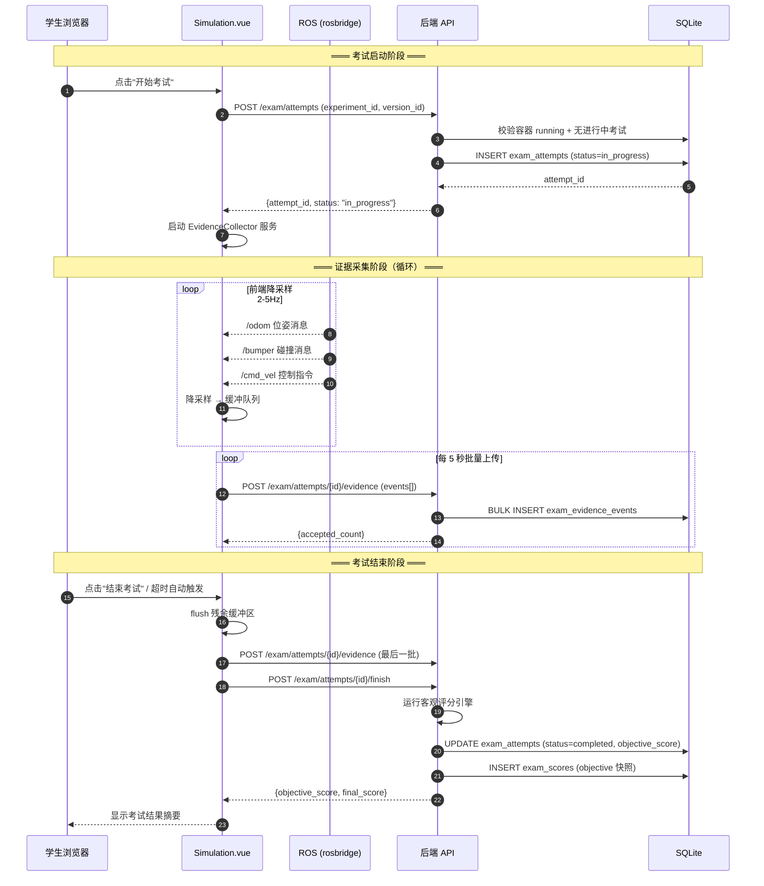
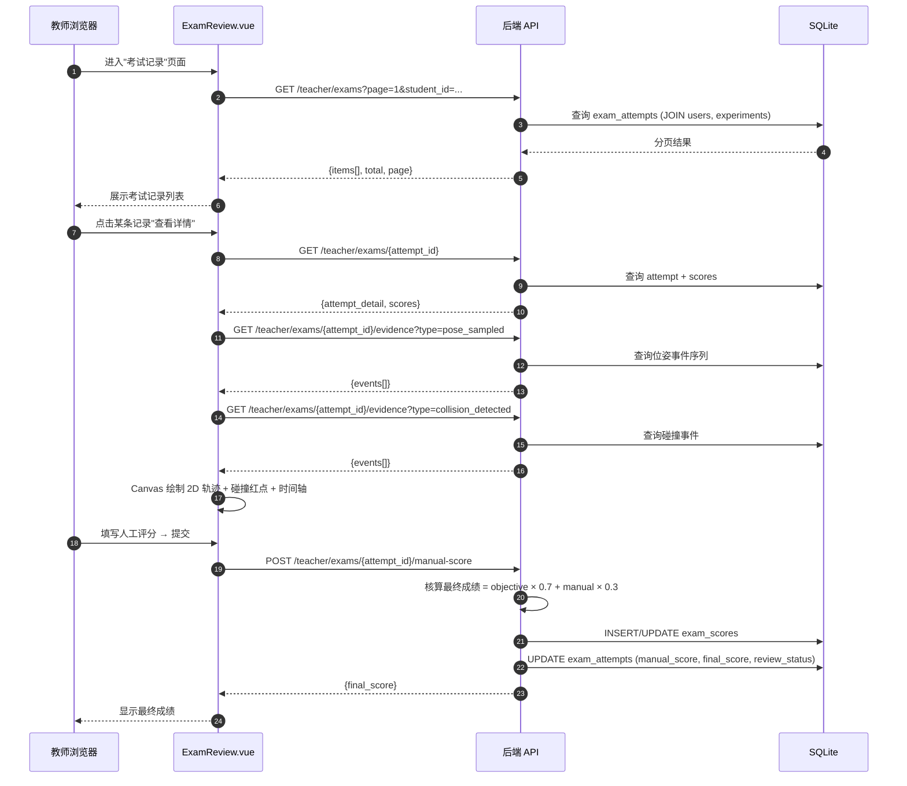
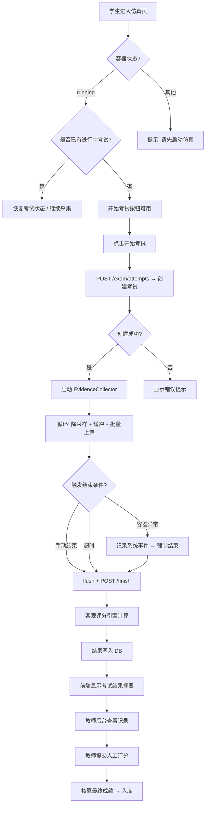
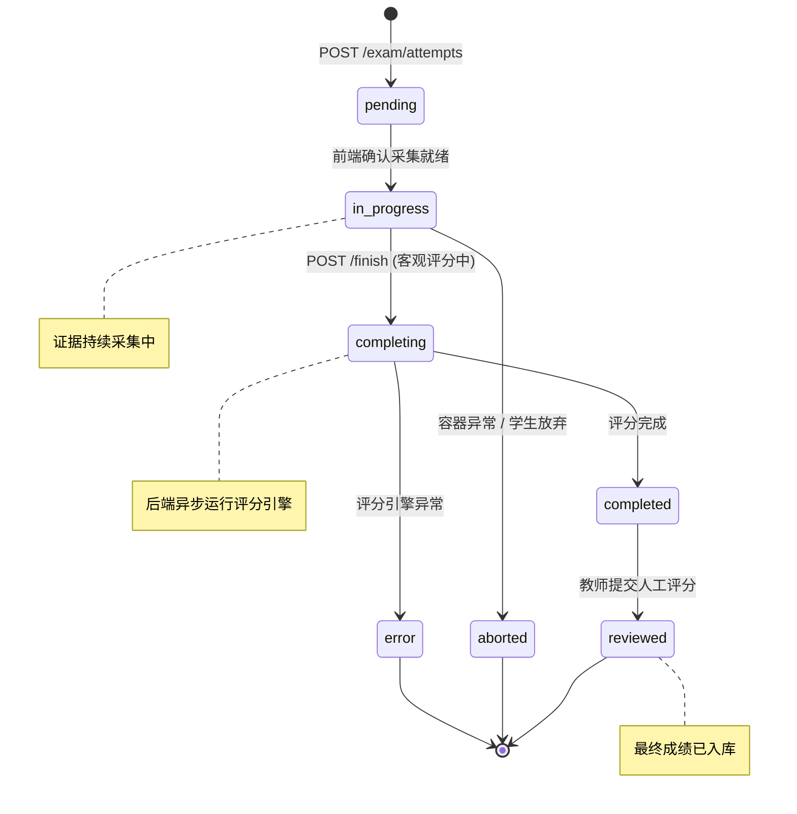
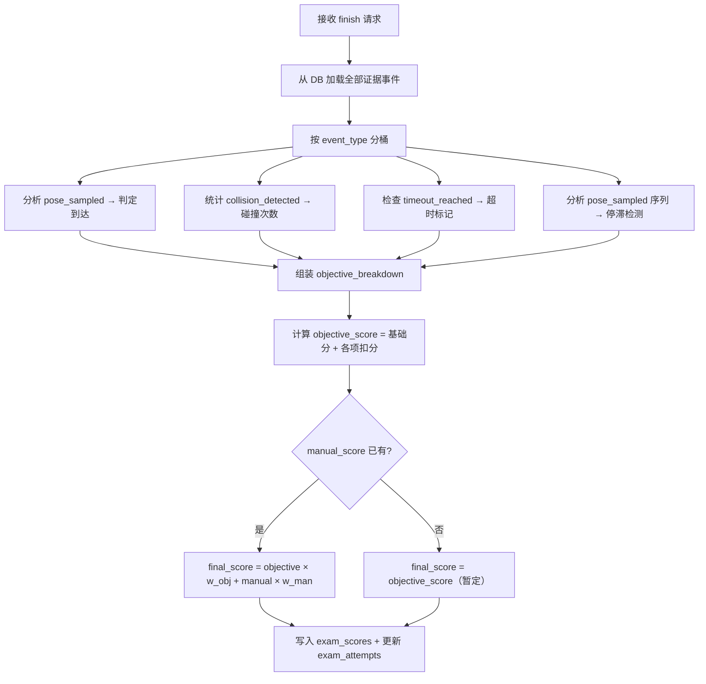

# SDD-第11-13期：评测计分体系与教师复核

> 版本：v1.1
> 日期：2026-04-12
> 状态：可评审

---

## 0. 文档元信息

- **文档标题**：SDD-第11-13期：评测计分体系与教师复核
- **文档版本**：v1.1
- **创建日期**：2026-04-10
- **修订日期**：2026-04-12
- **负责人**：Thouder03
- **关联需求/任务**：补全测评计分体系与周边业务
- **前置依赖期次**：第10期（实验环境版本化与容器重建）、第7.5期（用户域模型重构）
- **参考方案文档**：`docs/评测系统轻量级过程记录与评分方案.md`
- **目标读者**：产品 / 前端 / 后端 / 测试

### 0.1 v1.1 修订说明

本次修订基于进一步的课程场景讨论，对原方案做了重要收敛：

1. **评测执行架构改为 Sidecar 主方案**，不再以“前端采证 + 后端存储”作为主路线。
2. **教师编写评测脚本**，脚本输出标准 JSON，平台后端只解析固定语义字段，其余扩展字段统一进入 `custom_fields`。
3. **考试被抽象为配置驱动的考试模式**，至少支持 `result_run`、`process_run`、`multi_stage_run` 三类。
4. **教师端页面扩展为考试列表页、考试环境页、考试文件页**，其中环境与文件允许从实验体系复制，但发布后冻结为考试快照。
5. **学生端交互改为按考试模式驱动**，自动导航类考试采用“先调试，后显式开始考试，再由平台自动执行评测”的流程。

> **覆盖关系说明**：若本文件前文中存在与上述原则冲突的描述，以本次修订后的 [`15. v1.1 架构修订：Sidecar + 考试模式 + 配置驱动`](docs/SDD-第11-13期：评测计分体系与教师复核.md#15-v11-架构修订sidecar--考试模式--配置驱动) 为准。

---

## 1. 执行摘要（给决策者）

### 1.1 本期要解决的问题（Problem）

1. 平台已具备完整的"实验 → 容器 → 仿真"链路，但**缺少考试记录**：学生完成实训后无法留下结构化成绩。
2. 教师判定学生表现**主要依赖现场观察**，无结构化证据支撑，复核成本高且容易产生争议。
3. 客观评分能力为零——**无法自动判定**小车是否到达目标点、碰撞次数等基础指标。
4. 人工评分没有统一入口，教师评语散落在线下表格，**无法与平台成绩打通**。
5. "实训 → 评测"全流程存在断裂，平台定位为评测平台但**不具备评测闭环**。

### 1.2 本期关键结果（Outcome）

1. 学生在仿真页面点击"开始考试"后，系统自动采集轨迹、碰撞、控制、系统事件四类核心证据。
2. 考试结束后，系统自动运行客观评分规则引擎，产出客观分并写入数据库。
3. 教师在后台可按学生/实验/时间查看考试记录列表，进入详情页查看二维轨迹图、碰撞标记、事件时间轴。
4. 教师可在详情页提交人工评分与评语，系统自动核算最终成绩并入库。
5. 全流程数据可追溯：评分规则版本化，历史成绩不受后续规则调整影响。

### 1.3 成功判定（Success Metrics）

- **SM-1**：考试全流程可跑通——从"开始考试"到"最终成绩入库"端到端成功率 ≥ 95%。
- **SM-2**：客观评分可解释——每项扣分/得分可追溯到具体证据事件。
- **SM-3**：教师复核效率——教师从打开详情页到完成人工评分 ≤ 3 分钟（单次考试）。
- **SM-4**：证据完整性——考试期间位姿采样丢失率 ≤ 5%（相对于理论采样数量）。

---

## 2. 范围定义（Scope）

### 2.1 In Scope（本期必须交付）

| 编号 | 交付项 | 所属期次 |
|------|--------|----------|
| S1 | `exam_attempts` / `exam_evidence_events` / `exam_scores` / `exam_artifact_refs` 四张数据表 | 第11期 |
| S2 | 考试尝试生命周期 API（创建、结束、查询、列表） | 第11期 |
| S3 | 证据写入 API（批量写入证据事件） | 第11期 |
| S4 | 客观评分规则引擎 v1（到达判定、碰撞计数、超时、停滞） | 第11期 |
| S5 | 前端考试流程集成（仿真页"开始/结束考试"按钮与状态管理） | 第12期 |
| S6 | ROS 证据采集服务（前端订阅 `/odom`、bumper、`/cmd_vel`，降采样后上传） | 第12期 |
| S7 | 系统事件自动记录（复用 `SimulationTask` 阶段语义） | 第12期 |
| S8 | 教师端"考试记录"列表页（筛选、排序、分页） | 第13期 |
| S9 | 教师端"考试详情"页（考试摘要 + 二维轨迹图 + 碰撞标记 + 事件时间轴） | 第13期 |
| S10 | 人工评分表单 + 最终成绩核算入库 | 第13期 |

### 2.2 Out of Scope / NOT in scope（明确不做）

| 项目 | 不纳入本期原因 |
|------|---------------|
| 全量 rosbag 录制 | 存储成本高、回放系统复杂度极高，与预上线阶段目标不匹配（见方案文档 §3） |
| Gazebo 全状态录制 | 同上，教师真正关心的是结构化证据而非原始数据 |
| 视频录屏 | 带宽与存储不可控，轻量打点方案已覆盖核心复核场景 |
| 完整 3D 历史重演 | 复核目标是效率而非沉浸感；2D 轨迹图 + 事件时间轴已满足首版需求 |
| AI 自动评语 | 需先积累结构化评分数据，当前数据量不足以训练有意义的模型 |
| 复杂多维度评分模型 | 首版先用线性加权公式验证流程，后续按教学反馈迭代 |
| 争议时段短窗口原始片段 | 数据模型已预留 `exam_artifact_refs` 表，但实现推迟至争议场景确实频发时 |
| 多实验同时考试 | 当前一个学生同时仅有一个容器，不存在并发考试场景 |
| costmap 碰撞判定 | costmap 重叠率作为碰撞依据精度不足，首版使用 bumper/Gazebo 碰撞事件（见方案文档 §6.1.2） |

---

## 3. 前提挑战与方案比选

### 3.1 前提挑战（Premise Challenge）

**这是否是正确问题？** 是。平台定位为"数字孪生评测平台"，但当前无评测闭环，核心卖点未兑现。

**如果什么都不做？** 教师只能现场观察 + 线下手工登记成绩，与传统实训无差异，平台无法证明自身价值。

**是否存在更小改动？** 可以只做"手工录入成绩"——但这放弃了客观评分与证据留存，丧失了数字孪生的核心优势。

### 3.2 现有资产复用（What already exists）

#### 3.2.1 前端复用资产

| 资产 | 路径 | 可复用能力 | 本期复用方式 |
|------|------|-----------|-------------|
| 仿真主页面 | `views/Simulation/Simulation.vue` | 容器状态联动、面板编排 | 第12期：在顶栏集成"开始/结束考试"控件 |
| ROS WebSocket 连接 | `panels/ROS3DViewer/composables/useRosConnection.ts` | ROSLIB.Ros 连接管理 | 第12期：复用连接实例订阅证据话题 |
| 面板注册中心 | `panels/registry.ts` | Golden Layout 面板动态注册 | 第13期：可选注册"考试状态"面板 |
| 面板状态管理 | `stores/panelState.ts` | Pinia 状态共享 | 第12期：增加 exam 相关状态字段 |
| SimulationHeader | `components/SimulationHeader.vue` | 顶栏操作区 | 第12期：添加考试控制按钮 |
| 教师实验列表 | `views/Teacher/Experiments/ExperimentList.vue` | 表格 + 筛选 + 分页 | 第13期：参照其布局构建考试记录列表 |
| 教师实验详情 | `views/Teacher/Experiments/ExperimentDetail.vue` | 详情页布局、版本选择 | 第13期：参照其 ContentWrap + Card 布局 |
| Element Plus 组件库 | 项目全局 | Table、Dialog、Form、Tag、Timeline | 第13期：复核页全量使用 |
| API 请求封装 | `api/request/index.ts` | Axios 封装 + Token 注入 | 全部期次：新增 exam API 模块 |
| 容器 API | `api/container/index.ts` | 容器状态查询 | 第12期：考试开始时校验容器 running |

#### 3.2.2 后端复用资产

| 资产 | 路径 | 可复用能力 | 本期复用方式 |
|------|------|-----------|-------------|
| 统一响应模型 | `app/schemas/common.py` → `ApiResponse[T]` | 通用响应包装 | 全部 exam API |
| 用户鉴权 | `app/core/security.py` → `get_current_student_id` | JWT Token 鉴权 + user_id 提取 | 全部 exam API |
| 用户模型 | `app/models/student.py` → `User` | 用户实体 + role_code | 考试关联 student 身份 |
| 容器模型 | `app/models/container.py` → `SimContainer` | 容器状态 + rosbridge_port | 考试前校验容器可用 |
| 实验模型 | `app/models/experiment.py` → `Experiment` + `ExperimentVersion` | 实验/版本元信息 | exam_attempts 关联 experiment_id + version_id |
| 仿真任务模型 | `app/models/simulation_task.py` → `SimulationTask` | 任务阶段语义 | 第12期：系统事件复用 stage 枚举 |
| 数据库基类 | `app/db/base.py` → `Base` | SQLAlchemy ORM 基类 | 新模型继承 |
| 数据库会话 | `app/db/database.py` → `get_db` / `AsyncSessionLocal` | 异步会话管理 | 全部 exam CRUD |
| 路由聚合 | `app/api/v1/api.py` | 路由前缀一致性 | 注册 exam 路由模块 |
| 教师容器管理 API | `app/api/v1/endpoints/teacher/containers.py` | 容器列表+筛选模式 | 参照其分页+筛选模式构建考试列表 API |

### 3.3 实施路径备选

#### 方案 A：最小可行路径（全后端打点）

- **摘要**：证据采集全部在后端完成——后端定时轮询 ROS 话题（通过 rosbridge HTTP API 或后端直连 rosbridge），前端仅负责"开始/结束考试"按钮。
- **优点**：前端改动最小；证据不依赖前端网络稳定性。
- **风险**：后端需要为每个在考学生维护独立的 rosbridge 连接池，复杂度高；后端 Python 异步订阅 ROS 话题的生态不成熟，需要额外依赖；增加后端横向扩展困难度。
- **适用前提**：前端不可信或不稳定的场景。

#### 方案 B：前端采集 + 后端存储（推荐）

- **摘要**：前端在已有 ROS WebSocket 连接基础上订阅证据话题，降采样后通过 HTTP 批量上传后端；后端负责存储、校验、评分。
- **优点**：复用前端已有的 `useRosConnection` 和 ROSLIB 订阅能力，零额外后端 ROS 依赖；前端天然持有容器的 rosbridge 连接；降采样策略可在前端灵活调整。
- **风险**：前端页面关闭/崩溃会丢失未上传的证据缓冲区；浏览器 Tab 被切后台时定时器精度下降。
- **缓解**：采用 `visibilitychange` 事件检测 Tab 状态 + `beforeunload` 紧急 flush + 后端超时检测兜底。
- **适用前提**：前端 ROS 连接稳定（当前已验证）。

#### 方案 C：混合模式（后端主、前端辅）

- **摘要**：后端负责碰撞与系统事件（后端直接对接 Gazebo 碰撞回调），前端负责轨迹与控制指令采集。
- **优点**：碰撞事件的可靠性更高（不依赖前端）。
- **风险**：双数据源增加时间轴对齐难度；后端对接 Gazebo 碰撞回调需要额外的 plugin 或 topic relay。
- **适用前提**：碰撞判定精度要求极高的场景。

### 3.4 方案决策

- **最终采用**：**方案 B（前端采集 + 后端存储）**
- **决策理由**：
  1. 前端已拥有完整的 ROSLIB 连接和 Topic 订阅能力，边际成本最低。
  2. 碰撞判定首版基于 bumper/Gazebo 碰撞话题，该话题在 ROS 侧即可获取，无需后端直连 Gazebo。
  3. 降采样策略（2Hz 常规/5Hz 关键区域）在前端调整灵活度远高于后端。
  4. 证据丢失风险通过 flush 机制 + 后端超时兜底可控。
- **放弃方案的原因**：
  - 方案 A：后端 ROS 连接池管理复杂度与预上线阶段成本不匹配。
  - 方案 C：时间轴对齐问题在首版难以彻底解决，不值得引入双数据源。

---

## 4. 系统交互设计

### 4.1 考试全生命周期时序图



### 4.2 教师复核与人工评分时序图



### 4.3 考试主流程图



### 4.4 考试尝试状态机



**状态流转规则：**

| 当前状态 | 允许转换至 | 触发条件 | 不可逆说明 |
|---------|-----------|---------|-----------|
| `pending` | `in_progress` | 前端上报首条证据或显式确认 | — |
| `in_progress` | `completing` | POST /finish | 不可回退到 in_progress |
| `in_progress` | `aborted` | 容器异常退出 / 学生主动放弃 | 终态 |
| `completing` | `completed` | 客观评分完成 | — |
| `completing` | `error` | 评分引擎异常 | 可由管理员重试 |
| `completed` | `reviewed` | 教师提交人工评分 | 终态 |

---

## 5. API 契约

> 所有接口统一使用 `ApiResponse[T]` 包装，鉴权方式为 Bearer Token。

### 5.1 学生端 API（第11-12期）

#### 5.1.1 创建考试尝试

| 项目 | 内容 |
|------|------|
| **Endpoint** | `POST /api/v1/students/exam/attempts` |
| **鉴权** | Bearer Token (student) |
| **Request** | `{ experiment_id: int, version_id: int }` |
| **Response 200** | `ApiResponse<{ attempt_id: int, status: string, started_at: string }>` |
| **状态码** | `200` 成功 / `409` 已有进行中考试 / `400` 容器非 running / `404` 实验或版本不存在 |

**业务约束**：
- 同一学生同一时刻只能有一个 `in_progress` 状态的考试尝试。
- 创建时自动校验容器 `status = running`，否则返回 400。

#### 5.1.2 批量写入证据事件

| 项目 | 内容 |
|------|------|
| **Endpoint** | `POST /api/v1/students/exam/attempts/{attempt_id}/evidence` |
| **鉴权** | Bearer Token (student) |
| **Request** | `{ events: EvidenceEventCreate[] }` |
| **Response 200** | `ApiResponse<{ accepted_count: int, rejected_count: int }>` |
| **状态码** | `200` 成功 / `404` attempt 不存在 / `403` 非本人考试 / `409` 考试已结束 |

**`EvidenceEventCreate` 结构**：

| 字段 | 类型 | 必填 | 说明 |
|------|------|------|------|
| `event_type` | string | 是 | 事件类型枚举（见 §6.2） |
| `event_time_ms` | int | 是 | 事件发生时间戳（毫秒级 UNIX 时间） |
| `payload` | object | 是 | 事件负载 JSON（结构因 event_type 而异） |
| `source` | string | 否 | 事件来源标识，默认 `"frontend"` |

**业务约束**：
- 单次批量上限 200 条，超过则截断并在响应中标记 `rejected_count`。
- 仅 `in_progress` 状态的考试允许写入证据。
- `pending` → `in_progress` 状态转换在首次写入证据时自动触发。

#### 5.1.3 结束考试

| 项目 | 内容 |
|------|------|
| **Endpoint** | `POST /api/v1/students/exam/attempts/{attempt_id}/finish` |
| **鉴权** | Bearer Token (student) |
| **Request** | `{ reason?: string }` |
| **Response 200** | `ApiResponse<{ status: string, objective_score: float, score_breakdown: object }>` |
| **状态码** | `200` 成功 / `404` 不存在 / `403` 非本人 / `409` 状态不允许结束 |

**业务约束**：
- 仅 `in_progress` 状态允许调用。
- 调用后状态 → `completing`，同步执行客观评分引擎，完成后 → `completed`。
- 若评分引擎异常，状态 → `error`，前端显示"评分计算中，请稍后查看"。

#### 5.1.4 查询考试结果（学生自查）

| 项目 | 内容 |
|------|------|
| **Endpoint** | `GET /api/v1/students/exam/attempts/{attempt_id}` |
| **鉴权** | Bearer Token (student) |
| **Response 200** | `ApiResponse<ExamAttemptDetail>` |
| **状态码** | `200` / `404` / `403` 非本人 |

#### 5.1.5 学生考试历史列表

| 项目 | 内容 |
|------|------|
| **Endpoint** | `GET /api/v1/students/exam/attempts` |
| **鉴权** | Bearer Token (student) |
| **Query** | `page?: int, page_size?: int, experiment_id?: int` |
| **Response 200** | `ApiResponse<{ items: ExamAttemptSummary[], total: int, page: int }>` |

### 5.2 教师端 API（第11、13期）

#### 5.2.1 考试记录列表

| 项目 | 内容 |
|------|------|
| **Endpoint** | `GET /api/v1/teachers/exams` |
| **鉴权** | Bearer Token (teacher/admin) |
| **Query** | `page?: int, page_size?: int, student_id?: int, experiment_id?: int, status?: string, review_status?: string` |
| **Response 200** | `ApiResponse<{ items: ExamAttemptTeacherView[], total: int, page: int }>` |

#### 5.2.2 考试详情

| 项目 | 内容 |
|------|------|
| **Endpoint** | `GET /api/v1/teachers/exams/{attempt_id}` |
| **鉴权** | Bearer Token (teacher/admin) |
| **Response 200** | `ApiResponse<ExamAttemptFullDetail>` |
| **状态码** | `200` / `404` |

**`ExamAttemptFullDetail` 包含**：考试基本信息 + 学生信息 + 实验/版本信息 + 评分快照 + 统计摘要（总事件数、碰撞次数、总距离）。

#### 5.2.3 查询证据事件

| 项目 | 内容 |
|------|------|
| **Endpoint** | `GET /api/v1/teachers/exams/{attempt_id}/evidence` |
| **鉴权** | Bearer Token (teacher/admin) |
| **Query** | `event_type?: string, page?: int, page_size?: int` |
| **Response 200** | `ApiResponse<{ items: EvidenceEvent[], total: int }>` |

**说明**：`page_size` 上限 5000（轨迹点可能较多），默认 1000。当 `event_type=pose_sampled` 时建议一次性拉取全部点以绘制完整轨迹。

#### 5.2.4 提交人工评分

| 项目 | 内容 |
|------|------|
| **Endpoint** | `POST /api/v1/teachers/exams/{attempt_id}/manual-score` |
| **鉴权** | Bearer Token (teacher/admin) |
| **Request** | `{ manual_score: float, breakdown: ManualBreakdown, comment?: string }` |
| **Response 200** | `ApiResponse<{ final_score: float, review_status: string }>` |
| **状态码** | `200` / `404` / `409` 考试未完成客观评分 |

**`ManualBreakdown` 结构**：

| 字段 | 类型 | 必填 | 说明 |
|------|------|------|------|
| `operation_quality` | float | 是 | 操作规范性（0-100） |
| `path_rationality` | float | 是 | 路径合理性（0-100） |
| `recovery_ability` | float | 否 | 恢复能力（0-100） |
| `stability` | float | 否 | 运行稳定性（0-100） |
| `extra_comment` | string | 否 | 附加评语 |

**业务约束**：
- 仅 `completed` 或 `reviewed` 状态允许提交（支持教师多次修改人工分）。
- 提交后自动重算 `final_score` 并将 `review_status` 设为 `reviewed`。
- `manual_score` 为教师填写的综合人工分（0-100），`breakdown` 为细项记录。

### 5.3 错误语义映射

| 错误码 | HTTP Status | 语义 | 前端动作 |
|--------|------------|------|---------|
| `EXAM_IN_PROGRESS` | 409 | 已有进行中的考试 | 提示"您有未完成的考试" + 恢复按钮 |
| `CONTAINER_NOT_RUNNING` | 400 | 容器非 running 状态 | 提示"请先启动仿真环境" |
| `EXAM_ALREADY_FINISHED` | 409 | 考试已结束，不能再写入证据 | 前端停止采集 |
| `EXAM_NOT_SCORABLE` | 409 | 考试未完成客观评分，不能提交人工分 | 提示"请等待客观评分完成" |
| `ATTEMPT_NOT_FOUND` | 404 | 考试记录不存在 | 跳转列表页 |
| `FORBIDDEN_NOT_OWNER` | 403 | 非本人考试记录 | 提示"无权访问" |
| `EVIDENCE_BATCH_TOO_LARGE` | 400 | 单次证据超过 200 条 | 前端减小 batch size |
| `SCORING_ENGINE_ERROR` | 500 | 评分引擎内部异常 | 提示"评分计算异常，请联系管理员" |

---

## 6. 数据字典

### 6.1 表：`exam_attempts`（考试尝试主表）

| 字段名 | 数据类型 | 是否必填 | 默认值 | 业务说明 |
|--------|---------|---------|--------|---------|
| `id` | INTEGER | 是 | 自增 | 主键 |
| `student_id` | INTEGER | 是 | — | 学生 ID（FK → users.id） |
| `experiment_id` | INTEGER | 是 | — | 实验 ID（FK → experiments.id） |
| `version_id` | INTEGER | 是 | — | 实验版本 ID（FK → experiment_versions.id） |
| `container_id` | INTEGER | 否 | — | 关联容器 ID（FK → sim_containers.id），快照用途 |
| `status` | VARCHAR(20) | 是 | `"pending"` | 考试状态（见 §6.2 枚举） |
| `review_status` | VARCHAR(20) | 是 | `"pending"` | 复核状态（见 §6.2 枚举） |
| `started_at` | DATETIME | 否 | — | 考试开始时间（首条证据写入时设置） |
| `ended_at` | DATETIME | 否 | — | 考试结束时间 |
| `duration_ms` | INTEGER | 否 | — | 考试持续时长（毫秒），结束时计算 |
| `time_limit_ms` | INTEGER | 否 | — | 考试时间限制（毫秒），由实验版本配置决定 |
| `objective_score` | FLOAT | 否 | — | 客观分（0-100） |
| `manual_score` | FLOAT | 否 | — | 人工分（0-100） |
| `final_score` | FLOAT | 否 | — | 最终成绩（加权计算结果） |
| `score_rule_version` | VARCHAR(32) | 否 | — | 评分规则版本标识，如 `"v1.0"` |
| `teacher_comment` | TEXT | 否 | — | 教师总评评语 |
| `created_at` | DATETIME | 是 | `utcnow` | 记录创建时间 |
| `updated_at` | DATETIME | 是 | `utcnow` | 记录更新时间 |

**索引**：
- `idx_exam_attempts_student_id` (student_id)
- `idx_exam_attempts_experiment_id` (experiment_id)
- `idx_exam_attempts_status` (status)

### 6.2 枚举 / 状态字典

#### 考试状态 `ExamAttemptStatus`

| 枚举值 | 含义 | 业务约束 / UI 策略 |
|--------|------|-------------------|
| `pending` | 已创建，等待开始采集 | 前端显示"准备中" |
| `in_progress` | 考试进行中，证据采集中 | 允许写入证据；前端显示计时器 |
| `completing` | 考试已结束，客观评分进行中 | 禁止写入证据；前端显示"评分中…" |
| `completed` | 客观评分完成 | 教师可查看和提交人工评分 |
| `aborted` | 异常中止（容器崩溃/学生放弃） | 终态；标红提示原因 |
| `error` | 评分引擎异常 | 管理员可重试 |

#### 复核状态 `ReviewStatus`

| 枚举值 | 含义 | 业务约束 |
|--------|------|---------|
| `pending` | 待复核 | 客观分已出，教师尚未查看 |
| `reviewed` | 已复核 | 教师已提交人工分 + 最终成绩已入库 |

#### 证据事件类型 `EvidenceEventType`

| 枚举值 | 分类 | Payload 结构 | 来源话题 |
|--------|------|-------------|---------|
| `pose_sampled` | 轨迹 | `{ x, y, theta, linear_vel?, angular_vel? }` | `/odom` 或 `/amcl_pose` |
| `collision_detected` | 碰撞 | `{ x, y, object_a, object_b, severity?, contact_duration_ms? }` | bumper / Gazebo contact |
| `cmd_vel_sampled` | 控制 | `{ linear_x, angular_z, source? }` | `/cmd_vel` |
| `mode_changed` | 控制 | `{ mode: "nav_start" \| "manual" \| "stop" \| "reset" }` | 前端操作 |
| `goal_reached` | 系统 | `{ goal_x, goal_y, distance_to_goal }` | 前端/后端判定 |
| `timeout_reached` | 系统 | `{ elapsed_ms, limit_ms }` | 前端计时 |
| `exam_started` | 系统 | `{}` | 后端 |
| `exam_finished` | 系统 | `{ reason: "manual" \| "timeout" \| "abort" }` | 后端 |
| `system_warning` | 系统 | `{ code, message }` | 后端 |
| `system_error` | 系统 | `{ code, message }` | 后端 |

### 6.3 表：`exam_evidence_events`（证据事件表）

| 字段名 | 数据类型 | 是否必填 | 默认值 | 业务说明 |
|--------|---------|---------|--------|---------|
| `id` | INTEGER | 是 | 自增 | 主键 |
| `attempt_id` | INTEGER | 是 | — | FK → exam_attempts.id (CASCADE) |
| `event_type` | VARCHAR(30) | 是 | — | 事件类型（见 §6.2） |
| `event_time_ms` | BIGINT | 是 | — | 事件时间戳（毫秒级 UNIX 时间） |
| `sequence_no` | INTEGER | 是 | — | 同一 attempt 下的序号（前端自增） |
| `source` | VARCHAR(20) | 否 | `"frontend"` | 来源标识 |
| `payload_json` | JSON | 是 | — | 事件负载（结构因 event_type 而异） |
| `created_at` | DATETIME | 是 | `utcnow` | 入库时间 |

**索引**：
- `idx_evidence_attempt_id` (attempt_id)
- `idx_evidence_type` (attempt_id, event_type) — 按类型查询优化
- `idx_evidence_time` (attempt_id, event_time_ms) — 时间轴查询优化

### 6.4 表：`exam_scores`（评分结果快照表）

| 字段名 | 数据类型 | 是否必填 | 默认值 | 业务说明 |
|--------|---------|---------|--------|---------|
| `id` | INTEGER | 是 | 自增 | 主键 |
| `attempt_id` | INTEGER | 是 | — | FK → exam_attempts.id (CASCADE)，UNIQUE |
| `objective_score` | FLOAT | 否 | — | 客观分（0-100） |
| `manual_score` | FLOAT | 否 | — | 人工分（0-100） |
| `final_score` | FLOAT | 否 | — | 最终成绩 |
| `objective_breakdown_json` | JSON | 否 | — | 客观分细项拆解 |
| `manual_breakdown_json` | JSON | 否 | — | 人工分细项拆解 |
| `score_rule_version` | VARCHAR(32) | 是 | — | 评分规则版本 |
| `weight_objective` | FLOAT | 是 | `0.7` | 客观分权重 |
| `weight_manual` | FLOAT | 是 | `0.3` | 人工分权重 |
| `scored_by` | INTEGER | 否 | — | 评分教师 ID（人工评分时填写） |
| `scored_at` | DATETIME | 否 | — | 最近评分时间 |
| `created_at` | DATETIME | 是 | `utcnow` | 创建时间 |
| `updated_at` | DATETIME | 是 | `utcnow` | 更新时间 |

**`objective_breakdown_json` 结构示例**：

```json
{
  "base_score": 100,
  "goal_reached": true,
  "goal_deduction": 0,
  "collision_count": 2,
  "collision_deduction": -10,
  "timeout": false,
  "timeout_deduction": 0,
  "stagnation_detected": false,
  "stagnation_deduction": 0,
  "final_objective": 90
}
```

### 6.5 表：`exam_artifact_refs`（原始片段引用表 — 预留，第一版不启用）

| 字段名 | 数据类型 | 是否必填 | 默认值 | 业务说明 |
|--------|---------|---------|--------|---------|
| `id` | INTEGER | 是 | 自增 | 主键 |
| `attempt_id` | INTEGER | 是 | — | FK → exam_attempts.id |
| `event_id` | INTEGER | 否 | — | FK → exam_evidence_events.id |
| `artifact_type` | VARCHAR(30) | 是 | — | 类型（rosbag_segment / screenshot / video_clip） |
| `storage_path` | VARCHAR(512) | 是 | — | 存储路径 |
| `time_start_ms` | BIGINT | 否 | — | 片段起始时间 |
| `time_end_ms` | BIGINT | 否 | — | 片段结束时间 |
| `reason` | VARCHAR(200) | 否 | — | 保存原因 |
| `created_at` | DATETIME | 是 | `utcnow` | 创建时间 |

> **说明**：该表仅建表、不写入数据。为后续"争议时段短窗口原始片段能力"预留数据结构。

---

## 7. 客观评分引擎设计（第11期核心）

### 7.1 评分规则 v1.0

| 规则项 | 判定逻辑 | 分值影响 | 依据证据类型 |
|--------|---------|---------|-------------|
| **基础分** | 固定 | +100 | — |
| **到达目标** | 终点位姿距目标点 ≤ 阈值（默认 0.5m） | 未到达: -40 | `goal_reached` / `pose_sampled` |
| **碰撞扣分** | 每次碰撞固定扣分 | 每次: -5，上限 -30 | `collision_detected` |
| **超时扣分** | 超过 `time_limit_ms` | -20 | `timeout_reached` |
| **长时间停滞** | 连续 30s 位移 < 0.05m | -10 | `pose_sampled` 序列分析 |
| **下限** | 总分不低于 0 | `max(0, score)` | — |

**规则版本化**：
- 每次规则调整递增版本号（`v1.0` → `v1.1`）。
- 评分时将 `score_rule_version` 写入 `exam_scores` 和 `exam_attempts`。
- 历史成绩按当时规则版本不可追溯修改（除非管理员手动重算）。

### 7.2 评分引擎执行流程



### 7.3 最终成绩核算公式

```
final_score = objective_score × weight_objective + manual_score × weight_manual
```

- 默认权重：`weight_objective = 0.7`，`weight_manual = 0.3`
- 权重存储在 `exam_scores` 表，支持后续按实验/版本维度配置
- 若教师未提交人工分，`final_score` 暂等于 `objective_score`，`review_status` 保持 `pending`

---

## 8. 前端设计

### 8.1 学生端——仿真页考试集成（第12期）

#### 8.1.1 UI 变更：SimulationHeader 增加考试控件

在现有 `SimulationHeader.vue` 右侧操作区增加考试控制区域：

```
┌──────────────────────────────────────────────────────────────────────────┐
│  🤖 仿真工作台    [实验名称]  [版本: v1.0]        [⏱ 03:25] [■ 结束考试] │
│                                               或  [▶ 开始考试]           │
└──────────────────────────────────────────────────────────────────────────┘
```

**控件状态映射**：

| 考试状态 | 按钮文案 | 按钮样式 | 附加 UI |
|---------|---------|---------|--------|
| 无考试 | "开始考试" | primary + outline | — |
| `pending` | "准备中…" | loading | — |
| `in_progress` | "结束考试" | danger | 倒计时器 |
| `completing` | "评分中…" | disabled + loading | — |
| `completed` | "查看结果" | success + outline | 分数 badge |
| `aborted` / `error` | "考试异常" | warning | 错误提示 |

#### 8.1.2 EvidenceCollector 服务（Composable）

新建 `composables/useExamEvidence.ts`，职责：

1. **Topic 订阅**：通过现有 `useRosConnection` 获取 `Ros` 实例，订阅 `/odom`、bumper topic、`/cmd_vel`。
2. **降采样**：
   - `/odom` → 默认 2Hz（500ms 间隔），碰撞前后自动提升到 5Hz。
   - `/cmd_vel` → 2Hz。
   - bumper/碰撞 → 不降采样（事件驱动）。
3. **缓冲队列**：内存中维护 `EvidenceEvent[]` 队列。
4. **批量上传**：每 5 秒或队列满 100 条时触发上传。
5. **Flush 机制**：
   - `beforeunload` 事件触发同步 flush（`navigator.sendBeacon`）。
   - `visibilitychange` 事件触发异步 flush。
   - 考试结束时强制 flush。
6. **序号管理**：维护全局自增 `sequence_no`。

#### 8.1.3 考试状态管理

在现有 `stores/` 目录下新建 `examState.ts`（或集成到 `panelState.ts`），管理：

| 状态字段 | 类型 | 说明 |
|---------|------|------|
| `currentAttemptId` | `number \| null` | 当前考试 ID |
| `examStatus` | `ExamAttemptStatus \| null` | 当前考试状态 |
| `elapsedMs` | `number` | 已用时（前端计时） |
| `timeLimitMs` | `number \| null` | 时限 |
| `objectiveScore` | `number \| null` | 客观分（结束后填充） |
| `isCollecting` | `boolean` | 证据采集中标记 |

### 8.2 教师端——考试记录列表页（第13期）

#### 8.2.1 路由配置

**前端路由** `asyncRouterMap`：

```
/teacher/exams               → 考试记录父路由
/teacher/exams/list          → 考试记录列表页
/teacher/exams/:id/review    → 考试详情与复核页（hidden, activeMenu: list）
```

**后端路由权限** `auth.py` → `get_user_routes` → `teacher` 数组追加：

```
"/teacher/exams"
"/teacher/exams/list"
"/teacher/exams/:id/review"
```

#### 8.2.2 列表页布局

```
┌─────────────────────────────────────────────────────────────────┐
│  考试记录管理                                                    │
├─────────────────────────────────────────────────────────────────┤
│  筛选区：[学生 ▾] [实验 ▾] [状态 ▾] [复核状态 ▾] [🔍 搜索]      │
├───┬──────────┬──────┬──────┬──────┬──────┬──────┬──────┬───────┤
│ # │ 学生     │ 实验  │ 版本  │ 状态  │ 客观分│ 最终分│ 时间   │ 操作  │
├───┼──────────┼──────┼──────┼──────┼──────┼──────┼──────┼───────┤
│ 1 │ 张三     │ 导航  │ v1.0 │ ✅完成│ 85   │ 88   │ 04-10 │ [详情]│
│ 2 │ 李四     │ 导航  │ v1.0 │ ⏳待审│ 72   │  -   │ 04-10 │ [详情]│
│ 3 │ 王五     │ 避障  │ v2.0 │ ❌异常│  -   │  -   │ 04-09 │ [详情]│
├───┴──────────┴──────┴──────┴──────┴──────┴──────┴──────┴───────┤
│  共 42 条  [< 1 2 3 ... >]                                     │
└─────────────────────────────────────────────────────────────────┘
```

### 8.3 教师端——考试详情与复核页（第13期）

#### 8.3.1 页面布局

```
┌─────────────────────────────────────────────────────────────────────────┐
│  ← 返回列表    考试详情 - 张三 / 导航实验 v1.0                          │
├───────────────────────────────────┬─────────────────────────────────────┤
│                                   │  📊 考试摘要                        │
│                                   │  ┌─────────────────────────────┐   │
│   🗺️ 二维轨迹图                   │  │ 学生：张三                    │   │
│                                   │  │ 实验：自主导航 / v1.0         │   │
│   ┌───────────────────────────┐   │  │ 状态：已完成 ✅               │   │
│   │         ·····→            │   │  │ 用时：4分32秒                │   │
│   │       ·       ↘          │   │  │ 碰撞：2次                    │   │
│   │     ·     🔴    ↓        │   │  │ 客观分：85                   │   │
│   │    S·          ↓         │   │  │ 人工分：92                   │   │
│   │                🎯 G      │   │  │ 最终分：87.1                 │   │
│   └───────────────────────────┘   │  └─────────────────────────────┘   │
│                                   │                                     │
│   S=起点  G=目标  🔴=碰撞         │  📝 人工评分                        │
│                                   │  ┌─────────────────────────────┐   │
├───────────────────────────────────┤  │ 操作规范性  [████████░░] 80  │   │
│                                   │  │ 路径合理性  [█████████░] 90  │   │
│  📅 事件时间轴                     │  │ 恢复能力    [██████████] 100 │   │
│  ──●────●──●───●────●──●──●──→   │  │ 运行稳定性  [█████████░] 90  │   │
│   开始  导航 碰撞 碰撞 到达 结束   │  │                               │   │
│         启动               目标   │  │ 综合人工分   [        92    ] │   │
│                                   │  │ 教师评语     [____________] │   │
│  点击事件节点查看详情               │  │              [提交评分]      │   │
│                                   │  └─────────────────────────────┘   │
└───────────────────────────────────┴─────────────────────────────────────┘
```

#### 8.3.2 二维轨迹图实现方案

- **渲染引擎**：原生 Canvas 2D（不引入额外图表库，保持轻量）。
- **数据源**：`GET /teacher/exams/{id}/evidence?event_type=pose_sampled` 一次性拉取。
- **绘制要素**：
  - 轨迹折线（蓝色，按时间顺序连接 x,y 坐标）
  - 起点标记（绿色圆点 + "S" 标注）
  - 目标点标记（绿色旗帜 + "G" 标注）
  - 碰撞点标记（红色圆点，点击弹出 Tooltip 显示碰撞详情）
- **坐标变换**：ROS 坐标 → Canvas 像素坐标的线性映射（自动 fit 到画布尺寸，留 padding）。
- **交互**：鼠标悬停轨迹点显示时间和速度，碰撞点可点击。

#### 8.3.3 事件时间轴实现方案

- **组件**：基于 Element Plus `el-timeline` 或自定义横向时间轴。
- **数据源**：`GET /teacher/exams/{id}/evidence` 全量，前端按 event_type 分类渲染。
- **事件节点样式**：

| event_type | 图标 | 颜色 | 标签 |
|-----------|------|------|------|
| `exam_started` | ▶ | blue | 开始考试 |
| `mode_changed` (nav_start) | 🧭 | cyan | 启动导航 |
| `collision_detected` | ⚠ | red | 碰撞 |
| `goal_reached` | 🎯 | green | 到达目标 |
| `timeout_reached` | ⏰ | orange | 超时 |
| `system_error` | ✕ | red | 系统异常 |
| `exam_finished` | ■ | gray | 考试结束 |

---

## 9. 安全与边界约束

| 风险点 | 威胁描述 | 防护策略 | 验证方式 |
|--------|---------|---------|---------|
| 越权访问 | 学生 A 查看/篡改学生 B 的考试记录 | 所有学生端 API 强制校验 `attempt.student_id == current_user_id` | 权限测试 |
| 角色越权 | 学生调用教师端评分 API | 教师端 API 独立路由前缀 + 角色校验中间件 | 角色切换测试 |
| 证据伪造 | 前端伪造高分证据（假轨迹/假碰撞） | 后端校验 `event_time_ms` 单调递增 + 时间窗口合理性；教师复核作为最终防线 | 伪造数据测试 |
| 批量攻击 | 恶意高频调用证据写入 API | 单考试证据总量上限 50000 条 + 单批次 200 条 | 压力测试 |
| SQL 注入 | payload_json 含恶意内容 | SQLAlchemy 参数化查询 + JSON 字段不拼接 SQL | 安全扫描 |
| 并发冲突 | 两个教师同时评分同一考试 | `exam_scores` 表 `attempt_id` UNIQUE 约束 + 乐观锁（updated_at） | 并发测试 |
| 状态竞态 | 前端在 completing 时仍发送证据 | 后端严格校验状态，非 `in_progress` 拒绝写入 | 状态机测试 |

---

## 10. 异常、恢复与可观测性

### 10.1 失败模式登记（Failure Modes Registry）

| Codepath | 失败模式 | 已处理? | 用户可见? | 有日志/指标? | 测试覆盖? |
|----------|---------|---------|----------|------------|----------|
| 创建考试时容器已停止 | 容器非 running | Y | 明确提示"请先启动仿真" | Y | Y |
| 创建考试时已有进行中考试 | 状态冲突 | Y | 明确提示 + 恢复按钮 | Y | Y |
| 证据上传网络中断 | HTTP 失败 | Y | 前端静默重试(3次) → 失败后提示 | Y | Y |
| 证据写入时考试已结束 | 状态冲突 | Y | 前端停止采集 | Y | Y |
| 客观评分引擎异常 | 内部错误 | Y | 提示"评分异常，请联系管理员" | Y | Y |
| ROS 话题无数据 | 订阅超时 | Y | 前端 30s 无数据提示"传感器无响应" | Y | N (需真实 ROS) |
| Tab 切后台导致采样精度下降 | 定时器降频 | Y | 前端 visibilitychange 检测 + 标记 | Y | N |
| 页面关闭未结束考试 | 证据丢失 | Y | beforeunload flush + 后端超时自动 abort | Y | Y |
| 教师提交人工分时考试未完成客观评分 | 状态冲突 | Y | 提示"请等待客观评分完成" | Y | Y |

### 10.2 错误恢复策略

| 场景 | 降级策略 | 重试策略 | 终态处理 |
|------|---------|---------|---------|
| 证据上传失败 | 本地缓冲区保留，下次一起上传 | 指数退避重试（1s→2s→4s），最多3次 | 3次失败后提示用户，但不中断考试 |
| 评分引擎异常 | 状态设为 `error` | 管理员可触发重算 | 前端显示"评分异常" |
| 页面意外关闭 | `beforeunload` sendBeacon flush | — | 后端 10 分钟无新证据 → 自动 abort |
| ROS 连接断开 | 采集暂停，重连后恢复 | ROSLIB 自动重连 | 断连超过 60s 记录 system_warning |

### 10.3 可观测性要求

- **关键日志字段**：`trace_id`、`user_id`、`attempt_id`、`event_type`、`error_code`
- **核心指标**：
  - 考试创建成功率
  - 证据上传 P95 延迟
  - 证据批次丢弃率（rejected_count / total）
  - 客观评分引擎执行耗时
  - 人工评分提交率（reviewed / completed）
- **告警建议**：
  - 客观评分引擎连续失败 ≥ 3 次
  - 单考试证据超过 40000 条（接近上限）
  - 证据上传 P95 > 3 秒

---

## 11. 测试与验收

### 11.1 测试覆盖地图

| 流程/分支 | 测试类型 | 用例要点 | 通过标准 |
|----------|---------|---------|---------|
| 创建考试（正常） | 集成 | 容器 running + 无进行中考试 | 返回 attempt_id，状态=pending |
| 创建考试（容器非 running） | 集成 | 容器 stopped/creating | 返回 400 + CONTAINER_NOT_RUNNING |
| 创建考试（已有进行中） | 集成 | 存在 in_progress 记录 | 返回 409 + EXAM_IN_PROGRESS |
| 批量写入证据 | 集成 | 200 条正常 payload | accepted=200, rejected=0 |
| 批量写入超限 | 集成 | 300 条 | accepted=200, rejected=100 |
| 写入已结束考试 | 集成 | status=completed | 返回 409 |
| 结束考试 + 评分 | 集成 | 有效证据 → finish | 返回 objective_score |
| 客观评分-到达 | 单元 | 末点距目标 < 0.5m | goal_reached=true, 不扣分 |
| 客观评分-未到达 | 单元 | 末点距目标 > 0.5m | goal_reached=false, -40 |
| 客观评分-碰撞 | 单元 | 3 次碰撞 | collision_deduction=-15 |
| 客观评分-碰撞上限 | 单元 | 10 次碰撞 | collision_deduction=-30（cap） |
| 客观评分-超时 | 单元 | 有 timeout_reached 事件 | timeout_deduction=-20 |
| 客观评分-停滞 | 单元 | 30s 内位移<0.05m | stagnation_deduction=-10 |
| 教师查看列表 | 集成 | 多筛选条件 | 返回正确分页数据 |
| 教师查看详情 | 集成 | 有效 attempt_id | 返回完整 detail |
| 教师提交人工分 | 集成 | 有效分数 | 重算 final_score |
| 教师重复评分 | 集成 | 已 reviewed 的考试再次评分 | 覆盖旧分，更新 final_score |
| 越权访问-学生看他人 | 安全 | 用学生 A token 访问学生 B 考试 | 返回 403 |
| 越权访问-学生调教师 API | 安全 | student token 调 /teachers/exams | 返回 403 |

### 11.2 验收标准

#### 11.2.1 功能验收

- [ ] 学生可在仿真页点击"开始考试"，系统创建考试记录并开始证据采集
- [ ] 考试期间，位姿/碰撞/控制指令证据持续上传至后端
- [ ] 点击"结束考试"后，系统自动计算客观分并展示结果
- [ ] 教师可在列表页按学生/实验/状态筛选考试记录
- [ ] 教师进入详情页可看到二维轨迹图、碰撞标记、事件时间轴
- [ ] 教师可提交人工评分，系统自动核算最终成绩并更新记录
- [ ] 评分规则版本化，历史成绩不受后续规则调整影响

#### 11.2.2 稳定性验收

- [ ] 连续运行 10 分钟考试（包含多次碰撞）无致命错误
- [ ] 证据采集丢失率 ≤ 5%
- [ ] 客观评分引擎执行耗时 ≤ 2 秒
- [ ] Tab 切后台 30 秒后恢复，证据采集自动恢复

#### 11.2.3 一致性验收

- [ ] API 契约与实际行为一致（状态码、错误语义）
- [ ] 状态机转换与 §4.4 定义一致
- [ ] 评分 breakdown 各项之和等于 objective_score

---

## 12. 实施分期与交付清单

### 12.1 分期总览

| 期次 | 目标 | 范围边界 | 依赖 | 风险 |
|------|------|---------|------|------|
| **第11期** | 评测数据基座与客观评分引擎 | 4张表 + 学生端/教师端考试 API + 评分引擎 v1 | 第10期容器重建流程已稳定；第7.5期用户模型已完成 | 评分规则细节需教学侧确认 |
| **第12期** | 前端证据采集与考试流程集成 | 仿真页考试 UI + EvidenceCollector + 系统事件 | 第11期 API 已就绪 | ROS 话题可用性依赖仿真环境 |
| **第13期** | 教师复核界面与成绩管理 | 教师端列表页 + 详情页 + 人工评分 + 最终成绩 | 第12期端到端可跑通 | 2D 轨迹图 Canvas 实现工作量 |

### 12.2 第11期交付物清单

**文档交付**：
- 本 SDD 文档

**后端交付**：
- `app/models/exam.py` — `ExamAttempt`、`ExamEvidenceEvent`、`ExamScore`、`ExamArtifactRef` 四个模型
- `app/schemas/exam.py` — 请求/响应 Pydantic Schema
- `app/crud/exam.py` — 考试 CRUD 操作
- `app/api/v1/endpoints/student/exam.py` — 学生端考试 API（创建、写入证据、结束、查询）
- `app/api/v1/endpoints/teacher/exams.py` — 教师端考试 API（列表、详情、人工评分）
- `app/core/scoring_engine.py` — 客观评分引擎 v1
- `init_db.py` 更新 — 新增表的初始化

**测试交付**：
- 考试生命周期集成测试
- 客观评分引擎单元测试

### 12.3 第12期交付物清单

**前端交付**：
- `composables/useExamEvidence.ts` — 证据采集 Composable
- `stores/examState.ts` — 考试状态管理
- `api/exam/index.ts` + `types.ts` — 考试 API 封装
- `components/SimulationHeader.vue` 修改 — 增加考试控制区域
- `Simulation.vue` 修改 — 集成考试生命周期

**后端交付**：
- 考试超时自动 abort 定时任务
- 系统事件自动记录（复用 SimulationTask 阶段变更钩子）

### 12.4 第13期交付物清单

**前端交付**：
- `views/Teacher/Exams/ExamList.vue` — 考试记录列表页
- `views/Teacher/Exams/ExamReview.vue` — 考试详情与复核页
- `views/Teacher/Exams/components/TrajectoryCanvas.vue` — 二维轨迹图组件
- `views/Teacher/Exams/components/EventTimeline.vue` — 事件时间轴组件
- `views/Teacher/Exams/components/ManualScoreForm.vue` — 人工评分表单
- `api/exam/index.ts` 更新 — 教师端 API 封装
- `router/index.ts` 更新 — 教师端考试路由

**后端交付**：
- `auth.py` → `get_user_routes` 更新 — 追加教师考试路由权限

---

## 13. Deferred（后续阶段）

| 延后项 | 延后原因 | 触发条件（何时再做） |
|--------|---------|-------------------|
| 争议时段短窗口原始片段（rosbag segment） | 存储与回放系统复杂度高，当前核心打点方案已满足大部分复核场景 | 教师实际使用中争议比例 > 20% |
| 3D 历史重演 | 实现成本极高（需完整消息序列回放），2D 轨迹图已满足首版需求 | 教师明确反馈 2D 不够 + 积累足够历史消息数据 |
| 多维度评分模型 | 首版线性加权公式需先验证流程，教学侧尚未确定更复杂的评分维度 | 首版运行一学期后，根据教学反馈迭代 |
| AI 自动评语 | 数据量不足，需先积累结构化评分数据 | 考试记录 > 500 条 + 评分数据标注完成 |
| costmap 碰撞判定 | 精度不足以作为正式判分依据，适合辅助指标 | bumper 碰撞事件不足以覆盖所有碰撞场景时 |
| 考试成绩导出（Excel/PDF） | 非核心闭环能力，教师可在列表页手动记录 | 教师明确提出批量导出需求 |
| 按实验/版本维度配置评分权重 | 首版全局统一权重验证流程，后续按需扩展 | 不同实验确实需要不同权重配比 |
| 学生端考试历史详情页（含轨迹回看） | 首版学生仅需看到分数摘要，复核主要在教师端 | 学生有明确需求查看自己的轨迹 |

---

## 14. 附录

### 14.1 规范—代码映射

| 规范项 | 代码路径 |
|--------|---------|
| 考试数据模型 | `edubot-twin-server/app/models/exam.py` |
| 考试 Pydantic Schema | `edubot-twin-server/app/schemas/exam.py` |
| 考试 CRUD | `edubot-twin-server/app/crud/exam.py` |
| 学生端考试 API | `edubot-twin-server/app/api/v1/endpoints/student/exam.py` |
| 教师端考试 API | `edubot-twin-server/app/api/v1/endpoints/teacher/exams.py` |
| 客观评分引擎 | `edubot-twin-server/app/core/scoring_engine.py` |
| 前端证据采集 | `edubot-twin-web/src/views/Simulation/composables/useExamEvidence.ts` |
| 前端考试状态 | `edubot-twin-web/src/views/Simulation/stores/examState.ts` |
| 前端考试 API | `edubot-twin-web/src/api/exam/index.ts` |
| 教师考试列表页 | `edubot-twin-web/src/views/Teacher/Exams/ExamList.vue` |
| 教师复核详情页 | `edubot-twin-web/src/views/Teacher/Exams/ExamReview.vue` |
| 轨迹图组件 | `edubot-twin-web/src/views/Teacher/Exams/components/TrajectoryCanvas.vue` |
| 事件时间轴组件 | `edubot-twin-web/src/views/Teacher/Exams/components/EventTimeline.vue` |
| 人工评分表单 | `edubot-twin-web/src/views/Teacher/Exams/components/ManualScoreForm.vue` |

### 14.2 术语表

| 术语 | 定义 |
|------|------|
| Exam Attempt | 一次完整的考试尝试记录，从创建到最终评分 |
| Evidence Event | 考试过程中采集的结构化证据事件 |
| Objective Score | 系统根据规则自动计算的客观分数 |
| Manual Score | 教师基于复核界面给出的人工分数 |
| Final Score | 客观分与人工分加权后的最终成绩 |
| EvidenceCollector | 前端负责 ROS 话题订阅、降采样、缓冲上传的服务 |
| Score Rule Version | 评分规则版本标识，用于保证历史成绩可追溯 |
| Review Status | 教师复核状态（pending/reviewed） |
| Trajectory Canvas | 二维轨迹可视化 Canvas 组件 |
| Event Timeline | 考试关键事件的时间轴可视化组件 |

### 14.3 证据 Payload 结构详细定义

#### `pose_sampled` Payload

```json
{
  "x": 1.23,          // float, 米
  "y": 4.56,          // float, 米
  "theta": 0.78,      // float, 弧度
  "linear_vel": 0.5,  // float, m/s, 可选
  "angular_vel": 0.1  // float, rad/s, 可选
}
```

#### `collision_detected` Payload

```json
{
  "x": 2.34,                   // float, 碰撞位置 x
  "y": 5.67,                   // float, 碰撞位置 y
  "object_a": "turtlebot",     // string, 碰撞对象 A
  "object_b": "wall_east",     // string, 碰撞对象 B
  "severity": "minor",         // string, minor/major, 可选
  "contact_duration_ms": 150   // int, 接触持续时长, 可选
}
```

#### `cmd_vel_sampled` Payload

```json
{
  "linear_x": 0.5,   // float, m/s
  "angular_z": 0.2,  // float, rad/s
  "source": "nav"    // string, nav/manual/keyboard, 可选
}
```

#### `mode_changed` Payload

```json
{
  "mode": "nav_start"  // string, nav_start/manual/stop/reset
}
```

#### `goal_reached` Payload

```json
{
  "goal_x": 5.0,
  "goal_y": 3.0,
  "distance_to_goal": 0.32
}
```

### 14.4 降采样策略详细规格

| 话题 | 默认频率 | 提升条件 | 提升频率 | 缓冲策略 |
|------|---------|---------|---------|---------|
| `/odom` | 2 Hz | 碰撞后 5 秒 | 5 Hz | 最近一条覆盖（非累积） |
| `/cmd_vel` | 2 Hz | — | — | 最近一条覆盖 |
| bumper/contact | 不降采样 | — | — | 所有事件入队 |
| 模式变更 | 不降采样 | — | — | 所有事件入队 |

### 14.5 变更记录

| 版本 | 日期 | 变更说明 | 负责人 |
|------|------|---------|--------|
| v1.0 | 2026-04-10 | 初版：覆盖第11-13期完整规范 | Thouder03 |
| v1.1 | 2026-04-12 | 新增 Sidecar 架构、考试模式、教师配置与多课程交互修订 | Thouder03 |

---

## 15. v1.1 架构修订：Sidecar + 考试模式 + 配置驱动

> 本节为 v1.1 新增的覆盖性修订节。若前文存在与本节冲突的实现路径、数据语义或交互设计，以本节为准。

### 15.1 修订后的总决策

#### 15.1.1 评测执行架构

平台采用 **Sidecar 评测执行架构**：

- 教师提供评测脚本或评测脚本包
- Sidecar 在考试运行区内执行评测脚本
- 脚本输出标准 JSON 结果
- 平台后端只解析固定语义字段
- 课程私有指标统一进入 `custom_fields`

这意味着平台职责收敛为：

- 管理考试定义
- 管理考试环境与考试文件快照
- 调度 Sidecar 执行
- 解析标准 JSON
- 存储成绩、产物与审计信息
- 提供教师复核页面

#### 15.1.2 资源组织方式

教师端新增三类考试资源页面：

- **考试列表页**：管理考试定义、发布状态、运行策略、面板策略、考试测评脚本、脚本运行策略
- **考试环境页**：考试运行所需环境快照，可从实验环境复制
- **考试文件页**：考试运行所需文件快照，可从实验文件复制
- **测评脚本页**：考试自动测评运行所需脚本

关键约束：

- 底层 bundle / env / file 资源能力尽量复用实验体系
- 一旦发布考试，环境与文件必须冻结为**考试快照**
- 不允许考试运行时继续引用会漂移的实验动态配置

#### 15.1.3 学生端总体交互原则

不同考试不再共用一种交互，而由 `exam_mode` 决定学生流程。

推荐至少支持三类考试模式：

| `exam_mode` | 中文名称 | 适用场景 | 核心交互 |
|---|---|---|---|
| `result_run` | 结果型自动评测 | 自动导航、巡线导航、标准定点任务 | 先调试，显式开始后冻结代码，平台自动运行评测 |
| `process_run` | 过程型操作评测 | SLAM 建图、遥控、调参与故障处理类 | 开始考试后现场运行，结束时评测脚本汇总结果 |
| `multi_stage_run` | 多阶段编排评测 | 先巡线再返航、串联任务、综合测试 | 显式开始后由 Sidecar 按阶段编排执行 |

### 15.2 Sidecar 结果 JSON 契约

#### 15.2.1 标准结构

Sidecar 输出结果建议采用统一 JSON 契约：

```json
{
  "status": "completed",
  "objective_score": 85,
  "manual_score_suggested": null,
  "final_score": null,
  "pass": true,
  "summary": "在时限内完成任务，发生 1 次轻微碰撞",
  "metrics": {
    "goal_reached": true,
    "elapsed_seconds": 78.2,
    "collision_count": 1
  },
  "artifacts": {
    "evaluation_log": "artifacts/eval.log",
    "trajectory_file": "artifacts/trajectory.json"
  },
  "custom_fields": {
    "planner_name": "dwa",
    "waypoint_pass_rate": 0.92
  }
}
```

#### 15.2.2 固定语义字段

平台必须稳定解析的字段：

- `status`
- `objective_score`
- `manual_score_suggested`
- `final_score`
- `pass`
- `summary`
- `metrics`
- `artifacts`
- `custom_fields`

其中 `metrics` 中建议优先抽取一组平台级通用字段：

- `goal_reached`
- `elapsed_seconds`
- `collision_count`
- `path_length`
- `stage_count`
- `stage_passed_count`

#### 15.2.3 扩展字段策略

所有课程私有字段统一进入 `custom_fields`，例如：

- SLAM 地图覆盖率、闭环次数、建图完整度
- 巡线偏离误差、丢线次数、恢复时间
- 综合测试阶段中间产物、阶段专属指标

平台层不为课程私有字段设计固定列，只负责原样存储与展示。

### 15.3 教师端考试配置设计

教师配置不应是一坨无结构 JSON，而应拆成下列 6 个配置区块。

#### 15.3.1 基础信息

字段建议：

- 考试名称
- 考试编码
- 关联课程 / 实验模板
- `exam_mode`
- 状态，草稿 / 已发布 / 已停用
- 考试说明
- 教师评语模板

#### 15.3.2 考试环境配置

考试环境页可复用实验环境页能力，但语义改为“考试快照”。

字段建议：

- 来源实验版本
- 是否复制后冻结
- ROS / Gazebo 环境包
- 启动脚本
- 地图文件
- 初始位姿
- 目标点 / 路径点集
- 仿真世界文件
- 依赖节点清单

规则：

- 可从实验环境复制
- 复制后形成考试专属快照
- 发布后不可被来源实验动态变更影响

#### 15.3.3 考试文件配置

考试文件页同样可复用实验文件页能力，但必须冻结为考试快照。

字段建议：

- 提交方式，工作区快照 / 指定文件上传 / Git 提交包
- 允许提交的文件范围
- 禁止修改的文件范围
- 运行前是否清理工作区
- 是否保留学生调试产物
- 是否需要编译步骤
- 编译失败是否直接判失败

#### 15.3.4 运行策略配置 `runtime_policy`

字段建议：

- 是否允许开始前调试
- 是否允许考试中继续调试
- 是否允许手动结束
- 是否允许重新开始
- 最大考试时长
- 单学生最大尝试次数
- 是否显示倒计时
- 是否显示阶段状态
- 考试开始后是否冻结代码
- Sidecar 执行超时时间

#### 15.3.5 面板策略配置 `panel_policy`

考试列表页应新增“控制学生考试页可用面板”的能力。建议以白名单形式配置：

- `terminal_enabled`
- `file_tree_enabled`
- `editor_enabled`
- `ros_log_enabled`
- `ros3d_enabled`
- `keyboard_control_enabled`
- `manual_restart_enabled`
- `task_status_panel_enabled`

不同考试类型建议默认值不同：

| 考试类型 | Terminal | 文件树 / 编辑器 | 键盘控制 | 3D / 日志 | 阶段状态 |
|---|---|---|---|---|---|
| SLAM 建图 | 开 | 开，可按策略考试中继续编辑 | 开 | 开 | 可选 |
| 巡线导航 | 可关或只读 | 开始考试后建议关闭 | 通常关闭 | 开 | 可选 |
| 综合测试 | 通常只读 | 开始考试后关闭 | 通常关闭 | 开 | 必开 |

#### 15.3.6 评分策略配置 `scoring_policy`

字段建议：

- 是否启用人工评分
- 客观分权重
- 人工分权重
- 及格线
- 是否允许教师覆盖客观分
- 是否允许教师修改 `pass`
- 是否向学生展示评分明细

### 15.4 三类典型考试的学生交互设计

#### 15.4.1 自动导航类考试

推荐模式：`result_run`

推荐流程：

1. 学生进入考试页
2. 若策略允许，可先调试代码与参数
3. 学生点击“开始考试”
4. 平台冻结当前代码快照
5. Sidecar 在标准化运行区执行评测脚本
6. 系统自动发布目标点或标准任务序列
7. Sidecar 输出 JSON 结果
8. 平台写入成绩并展示摘要

**结论**：不建议“上传代码后自动开始”。应采用“先调试，后显式开始考试，再由平台自动执行标准评测”的流程，以减少误触和规则争议。

#### 15.4.2 SLAM 建图考试

推荐模式：`process_run`

推荐流程：

1. 学生进入考试页
2. 根据策略决定是否允许考前调试
3. 点击“开始考试”后正式计时
4. 学生现场运行建图节点并进行探索
5. 学生手动点击“提交考试”或超时自动结束
6. Sidecar 读取地图结果、轨迹和建图指标并输出 JSON
7. 平台记录客观分并供教师复核

SLAM 常见固定字段可包括：

- `metrics.elapsed_seconds`
- `metrics.map_coverage_ratio`
- `metrics.loop_closure_count`
- `metrics.map_completeness_score`
- `metrics.collision_count`

#### 15.4.3 巡线导航考试

推荐模式：`result_run`

推荐流程：

1. 学生考前可调试
2. 点击“开始考试”后冻结代码快照
3. 平台自动切换到标准赛道运行
4. Sidecar 自动统计完成时间、丢线次数、偏离误差、恢复次数等
5. 输出 JSON，后端解析入库

常见固定或扩展字段：

- `metrics.finished`
- `metrics.elapsed_seconds`
- `metrics.line_loss_count`
- `custom_fields.average_lateral_error`
- `custom_fields.line_reacquire_latency`

#### 15.4.4 综合测试

推荐模式：`multi_stage_run`

典型场景：先巡线，再根据阶段中间结果自动导航回起点。

推荐流程：

1. 学生考前调试
2. 点击“开始考试”后冻结代码并开始总计时
3. Sidecar 按阶段编排执行
4. 每个阶段独立记录状态、指标、阶段分
5. 汇总总分并生成统一 JSON

JSON 应支持阶段结构：

```json
{
  "objective_score": 82,
  "pass": true,
  "stages": [
    {
      "stage_key": "line_following",
      "score": 40,
      "status": "completed",
      "metrics": {"elapsed_seconds": 35.2, "line_loss_count": 1}
    },
    {
      "stage_key": "return_to_origin",
      "score": 42,
      "status": "completed",
      "metrics": {"goal_reached": true, "elapsed_seconds": 48.1}
    }
  ],
  "custom_fields": {}
}
```

教师端必须能看到：

- 总分
- 阶段分
- 阶段切换时间点
- 各阶段失败原因

### 15.5 对原学生端交互与页面设计的修订

#### 15.5.1 学生端统一考试页框架

建议学生端统一采用同一页面框架，再由 `exam_mode` 决定主按钮语义：

- 顶部：考试名、倒计时、当前状态、当前阶段
- 左侧：考试说明、规则、阶段说明
- 中部：仿真主画面
- 右侧：任务状态、日志、阶段状态
- 底部：主操作按钮区

不同模式的主按钮语义：

| 模式 | 主按钮语义 |
|---|---|
| `result_run` | 开始考试 / 提交并运行评测 / 查看结果 |
| `process_run` | 开始考试 / 结束并提交 / 查看结果 |
| `multi_stage_run` | 开始考试 / 查看阶段状态 / 结束并提交 |

#### 15.5.2 教师端页面树修订

教师端考试域建议扩展为：

- `/teacher/exams/list`，考试列表页
- `/teacher/exams/:id`，考试详情与成绩总览
- `/teacher/exams/:id/envs`，考试环境页
- `/teacher/exams/:id/files`，考试文件页
- `/teacher/exams/:id/runs`，考试记录页 / 参加记录列表
- `/teacher/exams/runs/:attempt_id/review`，考试复核详情页

说明：

- 列表页负责考试定义与运行策略配置
- 环境页、文件页可从实验体系复制，但语义为考试快照
- 记录页负责查看所有学生的参加结果
- 复核详情页负责人工评分和证据查看

### 15.6 对数据模型的增补建议

为承载本次修订，考试定义或考试主配置建议至少承载：

- `exam_mode`
- `runtime_policy_json`
- `panel_policy_json`
- `scoring_policy_json`
- `sidecar_policy_json`

考试运行结果建议额外承载：

- `submission_snapshot_ref`
- `result_json`
- `custom_fields_json`
- `stage_statuses_json`
- `artifact_index_json`

其中：

- 固定语义字段会被解析进标准列
- 扩展语义完整保存在 `result_json` / `custom_fields_json`
- 多阶段考试通过 `stage_statuses_json` 存储阶段执行结果

### 15.7 对原方案比选的替代说明

本次修订后，前文 [`3.3 实施路径备选`](docs/SDD-第11-13期：评测计分体系与教师复核.md:137) 与 [`3.4 方案决策`](docs/SDD-第11-13期：评测计分体系与教师复核.md:161) 中“前端采集 + 后端存储”为主路线的结论不再作为最终实施方案。

新的最终路线为：

- **评测执行主路线**：Sidecar 执行评测脚本
- **平台解析主路线**：后端解析标准 JSON + 固定语义字段
- **交互主路线**：按 `exam_mode` 驱动学生端考试交互
- **配置主路线**：考试定义、考试环境、考试文件、运行策略、面板策略、评分策略六段式配置

该路线更适合自动导航、SLAM 建图、巡线导航与综合测试等课程的长期扩展。
