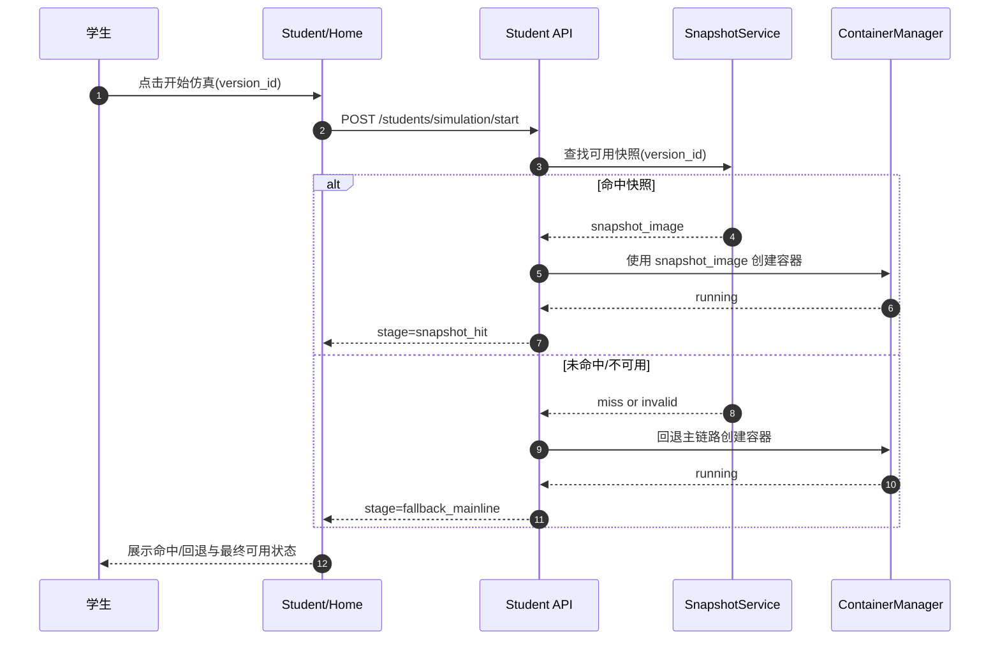
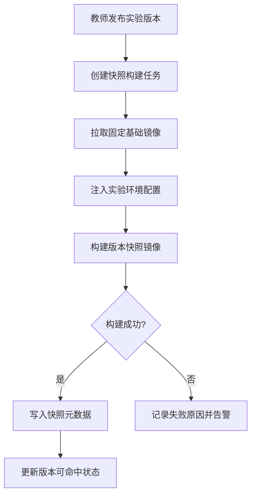
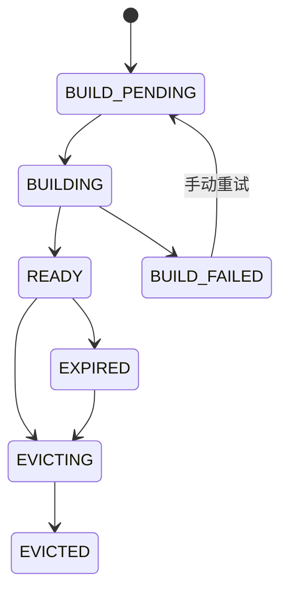

# SDD-第10.1期：预热优化层（快照加速）

- **文档版本**：v1.0
- **创建日期**：2026-04-02
- **修订日期**：2026-04-02
- **负责人**：架构组
- **关联需求**：实验版本快照构建、命中加速、回退主链路、容量治理与告警
- **前置依赖期次**：第10期主链路稳定版
- **目标读者**：产品 / 前端 / 后端 / 测试 / 运维

---

## 0) 分期总览表（期次、目标、范围边界、依赖、风险）

| 期次 | 目标 | 范围边界 | 依赖 | 风险 |
|---|---|---|---|---|
| 第10.1期（本期） | 引入“预热快照”加速层，命中时降低启动耗时 | 不改变第10期主链路契约；未命中必须无感回退主链路 | 第10期实验版本与任务状态流、发布记录 | 命中率低导致收益不稳定；快照空间失控增长 |
| 第10.2期（后续） | 智能预热与容量看板优化 | 不改主链路；仅优化策略 | 第10.1期稳定指标 | 预测偏差导致无效构建成本 |

---

## 1) 执行摘要（问题、目标结果、成功指标）

### 1.1 问题
1. 第10期主链路虽可达成 30 秒硬验收，但高并发下仍有启动抖动。
2. 实验版本发布后首次启动代价高，重复启动未充分复用。
3. 快照若无治理会导致镜像空间膨胀，影响宿主机稳定性。

### 1.2 目标结果
1. 教师发布实验版本后，可异步构建该版本快照镜像。
2. 学生开始仿真时优先尝试命中快照；未命中自动回退第10期主链路。
3. 系统提供快照元数据、命中统计、容量阈值、自动清理与告警。

### 1.3 成功指标（本期指标）
1. 快照命中场景下，启动耗时相对第10期主链路 P95 下降 **≥ 30%**。
2. 未命中回退主链路成功率 **= 100%**（不可影响功能正确性）。
3. 快照总空间占用稳定在配置阈值内（阈值超限后 10 分钟内回落）。
4. 快照相关关键失败场景静默失败率 = 0%。

> 说明：30 秒硬门槛仅属于第10期主链路验收，不作为第10.1期硬门槛。

---

## 2) 范围定义（In Scope / Out of Scope）

### 2.1 In Scope（本期必须交付）
1. 快照构建任务：发布后异步构建实验版本快照。
2. 启动命中决策：按版本优先命中快照，未命中自动回退主链路。
3. 快照元数据管理：实验ID、版本号、镜像ID、大小、命中次数、最近命中时间。
4. 双阈值容量治理：数量上限 + 总容量上限。
5. 自动清理：TTL + LRU 结合策略。
6. 白名单机制：按实验维度启用/禁用快照。
7. 观测与告警：命中率、回退次数、空间占用、清理结果。

### 2.2 Out of Scope（明确不做）

| 非本期项 | 不做原因 |
|---|---|
| 智能预热（按热度预测） | 需要稳定历史样本，属于第10.2期 |
| 多层链式继承镜像优化 | 复杂度高且有谱系过深风险 |
| 跨集群镜像分发与调度 | 当前单集群即可满足教学演示 |
| 仿真页内快照策略开关 | 违反“仿真页仅文件操作”边界 |
| 对象存储离线分层归档 | 运维体系尚未引入对象存储管控 |

---

## 3) 前提挑战与方案比选（至少2个方案）

### 3.1 前提挑战
1. 快照是否应替代主链路？
2. 快照构建是否使用链式继承降低构建时间？
3. 容量超限时先删 TTL 还是先删 LRU？

### 3.2 方案A：最小可行（本期采用）
- 快照作为可选加速层，不替代主链路。
- 每个实验版本基于固定基础镜像独立构建差异层（不链式继承）。
- 清理策略：先 TTL，再 LRU，保证删除可解释。

**优点**：风险低、可解释、与第10期解耦。  
**风险**：构建时间可能高于链式继承方案。  
**适用前提**：优先稳定与可演示。

### 3.3 方案B：长期最优
- 快照作为主路径，主链路仅兜底。
- 多级缓存+链式继承优化构建速度。
- 引入热度预测动态清理。

**优点**：长期性能上限更高。  
**风险**：故障半径大、治理复杂。  
**适用前提**：成熟运维与观测体系。

### 3.4 决策与理由
- **最终采用**：方案A。
- **决策理由**：保持第10期主链路稳定性优先；预热层仅增益、不影响正确性。
- **放弃方案B原因**：当前阶段缺少足够运维护栏与历史数据支持。

---

## 4) 现有资产复用（What already exists：前端/后端分别列表）

### 4.1 前端复用资产

| 资产 | 路径 | 可复用能力 | 本期复用方式 |
|---|---|---|---|
| 学生开始仿真入口 | `edubot-twin-web/src/views/Student/Home.vue` | 启动流程与状态反馈 | 增加命中/回退状态展示文案 |
| 仿真任务状态轮询 | 第10期任务查询能力 | 阶段状态可视化 | 展示 `snapshot_hit/fallback` 阶段 |
| 教师实验管理页 | 第10期新增 | 版本发布操作入口 | 增加“构建快照”状态与结果展示 |

### 4.2 后端复用资产

| 资产 | 路径 | 可复用能力 | 本期复用方式 |
|---|---|---|---|
| 容器创建能力 | `edubot-twin-server/app/core/container_manager.py` | 标准创建与健康检查 | 命中快照时替换 image_name |
| 开始仿真任务流 | 第10期任务化 API | 阶段状态与重试机制 | 插入 `SNAPSHOT_MATCHING` 与 `FALLBACK_MAINLINE` 阶段 |
| 发布记录域模型 | 第10期发布日志 | 版本发布事件可追踪 | 发布后触发快照构建任务 |
| 可观测字段基线 | 第10期日志规范 | trace/task/student/version 等字段 | 新增 snapshot_id/hit/fallback 原因 |

---

## 5) 核心系统交互图（时序图 + 流程图 + 状态机图）

### 5.1 时序图：命中快照启动与回退

### 5.2 流程图：发布后异步构建快照

### 5.3 状态机图：快照生命周期

---

## 6) API 契约表（Endpoint、Method、鉴权方式、Request结构、Response结构、状态码说明）

| Endpoint | Method | 鉴权方式 | Request 结构 | Response 结构 | 状态码说明 |
|---|---|---|---|---|---|
| `/api/v1/teachers/experiments/{experiment_id}/versions/{version_id}/snapshot/build` | POST | Bearer(teacher/admin) | `force_rebuild?:bool` | `snapshot_task_id,status:accepted` | 202/400/404/409 |
| `/api/v1/teachers/snapshots` | GET | Bearer(teacher/admin) | `experiment_id?:int, version_id?:int, status?:string, page:int, page_size:int` | `list[{snapshot_id,version_id,image,size_mb,hit_count,last_hit_at,status}], total` | 200/401/403 |
| `/api/v1/teachers/snapshots/{snapshot_id}` | DELETE | Bearer(teacher/admin) | 路径参数 | `deleted:true, reclaimed_mb:int` | 200/404/409 |
| `/api/v1/teachers/snapshots/cleanup` | POST | Bearer(admin) | `strategy:ttl|lru|mixed, dry_run?:bool` | `deleted_count, reclaimed_mb, details[]` | 200/400 |
| `/api/v1/students/simulation/start` | POST | Bearer(student) | `version_id:int, force_mainline?:bool(false)` | `task_id, route:snapshot|mainline, snapshot_id?:int` | 202/400/404/409 |
| `/api/v1/students/tasks/{task_id}` | GET | Bearer(student/teacher) | 路径参数 | `status, stages[{name,status,elapsed_ms}], snapshot_hit?:bool, fallback_reason?:string` | 200/403/404 |
| `/api/v1/teachers/snapshots/metrics` | GET | Bearer(teacher/admin) | `range:1h|24h|7d` | `hit_rate, fallback_count, total_size_mb, cleanup_events` | 200 |

### 6.1 错误语义映射

| 错误码 | 语义 | 前端动作 |
|---|---|---|
| `SNAPSHOT_NOT_READY` | 快照构建未完成 | 提示使用主链路并可稍后再试 |
| `SNAPSHOT_INVALID` | 快照损坏或校验失败 | 自动回退主链路并上报告警 |
| `SNAPSHOT_BUILD_CONFLICT` | 同版本重复构建冲突 | 复用已有任务并展示进度 |
| `SNAPSHOT_STORAGE_LIMIT_EXCEEDED` | 空间超过阈值 | 触发清理任务并提示教师 |
| `SNAPSHOT_EVICT_PROTECTED` | 白名单快照不可删 | 提示策略冲突，要求管理员调整 |

---

## 7) 数据字典表（字段名、数据类型、是否必填、默认值、业务说明）

### 7.1 实体：SnapshotMetadata

| 字段名 | 数据类型 | 必填 | 默认值 | 业务说明 |
|---|---|---|---|---|
| snapshot_id | int | 是 | 自增 | 快照主键 |
| experiment_id | int | 是 | - | 关联实验 |
| version_id | int | 是 | - | 关联版本 |
| image_name | string(255) | 是 | - | 快照镜像名 |
| image_digest | string(128) | 是 | - | 镜像摘要 |
| size_mb | int | 是 | 0 | 镜像体积 |
| status | enum(build_pending/building/ready/build_failed/expired/evicted) | 是 | build_pending | 生命周期状态 |
| hit_count | int | 是 | 0 | 命中次数 |
| last_hit_at | datetime | 否 | null | 最近命中时间 |
| last_build_at | datetime | 否 | null | 最近构建完成时间 |
| build_error | string(512) | 否 | null | 最近构建错误 |
| whitelist_protected | bool | 是 | false | 是否白名单保护 |

### 7.2 实体：SnapshotPolicy

| 字段名 | 数据类型 | 必填 | 默认值 | 业务说明 |
|---|---|---|---|---|
| policy_id | int | 是 | 自增 | 策略主键 |
| max_snapshot_count | int | 是 | 100 | 全局快照数量上限 |
| max_total_size_gb | int | 是 | 100 | 全局容量上限 |
| ttl_hours | int | 是 | 168 | 过期时间（小时） |
| lru_grace_count | int | 是 | 10 | LRU 保底保留数量 |
| enable_whitelist | bool | 是 | true | 是否启用白名单 |
| updated_at | datetime | 是 | now | 更新时间 |

### 7.3 实体：SnapshotBuildTask

| 字段名 | 数据类型 | 必填 | 默认值 | 业务说明 |
|---|---|---|---|---|
| snapshot_task_id | string(36) | 是 | UUID | 构建任务ID |
| version_id | int | 是 | - | 目标版本 |
| status | enum(pending/running/succeeded/failed) | 是 | pending | 任务状态 |
| elapsed_ms | int | 是 | 0 | 耗时 |
| error_code | string(64) | 否 | null | 错误码 |
| error_message | string(512) | 否 | null | 错误详情 |
| created_at | datetime | 是 | now | 创建时间 |

---

## 8) 安全与边界约束（鉴权、越权、路径安全、注入风险、并发冲突）

| 风险点 | 约束要求 | 控制策略 | 验证方式 |
|---|---|---|---|
| 越权清理快照 | 仅 admin 可执行全局 cleanup | RBAC + 二次鉴权 | 权限测试 |
| 供应链污染 | 快照镜像必须基于固定基础镜像 | 基础镜像白名单 + digest 校验 | 构建流程测试 |
| 命令注入 | 构建参数不可拼接 shell 原始字符串 | 参数模板白名单与转义 | 安全测试 |
| 并发构建冲突 | 同一版本同一时刻仅允许一个构建任务 | 唯一约束 + 任务去重 | 并发测试 |
| 清理误删 | 白名单快照不可被 TTL/LRU 误删 | 清理前保护判断 | 清理回归测试 |
| 主链路污染 | 预热层失败不得影响主链路成功路径 | 强制 fallback_mainline | 故障注入测试 |

---

## 9) 失败模式与恢复策略（Failure Modes Registry）

| Codepath | 失败模式 | 用户可见 | 日志/指标 | 测试覆盖 | 恢复策略 |
|---|---|---|---|---|---|
| snapshot-build | 基础镜像拉取失败 | 是（教师端可见） | 是 | 是 | 重试构建并记录失败原因 |
| snapshot-build | 注入脚本失败 | 是 | 是 | 是 | 任务失败并阻断 ready 状态 |
| start-with-snapshot | 快照命中但容器健康检查失败 | 是 | 是 | 是 | 自动回退主链路并标记 fallback_reason |
| start-with-snapshot | 快照未命中 | 是（信息级） | 是 | 是 | 直接走主链路，不算失败 |
| cleanup | 清理失败（权限/占用） | 是 | 是 | 是 | 标记失败条目，支持重试 |
| metrics | 统计任务异常 | 是（教师端告警） | 是 | 是 | 降级返回最近一次成功快照指标 |

### 9.1 恢复策略约束
1. 任一快照阶段失败必须可回退主链路。
2. 回退后不得丢失 `version_id` 与任务可追踪性。
3. 清理失败必须记录具体 `snapshot_id` 与失败原因。

---

## 10) 可观测性要求（关键日志字段、核心指标、告警建议）

### 10.1 关键日志字段
- `trace_id`
- `task_id` / `snapshot_task_id`
- `student_id`
- `experiment_id`
- `version_id`
- `snapshot_id`
- `route` (`snapshot`/`mainline`)
- `fallback_reason`
- `size_mb`
- `cleanup_strategy`

### 10.2 核心指标
1. `snapshot_hit_rate`。
2. `snapshot_start_duration_ms`（命中路径耗时分布）。
3. `fallback_mainline_count` 与 `fallback_mainline_rate`。
4. `snapshot_storage_total_mb`。
5. `snapshot_cleanup_reclaimed_mb`。
6. `snapshot_build_success_rate`。

### 10.3 告警建议
1. 连续 30 分钟命中率低于阈值（如 < 20%）告警。
2. 回退率连续 15 分钟 > 40% 告警。
3. 快照空间占用超过上限 90% 告警，并触发自动清理。
4. 构建失败率 1 小时窗口 > 10% 告警。

---

## 11) 测试与验收（覆盖地图 + 功能/稳定性/一致性验收，必须量化）

### 11.1 测试覆盖地图

| 流程/分支 | 类型 | 用例要点 | 通过标准 |
|---|---|---|---|
| Happy Path：命中快照启动 | 集成/E2E | version 已 ready 快照 | route=snapshot 且可进入仿真 |
| Miss Path：未命中回退主链路 | 集成/E2E | 无快照或状态非 ready | route=mainline 且功能正确 |
| Error Path：命中后健康失败回退 | 集成 | 构造快照损坏 | 自动 fallback 且用户可见 |
| Cleanup Path：TTL + LRU 清理 | 集成 | 超阈值后执行 cleanup | 占用回落且白名单不误删 |
| 并发构建冲突 | 并发测试 | 同版本并发触发 build | 一个 accepted，一个 conflict |
| 安全路径 | 安全测试 | 非 admin 调 cleanup | 403 拒绝 |

### 11.2 功能验收（量化）
- [ ] 教师发布后可触发快照构建，任务可查询率 100%。
- [ ] 学生启动可展示 route=snapshot/mainline，状态解释完整率 100%。
- [ ] 回退主链路成功率 = 100%。

### 11.3 稳定性验收（量化）
- [ ] 快照命中场景相对第10期主链路启动耗时 P95 下降 ≥ 30%。
- [ ] 快照构建任务成功率 ≥ 95%。
- [ ] 快照总空间超阈值后 10 分钟内回落到阈值内，达成率 ≥ 99%。

### 11.4 一致性验收
- [ ] `route` 字段与任务阶段文案一致。
- [ ] 命中/回退指标与日志口径一致。
- [ ] 清理策略执行结果与元数据状态一致。

---

## 12) 实施分期与交付清单（仅交付内容，不写W1/W2/W3）

### 12.1 本期交付内容
- 文档交付：本 SDD（第10.1期预热优化层）。
- 前端交付：
  - 教师端快照状态与构建结果展示。
  - 学生端命中/回退状态提示。
- 后端交付：
  - 快照构建 API、查询 API、清理 API、指标 API。
  - 启动链路命中与回退决策逻辑。
  - 元数据持久化与阈值治理任务。
- 测试交付：命中/回退/清理/并发/安全覆盖用例。

### 12.2 非本期项（再次冻结）
| 项目 | 不做原因 |
|---|---|
| 智能预热（热度预测） | 延至第10.2期 |
| 跨集群镜像复制 | 现阶段单集群即可 |

---

## 13) Deferred（后续阶段，说明延后原因与触发条件）

| 延后项 | 延后原因 | 触发条件 |
|---|---|---|
| 第10.2 智能预热策略 | 需稳定行为数据训练策略 | 命中/回退指标连续 2 周稳定 |
| 预热看板（趋势分析） | 先保证数据准确与告警有效 | 指标采集与口径冻结 |
| 对象存储冷归档 | 依赖运维基础设施 | 对象存储服务接入完成 |

---

## 14) 附录（规范-代码映射、术语表、变更记录）

### 14.1 规范-代码映射（目标映射）

| 规范项 | 现有基线路径 | 本期目标改动 |
|---|---|---|
| 启动主入口 | `edubot-twin-web/src/views/Student/Home.vue` | 增加命中/回退状态展示 |
| 容器编排 | `edubot-twin-server/app/core/container_manager.py` | 接收快照镜像参数并创建容器 |
| 任务状态 | 第10期任务 API | 插入快照匹配与回退阶段 |
| 发布流程 | 第10期教师实验发布能力 | 发布后触发异步快照构建 |

### 14.2 术语表

| 术语 | 定义 |
|---|---|
| 快照（Snapshot） | 针对某实验版本预构建的可直接启动镜像 |
| 命中（Hit） | 启动时找到可用快照并成功使用 |
| 回退（Fallback） | 快照不可用时自动切回第10期主链路 |
| TTL 清理 | 按保留时长删除过期快照 |
| LRU 清理 | 按最近最少使用删除低价值快照 |

### 14.3 变更记录

| 版本 | 日期 | 变更内容 |
|---|---|---|
| v1.0 | 2026-04-02 | 首版发布：定义预热层边界、契约、状态机、容量治理与验收 |
