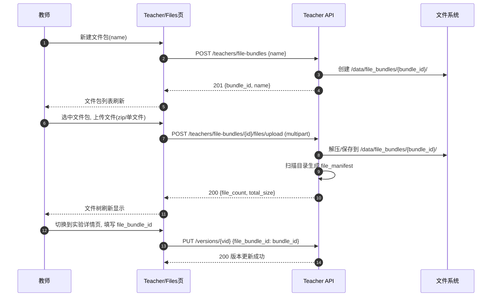
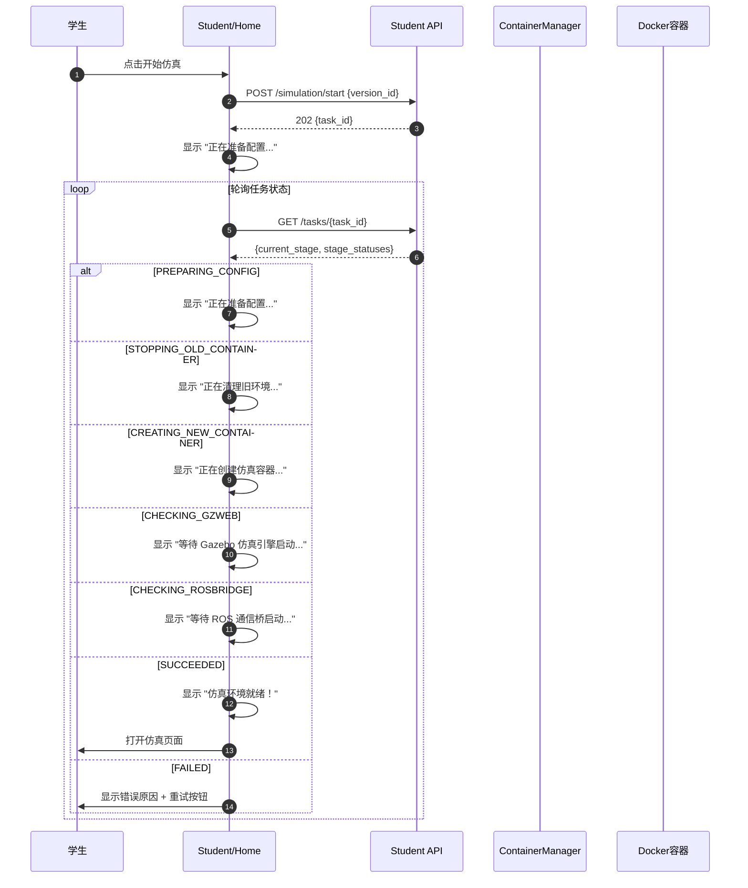
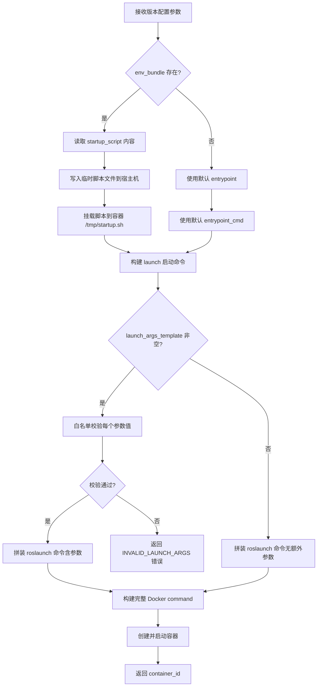
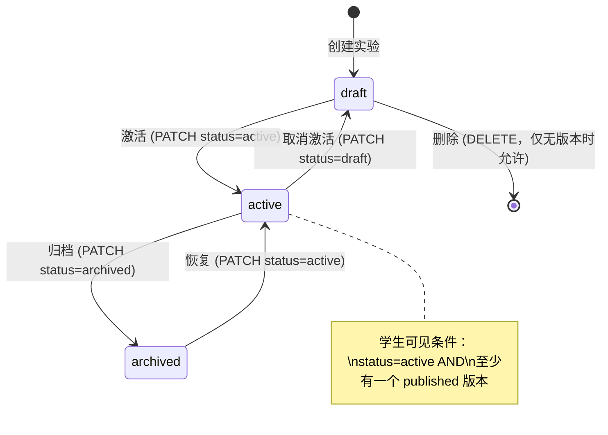
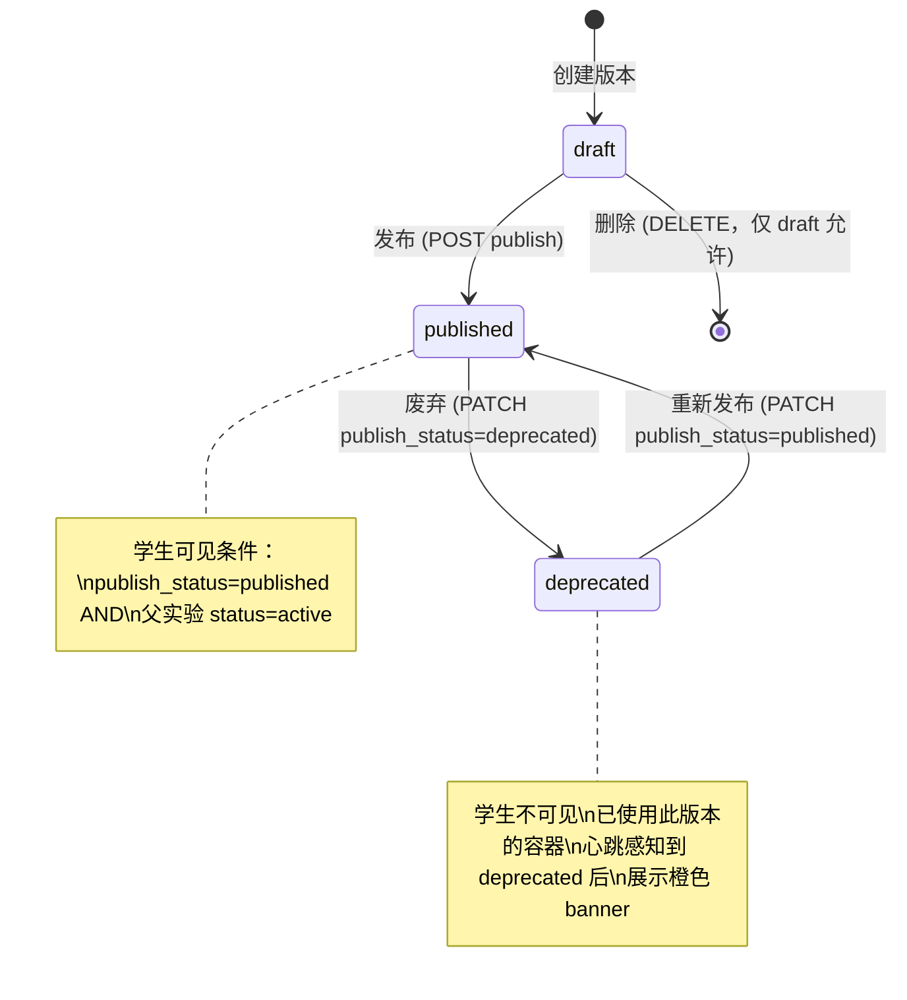
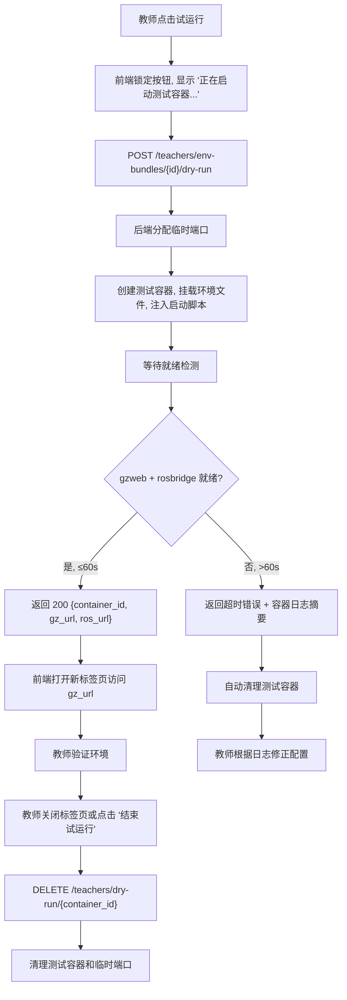

# SDD-第10期补充：实验管理增强与资源管理体系

- **文档版本**：v1.0
- **创建日期**：2026-04-04
- **修订日期**：2026-04-04
- **负责人**：架构组
- **关联需求**：第10期主链路 SDD 遗留项补全、实验管理体验增强、教师资源管理体系建设
- **前置依赖**：第10期主链路 SDD v1.3（已冻结）
- **目标读者**：产品 / 前端 / 后端 / 测试

---

## 0) 分期总览表

本补充 SDD 内含两个子期次，彼此强关联（10-S2 依赖 10-S1 的模型与 API）。

| 子期次 | 目标 | 范围边界 | 依赖 | 风险 |
|---|---|---|---|---|
| **10-S1** 模型修正与核心链路补全 | 修复数据模型缺陷、补全缺失 API、注入容器启动配置、容器就绪检测 | 不含 UI 页面重构；不含 Dry Run 容器 | 第10期主链路已稳定 | 模型迁移需兼容已有数据；launch 注入引入新失败路径 |
| **10-S2** 教师资源管理页面 | 路由重构为二级菜单、新增实验文件管理页、新增实验环境管理页（含 Dry Run） | 不含评测联动；不含多租户配额 | 10-S1 模型与 API 已就绪 | 页面复用度高但交互复杂；Dry Run 容器需资源隔离 |

---

## 1) 执行摘要

### 1.1 问题

1. **文件包上传端点完全缺失**：第10期 API 契约表定义了 `POST /teachers/experiment-files/upload`，但后端无实现，教师无法上传实验资源。
2. **容器启动命令硬编码**：`container_manager.py` 中 `launch_file` 和 `entrypoint_cmd` 写死为固定路径，版本配置中的 `launch_file_path` 和 `launch_args_template` 未注入。
3. **容器就绪检测缺失**：学生点击"开始仿真"后直接打开仿真页，但容器内 gzweb（8080）和 rosbridge（9090）可能尚未就绪，导致白屏或连接失败。
4. **数据模型冗余与语义冲突**：`is_visible` 与 `publish_status` 语义重叠；`ExperimentFileBundle.experiment_id` 约束了文件包只能绑定单个实验；`checksum` 字段无实际校验流程。
5. **实验/版本生命周期不完整**：缺少实验删除、实验状态切换、版本发布状态回退、版本删除等操作端点。
6. **教师端缺少资源管理 UI**：无实验文件管理页面、无环境配置管理页面，教师只能手动填写 ID 关联文件包。

### 1.2 目标结果

1. 教师可通过 UI 上传/管理实验文件包，通过编辑器管理环境文件和启动脚本。
2. 容器启动时从版本配置动态读取 launch 路径和参数，不再硬编码。
3. 仿真页打开前确保 gzweb 和 rosbridge 端口就绪，等待期间分阶段显示进度。
4. 数据模型消除冗余，文件包与实验解耦，支持跨实验复用。
5. 实验和版本具备完整生命周期管理（创建、编辑、发布、废弃、删除）。
6. 教师端路由重构为二级菜单，实验管理入口下辖列表、详情、文件、环境四个子页面。

### 1.3 成功指标

| 指标 | 目标值 |
|---|---|
| 文件包上传成功率（50MB 以内） | ≥ 99% |
| 容器就绪检测 P95 耗时（从容器 running 到双端口可用） | ≤ 20s |
| 就绪检测期间用户可见阶段提示率 | 100% |
| 容器启动命令来源为版本配置（非硬编码）覆盖率 | 100% |
| Dry Run 容器自动清理率（30min 内） | 100% |
| 教师端实验文件包上传→关联→学生分发全链路成功率 | ≥ 98% |

---

## 2) 范围定义

### 2.1 In Scope

**10-S1 模型修正与核心链路补全：**

| # | 工作项 | 说明 |
|---|---|---|
| S1-1 | 移除 `ExperimentVersion.is_visible` | 可见性统一由 `publish_status` + `Experiment.status` 决定 |
| S1-2 | 重构 `ExperimentFileBundle` | 移除 `experiment_id`、移除 `checksum`、新增 `name` 字段；文件包可跨实验复用 |
| S1-3 | 移除 `ExperimentVersion.startup_script_ref` | 由 `ExperimentEnvBundle.startup_script` 替代 |
| S1-4 | 新增 `ExperimentEnvBundle` 模型 | 环境文件包：启动脚本、容器目标目录、访问权限 |
| S1-5 | `ExperimentVersion` 新增 `env_bundle_id` 外键 | 引用环境文件包 |
| S1-6 | 实现 `POST /teachers/file-bundles/upload` | 文件包上传端点（支持 zip 与单文件） |
| S1-7 | 修复 `container_manager.create_container()` | 从版本配置读取 `launch_file_path`、`launch_args_template`、启动脚本注入 |
| S1-8 | 容器就绪检测 | 在 HEALTH_CHECKING 阶段检测 gzweb 和 rosbridge 端口可用性 |
| S1-9 | 实验状态切换与删除 | `PATCH /experiments/{id}/status`、`DELETE /experiments/{id}` |
| S1-10 | 版本发布状态管理与删除 | `PATCH /versions/{vid}/publish-status`、`DELETE /versions/{vid}`（仅 draft） |
| S1-11 | 版本创建后端验证 | `POST /versions/{vid}/validate`：检查镜像、文件包、环境包是否存在 |
| S1-12 | 学生端可见性过滤 | 学生仅可见 `Experiment.status=active` 且 `publish_status=published` 的版本 |

**10-S2 教师资源管理页面：**

| # | 工作项 | 说明 |
|---|---|---|
| S2-1 | 教师端路由重构 | 实验管理改为二级菜单：实验列表、实验详情、实验文件、实验环境 |
| S2-2 | 实验文件管理页 | 左侧文件包管理栏 + 右侧文件树与编辑器，复用 MonacoEditor |
| S2-3 | 实验环境管理页 | 环境文件上传 + 启动脚本编辑器 + 容器目标目录 + 访问权限 + Dry Run |

### 2.2 Out of Scope

| 非本期项 | 不做原因 |
|---|---|
| 文件包版本历史（Git-like） | 过度工程化，当前教师直接覆盖上传即可满足需求 |
| 启动脚本沙箱执行 | 教师角色视为受信任用户，不做脚本审计 |
| 多租户资源配额 | 单集群教学场景，先保证功能可用 |
| 自动评测联动实验版本 | 评测域契约尚未冻结 |
| 容器快照预热 | 已拆至第10.1期独立文档 |
| 文件包大文件分片上传 | 当前教学场景文件包 ≤ 200MB，单次上传足够 |
| 实验模板市场（跨教师共享） | 功能边界过大，列入长期路线图 |

---

## 3) 前提挑战与方案比选

### 3.1 挑战 A：文件包与实验的关系模型

**现状**：`ExperimentFileBundle.experiment_id` 将文件包绑死到单个实验，不可跨实验复用。

**方案 A1（最小可行，本期采用）**：移除 `experiment_id`，文件包作为独立实体。通过 `ExperimentVersion.file_bundle_id` 建立多对一引用。

- **优点**：文件包可跨实验版本复用；模型简洁；删除实验不级联删除文件包。
- **风险**：孤儿文件包需定期清理。
- **迁移策略**：现有 bundle 保留数据，`experiment_id` 列标记 deprecated 后在下一次 DDL 变更中物理删除。

**方案 A2（长期最优）**：引入独立的 AssetLibrary 域，文件包、环境包统一管理。

- **优点**：最优架构，支持版本控制和权限细分。
- **风险**：引入新的聚合根和领域边界，改造面过大。
- **放弃原因**：超出本期范围，列入 Deferred。

**决策**：采用 A1。文件包独立化 + 外键引用。

### 3.2 挑战 B：容器启动命令注入方式

**现状**：`container_manager.py` 硬编码 `launch_file` 和 `entrypoint_cmd`。

**方案 B1（本期采用）**：`create_container()` 新增参数 `launch_file_path`、`launch_args`、`startup_script`，在函数内部拼装 Docker 启动命令。

- **优点**：改动最小，仅扩展函数签名。
- **风险**：参数注入风险需白名单校验。

**方案 B2**：引入 ContainerSpec 配置对象，将所有容器参数封装为结构化对象。

- **优点**：可扩展性更好。
- **风险**：需重构所有调用方。
- **放弃原因**：调用方少（仅 `simulation.py`），当前无需此抽象层。

**决策**：采用 B1。扩展函数参数 + 白名单校验。

### 3.3 挑战 C：容器就绪检测策略

**方案 C1（本期采用）**：宿主机侧 TCP 端口探测，轮询 host-mapped 端口直到连接成功。

- **优点**：简单可靠，不依赖容器内工具。
- **策略**：每 2s 探测一次，超时 60s，分别检测 gzweb 和 rosbridge。

**方案 C2**：容器内健康检查脚本 + Docker HEALTHCHECK。

- **优点**：更精确（可检测应用层就绪而非仅端口监听）。
- **风险**：需修改镜像 Dockerfile，且 Docker HEALTHCHECK 间隔粒度有限。
- **放弃原因**：需修改镜像，影响面过大。

**决策**：采用 C1。宿主机 TCP 探测 + 超时兜底。

---

## 4) 现有资产复用

### 4.1 前端复用资产

| 资产 | 路径 | 复用方式 |
|---|---|---|
| MonacoEditor 组件 | `edubot-twin-web/src/components/Monaco/MonacoEditor.vue` | 教师文件编辑器、启动脚本编辑器直接复用 |
| 学生文件管理页 | `edubot-twin-web/src/views/Student/FileManager.vue` | 实验文件管理页复用其文件树 + 上传 + 编辑交互模式 |
| 仿真工作台 WorkspacePanel | `edubot-twin-web/src/views/Simulation/panels/WorkspacePanel/` | 复用文件树组件和文件操作 API 封装 |
| 实验详情页 | `edubot-twin-web/src/views/Teacher/Experiments/ExperimentDetail.vue` | 保留版本列表+配置编辑区结构，移除 `is_visible`、`startup_script_ref` 字段 |
| 实验列表页 | `edubot-twin-web/src/views/Teacher/Experiments/Experiments.vue` | 保留列表+搜索+创建交互，新增状态切换和删除操作 |
| 教师端路由骨架 | `edubot-twin-web/src/router/index.ts` `/teacher` 节点 | 重构 `experiments` 为 `getParentLayout()` 二级菜单 |
| 学生首页 | `edubot-twin-web/src/views/Student/Home.vue` | 增强 loading 提示，增加就绪检测阶段展示 |

### 4.2 后端复用资产

| 资产 | 路径 | 复用方式 |
|---|---|---|
| 学生文件 API | `app/api/v1/endpoints/student/files.py` | 教师文件包文件操作复用路径安全校验、上传/读写逻辑 |
| 容器编排核心 | `app/core/container_manager.py` | 扩展 `create_container()` 参数签名 |
| 端口分配器 | `app/core/port_allocator.py` | Dry Run 容器复用端口分配逻辑 |
| 仿真任务 CRUD | `app/crud/simulation_task.py` | 就绪检测阶段复用任务状态记录 |
| 路径安全策略 | `app/core/path_policy.py` | 文件包存储路径校验复用 |
| ExperimentFileBundle 模型 | `app/models/experiment.py` | 结构化改造，保留表名和主键 |

---

## 5) 核心系统交互图

### 5.1 时序图：教师上传文件包并关联版本



### 5.2 时序图：容器就绪检测与分阶段进度



### 5.3 流程图：container_manager 启动命令构建



### 5.4 状态机图：实验状态



### 5.5 状态机图：版本发布状态



### 5.6 流程图：Dry Run 试运行



---

## 6) API 契约表

### 6.0 API 路径迁移说明

第10期主链路 SDD 定义了 `POST /api/v1/teachers/experiment-files/upload` 和 `POST /api/v1/teachers/experiment-files/{id}/validate` 两个端点，本期将其废弃并替换为更完整的文件包管理 API 体系：

| 原端点（废弃） | 新端点 | 变更原因 |
|---|---|---|
| `POST /teachers/experiment-files/upload` | `POST /teachers/file-bundles` + `POST /teachers/file-bundles/{id}/files/upload` | 文件包创建与文件上传拆分为两步；文件包不再绑定 experiment_id |
| `POST /teachers/experiment-files/{id}/validate` | 由 `validate_status` 字段自动维护 | 文件包上传时自动校验，无需独立端点 |

### 6.1 文件包管理 API（10-S1 新增）

| Endpoint | Method | 鉴权 | Request | Response | 状态码 |
|---|---|---|---|---|---|
| `/api/v1/teachers/file-bundles` | POST | Bearer(teacher) | `{name: str}` | `{bundle_id, name, storage_root, created_at}` | 201/400 |
| `/api/v1/teachers/file-bundles` | GET | Bearer(teacher) | `page, page_size, keyword?` | `{total, list: [{bundle_id, name, file_count, total_size, created_at}]}` | 200 |
| `/api/v1/teachers/file-bundles/{id}` | GET | Bearer(teacher) | 路径参数 | `{bundle_id, name, file_count, total_size, file_manifest, created_at}` | 200/404 |
| `/api/v1/teachers/file-bundles/{id}` | PATCH | Bearer(teacher) | `{name: str}` | `{bundle_id, name, affected_versions: [{version_id, experiment_name, version_name}]}` | 200/404/409 |
| `/api/v1/teachers/file-bundles/{id}` | DELETE | Bearer(teacher) | 路径参数 | `204 No Content` | 204/404/409(有版本引用时) |
| `/api/v1/teachers/file-bundles/{id}/files/upload` | POST | Bearer(teacher) | `multipart(file), extract_zip?: bool(true)` | `{file_count, total_size_bytes}` | 200/400/413/422 |
| `/api/v1/teachers/file-bundles/{id}/files` | GET | Bearer(teacher) | `path?: str(默认根)` | `{items: [{name, type: file\|dir, size?, modified_at}]}` | 200/404 |
| `/api/v1/teachers/file-bundles/{id}/files/read` | GET | Bearer(teacher) | `path: str` | `{content: str, encoding: str}` | 200/400/404 |
| `/api/v1/teachers/file-bundles/{id}/files/save` | POST | Bearer(teacher) | `{path: str, content: str}` | `200 OK` | 200/400/404 |
| `/api/v1/teachers/file-bundles/{id}/files/delete` | DELETE | Bearer(teacher) | `path: str` | `204 No Content` | 204/400/404 |

### 6.2 环境包管理 API（10-S1 新增）

| Endpoint | Method | 鉴权 | Request | Response | 状态码 |
|---|---|---|---|---|---|
| `/api/v1/teachers/env-bundles` | POST | Bearer(teacher) | `{name: str, startup_script?: str, container_target_dir: str, access_level: str}` | `{env_bundle_id, name, created_at}` | 201/400 |
| `/api/v1/teachers/env-bundles` | GET | Bearer(teacher) | `page, page_size, keyword?` | `{total, list: [{env_bundle_id, name, has_startup_script, container_target_dir, created_at}]}` | 200 |
| `/api/v1/teachers/env-bundles/{id}` | GET | Bearer(teacher) | 路径参数 | `{env_bundle_id, name, startup_script, container_target_dir, access_level, file_manifest, created_at}` | 200/404 |
| `/api/v1/teachers/env-bundles/{id}` | PATCH | Bearer(teacher) | `{name?, startup_script?, container_target_dir?, access_level?}` | `{env_bundle_id, name, updated_at}` | 200/400/404 |
| `/api/v1/teachers/env-bundles/{id}` | DELETE | Bearer(teacher) | 路径参数 | `204 No Content` | 204/404/409(有版本引用时) |
| `/api/v1/teachers/env-bundles/{id}/files/upload` | POST | Bearer(teacher) | `multipart(file), extract_zip?: bool(true)` | `{file_count, total_size_bytes}` | 200/400/413 |
| `/api/v1/teachers/env-bundles/{id}/files` | GET | Bearer(teacher) | `path?: str` | `{items: [{name, type, size?, modified_at}]}` | 200/404 |
| `/api/v1/teachers/env-bundles/{id}/files/read` | GET | Bearer(teacher) | `path: str` | `{content: str, encoding: str}` | 200/400/404 |
| `/api/v1/teachers/env-bundles/{id}/files/save` | POST | Bearer(teacher) | `{path: str, content: str}` | `200 OK` | 200/400/404 |
| `/api/v1/teachers/env-bundles/{id}/dry-run` | POST | Bearer(teacher) | `{version_id: int}` | `{container_id: str, gzweb_url: str, rosbridge_url: str, expires_at: str}` | 200/400/404/503 |
| `/api/v1/teachers/dry-run/{container_id}` | DELETE | Bearer(teacher) | 路径参数 | `204 No Content` | 204/404 |

### 6.3 实验/版本生命周期 API（10-S1 新增/修改）

| Endpoint | Method | 鉴权 | Request | Response | 状态码 |
|---|---|---|---|---|---|
| `/api/v1/teachers/experiments/{id}` | DELETE | Bearer(teacher) | 路径参数 | `204 No Content` | 204/404/409(有非 draft 版本时) |
| `/api/v1/teachers/experiments/{id}/status` | PATCH | Bearer(teacher) | `{status: "draft"\|"active"\|"archived"}` | `{experiment_id, status, updated_at}` | 200/400/404 |
| `/api/v1/teachers/experiments/{eid}/versions/{vid}` | DELETE | Bearer(teacher) | 路径参数 | `204 No Content` | 204/404/409(非 draft 不可删) |
| `/api/v1/teachers/experiments/{eid}/versions/{vid}/publish-status` | PATCH | Bearer(teacher) | `{publish_status: "published"\|"deprecated", publish_note?: str}` | `{version_id, publish_status, updated_at}` | 200/400/404/409 |
| `/api/v1/teachers/experiments/{eid}/versions/{vid}/validate` | POST | Bearer(teacher) | 路径参数 | `{valid: bool, issues: [{field, message}]}` | 200/404 |

### 6.4 学生端修改（10-S1）

| Endpoint | 修改说明 |
|---|---|
| `GET /students/experiments/available` | 过滤条件变更：`Experiment.status=active AND ExperimentVersion.publish_status=published`；移除 `is_visible` 条件 |
| `POST /students/simulation/start` | 同上过滤条件；HEALTH_CHECKING 阶段细分为 `CHECKING_GZWEB` 和 `CHECKING_ROSBRIDGE` |

### 6.5 错误语义映射（新增）

| 错误码 | 语义 | 前端动作 |
|---|---|---|
| `BUNDLE_NAME_CONFLICT` | 文件包名称已存在 | 提示重命名 |
| `BUNDLE_IN_USE` | 文件包/环境包被版本引用，不可删除 | 提示先解除引用 |
| `EXPERIMENT_HAS_NON_DRAFT_VERSIONS` | 实验下有非 draft 版本，不可删除 | 提示先废弃或删除所有版本 |
| `VERSION_NOT_DRAFT` | 非 draft 版本不可删除 | 提示仅 draft 可删 |
| `INVALID_STATUS_TRANSITION` | 非法状态转换 | 提示当前状态不允许此操作 |
| `INVALID_LAUNCH_ARGS` | launch_args_template 含非法字符 | 提示参数格式要求 |
| `GZWEB_NOT_READY` | gzweb 端口超时未就绪 | 显示具体阶段 + 重试 |
| `ROSBRIDGE_NOT_READY` | rosbridge 端口超时未就绪 | 显示具体阶段 + 重试 |
| `DRY_RUN_RESOURCE_EXHAUSTED` | Dry Run 容器配额已满（上限 3） | 提示清理已有测试容器 |
| `UPLOAD_SIZE_EXCEEDED` | 上传文件超过 200MB 限制 | 提示减小文件包体积 |
| `VALIDATION_FAILED` | 版本配置验证失败 | 展示具体 issues 列表 |

---

## 7) 数据字典表

### 7.1 ExperimentVersion（字段变更）

| 字段名 | 变更类型 | 数据类型 | 必填 | 默认值 | 业务说明 |
|---|---|---|---|---|---|
| ~~is_visible~~ | **删除** | - | - | - | 语义与 `publish_status` + `Experiment.status` 重叠 |
| ~~startup_script_ref~~ | **删除** | - | - | - | 由 `ExperimentEnvBundle.startup_script` 替代 |
| env_bundle_id | **新增** | int (nullable) | 否 | null | 关联环境文件包 ID |

**学生可见性规则**（替代原 `is_visible`）：
```
Experiment.status = 'active'
AND ExperimentVersion.publish_status = 'published'
```

### 7.2 ExperimentFileBundle（字段变更）

| 字段名 | 变更类型 | 数据类型 | 必填 | 默认值 | 业务说明 |
|---|---|---|---|---|---|
| ~~experiment_id~~ | **删除** | - | - | - | 文件包独立于实验，通过版本外键引用 |
| ~~checksum~~ | **删除** | - | - | - | 无实际校验流程，移除 |
| name | **新增** | string(128) | 是 | - | 文件包显示名称（唯一约束 per created_by） |
| storage_root | **新增** | string(512) | 是 | `/data/file_bundles/{id}` | 服务器存储根目录（自动生成） |
| file_count | **新增** | int | 是 | 0 | 文件数量（上传时自动计算） |
| total_size_bytes | **新增** | bigint | 是 | 0 | 文件包总大小（字节） |

**保留字段行为变更**：

| 字段名 | 变更说明 |
|---|---|
| `file_manifest` | 保留 JSON 数组。上传文件后由后端扫描 `storage_root` 目录自动重建 manifest，不再由前端传入。元素格式不变：`{relative_path, chmod_mode}` |
| `validate_status` | 保留枚举。上传后自动设为 `valid`（后端扫描通过即有效）；`storage_root` 目录为空时设为 `invalid`。移除原有的手动触发校验端点 |

### 7.3 ExperimentEnvBundle（新增实体）

| 字段名 | 数据类型 | 必填 | 默认值 | 业务说明 |
|---|---|---|---|---|
| id | int | 是 | 自增 | 主键 |
| name | string(128) | 是 | - | 环境包名称 |
| storage_root | string(512) | 是 | `/data/env_bundles/{id}` | 环境文件存储根目录 |
| startup_script | text | 否 | null | 启动脚本内容（容器启动时以 ROOT 权限执行） |
| container_target_dir | string(255) | 是 | `/home/ubuntu20/catkin_ws` | 环境文件在容器中的挂载目标目录 |
| access_level | enum(readonly/readwrite/hidden) | 是 | readonly | 学生对环境文件的访问权限 |
| file_count | int | 是 | 0 | 环境文件数量 |
| total_size_bytes | bigint | 是 | 0 | 总大小（字节） |
| created_by | int | 是 | - | 创建教师 ID |
| created_at | datetime | 是 | now | 创建时间 |
| updated_at | datetime | 是 | now | 更新时间 |

### 7.4 SimulationTaskStage（枚举扩展）

| 新增枚举值 | 业务说明 |
|---|---|
| `CHECKING_GZWEB` | 等待 gzweb 端口（容器 8080 / 宿主机 gz_port）就绪 |
| `CHECKING_ROSBRIDGE` | 等待 rosbridge 端口（容器 9090 / 宿主机 ros_port）就绪 |

**阶段顺序更新**：
```
PREPARING_CONFIG → STOPPING_OLD_CONTAINER → CREATING_NEW_CONTAINER
→ CHECKING_GZWEB → CHECKING_ROSBRIDGE → SUCCEEDED/FAILED
```

原 `HEALTH_CHECKING` 阶段拆分为 `CHECKING_GZWEB` + `CHECKING_ROSBRIDGE`，粒度更细，前端可分阶段展示。

### 7.5 DryRunContainer（内存管理，不持久化）

| 字段 | 类型 | 说明 |
|---|---|---|
| container_id | str | Docker 容器 short_id |
| teacher_id | int | 创建教师 ID |
| gz_port | int | 宿主机 gzweb 端口 |
| ros_port | int | 宿主机 rosbridge 端口 |
| created_at | datetime | 创建时间 |
| expires_at | datetime | 过期时间（created_at + 30min） |

Dry Run 容器不写数据库，仅在进程内存中维护（`dict[str, DryRunContainer]`），后台定时任务清理超期容器。原因：测试容器为临时性资源，不应污染 `sim_containers` 表。

---

## 8) 安全与边界约束

| 风险点 | 约束要求 | 控制策略 | 验证方式 |
|---|---|---|---|
| 文件包路径穿越 | 上传/读取/保存操作的路径必须在 `storage_root` 下 | `os.path.normpath` + 前缀校验；禁止 `..` | 路径穿越用例 |
| zip 炸弹 | 解压后总大小 ≤ 200MB，文件数 ≤ 1000 | 解压前检测 zip 元信息；逐文件解压时累计校验 | 恶意 zip 用例 |
| 启动脚本注入 | 教师视为受信任用户，不做内容审计 | 脚本以文件方式挂载，不经 shell 变量展开 | - |
| launch_args 注入 | 参数值必须匹配 `^[a-zA-Z0-9_\-\./: ]+$` | 正则白名单 + `os.path.normpath` | 注入用例 |
| Dry Run 资源泄漏 | 每位教师最多同时运行 3 个 Dry Run 容器 | 内存计数器 + 30min 自动过期清理 | 并发创建用例 |
| 文件包删除越权 | 教师只能删除自己创建的文件包（admin 除外） | `created_by` 校验 | 越权删除用例 |
| 状态转换非法 | 实验/版本状态转换必须遵循状态机 | 后端校验当前状态 + 目标状态合法性 | 状态机全路径测试 |
| 实验删除约束 | 仅当所有版本均为 draft 或无版本时才允许删除 | 后端检查版本列表 | 含 published 版本时删除用例 |
| 版本删除约束 | 仅 draft 版本可删除 | 后端校验 `publish_status` | published 版本删除用例 |
| 重命名影响检测 | 文件包重命名时列出所有引用该文件包的版本 | 后端查询 `ExperimentVersion.file_bundle_id = bundle_id` | 重命名影响用例 |

---

## 9) 失败模式与恢复策略

| Codepath | 失败模式 | 用户可见 | 日志/指标 | 测试覆盖 | 恢复策略 |
|---|---|---|---|---|---|
| file-upload | 文件超过 200MB 限制 | 是（413） | 是 | 是 | 前端预校验 + 后端拒绝 |
| file-upload | zip 解压失败（损坏/格式错） | 是（422） | 是 | 是 | 提示重新上传 |
| file-upload | zip 炸弹检测触发 | 是（422 + 明确提示） | 是 | 是 | 拒绝并提示原因 |
| file-upload | 磁盘空间不足 | 是（503） | 是 | 是 | 告警运维扩容 |
| bundle-delete | 文件包被版本引用 | 是（409 BUNDLE_IN_USE） | 是 | 是 | 展示引用版本列表，引导先解除引用 |
| bundle-rename | 名称冲突 | 是（409） | 是 | 是 | 提示换名 |
| experiment-delete | 含非 draft 版本 | 是（409） | 是 | 是 | 提示先废弃/删除版本 |
| version-delete | 非 draft 状态 | 是（409） | 是 | 是 | 提示仅 draft 可删 |
| container-create | launch_file_path 文件不存在于镜像 | 是（FAILED + 错误信息） | 是 | 是 | 教师检查配置 |
| container-create | launch_args 含非法字符 | 是（400 INVALID_LAUNCH_ARGS） | 是 | 是 | 教师修正参数 |
| readiness-check | gzweb 端口 60s 超时 | 是（GZWEB_NOT_READY） | 是 | 是 | 重试按钮 + 容器日志提示 |
| readiness-check | rosbridge 端口 60s 超时 | 是（ROSBRIDGE_NOT_READY） | 是 | 是 | 重试按钮 + 容器日志提示 |
| dry-run | 配额已满（3个） | 是（DRY_RUN_RESOURCE_EXHAUSTED） | 是 | 是 | 提示清理已有测试容器 |
| dry-run | 30min 超期 | 否（自动清理） | 是 | 是 | 后台定时任务清理 |
| dry-run | 容器启动失败 | 是（容器日志摘要） | 是 | 是 | 自动清理 + 提示修正配置 |
| version-validate | 镜像不存在 | 是（issues 列表） | 是 | 是 | 教师更换镜像名 |
| version-validate | file_bundle 不存在或为空 | 是（issues 列表） | 是 | 是 | 教师重新关联文件包 |
| version-validate | env_bundle 不存在 | 是（issues 列表） | 是 | 是 | 教师关联环境包 |

---

## 10) 可观测性要求

### 10.1 关键日志字段（新增）

| 字段 | 说明 |
|---|---|
| `bundle_id` | 文件包/环境包 ID |
| `bundle_type` | `file` 或 `env` |
| `upload_size_bytes` | 上传文件大小 |
| `file_count` | 文件数量 |
| `dry_run_container_id` | Dry Run 容器 ID |
| `readiness_stage` | `gzweb` 或 `rosbridge` |
| `readiness_elapsed_ms` | 就绪检测耗时 |

### 10.2 核心指标（新增）

1. `bundle_upload_duration_ms`（P50/P95）— 文件包上传耗时。
2. `bundle_upload_size_bytes`（P50/P95）— 文件包大小分布。
3. `readiness_check_duration_ms{stage}`（P50/P95）— gzweb / rosbridge 各自就绪耗时。
4. `readiness_check_timeout_rate` — 就绪超时率。
5. `dry_run_success_rate` — Dry Run 成功率。
6. `dry_run_active_count` — 当前活跃 Dry Run 容器数。

### 10.3 告警建议

1. `readiness_check_timeout_rate > 10%`（5min 窗口）触发告警。
2. `dry_run_active_count >= 3`（单教师）触发通知。
3. `bundle_upload_size_bytes > 150MB` 记录 warning 日志。

---

## 11) 测试与验收

### 11.1 测试覆盖地图

| 流程/分支 | 类型 | 用例要点 | 通过标准 |
|---|---|---|---|
| 文件包 CRUD 全流程 | 集成 | 创建→上传→列表→详情→重命名→删除 | 全操作成功，数据一致 |
| 文件包上传 zip 解压 | 集成 | 上传 zip 文件，自动解压 | 解压后文件树与 zip 内容一致 |
| 文件包上传单文件 | 集成 | 上传单个 .py 文件 | 文件保存到正确路径 |
| zip 炸弹防护 | 安全 | 上传解压后 > 200MB 的 zip | 返回 422，无文件写入 |
| 文件包路径穿越 | 安全 | 读取/保存路径含 `../` | 返回 400，无越界操作 |
| 文件包被引用时删除 | 业务 | 删除被版本引用的文件包 | 返回 409 BUNDLE_IN_USE |
| 文件包重命名影响检测 | 业务 | 重命名被 3 个版本引用的文件包 | 返回 affected_versions 含 3 条记录 |
| 环境包 CRUD 全流程 | 集成 | 创建→设置启动脚本→上传文件→删除 | 全操作成功 |
| 实验状态切换 | 集成 | draft→active→archived→active→draft | 每步状态正确转换 |
| 实验删除约束 | 业务 | 删除含 published 版本的实验 | 返回 409 |
| 版本删除约束 | 业务 | 删除 published 版本 | 返回 409 |
| 版本发布状态切换 | 集成 | draft→published→deprecated→published | 每步正确，发布日志同步写入 |
| 学生可见性过滤 | 集成 | 实验 status=draft 时查询 available | 返回空列表 |
| 学生可见性过滤 | 集成 | 版本 publish_status=deprecated 时查询 | 该版本不在列表中 |
| container_manager launch 注入 | 集成 | 创建容器时传入自定义 launch_file_path | Docker command 包含正确路径 |
| launch_args 白名单 | 安全 | 传入含 `;rm -rf` 的参数 | 返回 INVALID_LAUNCH_ARGS |
| 就绪检测 Happy Path | 集成 | 容器创建后检测双端口 | CHECKING_GZWEB→CHECKING_ROSBRIDGE→SUCCEEDED |
| 就绪检测超时 | 集成 | 模拟端口不可达 | 60s 后 FAILED + GZWEB_NOT_READY |
| 版本验证 Happy Path | 集成 | 所有配置项正确 | `{valid: true, issues: []}` |
| 版本验证 — 镜像不存在 | 集成 | image_name 无效 | `{valid: false, issues: [{field: "image_name", ...}]}` |
| Dry Run 全流程 | 集成 | 创建→就绪→访问→清理 | 容器创建成功，30min 后自动清理 |
| Dry Run 配额限制 | 业务 | 同一教师创建第 4 个 | 返回 DRY_RUN_RESOURCE_EXHAUSTED |

### 11.2 功能验收（量化）

- [ ] 教师可通过 UI 完成文件包创建、上传、编辑、删除全流程，成功率 100%。
- [ ] 教师可创建环境包、编辑启动脚本、执行 Dry Run，成功率 ≥ 95%（允许容器内环境问题导致的预期失败）。
- [ ] 文件包上传支持 zip 自动解压和单文件上传，格式覆盖率 100%。
- [ ] 学生端 `available` 接口严格按 `status=active + publish_status=published` 过滤，无例外。
- [ ] 容器启动命令 100% 从版本配置读取，不存在硬编码路径。
- [ ] 仿真页打开前 gzweb 和 rosbridge 均已通过端口检测，就绪率 ≥ 95%。

### 11.3 稳定性验收（量化）

- [ ] 50MB 文件包连续上传 50 次，成功率 ≥ 99%。
- [ ] 就绪检测 P95 耗时 ≤ 20s（从容器 running 到双端口可用）。
- [ ] Dry Run 容器 30min 过期清理率 100%，无泄漏。

### 11.4 一致性验收

- [ ] `is_visible` 和 `startup_script_ref` 在前后端代码中零引用（已完全移除）。
- [ ] 文件包/环境包 API 命名风格统一（`file-bundles` / `env-bundles`）。
- [ ] 错误码字典与前端提示文案一一对应。

---

## 12) 实施分期与交付清单

### 12.1 第 10-S1 期交付内容

**文档交付**：
- 本 SDD 补充文档。

**后端交付**：

| 模块 | 交付内容 |
|---|---|
| `app/models/experiment.py` | 删除 `is_visible`、`startup_script_ref`、`experiment_id`(FileBundle)、`checksum`；新增 `env_bundle_id`、`name`(FileBundle)、`storage_root`、`file_count`、`total_size_bytes`；新增 `ExperimentEnvBundle` 模型 |
| `app/schemas/experiment.py` | 同步更新所有 Schema；新增 FileBundleCreate/Response/ListItem、EnvBundleCreate/Response/ListItem、VersionValidateResponse |
| `app/crud/experiment.py` | 新增 bundle CRUD（create/get/list/rename/delete）、环境包 CRUD、实验删除、状态切换、版本删除、版本发布状态切换、版本验证 |
| `app/api/v1/endpoints/teacher/file_bundles.py` | 文件包管理 API 全部端点 |
| `app/api/v1/endpoints/teacher/env_bundles.py` | 环境包管理 API 全部端点 |
| `app/api/v1/endpoints/teacher/experiments.py` | 新增 DELETE、PATCH /status、DELETE /versions/{vid}、PATCH /publish-status、POST /validate |
| `app/api/v1/endpoints/student/simulation.py` | `_run_rebuild_task` 注入 launch 配置；健康检查拆分为 CHECKING_GZWEB + CHECKING_ROSBRIDGE |
| `app/api/v1/endpoints/student/experiments.py` | 可见性过滤条件修改 |
| `app/core/container_manager.py` | `create_container()` 新增 `launch_file_path`、`launch_args`、`startup_script`、`env_volumes` 参数 |
| `app/core/readiness_checker.py` | 新建：TCP 端口探测工具，支持 gzweb 和 rosbridge 分别检测 |
| `app/core/dry_run_manager.py` | 新建：Dry Run 容器生命周期管理（内存存储 + 过期清理） |
| `app/models/simulation_task.py` | `SimulationTaskStage` 枚举新增 `CHECKING_GZWEB`、`CHECKING_ROSBRIDGE` |
| `app/api/v1/endpoints/common/auth.py` | `get_user_routes()` 新增教师端二级路由路径 |
| `init_db.py` | 更新种子数据以适配新模型 |

**前端交付**（10-S1 范围内的修改）：

| 模块 | 交付内容 |
|---|---|
| `src/api/experiment/types.ts` | 移除 `is_visible`、`startup_script_ref`；新增 FileBundleXxx、EnvBundleXxx 类型 |
| `src/api/experiment/index.ts` | 新增文件包/环境包 API 函数 |
| `src/views/Teacher/Experiments/ExperimentDetail.vue` | 移除 `is_visible` 和 `startup_script_ref` 表单项；新增 `env_bundle_id` 选择；新增版本删除、发布状态切换操作按钮；新增保存后验证调用 |
| `src/views/Teacher/Experiments/Experiments.vue` | 新增实验状态切换和删除操作 |
| `src/views/Student/Home.vue` | 增强 loading 提示：分阶段显示（准备配置/清理旧环境/创建容器/等待 Gazebo/等待 ROS） |

**测试交付**：

| 测试文件 | 覆盖内容 |
|---|---|
| `tests/test_file_bundle_crud.py` | 文件包 CRUD 全路径 |
| `tests/test_file_bundle_upload.py` | 上传（zip/单文件/大小限制/zip 炸弹） |
| `tests/test_file_bundle_security.py` | 路径穿越、越权删除 |
| `tests/test_env_bundle_crud.py` | 环境包 CRUD 全路径 |
| `tests/test_experiment_lifecycle.py` | 实验状态切换、删除约束 |
| `tests/test_version_lifecycle.py` | 版本发布状态切换、删除约束 |
| `tests/test_container_launch_injection.py` | launch 参数注入、白名单校验 |
| `tests/test_readiness_checker.py` | 端口探测成功/超时 |
| `tests/test_version_validate.py` | 版本验证全路径 |
| `tests/test_student_visibility.py` | 学生可见性过滤（status + publish_status 组合） |

### 12.2 第 10-S2 期交付内容

**前端交付**：

| 模块 | 交付内容 |
|---|---|
| `src/router/index.ts` | `/teacher/experiments` 改为 `getParentLayout()` 二级菜单结构 |
| `src/views/Teacher/Experiments/ExperimentList.vue` | 从 `Experiments.vue` 重命名/重构，放入二级路由 |
| `src/views/Teacher/Experiments/ExperimentFiles.vue` | **新建**：实验文件管理页 |
| `src/views/Teacher/Experiments/ExperimentEnvs.vue` | **新建**：实验环境管理页 |

**后端交付**：

| 模块 | 交付内容 |
|---|---|
| `app/api/v1/endpoints/common/auth.py` | 教师路由列表更新 |

**测试交付**：

| 测试文件 | 覆盖内容 |
|---|---|
| `tests/e2e/test_teacher_file_management.py` | 文件管理页全流程 |
| `tests/e2e/test_teacher_env_management.py` | 环境管理页全流程（含 Dry Run） |
| `tests/test_dry_run_lifecycle.py` | Dry Run 创建/就绪/过期清理/配额限制 |

---

## 13) Deferred（后续阶段）

| 延后项 | 延后原因 | 触发条件 |
|---|---|---|
| AssetLibrary 统一资源域 | 本期文件包独立化已满足需求，统一资源域需更大重构 | 出现 3+ 种资源类型需统一管理时 |
| 文件包版本历史 | 教师直接覆盖上传满足当前需求 | 多教师协作编辑同一文件包产生冲突时 |
| 启动脚本审计与沙箱 | 教师角色受信任，无需审计 | 引入不受信助教角色时 |
| 大文件分片上传 | 200MB 上限足够教学场景 | 仿真数据集 > 500MB 成为常态时 |
| 实验模板市场 | 当前单校部署，无跨教师共享需求 | 多校/多课程部署时 |
| 文件分发超时机制 | 第10期 Eng Review 标记为 P2 TODO | 生产环境出现分发卡死时 |

---

## 14) 附录

### 14.1 规范-代码映射

| 规范项（本文档） | 现有基线路径 | 目标改动 |
|---|---|---|
| ExperimentFileBundle 重构 | `app/models/experiment.py:95-117` | 删除 `experiment_id`、`checksum`；新增 `name`、`storage_root`、`file_count`、`total_size_bytes` |
| ExperimentVersion 字段清理 | `app/models/experiment.py:55-86` | 删除 `is_visible`、`startup_script_ref`；新增 `env_bundle_id` |
| 容器启动命令动态化 | `app/core/container_manager.py:131-209` | 移除硬编码的 `launch_file` 和 `entrypoint_cmd`，改为参数注入 |
| 学生可见性过滤 | `app/crud/experiment.py:list_student_available_versions()` | 移除 `is_visible` 条件，改为 `Experiment.status=active` |
| 仿真启动任务阶段扩展 | `app/api/v1/endpoints/student/simulation.py:_run_rebuild_task()` | 拆分 HEALTH_CHECKING 为 CHECKING_GZWEB + CHECKING_ROSBRIDGE |
| 学生首页进度展示 | `edubot-twin-web/src/views/Student/Home.vue:113-132` | 增强 `pollTaskUntilDone` 中的阶段文案映射 |
| 实验详情页字段清理 | `edubot-twin-web/src/views/Teacher/Experiments/ExperimentDetail.vue:42-72` | 移除 `is_visible`、`startup_script_ref` 表单项 |
| 教师路由重构 | `edubot-twin-web/src/router/index.ts:742-814` | `/teacher/experiments` 改为 `getParentLayout()` 嵌套结构 |
| 后端路由权限 | `app/api/v1/endpoints/common/auth.py:169-211` | 教师路由列表新增文件/环境管理路径 |

### 14.2 前端路由变更映射

**变更前**：
```
/teacher
├── home
├── students
├── experiments              → Experiments.vue
├── experiments/:id          → ExperimentDetail.vue (hidden)
└── containers/monitor
```

**变更后**：
```
/teacher
├── home
├── students
├── experiments              → getParentLayout() 二级菜单
│   ├── list                 → ExperimentList.vue（原 Experiments.vue 重命名）
│   ├── :id/detail           → ExperimentDetail.vue (hidden, activeMenu: /teacher/experiments/list)
│   ├── files                → ExperimentFiles.vue（新建）
│   └── environments         → ExperimentEnvs.vue（新建）
└── containers/monitor
```

**后端路由权限对应更新**：
```python
"teacher": [
    "/teacher",
    "/teacher/home",
    "/teacher/students",
    "/teacher/experiments",
    "/teacher/experiments/list",
    "/teacher/experiments/:id/detail",
    "/teacher/experiments/files",
    "/teacher/experiments/environments",
    "/teacher/containers",
    "/teacher/containers/monitor",
]
```

### 14.3 container_manager 参数扩展签名

当前签名：
```python
async def create_container(image, student_id, gz_port, ros_port) -> str
```

目标签名：
```python
async def create_container(
    image: str,
    student_id: int,
    gz_port: int,
    ros_port: int,
    *,
    launch_file_path: str = "/home/ubuntu20/catkin_ws/src/bingda_tutorials/launch/simulation_robot.launch",
    launch_args: dict[str, str] | None = None,
    startup_script: str | None = None,
    env_volumes: dict[str, str] | None = None,
) -> str
```

**行为变更**：
1. `launch_file_path`：替换原硬编码的 `launch_file` 变量。
2. `launch_args`：遍历 dict 生成 roslaunch 参数 `key:=value`，每个 value 必须通过白名单正则校验。
3. `startup_script`：如果非空，写入宿主机临时文件（`/tmp/edubot_startup_{student_id}.sh`），挂载到容器 `/tmp/startup.sh`，在 entrypoint 中先执行此脚本再启动 roslaunch。
4. `env_volumes`：额外的 Volume 挂载映射（`{host_path: container_path}`），用于环境文件。

**向后兼容**：所有新增参数有默认值，现有调用方无需修改即可继续工作。

### 14.4 readiness_checker 设计

TCP 端口探测工具，在 `app/core/readiness_checker.py` 中实现。

**核心函数签名**：
```python
async def check_port_ready(
    host: str,            # "127.0.0.1" 或 "0.0.0.0"
    port: int,            # 宿主机映射端口
    timeout_s: float = 60.0,
    interval_s: float = 2.0,
) -> tuple[bool, float]   # (is_ready, elapsed_ms)
```

**探测逻辑**：
1. 使用 `asyncio.open_connection(host, port)` 尝试 TCP 连接。
2. 连接成功（无异常）即视为端口就绪，立即返回。
3. 连接失败（`ConnectionRefusedError`、`OSError`）等待 `interval_s` 后重试。
4. 超过 `timeout_s` 仍未成功，返回 `(False, timeout_s * 1000)`。

**在 `_run_rebuild_task` 中的集成点**：

```
# 容器创建成功后，进入就绪检测
CREATING_NEW_CONTAINER → SUCCEEDED

# 新增两个阶段
mark_stage(CHECKING_GZWEB)
gzweb_ok, gzweb_ms = await check_port_ready("127.0.0.1", gz_port, timeout_s=60)
if not gzweb_ok: raise ReadinessTimeout("GZWEB_NOT_READY")
mark_stage(CHECKING_GZWEB, SUCCEEDED, gzweb_ms)

mark_stage(CHECKING_ROSBRIDGE)
rosbridge_ok, ros_ms = await check_port_ready("127.0.0.1", ros_port, timeout_s=60)
if not rosbridge_ok: raise ReadinessTimeout("ROSBRIDGE_NOT_READY")
mark_stage(CHECKING_ROSBRIDGE, SUCCEEDED, ros_ms)
```

### 14.5 术语表（新增/变更）

| 术语 | 定义 |
|---|---|
| 文件包（FileBundle） | 教师管理的实验资源包，独立于实验，通过版本外键引用 |
| 环境包（EnvBundle） | 教师管理的环境配置包，含 launch 相关文件和启动脚本 |
| 就绪检测（Readiness Check） | 容器创建后检测 gzweb 和 rosbridge 端口是否可用的过程 |
| 试运行（Dry Run） | 教师临时创建测试容器，验证环境配置是否正确 |
| 访问权限（access_level） | 学生对环境文件的访问级别：readonly（只读）、readwrite（读写）、hidden（不可见） |

### 14.6 变更记录

| 版本 | 日期 | 变更内容 |
|---|---|---|
| v1.0 | 2026-04-04 | 首版发布：第10期补充 SDD，包含模型修正、核心链路补全、教师资源管理页面三大板块 |

---

## 15) 前后端设计

### 15.1 学生首页 — 就绪检测阶段进度展示

**交互变更**：原 `loadingInstance.setText('正在重建仿真环境，请稍候...')` 替换为分阶段动态文案。

**阶段文案映射表**：

| `current_stage` | Loading 文案 | 进度百分比（参考值） |
|---|---|---|
| `PREPARING_CONFIG` | 正在准备配置... | 10% |
| `STOPPING_OLD_CONTAINER` | 正在清理旧环境... | 25% |
| `CREATING_NEW_CONTAINER` | 正在创建仿真容器... | 50% |
| `CHECKING_GZWEB` | 等待 Gazebo 仿真引擎启动... | 70% |
| `CHECKING_ROSBRIDGE` | 等待 ROS 通信桥启动... | 85% |
| `SUCCEEDED` | 仿真环境就绪，正在打开... | 100% |
| `FAILED` | （关闭 loading，弹出错误弹窗） | - |

**Loading 组件行为**：
- 使用 `ElLoading.service` 全屏遮罩。
- 每次轮询到新 stage 时调用 `loadingInstance.setText(stageText)`。
- SUCCEEDED 时延迟 500ms 后关闭 loading 并打开仿真页。
- FAILED 时立即关闭 loading，弹出 `ElMessageBox` 展示错误详情和重试按钮。

### 15.2 教师端实验列表页 — 增强操作

**现有能力**：查询、创建。

**新增操作列**：

| 操作 | 触发方式 | 条件 | 交互 |
|---|---|---|---|
| 切换状态 | 行内 Switch 组件 | 始终可用 | Switch 切换 active/draft；切换到 archived 用下拉菜单 |
| 删除 | 行内危险按钮 | 仅当无非 draft 版本 | 二次确认弹窗，含影响说明 |

### 15.3 教师端实验详情页 — 增强操作

**移除字段**：
- `is_visible` 复选框 → 删除
- `startup_script_ref` 输入框 → 删除

**新增字段**：
- `env_bundle_id` 选择器 → 下拉列表，可选已创建的环境包

**新增版本操作按钮**：

| 按钮 | 条件 | 说明 |
|---|---|---|
| 废弃版本 | `publish_status=published` | 切换为 deprecated |
| 重新发布 | `publish_status=deprecated` | 切换为 published |
| 删除版本 | `publish_status=draft` | 二次确认后删除 |
| 验证配置 | 始终可用 | 调用 validate API，展示 issues 列表 |

**保存后自动验证**：点击"保存配置"成功后，自动调用 `POST /validate`，若 `valid=false` 则在表单上方显示黄色警告条展示 issues。

### 15.4 实验文件管理页（10-S2 新建）

**路由**：`/teacher/experiments/files`

**布局**：左右分栏

```
┌──────────────────────────────────────────────────────┐
│  实验文件管理                              [新建文件包] │
├──────────────┬───────────────────────────────────────┤
│              │                                       │
│  文件包列表   │  文件树                    [上传文件]  │
│  ─────────── │  ─────────                            │
│  📦 导航实验包│  📁 src/                              │
│    (选中 ✓)  │    📄 nav_demo.py                     │
│  📦 SLAM实验包│    📄 config.yaml                     │
│  📦 控制实验包│  📁 launch/                           │
│              │    📄 main.launch                     │
│              ├───────────────────────────────────────┤
│  [重命名]    │  Monaco Editor                        │
│  [删除]      │  (选中文件后显示编辑器)                  │
│              │                                       │
├──────────────┴───────────────────────────────────────┤
│  状态栏: 当前文件包: 导航实验包 | 文件数: 12 | 总大小: 2.3MB  │
└──────────────────────────────────────────────────────┘
```

**左侧文件包管理栏**：
- 列表显示所有文件包（当前教师创建的）。
- 点击选中某个文件包，右侧加载其文件树。
- 新建：弹窗输入名称。
- 重命名：弹窗输入新名称；后端返回 `affected_versions` 列表，前端展示提示："重命名将影响以下实验版本的文件包关联：..."。注意：重命名不改变 `bundle_id`，因此不影响外键引用，仅影响显示名称。
- 删除：二次确认；若被版本引用，弹窗显示引用列表并阻止删除。

**右侧文件树与编辑器**：
- 复用学生端 `FileManager.vue` 的文件树组件和交互模式。
- 文件操作（上传/删除/重命名/新建目录）通过 `/teachers/file-bundles/{id}/files/*` API 完成。
- 上传支持 zip（自动解压）和单文件两种模式，通过 `extract_zip` 参数控制。
- 点击文件在下方 Monaco Editor 中打开编辑。

### 15.5 实验环境管理页（10-S2 新建）

**路由**：`/teacher/experiments/environments`

**布局**：左右分栏

```
┌──────────────────────────────────────────────────────────┐
│  实验环境管理                                [新建环境包]   │
├──────────────┬───────────────────────────────────────────┤
│              │ ┌─ 基本设置 ──────────────────────────┐   │
│  环境包列表   │ │ 名称: [_____________]               │   │
│  ─────────── │ │ 容器目标目录: [/home/ubuntu20/...]   │   │
│  🔧 导航环境  │ │ 学生访问权限: [readonly ▾]           │   │
│    (选中 ✓)  │ └────────────────────────────────────┘   │
│  🔧 SLAM环境  │ ┌─ 启动脚本 (ROOT权限执行) ───────────┐  │
│              │ │  Monaco Editor (bash)               │   │
│              │ │  #!/bin/bash                        │   │
│              │ │  source /opt/ros/noetic/setup.bash  │   │
│              │ │  ...                                │   │
│  [重命名]    │ └────────────────────────────────────┘   │
│  [删除]      │ ┌─ 环境文件 ─────────────── [上传文件] ┐  │
│              │ │  📁 launch/                         │   │
│              │ │    📄 simulation_robot.launch        │   │
│              │ │  📁 config/                         │   │
│              │ │    📄 navigation.yaml               │   │
│              │ └────────────────────────────────────┘   │
│              │                                          │
│              │  [保存] [试运行 🚀]                       │
├──────────────┴──────────────────────────────────────────┤
│  状态栏: 当前环境包: 导航环境 | 文件数: 5 | 访问级别: readonly  │
└──────────────────────────────────────────────────────────┘
```

**基本设置区**：
- `container_target_dir`：环境文件在容器中的挂载目标目录，下拉建议常用路径。
- `access_level`：readonly（学生只读）、readwrite（学生可读写）、hidden（学生不可见）。

**启动脚本编辑器**：
- 复用 MonacoEditor 组件，language 设为 `shell`。
- 脚本内容保存到 `ExperimentEnvBundle.startup_script`。
- 容器启动时以 ROOT 权限执行此脚本（通过 `/tmp/startup.sh` 挂载）。

**环境文件区**：
- 与文件包管理页的文件树交互一致。
- 文件操作通过 `/teachers/env-bundles/{id}/files/*` API 完成。

**试运行按钮**：
- 点击后弹出确认对话框："将为您创建一个临时测试容器，验证启动脚本和 Launch 文件是否能正常运行。容器将在 30 分钟后自动清理。"
- 需要选择关联的 `version_id`（指定镜像和 launch 配置来源）。
- 调用 `POST /teachers/env-bundles/{id}/dry-run {version_id}`。
- 成功后在新标签页打开 gzweb_url。
- 失败时展示容器日志摘要。

### 15.6 交互与文案矩阵（新增场景）

| 场景 | 后端返回 | 前端提示文案 | 用户可见动作 |
|---|---|---|---|
| 等待 Gazebo 启动 | `stage=CHECKING_GZWEB` | 等待 Gazebo 仿真引擎启动... | 显示进度条 70% |
| 等待 ROS 通信桥启动 | `stage=CHECKING_ROSBRIDGE` | 等待 ROS 通信桥启动... | 显示进度条 85% |
| Gazebo 超时 | `GZWEB_NOT_READY` | Gazebo 启动超时，请检查环境配置或重试 | 重试/返回首页 |
| ROS 超时 | `ROSBRIDGE_NOT_READY` | ROS 通信桥启动超时，请检查环境配置或重试 | 重试/返回首页 |
| 文件包上传成功 | 200 | 文件上传成功，共 {count} 个文件 | 文件树刷新 |
| zip 解压失败 | 422 | 压缩包格式错误或已损坏，请重新上传 | 清空上传区 |
| 文件包被引用不可删 | 409 BUNDLE_IN_USE | 该文件包被以下版本引用，请先解除关联：... | 展示版本列表 |
| Dry Run 启动成功 | 200 | 测试容器已就绪，正在打开 Gazebo 界面... | 新标签页打开 |
| Dry Run 启动失败 | 400/503 | 测试容器启动失败：{error_message} | 展示日志摘要 |
| 版本验证通过 | `{valid: true}` | 配置验证通过 ✓ | 绿色提示条 |
| 版本验证失败 | `{valid: false, issues}` | 配置存在以下问题：{issues} | 黄色警告条 + issues 列表 |
| 实验删除被阻止 | 409 | 该实验下存在已发布版本，请先废弃或删除所有版本 | 关闭弹窗 |
| 版本删除被阻止 | 409 | 仅草稿版本可删除 | 关闭弹窗 |

---

## 16) 补充：代码驱动增强点

### 16.1 文件包/环境包 API 复用策略

文件包和环境包的文件操作 API（upload/list/read/save/delete）逻辑高度相似，建议后端抽取一个 `BundleFileService` 通用服务类：

- 参数化 `storage_root`（文件包用 `/data/file_bundles/{id}`，环境包用 `/data/env_bundles/{id}`）。
- 统一路径安全校验、文件大小限制、编码检测逻辑。
- 教师端文件操作 API 端点仅做鉴权和参数解析，实际文件操作委托给 `BundleFileService`。
- 避免在 `file_bundles.py` 和 `env_bundles.py` 中重复实现相同逻辑（消除冗余坏味道）。

### 16.2 前端文件树组件复用策略

学生端 `FileManager.vue` 和仿真工作台 `WorkspacePanel` 已有文件树组件。教师端文件管理页应复用相同的文件树渲染逻辑，仅替换 API 后端地址：

- 学生端文件 API：`/api/v1/students/files/*`
- 教师文件包 API：`/api/v1/teachers/file-bundles/{id}/files/*`
- 教师环境包 API：`/api/v1/teachers/env-bundles/{id}/files/*`

建议将文件树渲染组件抽取为 `src/components/FileTree/` 通用组件，接收 `apiPrefix` prop。

### 16.3 数据库迁移策略

本次涉及破坏性模型变更（删列），SQLite 不支持 `ALTER TABLE DROP COLUMN`（3.35.0+ 才支持），需要：

1. 创建新表（不含待删列）。
2. 从旧表迁移数据。
3. 删除旧表。
4. 重命名新表。

建议在 `init_db.py` 中增加迁移函数，检测表结构版本后执行迁移。

### 16.4 Dry Run 容器与正式容器隔离

Dry Run 容器使用独立标签 `edubot.type: dry-run`（正式容器为 `simulation`），便于：
- 运维识别和批量清理。
- 端口分配器排除 Dry Run 容器占用的端口（Dry Run 结束后释放）。
- 后台清理任务按标签过滤。

---

*文档结束。建议在实施前进行 Eng Review，重点关注数据库迁移方案和容器启动命令安全性。*
