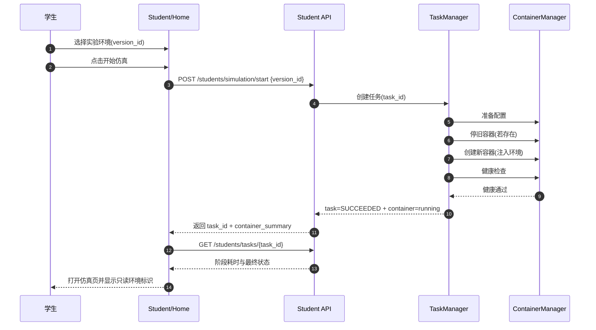
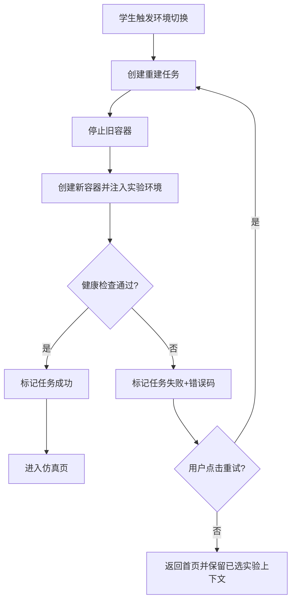
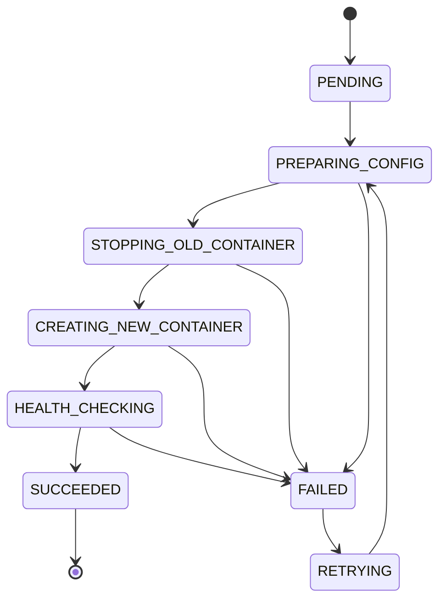

# SDD-第10期：实验环境版本化与容器重建主链路

- **文档版本**：v1.0
- **创建日期**：2026-04-02
- **修订日期**：2026-04-02
- **负责人**：架构组
- **关联需求**：实验环境与实验文件解耦、教师实验版本发布、学生按实验版本启动仿真、容器重建状态流可观测
- **前置依赖期次**：第4期（容器生命周期）、第5期（教师管理）、第7期（文件管理）、第8期（容器安全）、第9期（仿真面板）
- **目标读者**：产品 / 前端 / 后端 / 测试 / 运维

---

## 0) 分期总览表（期次、目标、范围边界、依赖、风险）

| 期次 | 目标 | 范围边界 | 依赖 | 风险 |
|---|---|---|---|---|
| 第10期（本期） | 打通“实验版本→容器绑定→学生仿真可用”的主链路 | 不做快照预热，不做智能调度；仿真页仅文件操作，不提供环境编辑 | 现有 `student_id + container` 语义、容器 API、文件 API、教师路由体系 | 容器重建链路超时、状态不一致、发布后版本回滚语义不清 |
| 第10.1期（后续独立文档） | 预热优化层（命中加速、回退主链路） | 仅加速层；不改变第10期主链路契约与边界 | 第10期稳定主链路、实验版本元数据 | 快照空间膨胀、命中偏低、清理策略误删 |

---

## 1) 执行摘要（问题、目标结果、成功指标）

### 1.1 问题
1. 当前容器启动与实验版本无强绑定，学生启动结果不可解释、不可追溯。
2. 仿真页对“环境”与“文件”边界不清，导致操作语义混乱。
3. 教师缺少实验版本发布与发布日志能力，无法支撑答辩演示链路。
4. 容器切换过程状态不可见，失败后恢复路径不统一。

### 1.2 目标结果
1. 学生在首页先选实验环境，再点击开始仿真；容器创建时注入并锁定实验版本。
2. 仿真页顶部左侧展示只读三元信息：实验名、实验版本、环境标识。
3. 仿真页新增实验文件面板（浏览、勾选实验文件、拉取到容器 `/home/student/experiment`、刷新、重试），不提供环境切换入口。
4. 教师端具备实验管理、实验详情拆分管理（环境配置区/文件资源区）、版本发布、发布记录查询。
5. 环境切换统一走“强制容器重建”链路，并可查询完整任务状态流与耗时。

### 1.3 成功指标（本期硬指标）
1. 从触发切换到容器可用（`running+health_passed`）P95 ≤ 30 秒。
2. 容器重建任务状态可见率 100%（前端可见每个阶段与失败原因）。
3. 关键失败场景（镜像失败/健康检查失败/文件分发失败）静默失败率 = 0%。
4. 仿真页环境编辑入口数量 = 0（仅首页选择，页内只读展示）。

---

## 2) 范围定义（In Scope / Out of Scope）

### 2.1 In Scope（本期必须交付）
1. 实验域模型：实验、实验版本、环境配置、文件资源包、发布记录。
2. 教师端实验管理页：列表、详情、版本管理、发布记录。
3. 学生端首页实验选择弹窗与“开始仿真”联动。
4. 开始仿真 API：基于实验版本创建或重建容器。
5. 环境切换 API：触发强制容器重建任务。
6. 任务状态查询 API：返回阶段状态、耗时、失败原因、重试入口。
7. 仿真页只读环境标识 + 实验文件面板（浏览/选择/拉取到 `/home/student/experiment`/刷新/重试）。
8. 统一错误语义、日志字段、验收标准与回归测试基线。

### 2.2 Out of Scope（明确不做）

| 非本期项 | 不做原因 |
|---|---|
| 镜像快照预热与命中优化 | 已拆分至第10.1期，避免主链路与加速层耦合 |
| 智能预热策略（按热度预测） | 需要稳定历史样本，当前阶段数据不足 |
| 仿真页内环境切换 | 与“容器强绑定”边界冲突，避免语义混乱 |
| 自动评测编排联动实验版本 | 评测域尚未稳定，避免跨域耦合 |
| 多租户资源配额调度 | 当前以教学单集群为目标，先保证链路可用性 |

---

## 3) 前提挑战与方案比选（至少2个方案）

### 3.1 前提挑战
1. 是否必须引入新领域命名并重构旧接口？
2. 是否可以在仿真页切环境以减少首页操作？
3. 容器切换是否允许“热切换”而非强制重建？

### 3.2 方案A：最小可行（本期采用）
- 保留现有 `student_id + container` 主语义。
- 新增接口补充 `experiment_id / version_id / environment_key` 字段。
- 环境切换统一强制重建容器。
- 仿真页只读展示环境信息，禁止页内切换。

**优点**：改动面最小、可复用现有容器生命周期接口、上线风险低。  
**风险**：领域命名短期内存在双语义并存。  
**适用前提**：需要快速形成可演示闭环。

### 3.3 方案B：长期最优
- 全面重命名为 `experiment_session` 语义。
- 重构容器与任务 API 为新资源树。
- 前后端统一迁移旧接口。

**优点**：语义最纯粹，长期可维护性高。  
**风险**：改造面过大，影响本期交付窗口。  
**适用前提**：有独立迁移期与双写机制。

### 3.4 决策与理由
- **最终采用**：方案A（最小可行）。
- **决策理由**：满足”规范可评审+链路可演示+30秒硬验收”三目标，且不破坏既有稳定能力。
- **放弃方案B原因**：迁移成本高，超出本期范围并提高上线风险。

### 3.5 API 简化决策（CEO Review 后）
- 删除独立的 `switch-environment` 端点，统一走 `POST /students/simulation/start` + `force_recreate=true`。
- `start` 端点行为树（Eng Review 后简化，删除健康失败模糊分支）：
  ```
  force_recreate=false:
    └─ 容器存在 AND current_version_id 匹配 AND 健康检查通过 → 200 + 容器信息（无任务）
    └─ 容器存在 AND (健康检查失败 OR version 不匹配) → 202 + task（自动重建，同 force_recreate=true）
    └─ 容器不存在 → 202 + task（重建）
  force_recreate=true:
    └─ 无论现有状态 → 202 + task（强制重建，旧容器删除后创建新容器）
  ```
  > **注**: 健康检查失败时不再提示用户手动使用 force_recreate=true，自动触发重建以简化 UX 和状态机。
- **容器清理原则**：重建时旧容器必须删除（`docker rm`），不保留 stopped 状态，防止资源堆积。

---

## 4) 现有资产复用（What already exists：前端/后端分别列表）

### 4.1 前端复用资产

| 资产 | 路径 | 可复用能力 | 本期复用方式 |
|---|---|---|---|
| 学生首页启动逻辑 | `edubot-twin-web/src/views/Student/Home.vue` | 容器状态判断、重建流程、loading 与弹窗 | 在”开始仿真”前插入实验选择与实验版本参数 |
| 仿真页主容器 | `edubot-twin-web/src/views/Simulation/Simulation.vue` | 容器状态注入、心跳、重连、退出关闭 | 增加顶部只读环境标识数据注入；心跳响应新增 `version_status` 字段，deprecated 时展示橙色 banner |
| 工作区面板 | `edubot-twin-web/src/views/Simulation/panels/WorkspacePanel/` | 文件浏览/拖拽/刷新/命令模型 | 抽离为”实验文件面板”能力子集 |
| **Monaco 代码编辑器** | `edubot-twin-web/src/views/Simulation/panels/WorkspacePanel/` | 文件查看与编辑 | **教师端环境配置编辑复用此组件**（JSON 文件内联编辑），消除重复实现 |
| 容器 API 封装 | `edubot-twin-web/src/api/container/index.ts` | mine/request/start/destroy-recreate/heartbeat | 新增带实验版本参数的 start-simulation/switch 接口；心跳响应增加 `version_status` |
| 教师容器监控路由骨架 | `edubot-twin-web/src/router/index.ts` | 教师端菜单与二级路由组织 | 新增”实验管理”路由并保持双处配置规则 |

### 4.2 后端复用资产

| 资产 | 路径 | 可复用能力 | 本期复用方式 |
|---|---|---|---|
| 学生容器生命周期接口 | `edubot-twin-server/app/api/v1/endpoints/student/container.py` | mine/request/start/destroy-and-recreate/heartbeat/stop | 扩展 experiment/version 入参与任务化响应 |
| 容器编排核心 | `edubot-twin-server/app/core/container_manager.py` | 创建/停止/删除容器、健康检查基础 | 增加环境注入参数与重建阶段日志 |
| 容器状态模型 | `edubot-twin-server/app/models/container.py` | 既有状态枚举 creating/running/stopped/error/removing | 复用并新增任务阶段映射，不改动核心容器状态字典 |
| 学生文件 API | `edubot-twin-server/app/api/v1/endpoints/student/files.py` | 路径安全、上传/读写/复制/移动 | 复用为实验文件分发与重试能力 |
| API 聚合入口 | `edubot-twin-server/app/api/v1/api.py` | `/students` `/teachers` 路由组织 | 新增 `/teachers/experiments` 与 `/students/experiments` 子路由 |

---

## 5) 核心系统交互图（时序图 + 流程图 + 状态机图）

### 5.1 时序图：学生选择实验并开始仿真



### 5.2 流程图：环境切换与失败恢复



### 5.3 状态机图：重建任务状态机（任务级）



---

## 6) API 契约表（Endpoint、Method、鉴权方式、Request结构、Response结构、状态码说明）

> 约束：保留既有 `student_id + container` 语义；新增 experiment/version 字段。

| Endpoint | Method | 鉴权方式 | Request 结构 | Response 结构 | 状态码说明 |
|---|---|---|---|---|---|
| `/api/v1/teachers/experiments` | GET | Bearer(teacher/admin) | `page:int, page_size:int, keyword?:string, status?:string` | `list[{experiment_id,name,latest_version,published_at}], total` | 200/401/403 |
| `/api/v1/teachers/experiments` | POST | Bearer(teacher/admin) | `name:str, code:str, description?:str` | `experiment_id, created_at` | 201/400/409 |
| `/api/v1/teachers/experiments/{experiment_id}` | GET | Bearer(teacher/admin) | 路径参数 | `base_info + versions + publish_logs` | 200/404 |
| `/api/v1/teachers/experiments/{experiment_id}/versions` | POST | Bearer(teacher/admin) | `version_name:str, environment_key:str, launch_args_template:object, startup_script_ref?:str, file_bundle_id?:int` | `version_id,status(draft)` | 201/400/409 |
| `/api/v1/teachers/experiments/{experiment_id}/versions/{version_id}/publish` | POST | Bearer(teacher/admin) | `publish_note?:str` | `publish_id, published_at, operator` | 200/400/404/409 |
| `/api/v1/teachers/experiments/{experiment_id}/publish-logs` | GET | Bearer(teacher/admin) | `page:int,page_size:int` | `list[{publish_id,version_id,operator,created_at,note}]` | 200/404 |
| `/api/v1/teachers/experiment-files/upload` | POST | Bearer(teacher/admin) | `multipart(file), experiment_id:int, checksum?:str` | `file_bundle_id, checksum, size, validate_status` | 201/400/413/422 |
| `/api/v1/teachers/experiment-files/{file_bundle_id}/validate` | POST | Bearer(teacher/admin) | 路径参数 | `validate_status, issues[]` | 200/404/409 |
| `/api/v1/students/experiments/available` | GET | Bearer(student) | 无 | `list[{version_id,experiment_name,version_name,environment_key,summary}]` | 200/401 |
| `/api/v1/students/simulation/start` | POST | Bearer(student) | `version_id:int, force_recreate?:bool(false)` | `task_id?, container_status, experiment_context` | 200(快速返回)/202(重建)/400/404/409/503 |
| ~~`/api/v1/students/simulation/switch-environment`~~ | ~~POST~~ | ~~已删除~~ | 用 `start` + `force_recreate=true` 替代，消除重复状态机逻辑 | - | - |
| `/api/v1/students/simulation/files/distribute` | POST | Bearer(student) | `version_id:int, selected_paths:string[] (空数组表示全选), mode:pull|refresh|retry` | `task_id, task_status:pending, accepted_at, target_dir:"/home/student/experiment"` | 202/400/404/409 |
| `/api/v1/students/tasks/{task_id}` | GET | Bearer(student/teacher) | 路径参数 | `task_status, stage_statuses[], elapsed_ms, error_code?, retryable` | 200/403/404 |
| `/api/v1/students/tasks/{task_id}/stream` | GET (SSE) | Bearer(student) | 路径参数 | `text/event-stream`；每阶段变更推送 `{stage, status, elapsed_ms}`；60s 无事件发送 keepalive。**客户端重连策略**：SSE 断开后降级为轮询；30s 后自动重试 SSE，最多 3 次；3次失败后永久使用轮询。**前端实现**：浏览器原生 `EventSource` 不支持自定义 header，**必须使用 `@microsoft/fetch-event-source`**（fetch 包装）以传递 `Authorization: Bearer xxx`。 | 200/403/404 |

### 6.1 错误语义映射

| 错误码 | 语义 | 前端动作 |
|---|---|---|
| `EXPERIMENT_VERSION_NOT_FOUND` | 版本不存在或不可见 | 刷新可选实验列表并提示重新选择 |
| `ENVIRONMENT_LOCKED_IN_SESSION` | 仿真页内尝试切环境 | 阻断并引导返回首页切换 |
| `CONTAINER_REBUILD_IN_PROGRESS` | 重建任务并发冲突 | 展示任务进度并禁用重复提交 |
| `CONTAINER_HEALTHCHECK_TIMEOUT` | 健康检查超时 | 提供重试入口与错误详情 |
| `FILE_BUNDLE_DISTRIBUTION_FAILED` | 文件分发失败 | 保留上下文并支持重试 |
| `STATE_CONFLICT` | 状态冲突（如 running 时重复 start） | 刷新容器状态并提示 |

---

## 7) 数据字典表（字段名、数据类型、是否必填、默认值、业务说明）

### 7.1 实体：Experiment

| 字段名 | 数据类型 | 必填 | 默认值 | 业务说明 |
|---|---|---|---|---|
| experiment_id | int | 是 | 自增 | 实验主键 |
| name | string(128) | 是 | - | 实验名称（展示） |
| code | string(64) | 是 | - | 实验编码（唯一） |
| description | string(512) | 否 | null | 实验说明 |
| status | enum(draft/active/archived) | 是 | draft | 实验生命周期 |
| created_by | int | 是 | - | 教师用户ID |
| created_at | datetime | 是 | now | 创建时间 |
| updated_at | datetime | 是 | now | 更新时间 |

### 7.2 实体：ExperimentVersion

| 字段名 | 数据类型 | 必填 | 默认值 | 业务说明 |
|---|---|---|---|---|
| version_id | int | 是 | 自增 | 版本主键 |
| experiment_id | int | 是 | - | 关联实验 |
| version_name | string(64) | 是 | - | 版本名，如 v1.0.0 |
| is_visible | bool | 是 | true | 学生是否可见 |
| environment_key | string(128) | 是 | - | 只读环境标识 |
| launch_args_template | json | 是 | `{}` | 参数模板 |
| startup_script_ref | string(255) | 否 | null | 启动脚本引用 |
| file_bundle_id | int | 否 | null | 关联实验文件包 |
| publish_status | enum(draft/published/deprecated) | 是 | draft | 发布状态 |
| published_at | datetime | 否 | null | 发布时间 |

### 7.3 实体：ExperimentPublishLog

| 字段名 | 数据类型 | 必填 | 默认值 | 业务说明 |
|---|---|---|---|---|
| publish_id | int | 是 | 自增 | 发布记录主键 |
| experiment_id | int | 是 | - | 关联实验 |
| version_id | int | 是 | - | 关联版本 |
| operator_id | int | 是 | - | 发布操作人 |
| publish_note | string(512) | 否 | null | 发布说明 |
| created_at | datetime | 是 | now | 发布时间 |

### 7.4 实体：ExperimentFileBundle

| 字段名 | 数据类型 | 必填 | 默认值 | 业务说明 |
|---|---|---|---|---|
| bundle_id | int | 是 | 自增 | 文件包主键 |
| experiment_id | int | 是 | - | 关联实验 |
| storage_root | string(512) | 是 | `/data/experiment_assets/{experiment_id}/{bundle_id}` | 服务器固定存储根目录（绝对路径） |
| manifest_path | string(512) | 是 | - | 服务器侧清单文件路径 |
| checksum | string(64) | 是 | - | SHA256 校验值 |
| size_bytes | bigint | 是 | - | 文件包大小（字节） |
| validate_status | enum(pending/valid/invalid) | 是 | pending | 校验状态 |
| created_at | datetime | 是 | now | 上传时间 |
| created_by | int | 是 | - | 上传教师 ID |

### 7.5 实体：ExperimentFileItem

| 字段名 | 数据类型 | 必填 | 默认值 | 业务说明 |
|---|---|---|---|---|
| item_id | int | 是 | 自增 | 文件项主键 |
| bundle_id | int | 是 | - | 关联文件包 |
| relative_path | string(512) | 是 | - | 相对 `storage_root` 的路径 |
| item_type | enum(file/dir) | 是 | file | 文件或目录 |
| size_bytes | bigint | 否 | null | 文件大小，目录可空 |
| chmod_mode | string(8) | 是 | `0777` | 拉取到容器后的权限模式 |

### 7.6 实体：SimContainer（新增字段）

> 补充说明：`SimContainer` 现有模型新增以下字段。

| 字段名 | 数据类型 | 必填 | 默认值 | 业务说明 |
|---|---|---|---|---|
| current_version_id | int | 否 | null | 当前绑定的实验版本 ID；任务 SUCCEEDED 时写入；null 表示旧容器（无版本上下文） |

> **迁移兼容说明**：新增字段为 nullable，现有容器记录迁移后 `current_version_id = null`。仿真页检测到 null 时展示"旧容器，请返回首页重新选择实验"提示，不崩溃。

### 7.7 实体：SimulationTask

| 字段名 | 数据类型 | 必填 | 默认值 | 业务说明 |
|---|---|---|---|---|
| task_id | string(36) | 是 | UUID | 任务ID |
| student_id | int | 是 | - | 学生ID（沿用现有语义） |
| container_id | int | 否 | null | 关联容器记录 |
| target_version_id | int | 是 | - | 目标实验版本 |
| status | enum | 是 | pending | 任务总状态 |
| current_stage | enum | 是 | preparing_config | 当前阶段 |
| elapsed_ms | int | 是 | 0 | 总耗时 |
| error_code | string(64) | 否 | null | 失败错误码 |
| error_message | string(512) | 否 | null | 失败详情 |
| retryable | bool | 是 | true | 是否可重试 |
| created_at | datetime | 是 | now | 创建时间 |
| updated_at | datetime | 是 | now | 最后更新时间；每次阶段变更时由 TaskRunner 更新，用于孤儿任务检测（`updated_at < now()-5min`） |

---

## 8) 安全与边界约束（鉴权、越权、路径安全、注入风险、并发冲突）

| 风险点 | 约束要求 | 控制策略 | 验证方式 |
|---|---|---|---|
| 鉴权绕过 | 学生仅可操作自身容器与可见实验版本 | JWT + `student_id` 资源归属校验 | 鉴权集成测试 |
| 越权发布 | 仅教师/管理员可发布实验版本 | 路由角色守卫 + 后端角色二次校验 | 权限回归测试 |
| 路径安全 | 实验文件源路径仅允许位于服务器固定目录 `/data/experiment_assets/{experiment_id}/{bundle_id}` 下；容器目标路径固定 `/home/student/experiment` | 服务端固定根目录 + manifest 校验 selected_paths + 禁止客户端自定义目标路径 | 恶意路径用例（`../`、绝对路径、伪造 target_dir、manifest 漂移） |
| 参数注入 | `launch_args_template` 每参数值匹配 `^[a-zA-Z0-9_\-\./]+$`，不含空格/`;`/`\|`/`$`/反引号；通过 `os.path.normpath` 二次确认无 `..`；参数化注入 roslaunch，**禁止**字符串拼接 | 参数白名单正则 + normpath 二次校验 | 注入用例（`;rm -rf`、`\|\|curl`、路径遍历） |
| 启动脚本引用 | `startup_script_ref` 定义为内部安全注册表键名（如 `nav_demo`），服务端 `app/core/script_registry.py` 维护白名单映射；未知键返回 400 | 注册表白名单模式 | 非注册键用例、空键用例 |
| 并发冲突 | 同一学生不得并发执行两个重建任务；第二次请求返回 409 CONTAINER_REBUILD_IN_PROGRESS | **应用层 `BEGIN IMMEDIATE` 事务**（SELECT+INSERT 包在同一事务内；SQLite 不支持 partial unique index，必须用 `execution_options(isolation_level='IMMEDIATE')`；不得用默认 DEFERRED 隔离） | 并发压测（同一学生并发2次请求） |
| 文件包路径安全 | `ExperimentFileBundle.file_path` 必须在白名单根目录（如 `/app/uploads/`）下 | 写入时校验路径前缀；分发时 `os.path.normpath` 并再次校验前缀，防止 `../` 路径遍历 | 恶意路径用例（`../`、绝对路径越界） |
| 状态篡改 | 任务阶段不可逆乱跳 | 状态机守卫 + 事务更新 | 状态机单元测试 |
| 镜像缺失 | `edubot/gazebo-ros` 镜像未缓存时不抛裸 DockerAPIError | 容器创建前检查镜像存在，缺失时返回 `CONTAINER_IMAGE_NOT_FOUND` 错误码 | 镜像缺失用例 |

---

## 9) 失败模式与恢复策略（Failure Modes Registry）

| Codepath | 失败模式 | 用户可见 | 日志/指标 | 测试覆盖 | 恢复策略 |
|---|---|---|---|---|---|
| start-simulation | 版本不存在 | 是（明确提示） | 是 | 是 | 刷新版本列表后重选 |
| rebuild:stop-old | 旧容器停止超时（15s 后 force kill）| 是（warning，不阻断） | 是 | 是 | 记录 warning 继续，不中断重建 |
| rebuild:stop-old | 旧容器停止失败（非超时） | 是 | 是 | 是 | 标记可重试，允许强制删除重试 |
| rebuild:create-new | 镜像不可用（CONTAINER_IMAGE_NOT_FOUND）| 是 | 是 | 是 | 返回明确错误码，管理员检查镜像缓存 |
| rebuild:create-new | 端口耗尽 | 是 | 是 | 是 | 返回 `503`，保留上下文重试 |
| rebuild:health-check | 健康检查超时 | 是 | 是 | 是 | 显示阶段耗时与错误码，支持重试 |
| distribute-files | 文件包校验失败 | 是 | 是 | 是 | 阻断分发，提示教师重新发布 |
| distribute-files | 容器 `/home/student/experiment` 权限设置失败 | 是 | 是 | 是 | 自动执行 `chown/chmod` 重试一次，失败后提示重试 |
| task-query | 任务不存在/越权 | 是 | 是 | 是 | 403/404 明确错误，提供返回入口 |
| simulation-page | 容器状态突变为 stopped/error | 是 | 是 | 是 | 弹窗提示 + 返回首页 + 可重建 |
| simulation-page | 版本被 deprecated（心跳感知） | 是（橙色 banner） | 是 | 是 | 非阻断提示，引导返回首页切换版本 |
| TaskRunner 进程崩溃 | 孤儿任务永远 PENDING | 否（无服务时） | 是（重启后） | 是 | 服务重启时扫描 `updated_at < now()-5min AND status IN (PENDING,IN_PROGRESS)` 标记 FAILED+retryable |

### 9.1 恢复策略约束
1. 每个失败场景必须提供”重试”或”返回首页并保留实验上下文”至少一种恢复入口。
2. 禁止静默失败：失败必须写入任务日志并回传 `error_code`。
3. 重试不得丢失 `version_id` 与 `environment_key`。
4. `stop_old_container` 必须设置 `docker stop --time=15`；超时后执行 `docker kill`；超时本身记录 warning 但**不中断**后续重建流程。

---

## 10) 可观测性要求（关键日志字段、核心指标、告警建议）

### 10.1 关键日志字段
- `trace_id`
- `task_id`
- `student_id`
- `container_id`
- `experiment_id`
- `version_id`
- `environment_key`
- `stage`
- `elapsed_ms`
- `error_code`

### 10.2 核心指标
1. `simulation_rebuild_duration_ms`（P50/P95/P99）。
2. `simulation_rebuild_success_rate`。
3. `stage_failure_count{stage,error_code}`。
4. `task_retry_rate`。
5. `file_distribution_success_rate`。

### 10.3 告警建议
1. `P95 rebuild_duration > 30s` 连续 5 分钟触发告警。
2. 重建失败率 > 5%（5分钟窗口）触发告警。
3. 同一错误码连续 20 次触发聚合告警。

---

## 11) 测试与验收（覆盖地图 + 功能/稳定性/一致性验收，必须量化）

### 11.1 测试覆盖地图

| 流程/分支 | 类型 | 用例要点 | 通过标准 |
|---|---|---|---|
| Happy Path：选版本后启动成功 | 集成/E2E | 创建任务→重建→健康通过 | 全链路成功且任务状态完整 |
| Nil Path：无可用实验版本 | 集成 | 可用列表为空 | 明确空态提示，无崩溃 |
| Error Path：健康检查超时 | 集成 | 强制健康失败 | 返回错误码+可重试入口 |
| Error Path：文件分发失败 | 集成 | 破坏文件包校验 | 显示失败原因并可重试 |
| 并发冲突 | 并发测试 | 同学生并发触发两次重建 | 一次 accepted，一次 conflict |
| 鉴权/越权 | 安全测试 | 学生请求他人任务ID | 返回 403，且无敏感泄漏 |
| 孤儿任务回收 | 服务恢复测试 | 模拟 CREATING_NEW_CONTAINER 阶段进程被 kill，重启后扫描 `startup_recovery()`，检查任务转 FAILED+retryable | 重启后任务 status=FAILED, retryable=true；学生可重新提交 |
| 分发任务化 | 集成测试 | `POST /students/simulation/files/distribute` 返回 202+task_id；随后轮询任务到 SUCCEEDED/FAILED | 任务阶段、耗时、错误码完整可见 |
| 分发全选语义 | 集成测试 | `selected_paths=[]` 触发 manifest 全量分发 | pulled_count 与 manifest 文件数一致 |
| 分发白名单与清单校验 | 安全测试 | 源路径越界、manifest 缺失、selected_paths 不在清单内 | 返回 400/403，不发生文件写入 |
| 分发权限修复 | 集成测试 | 分发完成后校验 `/home/student/experiment` 下文件属主/权限；模拟 chmod/chown 失败 | 成功时权限符合约定；失败时返回 retryable 错误 |
| SSE 降级回轮询 | 集成测试 | 断开 SSE 连接，验证客户端降级为轮询；30s 后重试 SSE；3次失败后永久轮询 | 符合客户端重连策略 |

### 11.2 功能验收（量化）
- [ ] 教师可完成实验创建、版本创建、发布、发布记录查询全流程，成功率 100%。
- [ ] 学生可在首页选择版本并启动仿真，仿真页显示只读三元信息准确率 100%。
- [ ] 仿真页环境编辑入口数为 0；实验文件面板提供浏览/复制/刷新/重试四类动作。

### 11.3 稳定性验收（量化）
- [ ] 连续 200 次“切换环境→重建”流程中，成功率 ≥ 99%。
- [ ] 重建总耗时 P95 ≤ 30 秒（硬门槛）。
- [ ] 失败重试后恢复成功率 ≥ 95%。

### 11.4 一致性验收
- [ ] API 契约字段与前端展示字段一一对应，无同义多名。
- [ ] 任务状态机与前端状态文案一致。
- [ ] 错误码字典与用户提示映射一致。

---

## 12) 实施分期与交付清单（仅交付内容，不写W1/W2/W3）

### 12.1 本期交付内容
- 文档交付：本 SDD（第10期主链路）。
- 前端交付：
  - 学生首页实验选择弹窗与开始仿真联动。
  - 仿真页顶部只读环境标识。
  - 实验文件面板（浏览/勾选/拉取到 `/home/student/experiment`/刷新/重试）。
  - 教师实验管理页面（列表/详情/版本/发布记录）。
- 后端交付：
  - 实验与版本管理 API。
  - 发布记录 API。
  - 学生开始仿真与环境切换 API（任务化）。
  - 任务状态查询 API（轮询 + SSE 双模式）。
  - 文件分发 API（任务化，202 + task_id）。
  - **PathPolicy 模块**（`app/core/path_policy.py`）：统一管理服务器实验包根目录、主机 experiment 目录、容器 `/home/student/workspace` 与 `/home/student/experiment` 路径常量。
  - **FileDistributionService 模块**（`app/services/file_distribution_service.py`）：白名单源目录 + manifest 校验 + 权限修复（`chown/chmod`）+ 失败可重试。
  - **TaskRunner 模块**（`app/core/task_runner.py`）：多阶段 pipeline + 孤儿任务回收 + 并发限制（含文件分发任务）。
  - **ScriptRegistry 模块**（`app/core/script_registry.py`）：startup_script_ref 白名单映射。
  - **SimContainer 迁移脚本**：新增 `current_version_id` nullable 外键。
- 测试交付：

  | 测试文件 | 框架 | 覆盖内容 |
  |---|---|---|
  | `edubot-twin-server/tests/test_task_runner.py` | pytest | TaskRunner 状态机全路径、孤儿回收、孤儿误判边界 |
  | `edubot-twin-server/tests/test_simulation_start.py` | pytest | start API 行为树（复用/重建/强制重建/冲突/越权） |
  | `edubot-twin-server/tests/test_concurrent_task.py` | pytest | 同一学生并发两次请求，验证 409 冲突（需 BEGIN IMMEDIATE） |
  | `edubot-twin-server/tests/test_experiment_publish.py` | pytest | 发布流程、非 draft 发布拒绝、发布日志同事务 |
  | `edubot-twin-server/tests/test_sse_stream.py` | pytest + httpx | SSE 推送、keepalive、越权 403 |
  | `edubot-twin-server/tests/e2e/test_experiment_flow.py` | pytest + httpx | 学生选版本→重建→仿真完整流程 |
  | `edubot-twin-server/tests/e2e/test_teacher_flow.py` | pytest + httpx | 教师创建实验→版本→发布完整流程 |
- **运维交付**：DB 迁移脚本 + null-version 旧容器兼容处理说明。

### 12.2 非本期项（再次冻结）
| 项目 | 不做原因 |
|---|---|
| 快照预热构建与命中 | 已拆至第10.1期 |
| 预热看板与智能策略 | 依赖预热层上线后的观测数据 |

---

## 13) Deferred（后续阶段，说明延后原因与触发条件）

| 延后项 | 延后原因 | 触发条件 |
|---|---|---|
| 第10.1 快照预热优化层 | 与主链路解耦，避免范围膨胀 | 第10期主链路稳定运行 1 个迭代 |
| 实验版本回滚一键恢复 | 需与发布日志形成强一致补偿机制 | 发布日志审计完成并通过压测 |
| 多集群容器调度 | 当前单集群即可满足教学场景 | 单集群资源利用率持续 > 80% |
| 自动评测联动版本 | 评测域契约尚未冻结 | 评测 API 完成标准化 |

---

## 14) 附录（规范-代码映射、术语表、变更记录）

### 14.1 规范-代码映射（目标映射）

| 规范项 | 现有基线路径 | 本期目标改动 |
|---|---|---|
| 学生容器生命周期 | `edubot-twin-server/app/api/v1/endpoints/student/container.py` | 扩展 start/switch 任务化能力 |
| 容器编排能力 | `edubot-twin-server/app/core/container_manager.py` | 增加环境注入参数与阶段日志 |
| 学生首页启动 | `edubot-twin-web/src/views/Student/Home.vue` | 增加实验选择与任务轮询 |
| 仿真页状态注入 | `edubot-twin-web/src/views/Simulation/Simulation.vue` | 增加只读环境标识数据源 |
| 文件面板能力 | `edubot-twin-web/src/views/Simulation/panels/WorkspacePanel/` | 提炼实验文件操作子集 |
| 教师路由入口 | `edubot-twin-web/src/router/index.ts` | 增加实验管理路由并双处配置 |

### 14.2 术语表

| 术语 | 定义 |
|---|---|
| 实验环境（Environment） | launch 文件、参数模板、默认入口、启动脚本等容器启动形态定义 |
| 实验文件（Experiment Files） | 分发给学生的代码/资料包 |
| 环境标识（environment_key） | 用于只读展示与追溯的环境唯一标识 |
| 主链路 | 不依赖快照预热即可完成的标准启动路径 |
| 重建任务（SimulationTask） | 环境切换时执行的可观测状态流任务 |

### 14.3 变更记录

| 版本 | 日期 | 变更内容 |
|---|---|---|
| v1.0 | 2026-04-02 | 首版发布：冻结第10期主链路范围、契约、状态机与验收标准 |
| v1.1 | 2026-04-02 | CEO Review 审查后补充：数据模型修正、TaskRunner 架构定义、安全约束细化、SSE/heartbeat 扩展 |
| v1.2 | 2026-04-02 | 工程落地增强：补充页面级映射、交互文案矩阵、后端事务边界、迁移索引策略、联调样例、测试文件级映射 |
| v1.3 | 2026-04-02 | Eng Review 收敛：实验文件分发任务化（202+task_id）、源目录强白名单+manifest 校验、双挂载固定 `/home/student/experiment`、路径策略集中化、分发专项测试矩阵补齐 |

### 14.4 前端页面级实施映射（布局结构 + 功能 + 交互）

| 页面/路由 | 布局结构 | 核心功能 | 交互约束 | 依赖 API | 状态来源 |
|---|---|---|---|---|---|
| `/student/home` | 顶部统计卡 + 实验选择区 + 开始仿真按钮 | 选择实验版本、发起仿真、查看任务进度 | 未选版本时禁用开始按钮；重建中禁用重复点击 | `GET /students/experiments/available`、`POST /students/simulation/start`、`GET /students/tasks/{id}` | 本地页面状态 + 任务状态轮询 |
| `/simulation`（仿真页） | 顶部 `SimulationHeader` + 左侧 `SettingsSidebar` + 中央 `GLayout` | 只读环境标识、面板协同、实验文件操作 | **禁止环境切换入口**；仅允许文件操作（浏览/勾选/拉取到 `/home/student/experiment`/刷新/重试） | `POST /students/simulation/files/distribute`、`GET /students/tasks/{id}`、`POST /students/container/heartbeat` | `containerStatus` + `experiment_context` + `task_status` |
| `/teacher/experiments`（新增） | 列表页 + 详情抽屉/页签（环境配置区/文件资源区/发布记录） | 实验 CRUD、版本管理、发布 | 发布前必须通过文件包校验；发布中按钮锁定 | `GET/POST /teachers/experiments*`、`POST /publish`、`POST /experiment-files/upload` | 服务端分页数据 + 本地表单状态 |
| `/teacher/experiments/:id`（详情） | 左侧版本列表 + 右侧配置编辑区（复用 Monaco） | launch 参数模板编辑、脚本引用绑定、发布记录查询 | 仅 draft 版本允许编辑；published 版本只读 | `GET /teachers/experiments/{id}`、`POST /versions`、`GET /publish-logs` | 版本状态机 + 编辑态 |

### 14.5 交互与文案矩阵（状态码/错误码 -> 用户动作）

| 场景 | 后端返回 | 前端提示文案（建议） | 用户可见动作 | 埋点事件 |
|---|---|---|---|---|
| 未选择实验直接开始 | 客户端前置校验 | `请先选择实验环境后再开始仿真` | 保持当前页，不发请求 | `student_start_blocked_no_version` |
| 启动快速返回复用容器 | `200` | `已复用当前仿真环境` | 直接进入仿真页 | `student_start_reuse_200` |
| 启动触发重建任务 | `202 + task_id` | `正在重建仿真环境，请稍候...` | 显示进度弹层，轮询任务 | `student_start_rebuild_202` |
| 版本不存在 | `EXPERIMENT_VERSION_NOT_FOUND` | `实验版本不存在或已下线，请重新选择` | 刷新版本列表 | `student_start_version_not_found` |
| 重建冲突 | `CONTAINER_REBUILD_IN_PROGRESS` | `已有重建任务进行中，正在为你同步进度` | 绑定现有任务进度 | `student_start_conflict_bind_task` |
| 健康检查超时 | `CONTAINER_HEALTHCHECK_TIMEOUT` | `环境启动超时，可重试或返回首页` | `重试` / `返回首页` | `student_rebuild_health_timeout` |
| 文件分发任务已受理 | `202 + task_id` | `已开始拉取实验文件，正在同步进度...` | 展示分发进度并轮询任务 | `simulation_files_distribute_accepted` |
| 文件分发失败 | `FILE_BUNDLE_DISTRIBUTION_FAILED` | `实验文件拉取失败，请重试` | `重试拉取` | `simulation_files_distribute_failed` |
| 文件拉取完成 | `task_status=SUCCEEDED` | `已拉取到 /home/student/experiment，可在容器中直接使用` | 关闭提示继续实验 | `simulation_files_pull_success` |
| 心跳检测到 deprecated | `version_status=deprecated` | `当前实验版本已废弃，建议返回首页切换新版本` | 非阻断 banner + 返回首页按钮 | `simulation_version_deprecated_banner` |

### 14.6 后端模块落点与事务边界

| 能力 | 模块落点（建议） | 事务边界 | 一致性策略 |
|---|---|---|---|
| 实验/版本管理 | `app/api/v1/endpoints/teacher/experiments.py` + `app/crud/experiment.py` | 单请求内事务提交 | 强一致 |
| 发布动作与发布日志 | `app/services/experiment_publish_service.py` | “版本状态更新 + 发布日志写入”同事务 | 强一致 |
| 启动/重建任务编排 | `app/core/task_runner.py` + `app/services/simulation_start_service.py` | 每阶段独立事务（阶段状态落库） | 最终一致（可恢复） |
| 容器控制 | 复用 `app/core/container_manager.py` | 容器动作与任务状态分离事务 | 失败可补偿 |
| 实验文件分发 | `app/api/v1/endpoints/student/simulation_files.py` + `app/services/file_distribution_service.py` | 先写 task=IN_PROGRESS，再执行分发，再写 SUCCEEDED/FAILED | 最终一致（任务化可恢复，支持 retry） |
| 任务查询/SSE 推送 | `app/api/v1/endpoints/student/tasks.py` | 只读，无事务写 | 实时读一致 |

**事务原则补充**：
1. 不在一个 DB 事务里包裹 Docker 调用，防止长事务锁表。
2. 任务阶段采用”先写 IN_PROGRESS，再执行，再写 SUCCEEDED/FAILED”模式，保证崩溃可恢复。
3. 发布动作中 `publish_status` 与 `publish_log` 必须同事务，防止”已发布但无日志”脏状态。
4. **TaskRunner session 归属**：`asyncio.create_task` 中运行的 TaskRunner 拿不到 FastAPI 请求生命周期的 `AsyncSession`。TaskRunner 内部所有 DB 操作必须自己创建新 session（`async with AsyncSessionLocal() as db`），禁止共享请求层 session，否则导致 `greenlet_spawn` 报错或 session 跨协程泄漏。
5. **SSE 生成器 session 管理**：SSE 生成器内每次轮询必须单独开一个新 DB session（`async with AsyncSessionLocal() as db`），用完即关，避免 30 个并发 SSE 连接长时间占用连接池。
6. **并发任务创建事务**：任务创建时必须使用 `BEGIN IMMEDIATE` 隔离级别（`execution_options(isolation_level='IMMEDIATE')`），SQLite 默认 DEFERRED 无法防止并发双写。

### 14.7 数据迁移与索引策略（DDL 级约束）

| 迁移项 | 变更内容 | 回滚策略 | 索引/约束 |
|---|---|---|---|
| `sim_containers` 新增列 | `current_version_id` nullable FK -> `experiment_versions.version_id` | 回滚时先删 FK 后删列 | `idx_sim_containers_current_version_id` |
| 新建 `experiments` | 实验主表 | 按依赖顺序 drop | `uk_experiments_code` |
| 新建 `experiment_versions` | 版本表（含 environment_key、publish_status） | 按依赖顺序 drop | `uk_versions_exp_version_name(experiment_id,version_name)`、`idx_versions_publish_status` |
| 新建 `experiment_publish_logs` | 发布日志表 | 可独立回滚 | `idx_publish_logs_exp_created_at(experiment_id,created_at)` |
| 新建 `simulation_tasks` | 任务表（阶段、错误、耗时、updated_at） | 可独立回滚 | `idx_tasks_student_created_at(student_id,created_at)`；**注**: SQLite 不支持 partial unique index，`uk_active_task_per_student` 由应用层 `BEGIN IMMEDIATE` 事务保证 |
| 新建 `experiment_file_bundles` | 文件包元数据 | 可独立回滚 | `idx_bundles_experiment_id`、`uk_bundles_checksum_experiment(experiment_id,checksum)` |

**迁移执行顺序**：
1) 建基础表（`experiments`、`experiment_versions`）-> 2) 建发布与文件包表 -> 3) 建任务表 -> 4) 增量修改 `sim_containers`。
**灰度兼容**：`current_version_id` 为 null 的旧容器按“需重新选择实验”处理，不阻塞系统运行。

### 14.8 联调契约样例（Happy / Nil / Error）

#### A. 启动仿真 `POST /api/v1/students/simulation/start`

**200（快速复用）**
```json
{
  "code": 0,
  "message": "ok",
  "data": {
    "task_id": null,
    "container_status": "running",
    "experiment_context": {
      "experiment_id": 12,
      "version_id": 33,
      "environment_key": "robot_nav_v2"
    }
  }
}
```

**202（触发重建）**
```json
{
  "code": 0,
  "message": "accepted",
  "data": {
    "task_id": "5f2c6e2c-31b5-4b34-8f4a-6f40f7f4c901",
    "container_status": "creating",
    "experiment_context": {
      "experiment_id": 12,
      "version_id": 34,
      "environment_key": "robot_nav_v3"
    }
  }
}
```

**404（版本不存在）**
```json
{
  "code": "EXPERIMENT_VERSION_NOT_FOUND",
  "message": "实验版本不存在或不可见",
  "data": null
}
```

#### B. 任务查询 `GET /api/v1/students/tasks/{task_id}`

**成功**
```json
{
  "code": 0,
  "message": "ok",
  "data": {
    "task_status": "SUCCEEDED",
    "elapsed_ms": 18642,
    "retryable": false,
    "stage_statuses": [
      {"stage": "PREPARING_CONFIG", "status": "SUCCEEDED", "elapsed_ms": 320},
      {"stage": "STOPPING_OLD_CONTAINER", "status": "SUCCEEDED", "elapsed_ms": 4100},
      {"stage": "CREATING_NEW_CONTAINER", "status": "SUCCEEDED", "elapsed_ms": 10322},
      {"stage": "HEALTH_CHECKING", "status": "SUCCEEDED", "elapsed_ms": 3900}
    ]
  }
}
```

**失败**
```json
{
  "code": 0,
  "message": "ok",
  "data": {
    "task_status": "FAILED",
    "elapsed_ms": 30120,
    "retryable": true,
    "error_code": "CONTAINER_HEALTHCHECK_TIMEOUT",
    "error_message": "health check timeout after 30s",
    "stage_statuses": [
      {"stage": "HEALTH_CHECKING", "status": "FAILED", "elapsed_ms": 30000}
    ]
  }
}
```

### 14.9 测试映射到文件级（可直接拆任务）

| 测试目标 | 类型 | 建议测试文件 | 关键断言 |
|---|---|---|---|
| 启动接口 200/202 分支 | 后端集成 | `edubot-twin-server/tests/test_student_simulation_start_api.py` | `force_recreate=false` 命中 200，版本不匹配命中 202 |
| 启动接口错误码语义 | 后端集成 | `edubot-twin-server/tests/test_student_simulation_start_errors.py` | `EXPERIMENT_VERSION_NOT_FOUND`、`CONTAINER_REBUILD_IN_PROGRESS` |
| TaskRunner 状态机 | 后端单测 | `edubot-twin-server/tests/test_task_runner_state_machine.py` | 阶段不可逆、失败可重试 |
| 容器重建补偿逻辑 | 后端集成 | `edubot-twin-server/tests/test_rebuild_compensation.py` | stop 超时 warning 不阻断；health timeout 返回 retryable |
| 分发任务受理 | 后端集成 | `edubot-twin-server/tests/test_file_distribution_task_api.py` | distribute 返回 202 + task_id；task 初始状态为 PENDING/IN_PROGRESS |
| 分发白名单与 manifest | 后端集成 | `edubot-twin-server/tests/test_file_distribution_security.py` | 仅允许 `/data/experiment_assets/{experiment_id}/{bundle_id}`；`selected_paths` 必须在 manifest 内 |
| 分发全选语义 | 后端集成 | `edubot-twin-server/tests/test_file_distribution_all_selected.py` | `selected_paths=[]` 拉取 manifest 全量文件 |
| 分发权限修复与失败重试 | 后端集成 | `edubot-twin-server/tests/test_file_distribution_permissions.py` | 成功后目标文件权限符合约定；`chown/chmod` 失败返回 retryable 错误 |
| 容器双挂载契约 | 后端单测 | `edubot-twin-server/tests/test_container_mount_paths.py` | 同时挂载 `/home/student/workspace` 与 `/home/student/experiment` |
| 学生首页选择->启动->进度 | 前端 E2E | `edubot-twin-web/tests/e2e/student-start-simulation.spec.ts` | 未选版本按钮禁用；202 时显示进度 |
| 仿真页文件分发任务进度 | 前端 E2E | `edubot-twin-web/tests/e2e/simulation-files-distribute.spec.ts` | 分发返回 task_id 后展示进度，成功/失败文案准确 |
| 仿真页只读边界 | 前端组件/E2E | `edubot-twin-web/tests/e2e/simulation-boundary.spec.ts` | 环境切换入口不存在；只读标识存在 |
| 错误码到文案映射 | 前端单测 | `edubot-twin-web/src/views/Student/__tests__/error-message-map.spec.ts` | 每个错误码映射固定文案与动作 |
| SSE 降级策略 | 前端集成 | `edubot-twin-web/src/api/__tests__/task-stream-fallback.spec.ts` | SSE 断开后轮询接管，30s 后重试 SSE |
| 鉴权越权与路径安全 | 安全测试 | `edubot-twin-server/tests/test_simulation_security.py` | 他人 task_id 返回 403；`../` 路径返回 400/403 |

---

## GSTACK REVIEW REPORT

| Review | Trigger | Why | Runs | Status | Findings |
|--------|---------|-----|------|--------|----------|
| CEO Review | `/plan-ceo-review` | Scope & strategy | 5 | DONE (0 unresolved) | SELECTIVE EXPANSION: 5 items accepted, 3 deferred |
| Outside Voice | `/plan-eng-review` (auto) | Independent 2nd opinion | 3 | issues_found (resolved) | SQLite DEFERRED, TaskRunner session, file_path security, Docker SDK false alarm |
| Eng Review | `/plan-eng-review` | Architecture & tests (required) | 8 | **CLEAR (PLAN)** | 7 issues, 7 resolved; 1 critical gap deferred to TODOS P2 (文件分发超时) |
| Design Review | `/plan-design-review` | UI/UX gaps | 1 | STALE (2026-03-28) | — |

**ENG:** 7 issues found and resolved — SSE auth (@microsoft/fetch-event-source), force_recreate健康失败自动重建, SimulationTask.updated_at补充, SQLite BEGIN IMMEDIATE, TaskRunner session归属, file_path安全约束, SSE DB session管理  
**OUTSIDE VOICE:** Claude subagent — 3 new findings incorporated (SQLite隔离级别, TaskRunner session, file_path安全); 1 false alarm (Docker SDK已工作); 1 deferred to TODOS P2 (文件分发语义)  
**UNRESOLVED:** 0 decisions outstanding  
**VERDICT:** CEO + ENG CLEARED — 可以开始实现。Design Review 如有教师端新UI建议先运行 `/plan-design-review`。
