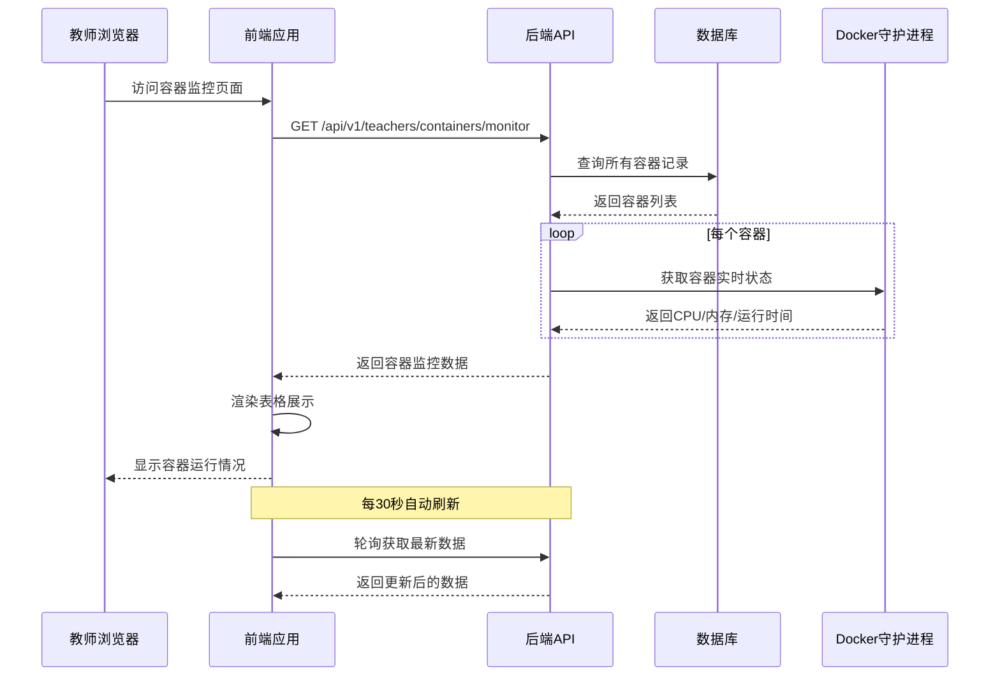
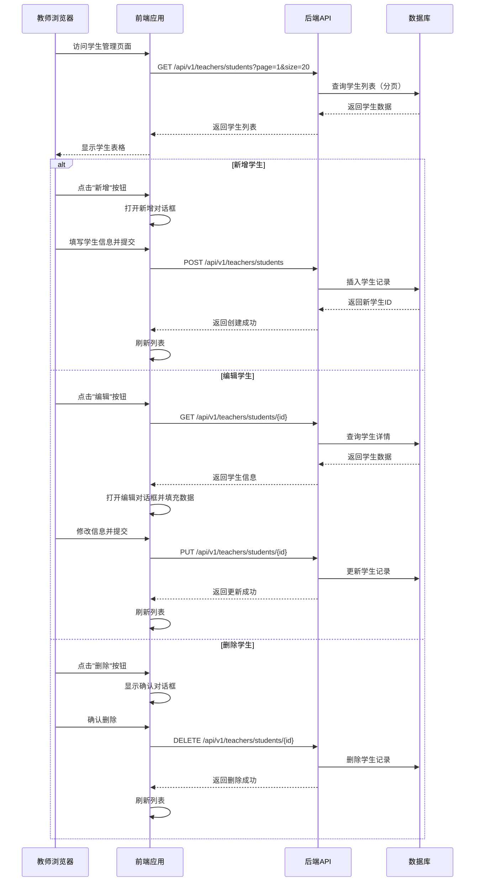

# SDD-第五期：教师端管理模块

## 1. 概述

### 1.1 目标
构建教师端管理系统，包括首页、学生管理、Docker容器管理三大核心模块，为教师提供完整的教学资源管理和监控能力。

### 1.2 范围
- 教师端首页（预留扩展）
- 学生信息管理（CRUD）
- Docker容器运行监控
- 容器性能数据展示

### 1.3 技术栈
- 前端：Vue 3.5 + Element Plus + TypeScript
- 后端：Python FastAPI + SQLAlchemy
- 数据库：SQLite（开发）/ PostgreSQL（生产）

---

## 2. 系统架构

### 2.1 模块划分

```
/teacher (教师端根路由)
├── /home              # 教师首页（暂时空白，预留扩展）
├── /students          # 学生管理
│   └── /list          # 内部包含表格列表以及增删改查的（Write/Detail）弹窗聚合
└── /containers        # Docker容器管理
    └── /monitor       # 容器运行情况监控
```

### 2.2 核心交互流程

#### 2.2.1 教师查看容器运行情况



#### 2.2.2 教师管理学生信息



---

## 3. 前端设计规范

### 3.1 路由配置

#### 3.1.1 静态路由定义（router/index.ts）

```typescript
// 必须在 asyncRouterMap 中添加
{
  path: '/teacher',
  component: Layout,
  redirect: '/teacher/home',
  name: 'Teacher',
  meta: {
    title: 'router.teacher',
    icon: 'vi-carbon:user-role',
    alwaysShow: true
  },
  children: [
    {
      path: 'home',
      component: () => import('@/views/Teacher/Home.vue'),
      name: 'TeacherHome',
      meta: {
        title: 'router.teacherHome',
        icon: 'vi-carbon:home',
        noCache: true
      }
    },
    {
      path: 'students',
      component: () => import('@/views/Teacher/Students/Students.vue'),
      name: 'TeacherStudents',
      meta: {
        title: 'router.studentManagement',
        icon: 'vi-carbon:user-multiple'
      }
    },
    {
      path: 'containers',
      component: getParentLayout(),
      redirect: '/teacher/containers/monitor',
      name: 'TeacherContainers',
      meta: {
        title: 'router.containerManagement',
        icon: 'vi-carbon:container-software',
        alwaysShow: true
      },
      children: [
        {
          path: 'monitor',
          component: () => import('@/views/Teacher/Containers/Monitor.vue'),
          name: 'ContainerMonitor',
          meta: {
            title: 'router.containerMonitor',
            icon: 'vi-carbon:dashboard'
          }
        }
      ]
    }
  ]
}
```

#### 3.1.2 动态路由配置（mock/role/index.mock.ts）

**关键约束**：必须同时在 mock 中为 `admin` 和 `teacher` 角色配置路由，否则用户无法访问。

```typescript
// 在 adminList 数组中添加
{
  path: '/teacher',
  component: '#',
  redirect: '/teacher/home',
  name: 'Teacher',
  meta: {
    title: 'router.teacher',
    icon: 'vi-carbon:user-role',
    alwaysShow: true
  },
  children: [
    {
      path: 'home',
      component: 'views/Teacher/Home',
      name: 'TeacherHome',
      meta: {
        title: 'router.teacherHome',
        icon: 'vi-carbon:home',
        noCache: true
      }
    },
    {
      path: 'students',
      component: 'views/Teacher/Students/Students',
      name: 'TeacherStudents',
      meta: {
        title: 'router.studentManagement',
        icon: 'vi-carbon:user-multiple'
      }
    },
    {
      path: 'containers',
      component: '##',
      redirect: '/teacher/containers/monitor',
      name: 'TeacherContainers',
      meta: {
        title: 'router.containerManagement',
        icon: 'vi-carbon:container-software',
        alwaysShow: true
      },
      children: [
        {
          path: 'monitor',
          component: 'views/Teacher/Containers/Monitor',
          name: 'ContainerMonitor',
          meta: {
            title: 'router.containerMonitor',
            icon: 'vi-carbon:dashboard'
          }
        }
      ]
    }
  ]
}
```

### 3.2 页面组件结构

#### 3.2.1 目录结构

```
edubot-twin-web/src/views/Teacher/
├── Home.vue                    # 教师首页（空白页，预留扩展）
├── Students/
│   ├── Students.vue            # 学生管理主页面（内嵌 Table与Search）
│   └── components/
│       └── Write.vue           # 学生表单（新增/编辑，替代原 Form 命名）
└── Containers/
    ├── Monitor.vue             # 容器监控主页面（内嵌 Table）
    └── components/
        └── ContainerStats.vue  # 容器性能统计卡片（可选扩展）
```

#### 3.2.2 组件设计要点

**全局布局与样式规范**
- **页面布局**：所有非全屏可视化的管理页面（如 `Students.vue`, `Monitor.vue`）的最外层容器**必须使用 `<ContentWrap>` 组件**（`@/components/ContentWrap`）包裹，以保持全局标准的边距与白底卡片一致性。
- **样式规范**：严禁随意使用大段 `<style>` 及写死 CSS 类名；基础布局与边距必须使用 **UnoCSS 原子类**；特定组件样式需配合 **`useDesign()` hook** 生成作用域前缀统一进行隔离（遵循 BEM 风格），避免样式污染。

**学生管理页面（Students.vue）**
- 使用 `useTable` Hook 管理表格状态
- 使用 `useCrudSchemas` 定义表格列配置
- 参考 `Authorization/User/User.vue` 的实现模式
- 支持搜索、分页、批量删除

**容器监控页面（Monitor.vue）**
- 使用 `Table` 组件配合 `useTable` Hook 展示容器列表
- 在 `useCrudSchemas` 中定义 `status` 字段，通过 Slot 使用 `el-tag` 展示容器状态（运行中/已停止/错误）
- 在 `useCrudSchemas` 中定义资源占用字段，通过 Slot 使用 `el-progress` 展示实时 CPU/内存占用
- 实现30秒自动刷新机制（通过 `tableMethods.getList` 定向轮询获取最新监控数据）

---

## 4. 后端API契约

> **全局响应架构声明**：
> 下列所有 API 的 JSON 响应结构均为前端所需的 **核心业务数据结构**（即对应 Axios 拦截器解包后的 `data` 层级）。
> 在后端实际开发中，必须利用统一的 `ApiResponse` 实体对外层响应进行包裹，最终接口回传给前端的完整结构形如：`{ "code": "200", "data": { ... }, "message": "Success" }`。

### 4.1 学生管理API

#### 4.1.1 获取学生列表

| 项目 | 内容 |
|------|------|
| Endpoint | `/api/v1/teachers/students` |
| Method | GET |
| 鉴权方式 | Bearer Token（教师角色） |
| Query参数 | `pageIndex`: int (默认1)<br>`pageSize`: int (默认20)<br>`keyword`: string (可选，搜索用户名/姓名) |

**Response 200**
```json
{
  "total": 100,
  "list": [
    {
      "id": 1,
      "username": "student001",
      "real_name": "张三",
      "email": "student001@example.com",
      "created_at": "2026-03-20T10:00:00Z"
    }
  ]
}
```

#### 4.1.2 获取学生详情

| 项目 | 内容 |
|------|------|
| Endpoint | `/api/v1/teachers/students/{student_id}` |
| Method | GET |
| 鉴权方式 | Bearer Token（教师角色） |
| Path参数 | `student_id`: int |

**Response 200**
```json
{
  "id": 1,
  "username": "student001",
  "real_name": "张三",
  "email": "student001@example.com",
  "created_at": "2026-03-20T10:00:00Z"
}
```

**Response 404**
```json
{
  "detail": "学生不存在"
}
```

#### 4.1.3 创建学生

| 项目 | 内容 |
|------|------|
| Endpoint | `/api/v1/teachers/students` |
| Method | POST |
| 鉴权方式 | Bearer Token（教师角色） |
| Content-Type | application/json |

**Request Body**
```json
{
  "username": "student002",
  "password": "123456",
  "real_name": "李四",
  "email": "student002@example.com"
}
```

**Response 201**
```json
{
  "id": 2,
  "username": "student002",
  "real_name": "李四",
  "email": "student002@example.com",
  "created_at": "2026-03-26T11:00:00Z"
}
```

**Response 400**
```json
{
  "detail": "用户名已存在"
}
```

#### 4.1.4 更新学生信息

| 项目 | 内容 |
|------|------|
| Endpoint | `/api/v1/teachers/students/{student_id}` |
| Method | PUT |
| 鉴权方式 | Bearer Token（教师角色） |
| Path参数 | `student_id`: int |
| Content-Type | application/json |

**Request Body**（所有字段可选）
```json
{
  "real_name": "李四（修改）",
  "email": "newemail@example.com",
  "password": "newpassword"
}
```

**Response 200**
```json
{
  "id": 2,
  "username": "student002",
  "real_name": "李四（修改）",
  "email": "newemail@example.com",
  "created_at": "2026-03-26T11:00:00Z"
}
```

#### 4.1.5 删除学生

| 项目 | 内容 |
|------|------|
| Endpoint | `/api/v1/teachers/students/{student_id}` |
| Method | DELETE |
| 鉴权方式 | Bearer Token（教师角色） |
| Path参数 | `student_id`: int |

**Response 204**
无响应体

**Response 404**
```json
{
  "detail": "学生不存在"
}
```

### 4.2 容器监控API

#### 4.2.1 获取容器运行情况列表

| 项目 | 内容 |
|------|------|
| Endpoint | `/api/v1/teachers/containers/monitor` |
| Method | GET |
| 鉴权方式 | Bearer Token（教师角色） |
| Query参数 | `pageIndex`: int (默认1)<br>`pageSize`: int (默认50) |

**Response 200**
```json
{
  "total": 25,
  "list": [
    {
      "id": 1,
      "container_id": "a1b2c3d4e5f6",
      "student_id": 1,
      "student_name": "张三",
      "student_username": "student001",
      "purpose": "实验一：ROS基础",
      "status": "running",
      "image_name": "gzweb_sim:v1",
      "cpu_percent": 45.2,
      "memory_mb": 512,
      "memory_limit_mb": 2048,
      "uptime_seconds": 3600,
      "created_at": "2026-03-26T10:00:00Z",
      "last_heartbeat_at": "2026-03-26T11:00:00Z"
    }
  ]
}
```

**字段说明**：
- `purpose`: 容器用途（从关联的实验/课程中获取，暂时可为空）
- `cpu_percent`: CPU占用百分比（0-100）
- `memory_mb`: 当前内存占用（MB）
- `memory_limit_mb`: 内存限制（MB）
- `uptime_seconds`: 运行时长（秒）
- `last_heartbeat_at`: 最后心跳时间（用于判断是否在线）

---

## 5. 数据库设计

### 5.1 学生表（students）

现有表结构，无需修改。

| 字段名 | 数据类型 | 是否必填 | 默认值 | 说明 |
|--------|----------|----------|--------|------|
| id | INTEGER | 是 | 自增 | 主键 |
| username | VARCHAR(50) | 是 | - | 用户名（唯一） |
| password_hash | VARCHAR(255) | 是 | - | bcrypt哈希密码 |
| real_name | VARCHAR(100) | 是 | - | 真实姓名 |
| email | VARCHAR(100) | 否 | NULL | 邮箱地址 |
| created_at | DATETIME | 是 | UTC NOW | 创建时间 |
| updated_at | DATETIME | 是 | UTC NOW | 更新时间 |

**索引**：
- PRIMARY KEY: `id`
- UNIQUE INDEX: `username`
- INDEX: `email`

### 5.2 容器表（sim_containers）

现有表结构，需新增字段。

| 字段名 | 数据类型 | 是否必填 | 默认值 | 说明 |
|--------|----------|----------|--------|------|
| id | INTEGER | 是 | 自增 | 主键 |
| container_id | VARCHAR(64) | 否 | NULL | Docker容器ID（唯一） |
| student_id | INTEGER | 是 | - | 外键关联students.id |
| image_name | VARCHAR(200) | 是 | gzweb_sim:v1 | 镜像名称 |
| status | ENUM | 是 | creating | 容器状态 |
| gzbridge_port | INTEGER | 否 | NULL | GzBridge端口 |
| rosbridge_port | INTEGER | 否 | NULL | ROSBridge端口 |
| error_message | VARCHAR(500) | 否 | NULL | 错误信息 |
| last_heartbeat_at | DATETIME | 否 | NULL | 最后心跳时间 |
| created_at | DATETIME | 是 | UTC NOW | 创建时间 |
| updated_at | DATETIME | 是 | UTC NOW | 更新时间 |
| **purpose** | **VARCHAR(200)** | **否** | **NULL** | **容器用途（新增）** |

**status枚举值**：
- `creating`: 创建中
- `running`: 运行中
- `stopped`: 已停止
- `error`: 错误
- `removing`: 删除中

**索引**：
- PRIMARY KEY: `id`
- UNIQUE INDEX: `container_id`
- INDEX: `student_id`
- INDEX: `status`

### 5.3 数据库迁移脚本

```python
# 伪代码：添加 purpose 字段
ALTER TABLE sim_containers 
ADD COLUMN purpose VARCHAR(200) NULL 
COMMENT '容器用途说明';
```

---

## 6. 核心业务逻辑

### 6.1 容器性能数据获取

**逻辑说明**：
1. 从数据库查询所有容器记录
2. 对于状态为 `running` 的容器，调用 Docker SDK 获取实时性能数据
3. 计算运行时长：`uptime_seconds = now - created_at`
4. 判断在线状态：`is_online = (now - last_heartbeat_at) < 60秒`

**伪代码**：
```python
async def get_container_monitor_data(db: Session, pageIndex: int, pageSize: int):
    # 1. 查询容器列表（分页），通过 joinedload 预加载关联学生防止 N+1 查询性能问题
    containers = await db.query(SimContainer).options(joinedload(SimContainer.student)).offset((pageIndex-1)*pageSize).limit(pageSize).all()
    
    result = []
    for container in containers:
        # 2. 直接获取内存里关联的学生信息
        student = container.student
        
        # 3. 如果容器运行中，获取Docker性能数据
        cpu_percent = 0.0
        memory_mb = 0
        memory_limit_mb = 2048
        
        if container.status == "running" and container.container_id:
            try:
                # 注意：此处需在 container_manager.py 中新增封装。
                # docker-py 的 container.stats(stream=False) 返回的是原生嵌套字典。
                # cpu_percent 需要通过 (cpu_delta / system_cpu_delta) * number_cpus * 100 算法自行计算。
                docker_stats = await container_manager.get_container_stats(container.container_id)
                cpu_percent = docker_stats.cpu_percent
                memory_mb = docker_stats.memory_usage / 1024 / 1024
                memory_limit_mb = docker_stats.memory_limit / 1024 / 1024
            except Exception:
                # 屏蔽偶现的 Docker D-Bus 或引擎丢包异常，保证不因单容器挂掉导致列表全盘 500
                pass
        
        # 4. 计算运行时长（非运行状态可重置为 0 或读取历史记录，此处防持续累加归零）
        uptime_seconds = (datetime.utcnow() - container.created_at).total_seconds() if container.status == "running" else 0
        
        # 5. 组装返回数据
        result.append({
            "id": container.id,
            "container_id": container.container_id,
            "student_id": student.id,
            "student_name": student.real_name,
            "student_username": student.username,
            "purpose": container.purpose or "",
            "status": container.status,
            "image_name": container.image_name,
            "cpu_percent": round(cpu_percent, 1),
            "memory_mb": int(memory_mb),
            "memory_limit_mb": int(memory_limit_mb),
            "uptime_seconds": int(uptime_seconds),
            "created_at": container.created_at,
            "last_heartbeat_at": container.last_heartbeat_at
        })
    
    return {"total": total_count, "list": result}
```

### 6.2 学生删除级联处理

**逻辑说明**：
删除学生时，需要同时处理关联的容器记录。

**策略选项**：
1. **级联删除**：删除学生时自动删除其所有容器（推荐）
2. **软删除**：标记学生为已删除，保留容器记录
3. **阻止删除**：如果学生有运行中的容器，禁止删除

**推荐实现（级联删除）**：
```python
async def delete_student(db: Session, student_id: int):
    # 1. 查询学生
    student = await db.query(Student).filter(Student.id == student_id).first()
    if not student:
        raise HTTPException(404, "学生不存在")
    
    # 2. 查询学生的所有容器
    containers = await db.query(SimContainer).filter(
        SimContainer.student_id == student_id
    ).all()
    
    # 3. 停止并删除关联侧的 Docker 容器实例
    for container in containers:
        if container.container_id:
            # 如果是运行状态先停止
            if container.status == "running":
                await container_manager.stop_container(container.container_id)
            # 无论什么状态，只要有 container_id 就必须移除，防止宿主机磁盘泄漏
            await container_manager.remove_container(container.container_id)
        await db.delete(container)
    
    # 4. 删除学生记录
    await db.delete(student)
    await db.commit()
```

---

## 7. 前端TypeScript类型定义

### 7.1 学生管理类型

```typescript
// edubot-twin-web/src/api/teacher/types.ts

/** 学生信息 */
export interface StudentInfo {
  id: number
  username: string
  real_name: string
  email: string | null
  created_at: string
}

/** 学生列表响应 */
export interface StudentListResponse {
  total: number
  list: StudentInfo[]
}

/** 创建学生请求 */
export interface StudentCreateRequest {
  username: string
  password: string
  real_name: string
  email?: string
}

/** 更新学生请求 */
export interface StudentUpdateRequest {
  real_name?: string
  email?: string
  password?: string
}
```

### 7.2 容器监控类型

```typescript
// edubot-twin-web/src/api/teacher/types.ts

/** 容器运行状态 */
export type ContainerStatus = 'creating' | 'running' | 'stopped' | 'error' | 'removing'

/** 容器监控信息 */
export interface ContainerMonitorInfo {
  id: number
  container_id: string | null
  student_id: number
  student_name: string
  student_username: string
  purpose: string
  status: ContainerStatus
  image_name: string
  cpu_percent: number
  memory_mb: number
  memory_limit_mb: number
  uptime_seconds: number
  created_at: string
  last_heartbeat_at: string | null
}

/** 容器监控列表响应 */
export interface ContainerMonitorListResponse {
  total: number
  list: ContainerMonitorInfo[]
}
```

---

## 8. 实施要点

### 8.1 开发顺序建议

1. **后端API开发**
   - 创建 `app/api/v1/endpoints/teacher/students.py`
   - 创建 `app/api/v1/endpoints/teacher/monitor.py`
   - 添加路由到 `app/api/v1/api.py`

2. **数据库迁移**
   - 为 `sim_containers` 表添加 `purpose` 字段

3. **前端路由配置**
   - 在 `router/index.ts` 添加教师端路由
   - 在 `mock/role/index.mock.ts` 配置权限

4. **前端页面开发**
   - 创建 `Teacher/Home.vue`（空白页）
   - 创建 `Teacher/Students/Students.vue`（参考User.vue）
   - 创建 `Teacher/Containers/Monitor.vue`

5. **国际化配置**
   - 在 `locales/zh-CN.ts` 添加路由标题翻译

### 8.2 注意事项

1. **双重路由配置陷阱**：必须同时在 `router/index.ts` 和 `mock/role/index.mock.ts` 配置路由
2. **密码安全**：学生密码必须使用 bcrypt 哈希存储，响应中不返回密码字段
3. **性能优化**：容器监控页面使用轮询时，注意控制请求频率（建议30秒）
4. **Docker连接**：确保后端能访问 Docker Socket（`/var/run/docker.sock`）
5. **权限控制**：所有教师端API必须验证用户角色为 `teacher` 或 `admin`

### 8.3 测试要点

1. **学生管理测试**
   - 创建学生时用户名重复校验
   - 删除学生时容器级联删除
   - 更新密码时bcrypt哈希验证

2. **容器监控测试**
   - 容器状态实时更新
   - CPU/内存数据准确性
   - 运行时长计算正确性
   - 心跳超时判断

---

## 9. 扩展规划

### 9.1 教师首页扩展方向

当前教师首页为空白页，未来可扩展为：
- 教学数据统计看板（学生数量、容器使用率、实验完成情况）
- 待处理事项提醒（学生申请、异常容器）
- 快捷操作入口

### 9.2 容器管理扩展功能

- 容器批量操作（批量启动/停止/删除）
- 容器日志查看
- 容器资源限制配置
- 容器使用历史记录

### 9.3 学生管理扩展功能

- 学生分组管理
- 批量导入学生（Excel/CSV）
- 学生实验进度跟踪
- 学生成绩管理

---

## 10. 附录

### 10.1 相关文档

- [第四期：容器生命周期与在线检测](./SDD-第四期：容器生命周期与在线检测.md)
- [API架构设计](../edubot-twin-server/API_ARCHITECTURE.md)
- [路由配置指南](../.agent/rules/router-map-guidance.md)

### 10.2 参考实现

- 学生管理参考：`edubot-twin-web/src/views/Authorization/User/User.vue`
- 表格组件参考：`edubot-twin-web/src/components/Table`
- CRUD操作参考：`edubot-twin-server/app/crud/student.py`

---

**文档版本**：v1.0  
**编写日期**：2026-03-26  
**编写人**：架构师  
**审核状态**：待审核
